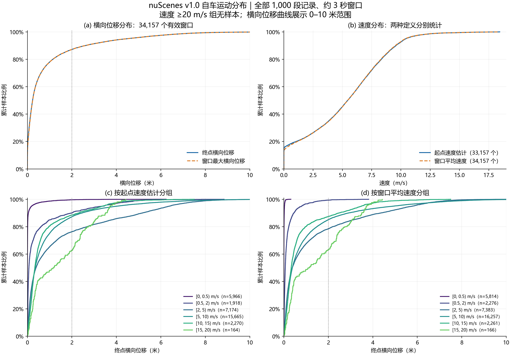
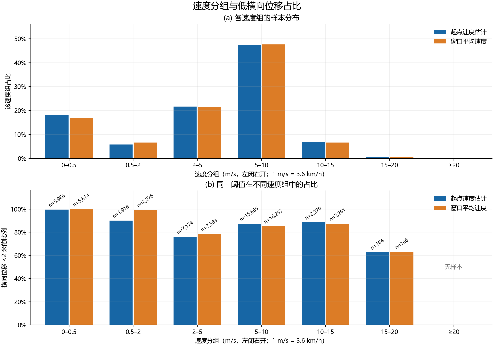

## 主张概述

本库对 nuScenes v1.0 全部记录的普查结果显示，34,157 个约 3 秒的有效轨迹窗口中，有 29,783 个的终点横向位移小于 2 米，占 87.19%。在累计行驶距离大于 1.5 米的窗口中，该比例为 84.56%。

- 终点横向位移的中位数为 **0.233 米**，P90 为 **2.601 米**，P95 为 **4.464 米**，P99 为 **7.300 米**。
- 起点速度估计的中位数为 **5.448 m/s（19.61 km/h）**，P90 为 **9.573 m/s（34.46 km/h）**。窗口平均速度的对应值为 5.455 和 9.521 m/s。两种速度的总体分布接近，同一速度区间内的横向位移分布存在差异。
- 按起点速度分组，终点横向位移小于 2 米的比例从 [0, 0.5) m/s 组的 **99.65%** 降至 [2, 5) m/s 组的 **76.26%**，随后在 [5, 10) 和 [10, 15) m/s 两组分别回到 **87.24%** 和 **88.50%**。[15, 20) m/s 组为 **62.80%**，该组仅有来自 10 段记录的 164 个窗口。两种速度口径在 20 m/s 及以上的区间均无样本。

## 实验定义

统计训练、验证和测试集的全部 1,000 段驾驶记录。以 nuScenes 标称 2 Hz 的关键帧为采样点，取起点及同一段记录中随后 6 个采样点的自车位姿，构成约 3 秒的轨迹窗口。仅统计后续 6 个采样点完整的窗口。

以起点的车辆位置及航向确定纵向参考线。终点横向位移为第 6 个后续采样点到参考线的垂直距离。终点横向位移小于 2 米的窗口计为“低横向位移”，占比以有效窗口总数为分母。窗口最大横向位移取这 6 个后续采样点到同一参考线的最大垂直距离。

**窗口平均速度**用未来六段平面路径长度之和除以窗口实际时长计算，共有34,157个有效窗口。

**起点速度估计**用起点与同一段记录内前一个采样点之间的平面距离除以实际时间差计算，代表起点之前约 0.5 秒的平均速度。每段记录的第一个采样点没有前一个采样点，共 1,000 个窗口缺少起点速度，分组统计使用其余 33,157 个窗口。

速度组采用左闭右开区间。速度单位为m/s，乘3.6换算为km/h。分位数采用线性插值，位置为 h=(n−1)q。总体标准差以N为分母。阈值表按严格小于阈值计数，完整经验累计分布同时保存严格小于和小于等于阈值的计数。

## 按数据集与运动状态分层

| 总体 | 终点横向位移小于 2 米的窗口数 | 有效窗口总数 | 占比 |
| --- | --- | --- | --- |
| 全集 | 29783 | 34157 | 87.194426% |
| 训练集 | 20908 | 23930 | 87.371500% |
| 验证集 | 4501 | 5119 | 87.927330% |
| 测试集 | 4374 | 5108 | 85.630384% |
| 全集，排除停止和低速 | 23963 | 28337 | 84.564350% |
| 全集。排除停止 | 24837 | 29211 | 85.026189% |

- 按窗口内累计行驶距离划分，停止组（不超过 0.3 米）的 4,946 个窗口和低速组（大于 0.3 米且不超过 1.5 米）的 874 个窗口，终点横向位移均小于 2 米。排除这两组后，28,337 个窗口中有 23,963 个的终点横向位移小于 2 米，占 84.56%。
- 在 2 米阈值下，窗口最大横向位移和终点横向位移的达标窗口数均为 29,783。终点横向位移小于 2 米、但任一中间采样点的横向位移达到或超过 2 米的窗口为 0 个。
- 训练/验证输入四表与官方元数据包逐字节一致；测试集四表直接取自官方包。实际执行代码与本地一致。25个分组汇总、350行阈值表及1000个场景的计数已从逐样本表复核一致。
- 测试集比例比训练/验证合并值低约1.84个百分点，但仍以低横向位移为主。1000段记录各自的比例范围为8.82%–100%，中位数100%，按记录等权的平均值为87.183323%。

## 分布分位数

| 变量 | 有效窗口数 | 均值 | P25 | 中位数 | P75 | P90 | P95 | P99 | 最大值 |
| --- | --- | --- | --- | --- | --- | --- | --- | --- | --- |
| 终点横向位移（米） | 34157 | 0.853 | 0.048 | 0.233 | 0.820 | 2.601 | 4.464 | 7.300 | 13.316 |
| 窗口最大横向位移（米） | 34157 | 0.857 | 0.059 | 0.238 | 0.821 | 2.601 | 4.464 | 7.300 | 13.316 |
| 起点速度估计（m/s） | 33157 | 5.167 | 2.236 | 5.448 | 7.778 | 9.573 | 10.415 | 13.138 | 18.439 |
| 窗口平均速度（m/s） | 34157 | 5.171 | 2.252 | 5.455 | 7.751 | 9.521 | 10.368 | 13.102 | 18.359 |

起点速度估计P95=37.49km/h、P99=47.30km/h。窗口平均速度P95=37.32km/h、P99=47.17km/h。

## 横向位移阈值累计比例

| 终点横向位移阈值（米） | 达标窗口数 | 有效窗口总数 | 占比 |
| --- | --- | --- | --- |
| 0.1 | 11424 | 34157 | 33.45% |
| 0.25 | 17639 | 34157 | 51.64% |
| 0.5 | 22697 | 34157 | 66.45% |
| 1 | 26638 | 34157 | 77.99% |
| 1.5 | 28611 | 34157 | 83.76% |
| 2 | 29783 | 34157 | 87.19% |
| 3 | 31219 | 34157 | 91.40% |
| 5 | 32771 | 34157 | 95.94% |
| 10 | 34123 | 34157 | 99.90% |

全量样本中，约一半的终点横向位移不足0.25米，约四分之三不足1米。窗口最大横向位移与终点横向位移的中位数分别为0.238米和0.233米，两者的P90、P95和P99在表中精度下相同。

## 速度分布及速度条件下的横向位移

### 按起点速度估计分组

| 速度组（m/s） | 窗口数 | 记录数 | 占起点速度有效窗口的比例 | 横向位移P50（米） | P90（米） | <0.5米 | <1米 | <2米 | <3米 |
| --- | --- | --- | --- | --- | --- | --- | --- | --- | --- |
| [0, 0.5) | 5966 | 389 | 17.99% | 0.001 | 0.047 | 97.35% | 98.66% | 99.65% | 99.85% |
| [0.5, 2) | 1918 | 405 | 5.78% | 0.069 | 1.990 | 77.95% | 84.93% | 90.09% | 94.11% |
| [2, 5) | 7174 | 680 | 21.64% | 0.388 | 5.175 | 54.38% | 65.26% | 76.26% | 81.64% |
| [5, 10) | 15665 | 783 | 47.24% | 0.351 | 2.463 | 59.32% | 75.12% | 87.24% | 92.21% |
| [10, 15) | 2270 | 177 | 6.85% | 0.335 | 2.312 | 65.42% | 80.40% | 88.50% | 93.08% |
| [15, 20) | 164 | 10 | 0.49% | 1.166 | 3.502 | 40.85% | 48.17% | 62.80% | 83.54% |
| ≥20 | 0 | 0 | 0.00% | — | — | — | — | — | — |

2–5m/s组的终点横向位移P90为5.175米，高于5–10m/s组的2.463米和10–15m/s组的2.312米。这些数值描述不同速度组的横向位移分布。

### 按窗口平均速度分组

| 速度组（m/s） | 窗口数 | 记录数 | 占平均速度有效窗口的比例 | 横向位移P50（米） | P90（米） | <0.5米 | <1米 | <2米 | <3米 |
| --- | --- | --- | --- | --- | --- | --- | --- | --- | --- |
| [0, 0.5) | 5814 | 340 | 17.02% | 0.001 | 0.019 | 100.00% | 100.00% | 100.00% | 100.00% |
| [0.5, 2) | 2276 | 399 | 6.66% | 0.067 | 0.455 | 91.08% | 96.62% | 99.38% | 99.82% |
| [2, 5) | 7383 | 658 | 21.61% | 0.383 | 4.368 | 54.95% | 67.51% | 78.41% | 84.45% |
| [5, 10) | 16257 | 783 | 47.59% | 0.385 | 2.913 | 56.66% | 72.27% | 85.11% | 90.26% |
| [10, 15) | 2261 | 162 | 6.62% | 0.332 | 2.479 | 65.10% | 80.10% | 87.44% | 92.30% |
| [15, 20) | 166 | 7 | 0.49% | 1.113 | 3.500 | 41.57% | 48.80% | 63.25% | 83.13% |
| ≥20 | 0 | 0 | 0.00% | — | — | — | — | — | — |

“—”表示该速度组无样本。以[0.5, 2) m/s组为例，按起点速度估计和按窗口平均速度分组时，横向位移小于2米的比例分别为90.09%和99.38%。

### 固定较高速度范围

| 速度定义 | 下界（m/s） | 窗口数 | 记录数 | 横向位移中位数（米） | <1米 | <2米 |
| --- | --- | --- | --- | --- | --- | --- |
| 起点速度估计 | ≥5 | 18099 | 806 | 0.350 | 75.53% | 87.18% |
| 起点速度估计 | ≥10 | 2434 | 180 | 0.347 | 78.23% | 86.77% |
| 起点速度估计 | ≥15 | 164 | 10 | 1.166 | 48.17% | 62.80% |
| 起点速度估计 | ≥20 | 0 | 0 | — | — | — |
| 窗口平均速度 | ≥5 | 18684 | 807 | 0.376 | 73.01% | 85.20% |
| 窗口平均速度 | ≥10 | 2427 | 165 | 0.342 | 77.96% | 85.78% |
| 窗口平均速度 | ≥15 | 166 | 7 | 1.113 | 48.80% | 63.25% |
| 窗口平均速度 | ≥20 | 0 | 0 | — | — | — |

≥10m/s（36km/h）起点速度范围有2434个窗口，来自180段记录，<2米比例86.77%。起点速度估计≥15m/s的164个窗口覆盖10段记录，窗口平均速度≥15m/s的166个窗口覆盖7段记录。

## 分布图

图中CDF采用≤x，阈值表及柱状图采用严格小于阈值。完整经验累计分布保留全部观测值。横向位移曲线图的显示范围为0–10米。SVG版本在同一figures目录。
