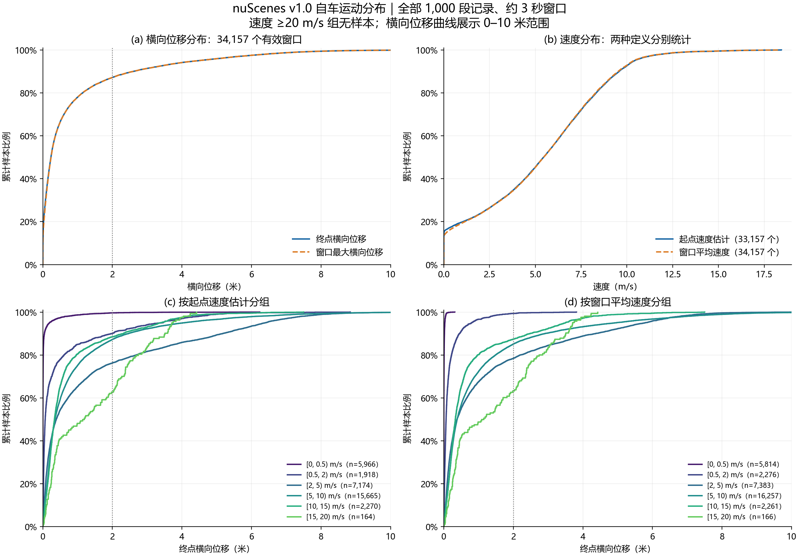
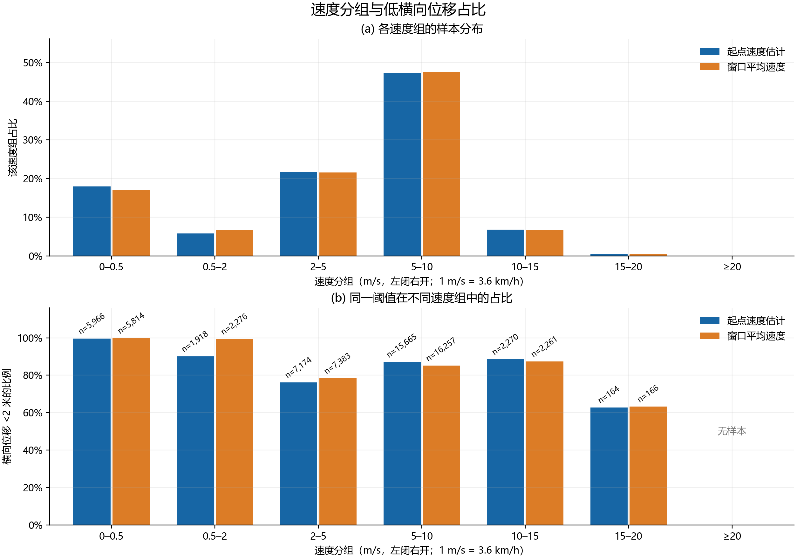

# nuScenes 短时自车运动分布：补充实验结果

本轮为描述性补充统计，关联 `claim-nuscenes-three-second-ego-motion-distribution`（asserted / watch）。先完整呈现分布，再讨论锚点如何提炼；未修改原卡标题、status、stance或signoff。

## 1. 主要观察

- 未来约3秒的终点横向位移中位数为 **0.233米**，P90为 **2.601米**，P95为 **4.464米**，P99为 **7.300米**。这比“2米以内占多数”更完整地呈现了集中程度和尾部。
- 起点速度估计中位数为 **5.448m/s（19.61km/h）**，P90为 **9.573m/s（34.46km/h）**；窗口平均速度的对应值为5.455和9.521m/s。两种速度总体分布接近，条件分组结果却不能互相替代。
- 按起点速度分组，横向位移<2米的比例在2–5m/s组为 **76.26%**，5–10m/s组为 **87.24%**，10–15m/s组为 **88.50%**。因此，较小横向位移并非只出现在接近停车的速度组；这个占比也不是随速度单调变化。
- 15–20m/s组为 **62.80%**，但仅164个窗口、来自10段记录；≥20m/s组 **没有样本**。本数据不能提供更高速度区间的分布结论。

## 2. 速度与时间定义

范围与上一轮一致：nuScenes v1.0训练、验证、测试全部1000段记录，共34157个有完整未来六个keyframe的样本窗口；真实跨度沿用原时间戳，名义约3秒。

**窗口平均速度** = 未来六段XY路径长度之和 ÷ 窗口实际时间跨度。它使用整个未来窗口，不是起终点直线距离除以3，也不等于起点瞬时速度。

**起点速度估计** = 起点与前一个keyframe的XY距离 ÷ 两者真实时间差。它是起点之前约0.5秒的平均速度估计，不是CAN bus速度读数。每段记录首帧没有前一帧，这1000个窗口的起点速度保持缺失；起点速度分母为33157，窗口平均速度分母为34157。

速度组采用左闭右开区间，单位m/s；乘3.6可换算为km/h。分位数使用线性插值（h=(n−1)q），总体标准差以N为分母。阈值表采用严格<x，完整ECDF同时保存<x和≤x的计数。

## 3. 分布分位数

| 变量 | 有效样本数 | 均值 | P25 | 中位数 | P75 | P90 | P95 | P99 | 最大值 |
| --- | --- | --- | --- | --- | --- | --- | --- | --- | --- |
| 终点横向位移（米） | 34157 | 0.853 | 0.048 | 0.233 | 0.820 | 2.601 | 4.464 | 7.300 | 13.316 |
| 窗口最大横向位移（米） | 34157 | 0.857 | 0.059 | 0.238 | 0.821 | 2.601 | 4.464 | 7.300 | 13.316 |
| 起点速度估计（m/s） | 33157 | 5.167 | 2.236 | 5.448 | 7.778 | 9.573 | 10.415 | 13.138 | 18.439 |
| 窗口平均速度（m/s） | 34157 | 5.171 | 2.252 | 5.455 | 7.751 | 9.521 | 10.368 | 13.102 | 18.359 |

起点速度估计P95=37.49km/h、P99=47.30km/h；窗口平均速度P95=37.32km/h、P99=47.17km/h。这里只描述本数据的速度覆盖，不把最大观测值解释为车辆能力上限。

完整分位数表还包含min、P10、总体标准差，以及trainval/train/val/test各自结果，见本目录归档的quantiles.csv。

## 4. 横向位移阈值累计比例

| 终点横向位移阈值（严格小于） | 样本数 | 有效样本总数 | 占比 |
| --- | --- | --- | --- |
| 0.1米 | 11424 | 34157 | 33.45% |
| 0.25米 | 17639 | 34157 | 51.64% |
| 0.5米 | 22697 | 34157 | 66.45% |
| 1米 | 26638 | 34157 | 77.99% |
| 1.5米 | 28611 | 34157 | 83.76% |
| 2米 | 29783 | 34157 | 87.19% |
| 3米 | 31219 | 34157 | 91.40% |
| 5米 | 32771 | 34157 | 95.94% |
| 10米 | 34123 | 34157 | 99.90% |

全量样本中，约一半的终点横向位移不足0.25米，约四分之三不足1米；同时存在较长尾部。窗口最大横向位移分布与终点分布在本数据中很接近，但两者仍分别保存，未将其定义混为一谈。

## 5. 速度分布及速度条件下的横向位移

### 5.1 按起点速度估计分组

| 速度组（m/s） | 窗口数 | 记录数 | 占起点速度有效样本 | 横向位移P50（米） | P90（米） | <0.5米 | <1米 | <2米 | <3米 |
| --- | --- | --- | --- | --- | --- | --- | --- | --- | --- |
| [0, 0.5) | 5966 | 389 | 17.99% | 0.001 | 0.047 | 97.35% | 98.66% | 99.65% | 99.85% |
| [0.5, 2) | 1918 | 405 | 5.78% | 0.069 | 1.990 | 77.95% | 84.93% | 90.09% | 94.11% |
| [2, 5) | 7174 | 680 | 21.64% | 0.388 | 5.175 | 54.38% | 65.26% | 76.26% | 81.64% |
| [5, 10) | 15665 | 783 | 47.24% | 0.351 | 2.463 | 59.32% | 75.12% | 87.24% | 92.21% |
| [10, 15) | 2270 | 177 | 6.85% | 0.335 | 2.312 | 65.42% | 80.40% | 88.50% | 93.08% |
| [15, 20) | 164 | 10 | 0.49% | 1.166 | 3.502 | 40.85% | 48.17% | 62.80% | 83.54% |
| ≥20 | 0 | 0 | 0.00% | — | — | — | — | — | — |

2–5m/s组的终点横向位移P90为5.175米，高于5–10m/s组的2.463米和10–15m/s组的2.312米。这描述了速度与横向运动的联合分布；本轮没有隔离其道路类型或驾驶行为成因。

### 5.2 按窗口平均速度分组

| 速度组（m/s） | 窗口数 | 记录数 | 占平均速度有效样本 | 横向位移P50（米） | P90（米） | <0.5米 | <1米 | <2米 | <3米 |
| --- | --- | --- | --- | --- | --- | --- | --- | --- | --- |
| [0, 0.5) | 5814 | 340 | 17.02% | 0.001 | 0.019 | 100.00% | 100.00% | 100.00% | 100.00% |
| [0.5, 2) | 2276 | 399 | 6.66% | 0.067 | 0.455 | 91.08% | 96.62% | 99.38% | 99.82% |
| [2, 5) | 7383 | 658 | 21.61% | 0.383 | 4.368 | 54.95% | 67.51% | 78.41% | 84.45% |
| [5, 10) | 16257 | 783 | 47.59% | 0.385 | 2.913 | 56.66% | 72.27% | 85.11% | 90.26% |
| [10, 15) | 2261 | 162 | 6.62% | 0.332 | 2.479 | 65.10% | 80.10% | 87.44% | 92.30% |
| [15, 20) | 166 | 7 | 0.49% | 1.113 | 3.500 | 41.57% | 48.80% | 63.25% | 83.13% |
| ≥20 | 0 | 0 | 0.00% | — | — | — | — | — | — |

“—”表示该速度组没有样本，不能读为0%的条件概率。起点速度与未来窗口平均速度对样本的分组不同：例如0.5–2m/s组的<2米比例分别为90.09%和99.38%，因此结果表始终标明速度定义和分母。

### 5.3 固定较高速度范围

| 速度定义 | 下界（m/s） | 窗口数 | 记录数 | 横向位移中位数（米） | <1米 | <2米 |
| --- | --- | --- | --- | --- | --- | --- |
| 起点速度估计 | ≥5 | 18099 | 806 | 0.350 | 75.53% | 87.18% |
| 起点速度估计 | ≥10 | 2434 | 180 | 0.347 | 78.23% | 86.77% |
| 起点速度估计 | ≥15 | 164 | 10 | 1.166 | 48.17% | 62.80% |
| 起点速度估计 | ≥20 | 0 | 0 | — | — | — |
| 窗口平均速度 | ≥5 | 18684 | 807 | 0.376 | 73.01% | 85.20% |
| 窗口平均速度 | ≥10 | 2427 | 165 | 0.342 | 77.96% | 85.78% |
| 窗口平均速度 | ≥15 | 166 | 7 | 1.113 | 48.80% | 63.25% |
| 窗口平均速度 | ≥20 | 0 | 0 | — | — | — |

≥10m/s（36km/h）起点速度范围有2434个窗口，来自180段记录，<2米比例86.77%。≥15m/s的164个窗口仅覆盖10段记录；未来窗口平均速度≥15m/s的166个窗口覆盖7段记录。这些数量差异是解释速度尾部时必须保留的信息。

## 6. 分布图

图中CDF采用≤x，阈值表及柱状图采用严格<x；完整ECDF保留全部观测值，横向位移曲线图仅展示0–10米以便阅读。SVG版本在同一figures目录。

## 7. 结果与复核记录

- Kaggle CPU version 1：[claim-nuscenes-motion-profile](https://www.kaggle.com/code/cauliyulong/claim-nuscenes-motion-profile)，未使用GPU、未训练模型。日志UTC 2026-11-08 15:23:55–15:25:03（上海时间23:23:55–23:25:03），运行约67.9秒。首次全量运行成功。
- 重新读取官方字节一致的trainval镜像和官方test元数据，八个JSON文件SHA256均与前轮记录相同。1000段记录和34157个样本未变；全部原运动指标逐项重算后与原逐样本表完全相同。
- 前轮测量函数未修改，SHA256仍为ce4dda3c13b64fe511f109366796edbf6795385f747a979deb08ee48089e27d7。输入/源码/设计/split的固定哈希见launch-provenance.json和运行回传provenance；启动HEAD为d50d40679a4a904a3faf92e0b2e76208c0b94502，未提交工作区的实际代码由哈希标识，不能以HEAD代替。
- 本地独立使用NumPy linear quantile重新核对20个分布的均值、总体标准差和全部分位数；重计90行阈值表、110个速度条件组以及4个完整ECDF。CSV与JSON逐项一致；所有平均速度都以原路径长/真实时长复算一致，起点速度缺失恰为每段首帧一条。
- 5项新增边界测试通过，覆盖真实时间差、过去区间速度、首帧缺失不补零、分位数插值、严格/包含边界、左闭右开速度分组及空组。
- results中保留train/val/test三个压缩逐样本文件，避免单文件超过5MB；所有结果文件SHA256见results/sha256-manifest.txt。官方原始JSON和数据集文件未入Git。图由本地Matplotlib从归档逐样本表生成，并已视觉检查；其源码、环境和哈希记录在figures/plot-provenance.json。
- 确切kernel版本、依赖和容器镜像见sources。API last_run_time仍与日志日期不一致，原值保留，不用它推断运行先后。

此前卡片主张仍有效但信息量有限。本轮先提供完整数据，尚未据此新建或改写更强的结论卡，也未代填验证状态或签署。
