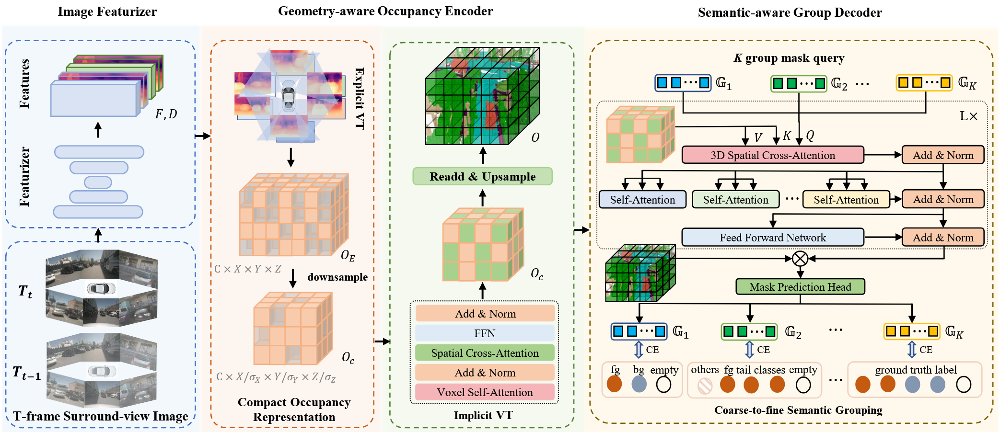
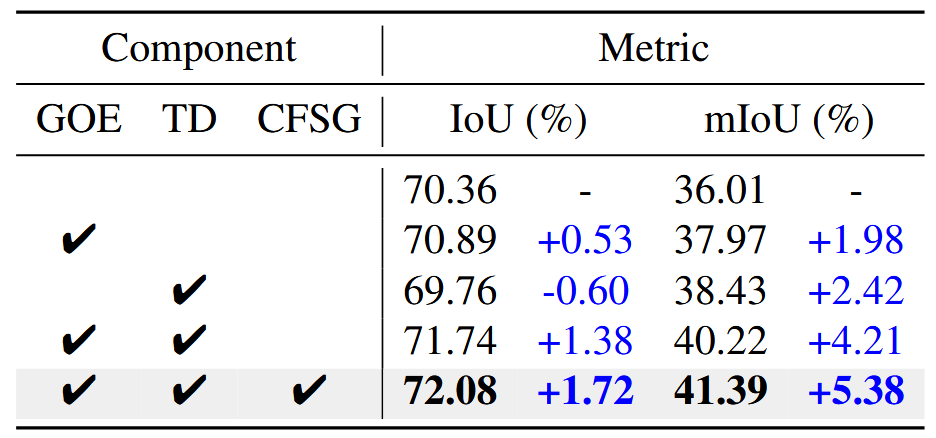
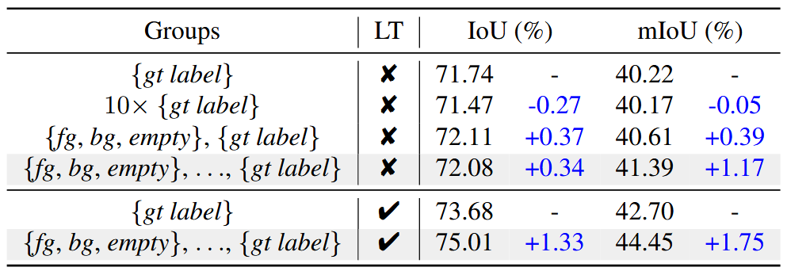

# COTR: Compact Occupancy TRansformer for Vision-based 3D Occupancy Prediction

**出处会议：** CVPR 2024（arXiv:2312.01919，cs.CV；v1 2023-12-04，v2 2024-04-11。abs 页 Comments 字段原文 "CVPR2024. Code is available at this https URL"）  
**是否开源：** https://github.com/NotACracker/COTR （HTML 版摘要末句原话 "The code is available at https://github.com/NotACracker/COTR."；GitHub API 核实：仓库描述 "[CVPR24] COTR: Compact Occupancy TRansformer for Vision-based 3D Occupancy Prediction"，创建于 2024-03-30，125 stars，2026-11-02 查询）  
**关键词：** 视觉 3D 占据预测、紧凑 3D OCC 表示、显式-隐式视角变换（EVT/IVT）、几何感知占据编码器（GOE）、语义感知组解码器（SGD）、粗到细语义分组（CFSG）、mask classification

> **关联笔记：** 本文是**纯视觉（camera-only）**的 3D 占据预测方法，与库内笔记 [RadarOcc](RadarOcc.md)（4D 成像雷达占据预测，NeurIPS 2024）同属 3D occupancy prediction 任务族但传感器模态不同（本文纯视觉、RadarOcc 为 4D 成像雷达输入）。论文在补充材料自述低光场景失效时写道 "other modalities such as LiDAR or Radar might be required to aid successful detection"，可作为库内雷达/多模态融合笔记（如 HGSFusion、RCBEVDet）的动机参照。库内 [SurroundOcc](SurroundOcc.md)（ICCV 2023）是本文 Table 1 中被集成（plug-in）的四个基线之一。
>
> **Locator 约定：** 本笔记章节号（§1–§5，含 §2.1–§2.3、§3.1–§3.4、§4.1–§4.3）、公式号 (1)–(4)、表号 Table 1–7 均指 arXiv HTML v2（https://arxiv.org/html/2312.01919v2 ，LaTeXML 生成）的编号；Table 4–7 位于 Supplementary Material。HTML 中 Table 4 被拆成两个元素：只含 caption 的空 figure（id S5.T4）与数据表（id tab1），本笔记 Table 4 的数据行取自 id=tab1。英文引号内文字为本次从该 HTML 抓取的逐字原文；数学式保留 HTML alttext 的 LaTeX 形式（$256\times 704$ 即原文写法）；✔/✘ 为原文勾叉符号（HTML 部分表格用 ✗，已统一记作 ✘）。注意：库内本地截图 `library/assets/COTR/` 的 `Table2.png`（内容 = HTML Table 2）、`Table4.png`（内容 = HTML **Table 3**），提示 PDF（camera-ready）与 arXiv HTML v2 的表号在后半部分可能整体错位一位——**引用图表时必须以内容为准并逐张核对**（QUESTIONS #10 caveat；三张截图已于 2026-11-03 入库时逐张目视核对，见正文配图加注与文末 TODO）。

---

## 一、概述

COTR（Compact Occupancy TRansformer）面向视觉 3D 占据预测（vision-based 3D occupancy prediction）：把自车周围空间划分为体素，逐体素预测占据状态与语义。论文动机（§1）：

1. **压缩表示丢几何**：BEV 塌掉高度维、TPV 沿水平维压缩，"the compression on a specific dimension of 3D representations would lose substantial 3D geometry information"（§1）。
2. **原始稀疏 OCC 表示又重又冗余**：3D OCC 表示 "costs huge computational resources than previous BEV or TPV representations"，且 "due to the sparsity, the information density of such uncompressed representation is low"（§1）。
3. **缺乏语义可辨性**：类别不平衡导致稀有物体识别差。论文用代理实验佐证——保持占据预测不变、把非空区域的语义预测换成真值语义，"The experimental results indicate an improvement of about 95%, especially for the rare classes."（§1）。

为此提出两个模块（§1）：

- **几何感知占据编码器（Geometry-aware Occupancy Encoder, GOE）**：先经显式视角变换（EVT）得到稀疏高分辨率 3D OCC 特征，再下采样为紧凑 OCC 表示。论文原话："Specifically, after generating a sparse yet high-resolution 3D OCC feature by Explicit View Transformation (EVT), we downsampled it to a compact OCC representation, a size merely 1/16 of the original, without any performance drop."（§1）下采样-上采样被组织成 U-Net 结构以找回下采样损失的几何细节；隐式视角变换（IVT）只在紧凑表示上做 spatial cross-attention 与 self-attention。
- **语义感知组解码器（Semantic-aware Group Decoder, SGD）**：把占据预测转成 mask classification（MaskFormer 式），并按语义粒度与样本数把真值标签分组（coarse-to-fine semantic grouping），组内 one-to-many 分配，"The grouping strategy results in balanced supervision signals, significantly enhancing the capability to recognize different classes"（§1）。

**论文声明的三点贡献（§1，逐字）**：

> "We propose a geometry-aware occupancy encoder to construct a compact occupancy representation through efficient explicit-implicit view transformation. We can handle the sparsity of the occupancy feature while preserving the geometry information and reducing computation costs."
>
> "We proposed a novel semantic-aware group decoder that significantly enhances the semantic discriminability of the compact occupancy feature. This group strategy balances the supervision signals and alleviates the suppression from common objects to rare objects."
>
> "Our method has been embedded into several prevailing backbones, and experiments on the Occ3D-nuScenes dataset show that our approach achieves state-of-the-art performance. What’s more, our method outperforms the backbones with a relative improvement of 8%-15%, as illustrated in Fig. 1."

摘要对结果的概括（Abstract）："Empirical experiments show that there are evident performance gains across multiple baselines, e.g., COTR outperforms baselines with a relative improvement of 8%-15%, demonstrating the superiority of our method."

（笔记作者观察：8%–15% 是论文口径、配图在 Fig. 1；按本笔记 Table 1 抄录数字推算，四种基线的 mIoU 相对增益为 5.1/34.2≈14.9%、4.7/34.6≈13.6%、3.8/37.4≈10.2%、5.2/39.3≈13.2%，IoU 相对增益为 3.8/66.8≈5.7%、5.5/65.5≈8.4%、1.6/70.1≈2.3%、1.2/73.8≈1.6%——"8%-15%" 与表中 mIoU 增益区间（10.2%–14.9%）大体相符；IoU 增益四组中仅 SurroundOcc 一组达 8.4%，其余三组低于 8%（2026-11-03 入库 QA 修正：原稿此句作 "IoU 增益达不到 8%"，与其自列的 8.4% 相矛盾，已按表内数字改写）。此推算为本笔记所加，非论文原文。）

---

## 二、方法

### 2.1 任务定义与整体架构（§3.1–§3.2）

输入是 $T$ 帧环视图像 $\{I_{i,t}\in\mathbb{R}^{H_{i}\times W_{i}\times 3}\}$（$N_c$ 个相机）及已知内外参（§3.1）。输出对每个体素给出占据与语义，如 "a voxel on a car is annotated as [occupied; car], and a voxel in the free space is annotated as [empty; None]"；核心卖点是通用物体表示："out-of-vocabulary objects and abnormity can be easily represented as [occupied; unknown]"（§3.1）。

整体架构三模块（§3.2，Fig. 2）：

（配图注：`library/assets/COTR/Figure2.png`，2026-11-03 入库时目视核对，内容 = 论文 Fig. 2 整体架构，与本节三模块描述一致。）

1. **Image Featurizer**：预训练图像骨干（如 ResNet-50）提特征 $F$，depth net 出深度分布 $D$（§3.2）。
2. **GOE**（§3.3）：经高效显式-隐式视角变换生成紧凑占据表示。
3. **SGD**（§3.4）：增强紧凑 OCC 特征的语义可辨性与几何细节。

（注：原文 §3.2 首句作 "An overview of the Compact Occupancy TRansforemr (COTR) is presented in Fig. 2."——"TRansforemr" 为原文拼写笔误，照录。）

### 2.2 几何感知占据编码器 GOE（§3.3）

**显式-隐式视角变换（EVT/IVT）**（§3.3）：

- **EVT**：图像特征与深度分布做外积 $F\otimes D$ 得伪点云特征，不经 BEV、直接 voxel-pooling 成 3D OCC 特征 $O_{\rm E}\in\mathbb{R}^{C\times X\times Y\times Z}$。
- **IVT**：预定义一组网格状可学习 query $Q\in\mathbb{R}^{C\times X\times Y\times Z}$，"Then the set of OCC queries will be updated through spatial cross-attention and self-attention to interact with the image features."（§3.3）

**紧凑占据表示**（§3.3）：直接在高分辨率（如 $200\times 200\times 16$）上算 SCA 代价高，且自由空间计算无效。做法是把 $O_{\rm E}$ 下采样为紧凑表示 $O_c$，以其体素为 query 做 IVT，再上采样回原分辨率；"Since the downsampling operation inevitably introduces information loss, especially for small objects, we constructed the downsampling and upsampling processes into a Unet [29] architecture to mitigate this problem."（§3.3）论文称："In practice, we construct a compact OCC representation with a size merely 1/16 of the original while achieving a better performance."（§3.3）

**Discussion（§3.3）三点优势**：

1. 3D 表示对 2D BEV/TPV 有天然几何优势（Fig. 3(a) 中 compact OCC 的 IoU 最高）；
2. 缓解稀疏："For outdoor autonomous driving datasets such as Nuscenes [1], SemanticKITTI [30], and Waymo [31], the proportion of free space stands at 78%, 93%, and 92%, respectively."（§3.3；"Nuscenes" 为原文拼写）
3. 计算量大降："the computational cost of a raw high-resolution OCC representation is approximately 500% higher than that of a compact OCC representation."（§3.3）

**补充材料实现细节（Supplementary, Geometry-aware Occupancy Encoder 段）**：EVT 输出 $O_{\rm E}\in\mathbb{R}^{32\times 200\times 200\times 16}$；按 BEVDet4D 用 3D-ResNet 出多尺度特征 $O_{\rm E}^{0}\in\mathbb{R}^{32\times 200\times 200\times 16}$、$O_{\rm E}^{1}\in\mathbb{R}^{64\times 100\times 100\times 8}$、$O_{\rm E}^{2}\in\mathbb{R}^{128\times 50\times 50\times 4}$；三线性插值到同一尺寸 $50\times 50\times 16$ 后拼接过卷积得紧凑表示 $O_{c}\in\mathbb{R}^{256\times 50\times 50\times 16}$。原话："Since the compact OCC feature $O_{c}$ has been already initialized by EVT, we only use 1 Transformer layer in IVT."（Supplementary）上采样用反卷积到 $O\in\mathbb{R}^{256\times 200\times 200\times 16}$（仅供 SGD 的 mask 预测用），U-Net 跳连拼接多尺度特征 $\{O_{\rm E}^{i}\}_{i=0}^{3}$。

### 2.3 语义感知组解码器 SGD（§3.4）

**代理实验（Proxy Experiment，§3.4）**：把占据预测中的语义预测替换为对应位置真值标签，"As shown in Fig. 3 (b), the IoU scores are greatly improved, especially for the tail class."（§3.4）

**Transformer Decoder（§3.4）**：受 MaskFormer 启发转为 mask classification（原句 "Inspired by MaskFormer [6], We convert the occupancy prediction to the form of mask classification."——逗号后大写 "We" 为原文照录）。两处替换：用紧凑 OCC 特征 $O_c$ 替换 decoder 中的图像特征；用 3D SCA 替换 encoder-decoder 全局自注意力以省算力。

$$\text{(1)}\qquad {\rm 3D\mbox{-}SCA}(Q_{m},O_{c})=\sum_{i=1}^{\mathcal{N}_{\rm ref}}f(Q_{m},\mathbb{p}_{i},O_{c}),$$

其中 $f(\cdot)$ 为 deformable attention，$Q_m$ 为 $N_q$ 个可学习 mask query，每个 query 采样 $\mathcal{N}_{\rm ref}$ 个 3D 占据特征（原文此处 "occcupancy" 三写 c，照录）。mask 生成：

$$\text{(2)}\qquad m_{i}[x,y,z]={\rm sigmoid}(\mathcal{E}_{m}[:,i]^{\rm T}\cdot O[:,x,y,z]).$$

**Coarse-to-Fine Semantic Grouping（CFSG，§3.4）**：类别不平衡使分类器给 low-shot 类的打分远低于 many-shot 类。先按 [4] 采用 group-wise one-to-many assignment，但 "However, experiments show that such a simple grouping strategy is ineffective and can not bring performance improvement."（§3.4）于是进一步按语义粒度与样本数把语义类别划成 $K$ 个真值标签组、每组一组 mask query。类别 $i$ 归入组 $\mathbb{G}_n$ 的条件（公式由 HTML alttext 转写）：

$$\text{(3)}\qquad N_{n}^{l}<\mathcal{N}(i)\leq N_{n}^{h},~~~~n\in[2,K-1],$$

其中 $\mathcal{N}(i)$ 为类别 $i$ 的训练样本数，$N_n^l, N_n^h$ 为第 $n$ 组的样本数上下界超参。具体分组："we first divided the categories into $\mathbb{G}_{1}=$ {“foreground”, “background”, “empty”}"，前景/背景类再按训练样本数细分（§3.4）。

**推理零开销设计（§3.4）**："In order to keep only one group during inference, we manually set the $\mathbb{G}_{K}$ to the original ground truth label and $\mathbb{G}_{1}$ to {“foreground”, “background”, “empty”}, thus there is no extra cost compared with single-group models."（§3.4）训练时把未分入当前组的类标为 "others"，原文举例："For example, if the foreground classes motorcycle and bicycle are assigned in the same group, the ground truth label for this group is {“others”, “motorcycle”, “bicycle”, “empty” }."（§3.4）

---

## 三、实验

### 3.1 实验设置（§4.1 + Supplementary）

- **数据集**：Occ3D-nuScenes，"contains 700 training scenes and 150 validation scenes"；每帧 32 线 LiDAR 点云 + 6 相机图像。原话："The occupancy scope is defined as -40 $m$ to 40 $m$ for the X and Y axis, and -1 $m$ to 5.4 $m$ for the Z axis in the ego coordinate. The voxel size is $0.4m\times 0.4m\times 0.4m$ for the occupancy label. The semantic labels contain 17 categories, including 16 known object classes with an additional “empty” class."（§4.1）
- **默认配置**：ResNet-50 骨干、图像 $256\times 704$；EVT 用 BEVStereo（深度由稀疏 LiDAR 监督）；EVT 分辨率 $200\times 200\times 16$、特征维 $C=32$；下采样率 $\sigma_x=\sigma_y=4,\sigma_z=1$、嵌入维 $C_Q=256$；8 头注意力、$\mathcal{N}_{ref}=4$；24 epochs、AdamW、lr 2e-4、梯度裁剪（§4.1）。
- **分组数（原文自相矛盾处，照录）**："We simply generate $K=6$ group gt labels and mask queries for the Group Occupancy Decoder, which We simply divided both the foreground and background classes into two separate groups, resulting in a total of 4 groups."（§4.1；前说 $K=6$、后说共 4 组，句子本身残缺，见文末遗留观察）
- **损失（Supplementary Loss Function 段，公式由 HTML alttext 转写）**：

$$\text{(4)}\qquad \mathcal{L}=\lambda_{{\rm depth}}\mathcal{L_{\rm depth}}+\lambda_{{\rm seg}}\mathcal{L_{\rm seg}}+\lambda_{{\rm mask\text{-}cls}}\mathcal{L_{\rm mask\text{-}cls}},$$

  深度损失沿用 BEVDepth，$\mathcal{L_{\rm seg}}$ 为粗预测的交叉熵分割损失，$\lambda_{{\rm mask\text{-}cls}}$ 组合分类交叉熵与二值 mask 损失（沿 MaskFormer）；"We set the hyper-parameters to $\lambda_{{\rm depth}}=\lambda_{{\rm mask\text{-}cls}}=1$ and $\lambda_{{\rm seg}}=10$."（Supplementary）
- **集成基线**：BEVDet4D、TPVFormer、SurroundOcc、OccFormer 四个主流占据模型（§4.1）。

### 3.2 Occ3D-nuScenes 主结果（§4.2）

**Table 1：Occ3D-nuScenes 上的 3D 占据预测对比**（表题："3D Occupancy prediction performance on the Occ3D-nuScenes dataset. $\dagger$ with test-time augmentation. $\ddagger$ means the performance is reported by its official code. * means the performance is achieved by our implementation using its official code. Visible Mask means whether models are trained with visible masks."；逐行照抄，数学式保留 HTML alttext 形式）：

| Method | Venue | Image Backbone | Image Size | Epoch | Visible Mask | IoU (%) | mIoU (%) |
|---|---|---|---|---|---|---|---|
| MonoScene [3] | CVPR’22 | ResNet-101 | $928\times 600$ | 24 | ✘ | - | 6.1 |
| OccFormer* [41] | ICCV’23 | ResNet-50 | $256\times 704$ | 24 | ✘ | 30.1 | 20.4 |
| BEVFormer [18] | ECCV22 | ResNet-101 | $928\times 600$ | 24 | ✘ | - | 26.9 |
| CTF-Occ [32] | arXiv’23 | ResNet-101 | $928\times 600$ | 24 | ✘ | - | 28.5 |
| VoxFormer [17] | CVPR’23 | ResNet-101 | $900\times 1600$ | 24 | ✔ | - | 40.7 |
| SurroundOcc [37] | ICCV’23 | InternImage-B | $900\times 1600$ | 24 | ✔ | - | 40.7 |
| FBOcc $\dagger$ [19] | ICCV’23 | ResNet-50 | $256\times 704$ | 20 | ✔ | - | 42.1 |
| TPVFormer* [10] | CVPR’23 | ResNet-50 | $900\times 1600$ | 24 | ✔ | 66.8 | 34.2 |
| TPVFormer + COTR | - | ResNet-50 | $256\times 704$ | 24 | ✔ | 70.6 | 39.3 |
| SurroundOcc* [37] | ICCV’23 | ResNet-101 | $900\times 1600$ | 24 | ✔ | 65.5 | 34.6 |
| SurroundOcc + COTR | - | ResNet-50 | $256\times 704$ | 24 | ✔ | 71.0 | 39.3 |
| OccFormer* [41] | ICCV’23 | ResNet-50 | $256\times 704$ | 24 | ✔ | 70.1 | 37.4 |
| OccFormer + COTR | - | ResNet-50 | $256\times 704$ | 24 | ✔ | 71.7 | 41.2 |
| BEVDet4D $\ddagger$ [8] | arXiv’22 | ResNet-50 | $384\times 704$ | 24 | ✔ | 73.8 | 39.3 |
| BEVDet4D + COTR | - | ResNet-50 | $256\times 704$ | 24 | ✔ | 75.0 | 44.5 |
| BEVDet4D $\ddagger$ [8] | arXiv’22 | SwinTransformer-B | $512\times 1408$ | 36 | ✔ | 72.3 | 42.5 |
| BEVDet4D + COTR | - | SwinTransformer-B | $512\times 1408$ | 24 | ✔ | 74.9 | 46.2 |

正文关键句（§4.2）：

> "We integrate our method into TPVFormer, SurroundOcc, OccFormer and BEVDet4D, and our approach yields significant performance improvements in both geometric completion and semantic segmentation, surpassing the baseline by 3.8%, 5.5%, 1.6%, 1.2% in IoU and 5.1%, 4.7%, 3.8%, 5.2% in mIoU."
>
> "Notably, our approach based on BEVDet4D utilizes a smaller backbone (ResNet-50) and smaller image input size ( $256\times 704$ ) to achieve mIoU scores of 44.5%, which outperforms both Voxformer [17] (ResNet-101, $900\times 1600$ ) and SurroundOcc [37] (InternImage-B) by 3.8%."
>
> "Compared to the state-of-the-art FBOcc [19], BEVDet4D with COTR surpasses it by 2.3% even without test-time augmentation."

（笔记作者观察：① 按表内数字，44.5 − 42.1 = 2.4，正文写 "2.3%"，差异疑为未舍入中间值的口径，两处均照录；② 四组 IoU/mIoU 增量与 Table 1 逐行核对一致。）

**Table 4（Supplementary，逐类 IoU）**：表题 "3D Occupancy prediction performance on the Occ3D-nuScenes dataset. We present the IoU (geometry) and mean IoU (semantic) over categories and the IoUs (semantic) for different classes."（数据取自 HTML id=tab1；原表每类名前有颜色方块标记 $\blacksquare$，此处略去；OccFormer 与 "+ COTR (Res-50)" 两行在 HTML 中重复出现两次，照原文保留）。列：Method | Epoch | Mask | IoU | mIoU | others | barrier | bicycle | bus | car | const. veh. | motorcycle | pedestrian | traffic cone | trailer | truck | drive. suf. | other flat | sidewalk | terrain | manmade | vegetation（逐行照抄）：

| Method | Epoch | Mask | IoU | mIoU | others | barrier | bicycle | bus | car | const. veh. | motorcycle | pedestrian | traffic cone | trailer | truck | drive. suf. | other flat | sidewalk | terrain | manmade | vegetation |
|---|---|---|---|---|---|---|---|---|---|---|---|---|---|---|---|---|---|---|---|---|---|
| MonoScene [3] | 24 | ✘ | - | 6.1 | 1.75 | 7.23 | 4.26 | 4.93 | 9.38 | 5.67 | 3.98 | 3.01 | 5.90 | 4.45 | 7.17 | 14.91 | 6.32 | 7.92 | 7.43 | 1.01 | 7.65 |
| OccFormer[41] | 24 | ✘ | 30.1 | 20.4 | 6.62 | 32.57 | 13.13 | 20.37 | 37.12 | 5.04 | 14.02 | 21.01 | 16.96 | 9.34 | 20.64 | 40.89 | 27.02 | 27.43 | 18.65 | 18.78 | 16.90 |
| BEVFormer [18] | 24 | ✘ | - | 26.9 | 5.85 | 37.83 | 17.87 | 40.44 | 42.43 | 7.36 | 23.88 | 21.81 | 20.98 | 22.38 | 30.70 | 55.35 | 28.36 | 36.0 | 28.06 | 20.04 | 17.69 |
| CTF-Occ [32] | 24 | ✘ | - | 28.5 | 8.09 | 39.33 | 20.56 | 38.29 | 42.24 | 16.93 | 24.52 | 22.72 | 21.05 | 22.98 | 31.11 | 53.33 | 33.84 | 37.98 | 33.23 | 20.79 | 18.0 |
| VoxFormer [17] | 24 | ✔ | - | 40.7 | - | - | - | - | - | - | - | - | - | - | - | - | - | - | - | - | - |
| SurroundOcc [37] | 24 | ✔ | - | 40.7 | - | - | - | - | - | - | - | - | - | - | - | - | - | - | - | - | - |
| FBOcc [19] | 20 | ✔ | - | 42.1 | 14.30 | 49.71 | 30.0 | 46.62 | 51.54 | 29.3 | 29.13 | 29.35 | 30.48 | 34.97 | 39.36 | 83.07 | 47.16 | 55.62 | 59.88 | 44.89 | 39.58 |
| TPVFormer [10] | 24 | ✔ | 66.8 | 34.2 | 7.68 | 44.01 | 17.66 | 40.88 | 46.98 | 15.06 | 20.54 | 24.69 | 24.66 | 24.26 | 29.28 | 79.27 | 40.65 | 48.49 | 49.44 | 32.63 | 29.82 |
| + COTR (Res-50) | 24 | ✔ | 70.6 | 39.3 | 11.66 | 45.47 | 25.34 | 41.71 | 50.77 | 27.39 | 26.30 | 27.76 | 29.71 | 33.04 | 37.76 | 80.52 | 41.67 | 50.82 | 54.54 | 44.91 | 38.27 |
| SurroundOcc [37] | 24 | ✔ | 65.5 | 34.6 | 9.51 | 38.50 | 22.08 | 39.82 | 47.04 | 20.45 | 22.48 | 23.78 | 23.00 | 27.29 | 34.27 | 78.32 | 36.99 | 46.27 | 49.71 | 35.93 | 32.06 |
| + COTR (Res-50) | 24 | ✔ | 71.0 | 39.3 | 11.37 | 45.90 | 25.97 | 43.08 | 51.56 | 25.55 | 26.21 | 26.53 | 29.48 | 33.65 | 38.87 | 80.45 | 40.34 | 50.86 | 53.88 | 45.37 | 38.94 |
| OccFormer[41] | 24 | ✔ | 70.1 | 37.4 | 9.15 | 45.84 | 18.20 | 42.80 | 50.27 | 24.00 | 20.80 | 22.86 | 20.98 | 31.94 | 38.13 | 80.13 | 38.24 | 50.83 | 54.3 | 46.41 | 40.15 |
| + COTR (Res-50) | 24 | ✔ | 71.7 | 41.2 | 12.19 | 48.47 | 27.81 | 44.28 | 52.82 | 28.70 | 28.16 | 28.95 | 31.32 | 35.01 | 39.93 | 81.54 | 42.05 | 53.44 | 56.22 | 47.37 | 41.38 |
| OccFormer[41] | 24 | ✔ | 70.1 | 37.4 | 9.15 | 45.84 | 18.20 | 42.80 | 50.27 | 24.00 | 20.80 | 22.86 | 20.98 | 31.94 | 38.13 | 80.13 | 38.24 | 50.83 | 54.3 | 46.41 | 40.15 |
| + COTR (Res-50) | 24 | ✔ | 71.7 | 41.2 | 12.19 | 48.47 | 27.81 | 44.28 | 52.82 | 28.70 | 28.16 | 28.95 | 31.32 | 35.01 | 39.93 | 81.54 | 42.05 | 53.44 | 56.22 | 47.37 | 41.38 |
| BEVDet4D [8] | 24 | ✔ | 73.8 | 39.3 | 9.33 | 47.05 | 19.23 | 41.47 | 52.21 | 27.19 | 21.23 | 23.32 | 21.58 | 35.77 | 38.94 | 82.48 | 40.42 | 53.75 | 57.71 | 49.94 | 45.76 |
| + COTR (Res-50) | 24 | ✔ | 75.0 | 44.5 | 13.29 | 52.11 | 31.95 | 46.03 | 55.63 | 32.57 | 32.78 | 30.35 | 34.09 | 37.72 | 41.84 | 84.48 | 46.19 | 57.55 | 60.67 | 51.99 | 46.33 |
| BEVDet4D [8] | 36 | ✔ | 72.3 | 42.5 | 12.37 | 50.15 | 26.97 | 51.86 | 54.65 | 28.38 | 28.96 | 29.02 | 28.28 | 37.05 | 42.52 | 82.55 | 43.15 | 54.87 | 58.33 | 48.78 | 43.79 |
| + COTR (Swin-B) | 24 | ✔ | 74.9 | 46.2 | 14.85 | 53.25 | 35.19 | 50.83 | 57.25 | 35.36 | 34.06 | 33.54 | 37.14 | 38.99 | 44.97 | 84.46 | 48.73 | 57.60 | 61.08 | 51.61 | 46.72 |

Supplementary 正文（Per-class comparison with SOTA 段）："Notably, a conspicuous amelioration primarily resides within small objects and rare objects, demonstrating that our approach can indeed apprehend finer geometric details, and substantially enhance semantic discernibility."

### 3.3 组件消融（§4.3）

消融基于 BEVDet4D、Occ3D-nuScenes（§4.3）。

**Table 2：各组件消融**（表题："Ablation study on the each component. GOE denotes the Geometry-aware Occupancy Encoder, TD denotes the Transformer Decoder and CFSG means Course-to-Fine Semantic Grouping. All models are trained without long-term temporal information."——"on the each component" 与 "Course-to-Fine" 为原文笔误，照录。原表两级表头：第一行 "Component | Metric"，第二行 "GOE | TD | CFSG | IoU (%) | mIoU (%)"，IoU/mIoU 各跨「值、Δ」两子列；逐行照抄）：

| GOE | TD | CFSG | IoU (%) | | mIoU (%) | |
|---|---|---|---|---|---|---|
|  |  |  | 70.36 | - | 36.01 | - |
| ✔ |  |  | 70.89 | +0.53 | 37.97 | +1.98 |
|  | ✔ |  | 69.76 | -0.60 | 38.43 | +2.42 |
| ✔ | ✔ |  | 71.74 | +1.38 | 40.22 | +4.21 |
| ✔ | ✔ | ✔ | 72.08 | +1.72 | 41.39 | +5.38 |

（配图注：`library/assets/COTR/Table2.png`，2026-11-03 入库时目视核对——内容 = HTML v2 Table 2（各组件消融），与上表逐格一致（70.36/36.01 基线至 72.08/41.39 全组件行）。）

正文（§4.3）：

> "The baseline achieves 70.36% of IoU and 36.01% of mIoU without long-term temporal information."
>
> "By using both GOE and TD, the network can excel in both geometric completion and semantic segmentation, outperforming the baseline by 1.38% of IoU and 4.21% of mIou. Moreover, the Coarse-to-Fine Semantic Grouping further enhances rare object recognition and achieves 41.05% mIoU scores while retaining essentially the same geometry completion capability."

（笔记作者观察：正文说 CFSG 后 "41.05% mIoU"，Table 2 全组件行为 41.39，两处不一致，均照录；另注意 TD 单独使用使 IoU 下降 0.60——mask classification 提语义但略伤几何。）

**Table 3：语义分组数消融**（表题："Ablation study on the number of Semantic Groups. $10\times$ {gt label} means we replicated the original ground truth labels ten times to verify that the performance improvement was due to the increase in model parameters. LT means models are trained with long-term temporal information."。原表表头为单行，IoU (%) 与 mIoU (%) 各跨「值、Δ」两子列；逐行照抄）：

| Groups | LT | IoU (%) | | mIoU (%) | |
|---|---|---|---|---|---|
| {gt label} | ✘ | 71.74 | - | 40.22 | - |
| $10\times$ {gt label} | ✘ | 71.47 | -0.27 | 40.17 | -0.05 |
| {fg, bg, empty}, {gt label} | ✘ | 72.11 | +0.37 | 40.61 | +0.39 |
| {fg, bg, empty}, $\ldots$ , {gt label} | ✘ | 72.08 | +0.34 | 41.39 | +1.17 |
| {gt label} | ✔ | 73.68 | - | 42.70 | - |
| {fg, bg, empty}, $\ldots$ , {gt label} | ✔ | 75.01 | +1.33 | 44.45 | +1.75 |

（配图注 / **QUESTIONS #10 caveat**：`library/assets/COTR/Table4.png` 文件名叫 Table4，但 2026-11-03 入库时目视核对其内容 = HTML v2 **Table 3**（语义分组数消融），与上表逐格一致（71.74/40.22 至 75.01/44.45）——本地 PDF（camera-ready）与 arXiv HTML v2 的表号在后半部分疑整体错位一位。引用本地素材时必须逐张按内容核对表号，勿按文件名引用。）

正文（§4.3）：

> "As shown in Table 3, replicating the original ground truth labels ten times like [4] to formulate a one-to-many assignment and increase the number of model parameters does not result in performance improvement. However, adding a simple {“foreground”, “background”, “empty”} group can give a significant performance boost."

可视化证据（§4.3）："As illustrated in Fig. 6, the rare class motorcycle is correctly detected in both the group of {gt label} or {“foreground”, “background”, “empty”}, which strengthens the semantic supervision of this class. In contrast, the network without using CFSG experienced suppression of its response values by the background class at that position."

类别不平衡的量化（§4.3）："It is clear to see that there exists a significant class imbalance phenomenon in the dataset, for example, where the 6 background categories account for 93.8% of the total labels."

### 3.4 表示分辨率与效率消融（Supplementary）

**Table 5：不同占据表示分辨率**（表题："Ablation study for different occupancy representation resolution. All models are trained without Semantic-aware Group Decoder and long-term temporal information. We report the FLOPs of the Implicit View Transformation module."。Rep 列的 Voxel 为竖向合并单元格，覆盖后四行；逐行照抄）：

| Rep. | Resolution | IoU (%) | mIoU (%) | FLOPs (G) |
|---|---|---|---|---|
| BEV | $200\times 200$ | 70.48 | 37.51 | 65.74 |
| TPV | $200\times(200,16\times 2)$ | 70.41 | 37.21 | 291.62 |
| Voxel | $200\times 200\times 16$ | - | - | 402.98 |
|  | $100\times 100\times 8$ | 70.83 | 37.36 | 101.73 |
|  | $50\times 50\times 4$ | 70.87 | 37.61 | 61.27 |
|  | $50\times 50\times 8$ | 70.71 | 37.45 | 67.11 |
|  | $50\times 50\times 16$ | 70.89 | 37.97 | 78.47 |

Supplementary 正文："It is abundantly clear that the high-resolution ( $200\times 200\times 16$ ) OCC representation incurs a massive computational overhead, with the FLOPs approximately $5\times$ that of the compact ( $50\times 50\times 16$ ) OCC representation, respectively. Additionally, it appears that preserving the height information is beneficial for the task of occupancy prediction."

（笔记作者观察：402.98 / 78.47 ≈ 5.13，与正文 "approximately $5\times$" 一致；同为 compact 尺寸下保留更多高度（$50\times 50\times 16$ 对 $50\times 50\times 4$）mIoU 更高（37.97 对 37.61）。）

**Table 6：各组件计算开销**（表题："Ablation study on each component’s computational cost. All models are trained without long-term temporal information."。原表两级表头：Component | Computational Cost，下分 GOE | TD | CFSG | Params (M) | FLOPs (G)，后两者各跨两子列；逐行照抄）：

| GOE | TD | CFSG | Params (M) | | FLOPs (G) | |
|---|---|---|---|---|---|---|
|  |  |  | 34.97 | - | 541.21 | - |
| ✔ |  |  | 35.84 | +0.87 | 573.82 | +32.61 |
|  | ✔ |  | 36.21 | +1.24 | 628.75 | +87.54 |
|  | ✔ | ✔ | 36.21 | +1.24 | 628.75 | +87.54 |

Supplementary 正文："It’s worth noting that, since we only used the Coarse-to-Fine Semantic Grouping (CFSG) strategy during training and kept only one group during inference, CFSG doesn’t introduce any extra overhead. More metrics are reported in Table 7. All baselines are concurrently equipped with EVT and IVT for a fare comparison."（"a fare comparison" 为原文拼写，应为 fair，照录。）

**Table 7：效率对比（RTX A6000）**（表题："Ablation study on efficiency. All models are tested on a RTX A6000 GPU. $\dagger$ input size of $256\times 704$ , others same as Tab. 1."。表头首列原文即小写 "method"；逐行照抄）：

| method | Params (M) | FLOPs (G) | LT | Latency (s) |
|---|---|---|---|---|
| TPVFormer | 54.05 | 972.75 | ✘ | 0.59 |
| + COTR (R50) | 53.30 | 784.85 | ✘ | 0.43 |
| BEVDet4D $\dagger$ | 35.67 | 924.07 | ✘ | 0.67 |
| + COTR (R50) | 38.87 | 747.26 | ✘ | 0.42 |
| BEVDet4D | 35.67 | 1049.52 | ✔ | 1.89 |
| + COTR (R50) | 38.87 | 747.26 | ✔ | 1.43 |
| BEVDet4D | 121.28 | 4195.12 | ✘ | 1.67 |
| + COTR (SwinB) | 104.99 | 3761.06 | ✘ | 1.43 |

（笔记作者观察：加 COTR 后 FLOPs 与延迟均低于基线——因 IVT 只在 1/16 紧凑表示上计算且 CFSG 推理零开销；BEVDet4D Swin-B 行参数从 121.28 降到 104.99 的机制论文正文未解释。）

**鲁棒性可视化（Supplementary）**：遮挡场景下无长期时序也能检出小物体，但"当车辆大部分被遮挡时"模型难以正确识别；低光场景能检出远处小物体与暗处未知物体，但相机近乎全黑时失败。原话："This limitation is primarily due to the camera’s perception capabilities and other modalities such as LiDAR or Radar might be required to aid successful detection."（Supplementary, Visual Ablations on Low-light Scenes 段）

---

## 四、核心结论

1. **论文自述结论（§5 逐字）**：

   > "In this paper, we have presented COTR, a Compact Occupancy TRansformer for vision-based 3D occupancy prediction. For a holistic understanding of the 3D scene, we construct a compact geometry- and semantic-aware 3D occupancy representation through efficient explicit-implicit view transformation and coarse-to-fine semantic grouping. We evaluate COTR with several prevailing baselines and achieve state-of-the-art performance on nuScenes."

2. **对后续工作的含义（均为论文声称，未经本库独立验证）**：
   - 高分辨率原始 OCC 表示（$200\times 200\times 16$）先下采样 16 倍再做隐式视角变换、再上采样并配 U-Net 跳连，可在不掉点（Table 5：compact $50\times 50\times 16$ 为 70.89/37.97，不低于其他配置）的前提下把 IVT 的 FLOPs 降到约 1/5（Table 5，Supplementary 正文称 "approximately $5\times$"）。
   - 把占据预测改写成 mask classification + 分组监督：纯 one-to-many 复制标签无效（Table 3 的 $10\times$ {gt label} 行 −0.27 IoU），有效的是 {foreground, background, empty} 粗组 + 按样本数细分的组（Table 3 +1.17 mIoU）；CFSG 只在训练期使用、推理零开销（Table 6，Supplementary）。
   - TD（Transformer decoder）单独加会掉 IoU（Table 2：−0.60），GOE+TD+CFSG 组合才同时拿到几何与语义收益（Table 2：72.08/41.39）。
   - 论文自己承认纯视觉方案在低光/重遮挡下失效，需要 "LiDAR or Radar" 等其他模态辅助（Supplementary）——与库内雷达、雷达-相机融合笔记的动机直接相关。

3. **本笔记与 claim 的边界**：以上全部数字与结论均为论文声称（Occ3D-nuScenes 验证集、Table 1–7 抄录），尚未独立验证。若后续要建 claim 卡，需按 `templates/claim.md` 独立成卡并附 falsifiers，本笔记不承载 verified 结论。

---

## TODO

- [x] **配图已回填（2026-11-03 入库）**：`library/assets/COTR/` 3 张截图已按现有目录相对路径（`../assets/COTR/`）嵌入正文——`Figure2.png`（= 论文 Fig. 2 整体架构 → §2.1）、`Table2.png`（= HTML Table 2 组件消融 → §3.3）、`Table4.png`（**内容 = HTML Table 3** 分组数消融 → §3.3；文件名与 HTML 表号错位一位，已按 QUESTIONS #10 加注）；入库时已逐张目视核对图片内容并与笔记表格对格。未新建 assets 目录、未移动/重命名素材。
- [ ] 本笔记由草稿（`nightshift/drafts/COTR.md`，保留不删）经入库前 QA 后写入（2026-11-03）：quote 64 条经脚本验证在草稿文本中逐字存在（自洽检查），并全部对照本次实抓的 arXiv HTML v2（https://arxiv.org/html/2312.01919v2 ）逐字核验通过；数字抽查 9 处与表格行一致（Table 1 四组 IoU/mIoU 增量 3.8/5.5/1.6/1.2 与 5.1/4.7/3.8/5.2、44.5−42.1=2.4 vs 正文 "2.3%"、402.98/78.47≈5.13 vs "approximately 5×"、Table 2 增量列 +1.72/+5.38、Table 3 增量列 +0.34/+1.17/+1.33/+1.75、紧凑表示 1/16 体素比等）；Eq. (1)–(4) 与补充材料形状（$O_{\rm E}\in\mathbb{R}^{32\times 200\times 200\times 16}$、$O_{c}\in\mathbb{R}^{256\times 50\times 50\times 16}$）已对 HTML alttext 核验一致。入库时修正一处草稿自洽问题（§一观察句 "IoU 增益达不到 8%" 与其自列的 8.4% 矛盾，已按表内数字改写，见正文括注）。尚未经用户审阅；引用规则遵循 AGENTS.md：论文结论均表述为「论文声称」，未做独立验证。
- [ ] **同名论文甄别记录（抓取/甄别日期 2026-11-02）**：arXiv API 以 `ti:"COTR"` 检索共得 7 条，其余候选为：COTR: Correspondence Transformer for Matching Across Images（2103.14167，ICCV 2021，图像匹配）、COTR: Convolution in Transformer Network for End to End Polyp Detection（2105.10925，息肉检测）、CoTr: Efficiently Bridging CNN and Transformer for 3D Medical Image Segmentation（2103.03024，医学分割）、Chain-of-Translation Prompting (CoTR)（2409.04512，低资源语言 NLP）、L3Cube-MahaEmotions（2506.00863，马拉地语情感数据集）、以及 1409.2829（加速器物理，COTR 为术语缩写）。本笔记采用与库内自动驾驶感知主题唯一匹配的 arXiv:2312.01919。采用的论文标题完整含 "COTR" 字样，无字面出入。
- [ ] 抓取来源（本次实际抓取，日期 2026-11-02）：
  - arXiv abs 页：https://arxiv.org/abs/2312.01919 （核对标题 "COTR: Compact Occupancy TRansformer for Vision-based 3D Occupancy Prediction"、作者 Qihang Ma, Xin Tan, Yanyun Qu, Lizhuang Ma, Zhizhong Zhang, Yuan Xie、v1 2023-12-04 / v2 2024-04-11、Comments "CVPR2024. Code is available at this https URL"）
  - arXiv HTML 全文（LaTeXML）：https://arxiv.org/html/2312.01919v2 （全部引文、公式 alttext、Table 1–7 数据均来自此页；引文与表格已脚本核验为逐字一致）
  - GitHub API：https://api.github.com/repos/NotACracker/COTR （核实开源仓库存在、描述与创建日期）
- [ ] 遗留观察（写笔记时发现，供调度班次参考）：
  1. §4.3 正文 "achieves 41.05% mIoU scores" 与 Table 2 全组件行 41.39 不一致（疑笔误），两处均照录；
  2. §4.1 分组数一句自相矛盾且残缺："K=6 ... resulting in a total of 4 groups"（照录），分组总数到底为 6 还是 4 待对 PDF 原文；
  3. §4.2 "surpasses it by 2.3%" 与 Table 1 差值 44.5−42.1=2.4 不完全吻合（疑未舍入口径）；
  4. 原文多处拼写笔误照录未改动：§3.2 "TRansforemr"、Table 2 表题 "Course-to-Fine"/"on the each component"、§3.4 "occcupancy"、§4.3 "mIou"、Supplementary "a fare comparison"、"Nuscenes"；
  5. HTML 中 Table 4（id tab1）的 OccFormer 与 + COTR 两行重复出现两次，已照录；该表的 caption figure（id S5.T4）与数据 figure（id tab1）在 HTML 中分离；
  6. 本地 PDF 截图 Table4.png 的内容对应 HTML Table 3，提示 PDF（Camera-ready）与 arXiv HTML v2 的表号在后半部分可能错位一位，后续引用 PDF 时需按内容核对；
  7. §4.2 的对比均为各基线加 COTR 后（TPVFormer/SurroundOcc 基线用 $900\times 1600$ 输入而 + COTR 行用 $256\times 704$，Image Size 列已照录），严格同输入对比需注意。
