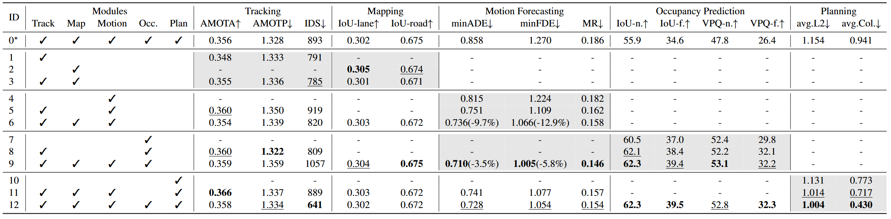
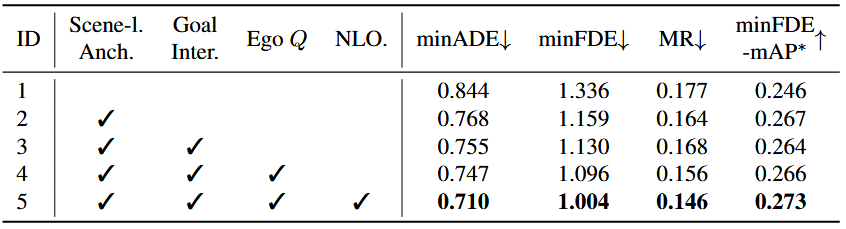
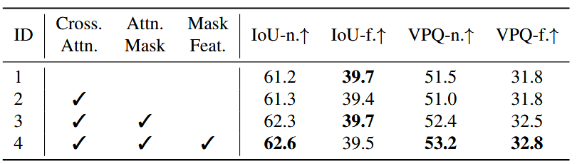
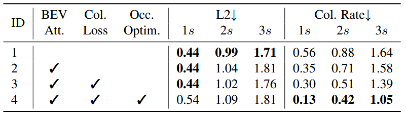

# Planning-oriented Autonomous Driving

**出处会议：** CVPR 2023 最佳论文（arXiv:2212.10156；arXiv abs 页 Comments: "CVPR 2023 award candidate"；GitHub 仓库标题: "[CVPR 2023 Best Paper Award] Planning-oriented Autonomous Driving"）
**是否开源：** https://github.com/OpenDriveLab/UniAD （本次实际抓取确认存在；论文摘要原句 "Code and models are public."）
**关键词：** 端到端自动驾驶、planning-oriented、query-based 接口、多任务联合（跟踪/建图/运动预测/占用预测/规划）、nuScenes

> 来源与核验（抓取日期 2026-11-02）：
> - arXiv abs 页 https://arxiv.org/abs/2212.10156 ，标题 "Planning-oriented Autonomous Driving"，与任务给定标题一致，允许使用。作者：Yihan Hu, Jiazhi Yang, Li Chen, Keyu Li, Chonghao Sima, Xizhou Zhu, Siqi Chai, Senyao Du, Tianwei Lin, Wenhai Wang, Lewei Lu, Xiaosong Jia, Qiang Liu, Jifeng Dai, Yu Qiao, Hongyang Li（v1 2022-12-20，v2 2023-03-23）。
> - 全文 ar5iv https://ar5iv.labs.arxiv.org/html/2212.10156 （title 核对一致），并与 arXiv 官方 HTML v2 https://arxiv.org/html/2212.10156v2 交叉核对关键表格数字一致。以下 locator（§x / Table x / Appendix x）均指该论文 v2 的章节与表格编号；引号为本次实际抓取文本的逐字摘录，以 arXiv 官方 HTML v2 的渲染为准，方括号数字（如 [104]）为该版参考文献编号、照抄未改，正文数学符号（Q、t 等）按该渲染保留单个字符。
> - 本笔记 2026-11-03 自 nightshift/drafts/UniAD.md 草稿入库（草稿保留）：入库前做了逐字自洽 QA——45 处引号内引文全部配对且逐字在文中、⚠ 自不一致注记原样保留、正文数字与表格行抽查一致。

------

## 1. 概述

- 论文动机：级联式独立模型存在误差累积，多任务学习（MTL）存在负迁移。摘要原句："However, they might suffer from accumulative errors or deficient task coordination."（Abstract）
- 论文核心主张是"面向规划"（planning-oriented）来设计整个栈，摘要原句："we argue that a favorable framework should be devised and optimized in pursuit of the ultimate goal, i.e., planning of the self-driving car."（Abstract）
- UniAD 把五个任务放进一个网络：检测+跟踪（TrackFormer）、在线建图（MapFormer）、运动预测（MotionFormer）、占用预测（OccFormer）、规划（Planner）。任务之间用 query 作为接口通信（Abstract: "Tasks are communicated with unified query interfaces to facilitate each other toward planning."）。
- 论文声称的首创性（§1，注意这是论文自述）："To the best of our knowledge, UniAD is the first work to comprehensively investigate the joint cooperation of such a variety of tasks including perception, prediction and planning in the field of autonomous driving."
- 选 query 作为节点接口的理由（§1）："A key component is the query-based design to connect all nodes. Compared to the classic bounding box representation, queries benefit from a larger receptive field to soften the compounding error from upstream predictions."
- 框架对比（Table 1 逐字转录；列：Design / Approach / Det. / Track / Map / Motion / Occ. / Plan；✓=具备该模块）：

| Design | Approach | Det. | Track | Map | Motion | Occ. | Plan |
| --- | --- | --- | --- | --- | --- | --- | --- |
| (b) | NMP | ✓ |  |  | ✓ |  | ✓ |
| (b) | NEAT |  |  | ✓ |  |  | ✓ |
| (b) | BEVerse | ✓ |  | ✓ |  | ✓ |  |
| (c.1) | [14, 16, 78, 97]（原表 Approach 即为一组引文） |  |  |  |  |  | ✓ |
| (c.2) | PnPNet† | ✓ | ✓ |  | ✓ |  |  |
| (c.2) | ViP3D† | ✓ | ✓ |  | ✓ |  |  |
| (c.2) | P3 |  |  |  |  | ✓ | ✓ |
| (c.2) | MP3 |  |  | ✓ |  | ✓ | ✓ |
| (c.2) | ST-P3 |  |  | ✓ |  | ✓ | ✓ |
| (c.2) | LAV | ✓ |  | ✓ | ✓ |  | ✓ |
| (c.3) | UniAD (ours) | ✓ | ✓ | ✓ | ✓ | ✓ | ✓ |

  Approach 列在 ar5iv 中渲染为引用键（如 zeng2019nmp）、在 arXiv HTML v2 中渲染为方括号编号（如 [104]），其余行此处从略引用标注；† 标注见各表 caption。可见此前无任何方法同时具备五任务 + 规划，UniAD (ours) 六列全 ✓（Table 1）。

## 2. 方法

### 2.1 总体结构（§2 Overview）

- 原句："UniAD comprises four transformer decoder-based perception and prediction modules and one planner in the end."（§2）其后的原句（Q 为原文数学符号）："Queries Q play the role of connecting the pipeline to model different interactions of entities in the driving scenario."
- 多相机图像 → BEV 特征：使用 BEVFormer 的 BEV encoder；论文强调可替换（§2）："Note that UniAD is not confined to a specific BEV encoder"。
- 数据流（§2）：TrackFormer 用 track queries 从 BEV 特征检测并跟踪 agent；MapFormer 用 map queries 做地图全景分割；MotionFormer 联合预测所有 agent 的未来轨迹（scene-centric，含 ego-vehicle query）；OccFormer 以 BEV 特征为 query、agent 知识为 K/V 预测多步未来占用；Planner 用 MotionFormer 的 ego-vehicle query 出规划轨迹，并避开 OccFormer 预测的占用区域。

### 2.2 感知：TrackFormer 与 MapFormer（§2.1）

- TrackFormer 联合检测与多目标跟踪，无可微性问题后处理；detection queries 负责新出现的 agent，track queries 跨帧跟踪已检测 agent，track queries 与历史帧记录的 query 做 self-attention 聚合时序信息（§2.1）。层数 N=6（Table 11）。
- 引入一个特殊的 ego-vehicle query 显式建模自车（§2.1）："we introduce one particular ego-vehicle query in the query set to explicitly model the self-driving vehicle itself, which is further used in planning."
- MapFormer 基于 Panoptic SegFormer（2D 全景分割）；lanes、dividers、crossings 设为 things，drivable area 设为 stuff；每层输出均监督，仅最后一层更新后的 map queries Q_M 传给 MotionFormer（§2.1）。map queries 数 N_m=300（Table 11）。

### 2.3 预测：MotionFormer（§2.2）

- 输入 TrackFormer 的 agent queries Q_A 与 MapFormer 的 map queries Q_M，scene-centric 一次前向输出全部 agent 的 top-K 模态轨迹（§2.2）。K=6 个模态、预测时域 T=12（Table 11）。
- 每层并行建模三类交互：agent-agent、agent-map、agent-goal point（§2.2）。前两类 Eq.(1)：`Q_{a/m} = MHCA(MHSA(Q), Q_{A}/Q_{M})`；goal point 用 deformable attention Eq.(2)：`Q_{g} = DeformAttn(Q, x̂_{T}^{l-1}, B)`，其中 x̂_{T}^{l-1} 是上一层预测轨迹的端点（§2.2）。
- motion query = query context Q_ctx + query position Q_pos；Q_pos 四项相加（Eq.(3)）：场景级锚点 I^s、agent 级锚点 I^a、agent 当前位置 x̂_0、预测终点 x̂_{T}^{l-1}，均经正弦位置编码 PE + MLP（§2.2）。锚点由 k-means 在真值轨迹端点上聚类得到（§2.2）。
- 非线性优化（Non-linear Optimization，Eq.(4)(5)）：端到端设定下上游检测结果不完美，直接回归真值 waypoints 会产生大曲率/大加速度的不现实轨迹，故用 non-linear smoother 调整训练目标，代价函数含 λ_xy、λ_goal 两项 l2 与运动学项集合 Φ（jerk, curvature, curvature rate, acceleration, lateral acceleration 五项）（§2.2）。原句："This target trajectory optimization is only conducted in training and does not affect inference."（§2.2）

### 2.4 预测：OccFormer（§2.3）

- OccFormer 由 T_o 个顺序 block 组成，T_o 为预测时域；补充材料设定 H=4 步未来、加当前帧共 T_o=5（2 Hz 下 2.0 s）（Appendix F.2）。
- agent 特征 G^t 由 motion query 沿模态维 max-pool 后与 track query Q_A、位置嵌入 P_A 经 temporal-specific MLP 融合（Eq.(6)）（§2.3）。
- BEV 特征 B 先降采样到 1/4 作为首个 block 输入 F^0；每个 block 内 downsample-upsample，在 1/8 特征上做 pixel-agent interaction；cross-attention 受注意力掩码约束，"which restricts each pixel to only look at the agent occupying it at timestep t"（§2.3，Eq.(7)：`D_{ds}^{t} = MHCA(MHSA(F_{ds}^{t}), G^{t}, attn_mask=O_{m}^{t})`）。
- 实例级占用由矩阵乘法得到（Eq.(8)）：`Ô_{A}^{t} = U^{t} · F_{dec}^{t}`，占用特征 U^t 从 mask feature M^t=MLP(G^t) 再经 MLP 得到；论文称从 M^t 而非 G^t 生成 U^t 效果更好（§2.3）。

### 2.5 规划 Planner（§2.4）

- 无高精地图/预定义路线时需高层指令：把导航信号（turn left, turn right, keep forward）转成三个可学习的 command embeddings，与 MotionFormer 的 ego-vehicle query 组成 "plan query"，attend 到 BEV 特征后解码未来 waypoints τ̂（§2.4）。
- 推理期避撞优化：仅推理时用牛顿法（Newton's method）优化 τ̂（Eq.(9)-(11)），代价 = λ_coord·‖τ,τ̂‖₂ + λ_obs·Σ_t 𝒟(τ_t, Ô^t)，𝒟 为以占用格为中心的高斯代价，S 限制在轨迹周围半径 d 内的占用格（§2.4）。
- Planner 超参（Appendix E.5）：BEV 交互解码层数 N=3；预测时域 T_p=6（3 秒）；d=5, σ=1.0, λ_coord=1.0, λ_obs=5.0。

### 2.6 训练与匹配（§2.5，Appendix E.6/F.1）

- 原句（§2.5）："UniAD is trained in two stages. We first jointly train perception parts, i.e., the tracking and mapping modules, for a few epochs (6 in our experiments), and then train the model end-to-end for 20 epochs with all perception, prediction and planning modules. The two-stage training is found more stable empirically."
- 阶段一：加载 BEVFormer 预训练权重（image backbone、FPN、BEV encoder、detection decoder，object query embeddings 除外——因新增 ego-vehicle query），截断 image backbone 梯度，L1 = L_track + L_map 训练 6 epochs（Appendix E.6）。
- 阶段二：image backbone 继续冻结、额外冻结 BEV encoder；L2 = L_track + L_map + L_motion + L_occ + L_plan 训练 20 epochs（主文消融实验为省算力训 8 epochs）（Appendix E.6）。
- 训练序列长度：tracking 与 BEV 时序聚合每步 5 帧（消融 3 帧）（Appendix E.6）。
- 训练配置（Appendix F.1）：batch size 1、learning rate 2×10⁻⁴、backbone 学习率倍率 0.1、AdamW weight decay 1×10⁻²；"Experiments are conducted with 16 NVIDIA Tesla A100 GPUs."；BEV 尺寸 200×200，覆盖 [-51.2 m, 51.2 m]，间隔 0.512 m。
- 共享匹配（§2.5 Shared matching）：跟踪阶段二分匹配结果被 motion 与 occupancy 节点复用，以保持端到端内 agent 的一致建模。

## 3. 实验

数据集为 nuScenes（验证集对比）（§3.1-3.2）。消融默认 8 epochs 训练（Appendix E.6），主表 UniAD-B 结果见 Table 12。

### 3.1 联合消融：任务协作对规划的作用（Table 2，§3.1）

Table 2 逐字行（列序：ID / Modules：Track,Map,Motion,Occ.,Plan / AMOTA↑ / AMOTP↓ / IDS↓ / IoU-lane↑ / IoU-road↑ / minADE↓ / minFDE↓ / MR↓ / IoU-n.↑ / IoU-f.↑ / VPQ-n.↑ / VPQ-f.↑ / avg.L2↓ / avg.Col.↓）：

| ID | Track | Map | Motion | Occ. | Plan | AMOTA | AMOTP | IDS | IoU-lane | IoU-road | minADE | minFDE | MR | IoU-n. | IoU-f. | VPQ-n. | VPQ-f. | avg.L2 | avg.Col. |
| --- | --- | --- | --- | --- | --- | --- | --- | --- | --- | --- | --- | --- | --- | --- | --- | --- | --- | --- | --- |
| 0∗ | ✓ | ✓ | ✓ | ✓ | ✓ | 0.356 | 1.328 | 893 | 0.302 | 0.675 | 0.858 | 1.270 | 0.186 | 55.9 | 34.6 | 47.8 | 26.4 | 1.154 | 0.941 |
| 12（全 UniAD） | ✓ | ✓ | ✓ | ✓ | ✓ | 0.358 | 1.334 | 641 | 0.302 | 0.672 | 0.728 | 1.054 | 0.154 | 62.3 | 39.5 | 52.8 | 32.3 | 1.004 | 0.430 |
| 10（仅 Plan） |  |  |  |  | ✓ | - | - | - | - | - | - | - | - | - | - | - | - | 1.131 | 0.773 |
| 6（Track+Map+Motion） | ✓ | ✓ | ✓ |  |  | 0.354 | 1.339 | 820 | 0.303 | 0.672 | 0.736(-9.7%) | 1.066(-12.9%) | 0.158 | - | - | - | - | - | - |
| 9（Track+Map+Motion+Occ.） | ✓ | ✓ | ✓ | ✓ |  | 0.359 | 1.359 | 1057 | 0.304 | 0.675 | 0.710(-3.5%) | 1.005(-5.8%) | 0.146 | 62.3 | 39.4 | 53.1 | 32.2 | - | - |

注：ID-0∗ 是"MTL scheme with separate heads for each task"（Table 2 caption），其余中间行（1-5、7-8、11）略，见原文。

- 正文对 Exp.12 vs Exp.0 的总结原句（§3.1）："Exp.12 outperforms it by a significant margin in all essential metrics (-15.2% minADE, -17.0% minFDE, -3.2 MR(%)), +4.9 IoU-f.(%)., +5.9 VPQ-f.(%), -0.15 m avg.L2, -0.51 avg.Col.(%)), showing the superiority of our planning-oriented design."（原文该句括号排版有笔误，逐字如抓取；-0.15 单位经 LaTeX alttext 核为 m，与 Table 2 的 1.154→1.004 一致）
- 两种预测任务缺一不可（§3.1）："In Exp.10-12, only when the two tasks are introduced simultaneously (Exp.12), both metrics of the planning L2 and collision rate achieve the best results"。

### 3.2 感知结果（Table 3 / Table 4，§3.2）

Table 3（多目标跟踪，nuScenes val）逐字行：

| Method | AMOTA↑ | AMOTP↓ | Recall↑ | IDS↓ |
| --- | --- | --- | --- | --- |
| Immortal Tracker† | 0.378 | 1.119 | 0.478 | 936 |
| ViP3D | 0.217 | 1.625 | 0.363 | - |
| QD3DT | 0.242 | 1.518 | 0.399 | - |
| MUTR3D | 0.294 | 1.498 | 0.427 | 3822 |
| UniAD | 0.359 | 1.320 | 0.467 | 906 |

†：tracking-by-detection 方法，用 BEVFormer 重实现以公平比较（Table 3 caption）。

- 原句（§3.2）："UniAD yields a significant improvement of +6.5 and +14.2 AMOTA(%) compared to MUTR3D [104] and ViP3D [30] respectively."；同时 UniAD 的 IDS 最低（906）。
- 论文自认局限（§3.2）："it is still inferior to tracking-by-detection methods with complex associations such as Immortal Tracker"。

Table 4（在线建图，IoU %）逐字行：

| Method | Lanes↑ | Drivable↑ | Divider↑ | Crossing↑ |
| --- | --- | --- | --- | --- |
| VPN | 18.0 | 76.0 | - | - |
| LSS | 18.3 | 73.9 | - | - |
| BEVFormer | 23.9 | 77.5 | - | - |
| BEVerse† | - | - | 30.6 | 17.2 |
| UniAD | 31.3 | 69.1 | 25.7 | 13.8 |

- 原句（§3.2）："UniAD performs well on segmenting lanes (+7.4 IoU(%) compared to BEVFormer)"（31.3 vs 23.9）。

### 3.3 预测结果（Table 5 / Table 6，§3.2）

Table 5（运动预测；minADE/minFDE 单位为 m）逐字行：

| Method | minADE(m)↓ | minFDE(m)↓ | MR↓ | EPA↑ |
| --- | --- | --- | --- | --- |
| PnPNet† | 1.15 | 1.95 | 0.226 | 0.222 |
| ViP3D | 2.05 | 2.84 | 0.246 | 0.226 |
| Constant Pos. | 5.80 | 10.27 | 0.347 | - |
| Constant Vel. | 2.13 | 4.01 | 0.318 | - |
| UniAD | 0.71 | 1.02 | 0.151 | 0.456 |

- 原句（§3.2）："It reduces prediction errors by 38.3% and 65.4% on minADE compared to PnPNet-vision [57] and ViP3D [30] respectively."

Table 6（占用预测；"n."=近距 30 m×30 m，"f."=远距 100 m×100 m，见 caption 与 Appendix F.2）逐字行：

| Method | IoU-n.↑ | IoU-f.↑ | VPQ-n.↑ | VPQ-f.↑ |
| --- | --- | --- | --- | --- |
| FIERY | 59.4 | 36.7 | 50.2 | 29.9 |
| StretchBEV | 55.5 | 37.1 | 46.0 | 29.0 |
| ST-P3 | - | 38.9 | - | 32.1 |
| BEVerse† | 61.4 | 40.9 | 54.3 | 36.1 |
| UniAD | 63.4 | 40.2 | 54.7 | 33.5 |

†：BEVerse 使用 heavy augmentations 训练（Table 6 caption）。

- 原句（§3.2）："UniAD gets notable advances in nearby areas, yielding +4.0 and +2.0 on IoU-near(%) compared to FIERY [35] and BEVerse [105] with heavy augmentations, respectively."（远距 IoU-f./VPQ-f. 低于 BEVerse†，见上表逐字行）

### 3.4 规划结果（Table 7，§3.2）

Table 7（规划；L2 单位 m，Col. Rate 单位 %）逐字行：

| Method | L2(m) 1s | 2s | 3s | Avg. | Col.Rate(%) 1s | 2s | 3s | Avg. |
| --- | --- | --- | --- | --- | --- | --- | --- | --- |
| NMP† | - | - | 2.31 | - | - | - | 1.92 | - |
| SA-NMP† | - | - | 2.05 | - | - | - | 1.59 | - |
| FF† | 0.55 | 1.20 | 2.54 | 1.43 | 0.06 | 0.17 | 1.07 | 0.43 |
| EO† | 0.67 | 1.36 | 2.78 | 1.60 | 0.04 | 0.09 | 0.88 | 0.33 |
| ST-P3 | 1.33 | 2.11 | 2.90 | 2.11 | 0.23 | 0.62 | 1.27 | 0.71 |
| UniAD | 0.48 | 0.96 | 1.65 | 1.03 | 0.05 | 0.17 | 0.71 | 0.31 |

†：LiDAR-based 方法（Table 7 caption: "even outperforms LiDAR-based methods (†) in most cases"）。

- 原句（§3.2）："UniAD reduces planning L2 error and collision rate by 51.2% and 56.3% compared to ST-P3 [38], in terms of the average value for the planning horizon."（avg.L2 2.11→1.03，avg.Col. 0.71→0.31，与上表一致）

### 3.5 模块内消融（Table 8 / 9 / 10，§3.4）

Table 8（MotionFormer 设计；列：Scene-l. Anch. / Goal Inter. / Ego Q / NLO.；minADE↓ / minFDE↓ / MR↓ / minFDE-mAP∗↑）逐字行（✓=启用）：

| ID | Scene-l. Anch. | Goal Inter. | Ego Q | NLO. | minADE | minFDE | MR | minFDE-mAP |
| --- | --- | --- | --- | --- | --- | --- | --- | --- |
| 1 |  |  |  |  | 0.844 | 1.336 | 0.177 | 0.246 |
| 2 | ✓ |  |  |  | 0.768 | 1.159 | 0.164 | 0.267 |
| 3 | ✓ | ✓ |  |  | 0.755 | 1.130 | 0.168 | 0.264 |
| 4 | ✓ | ✓ | ✓ |  | 0.747 | 1.096 | 0.156 | 0.266 |
| 5 | ✓ | ✓ | ✓ | ✓ | 0.710 | 1.004 | 0.146 | 0.273 |

- 正文原句（§3.4）："Notably, the rotated scene-level anchor shows a significant performance boost (-15.8% minADE, -11.2% minFDE, +1.9 minFDE-mAP(%)), indicating that it is essential to do motion forecasting in the scene-centric manner."
- ⚠ 存疑（同一 v2 内不自洽）：按 Table 8 逐字行，ID-1→ID-2 的 minADE 变化为 0.844→0.768（-9.0%）、minFDE 1.336→1.159（-13.2%），与正文括号里的 -15.8%/-11.2% 对不上（-15.8% 恰等于 ID-1→ID-5 的 0.844→0.710）。ar5iv 与 arXiv 官方 HTML v2 两处均如此。引用时建议以 Table 8 行为准并注明正文数字存在出入。
- NLO 的贡献原句（§3.4）："the non-linear optimization strategy improves the performance (-5.0% minADE, -8.4% minFDE, -1.0 MR(%), +0.7 minFDE-mAP(%)) by taking perceptual uncertainty into account"（与 Table 8 ID-4→ID-5：0.747→0.710、1.096→1.004、0.156→0.146、0.266→0.273 一致）。

Table 9（OccFormer 设计；列：Cross. Attn. / Attn. Mask / Mask Feat.）逐字行：

| ID | Cross. Attn. | Attn. Mask | Mask Feat. | IoU-n.↑ | IoU-f.↑ | VPQ-n.↑ | VPQ-f.↑ |
| --- | --- | --- | --- | --- | --- | --- | --- |
| 1 |  |  |  | 61.2 | 39.7 | 51.5 | 31.8 |
| 2 | ✓ |  |  | 61.3 | 39.4 | 51.0 | 31.8 |
| 3 | ✓ | ✓ |  | 62.3 | 39.7 | 52.4 | 32.5 |
| 4 | ✓ | ✓ | ✓ | 62.6 | 39.5 | 53.2 | 32.8 |

- 原句（§3.4）："attending each pixel to all agents without locality constraints (Exp.2) results in slightly worse performance compared to an attention-free baseline (Exp.1). The occupancy-guided attention mask resolves the problem and brings in gain, especially for nearby areas (Exp.3, +1.0 IoU-n.(%), +1.4 VPQ-n.(%))."

Table 10（Planner 设计；列：BEV Att. / Col. Loss / Occ. Optim.）逐字行：

| ID | BEV Att. | Col. Loss | Occ. Optim. | L2 1s | 2s | 3s | Col.Rate 1s | 2s | 3s |
| --- | --- | --- | --- | --- | --- | --- | --- | --- | --- |
| 1 |  |  |  | 0.44 | 0.99 | 1.71 | 0.56 | 0.88 | 1.64 |
| 2 | ✓ |  |  | 0.44 | 1.04 | 1.81 | 0.35 | 0.71 | 1.58 |
| 3 | ✓ | ✓ |  | 0.44 | 1.02 | 1.76 | 0.30 | 0.51 | 1.39 |
| 4 | ✓ | ✓ | ✓ | 0.54 | 1.09 | 1.81 | 0.13 | 0.42 | 1.05 |

- 原句（§3.4）："a lower collision rate is preferred for safety over naive trajectory mimicking (L2 metric), and is reduced with all parts applied in UniAD."（ID-4 的 3s Col. Rate 1.05 为四行最低，代价是 L2 变大）

### 3.6 模型规模与计算量（Table 12 / Table 13，Appendix F.3/F.4，补充材料）

Table 12（三个规模；仅摘 UniAD-B 主列与规划列）逐字行（列序：Encoder / AMOTA↑ / AMOTP↓ / IDS↓ / IoU-lane↑ / IoU-road↑ / minADE↓ / minFDE↓ / MR↓ / EPA↑ / IoU-n.↑ / IoU-f.↑ / VPQ-n.↑ / VPQ-f.↑ / avg.L2↓ / avg.Col.↓）：

| Method | Encoder | AMOTA | AMOTP | IDS | IoU-lane | IoU-road | minADE | minFDE | MR | EPA | IoU-n. | IoU-f. | VPQ-n. | VPQ-f. | avg.L2 | avg.Col. |
| --- | --- | --- | --- | --- | --- | --- | --- | --- | --- | --- | --- | --- | --- | --- | --- | --- |
| UniAD-S | R50 | 0.241 | 1.488 | 958 | 0.315 | 0.689 | 0.788 | 1.126 | 0.156 | 0.381 | 59.4 | 35.6 | 49.2 | 28.9 | 1.04 | 0.32 |
| UniAD-B | R101 | 0.359 | 1.320 | 906 | 0.313 | 0.691 | 0.708 | 1.025 | 0.151 | 0.456 | 63.4 | 40.2 | 54.7 | 33.5 | 1.03 | 0.31 |
| UniAD-L | V2-99∗ | 0.409 | 1.259 | 1583 | 0.323 | 0.709 | 0.723 | 1.067 | 0.158 | 0.508 | 64.1 | 42.6 | 55.8 | 36.9 | 1.03 | 0.29 |

∗：UniAD-L 用额外深度数据预训练（Table 12 caption: "pre-trained with extra depth data"）。附录 F.4 原句："The chosen image backbones for image-view feature extraction are ResNet-50 [32], ResNet-101 and VoVNet 2-99 [51] for UniAD-S, UniAD-B and UniAD-L respectively."

Table 13（复杂度与运行时，A100 上测量）逐字行（列：ID / Det.,Track,Map,Motion,Occ.,Plan / #Params / FLOPs / FPS）：

| ID | Det. | Track | Map | Motion | Occ. | Plan | #Params | FLOPs | FPS |
| --- | --- | --- | --- | --- | --- | --- | --- | --- | --- |
| 0（BEVerse-Tiny） | ✓ |  | ✓ |  | ✓ |  | 102.5M | 1921G | - |
| 1（≈BEVFormer） | ✓ |  |  |  |  |  | 65.9M | 1324G | 4.2 |
| 2 | ✓ | ✓ |  |  |  |  | 68.2M | 1326G | 2.7 |
| 3 | ✓ | ✓ | ✓ |  |  |  | 95.8M | 1520G | 2.2 |
| 4 | ✓ | ✓ | ✓ | ✓ |  |  | 108.6M | 1535G | 2.1 |
| 5 | ✓ | ✓ | ✓ | ✓ | ✓ |  | 122.5M | 1701G | 2.0 |
| 6（完整 UniAD） | ✓ | ✓ | ✓ | ✓ | ✓ | ✓ | 125.0M | 1709G | 1.8 |

- 原句（Appendix F.3）："We measure the complexity of UniAD and runtime on an Nvidia Tesla A100 GPU, as depicted in Table 13."；"UniAD owns more tasks, achieves superior performance, and has lower FLOPs - indicating affordable budget to additional computation cost."（相对 BEVerse-Tiny）

### 3.7 定性结果与失败案例（§3.3）

- 原句（§3.3）："we analyze that failure cases of UniAD are mainly under some long-tail scenarios such as large trucks and trailers, shown in the Supplementary as well."
- 补充材料还展示了一个对 planning-oriented 设计有利的案例：上游模块结果不准时，后续任务仍可恢复（§3.3）："inaccurate results occur in prior modules while the later tasks could still recover, e.g., the planned trajectory remains reasonable though objects have a large heading angle deviation or fail to be detected in tracking results."

## 4. 核心结论

1. 论文声称：以规划为最终目标重新组织感知/预测任务（五任务全栈 + query 接口）能在 nuScenes 上同时改善各任务与规划指标，优于独立模型与朴素 MTL（Table 2/3/5/7；Abstract）。注意此为论文声称。
2. 两种预测表示互补：agent 级 motion forecasting 提供带身份的稀疏轨迹，scene 级 occupancy 提供稠密未来场景，二者同时引入时规划 L2 与碰撞率最好（§3.1，Table 2 Exp.10-12；Appendix B 原句 "to benefit from the two complementary types of prediction tasks for safe planning, we incorporate both agent-centric motion and whole-scene occupancy in UniAD"）。
3. 代价：完整模型 125.0M 参数 / 1709 GFLOPs / A100 上 1.8 FPS（Table 13）；论文自述局限（§4）："Coordinating such a comprehensive system with multiple tasks is non-trivial and needs extensive computational power, especially trained with temporal history. How to devise and curate the system for a lightweight deployment deserves future exploration."
4. 规划结果的评价语境：nuScenes 开环指标（L2 / collision rate），与 ST-P3 等同口径（Appendix F.2 Planning: "We adopt the same metrics as in ST-P3 [38], i.e., L2 error and collision rate at various timestamps."）。

### 与后续工作的关系（本次抓取范围内的一句标注）

本次抓取的论文全文（arXiv v2，2023-03-23）经检索未出现 BEV-Planner 等后续工作的任何引用或讨论（论文成稿早于该类后续工作发表）；两者关系（如 BEV-Planner 对开环规划指标的质疑）不在本笔记来源覆盖范围内，本笔记不作任何断言，待后续单独建卡/核对。

------

## TODO

- 配图：已有截图（Table 2/8/9/10）按现有目录相对路径回填（素材在 `library/ADe2e/UniAD/`，引用路径 `UniAD/Table*.png`，未移动主人素材）；仍缺 Fig.1（框架分类）、Fig.2（pipeline 总图）、Fig.3（可视化）与 Table 3-7、12、13 的截图。`library/assets/` 下无 UniAD 目录，若主人统一要求 `assets/<论文名>/` 需先迁移素材再改引用路径。
- Table 2 仅逐字摘录 ID-0/6/9/10/12 五行，其余行（1-5、7-8、11）待需要时补全。
- Table 13 的 ID.0 行的 ✓/空列组合是从 HTML 单元格逐字解析（BEVerse-Tiny 仅 Det./Map./Occ. 打勾），建议对照 PDF 原表复核一次再引用。
- §3.4 正文 -15.8%/-11.2% 与 Table 8 行内数字的出入（见 3.5 节 ⚠）可考虑后续向作者版本/PDF 相机就绪版求证。
- 与 BEV-Planner 的关系需单独建卡核对（本笔记不引用任何未抓取的 BEV-Planner 内容）。
