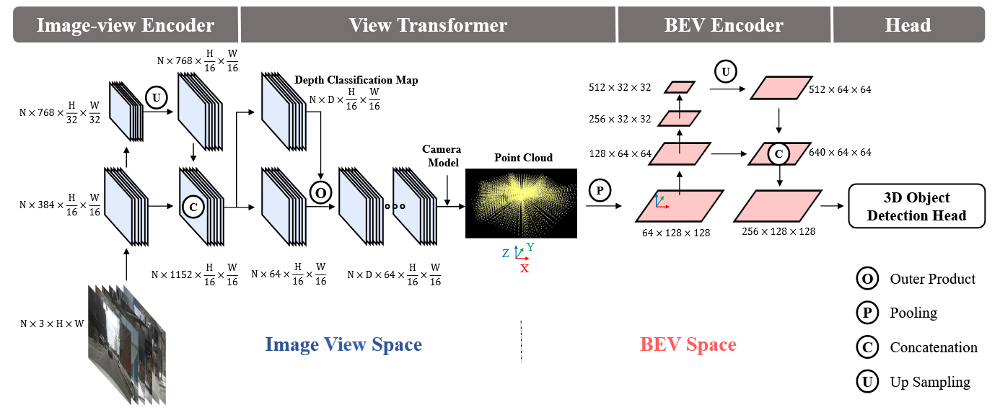
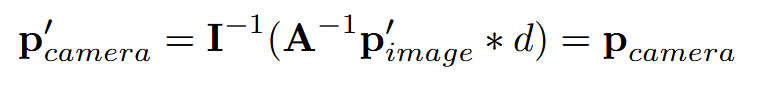
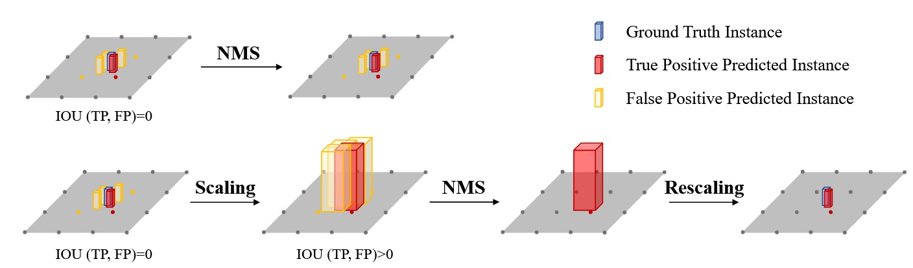
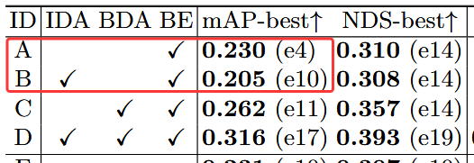
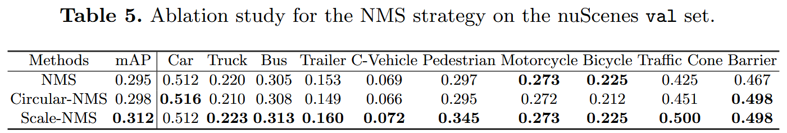
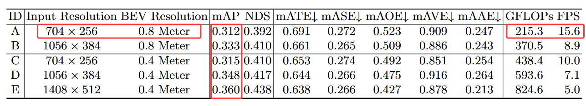
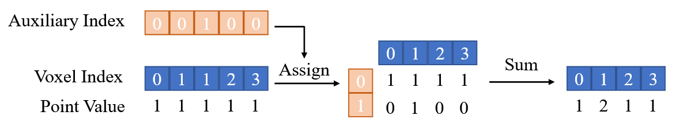

# BEVDet: High-Performance Multi-Camera 3D Object Detection in Bird-Eye-View

**出处会议：** arXiv preprint（[2112.11790](https://arxiv.org/abs/2112.11790)，v1 2021-12-22 / v2 2022-03-31 / v3 2022-06-16）；abs 页 Comments 仅写 "Multi-camera 3D Object Detection"，未见正式会议收录信息
**是否开源：** 开源，https://github.com/HuangJunJie2017/BEVDet（论文摘要脚注给出）
**关键词：** BEV 3D 目标检测、多相机、视图变换（Lift-Splat-Shoot）、数据增强（IDA+BDA）、Scale-NMS、nuScenes

> 来源说明（2026-11-03 经入库前 QA 后入库，本班授权直写 `library/`）：正文数字、表格行、英文引句均取自本次（2026-11-02）实际抓取的 arXiv abs 页与 ar5iv 全文 HTML（渲染版本判断为 v3：其摘要与 abs 页 v3 摘要逐句一致，正文含 v2/v3 才加入的 PGD、DD3D 对比）。标题核对：ar5iv 全文标题 "BEVDet: High-Performance Multi-Camera 3D Object Detection in Bird-Eye-View" 与目标标题逐字符一致；abs 页 metadata 为 "High-performance Multi-camera"（仅大小写差异）。抓取记录详见文末。

------

## 1. 概述

### 1.1 动机与定位

论文出发点：2D 感知领域范式创新（如 Mask R-CNN）的成功启发作者在自动驾驶感知中寻找一个"elegant, feasible, and scalable paradigm"；当时 nuScenes 上多相机 3D 检测赛道由 image-view 方法（FCOS3D、PGD）领先，而 BEV 语义分割赛道由 BEV 方法（PON、Lift-Splat-Shoot、VPN）主导，两任务范式不统一（§1 Introduction）。

核心主张：直接在 BEV 空间做 3D 目标检测——"BEVDet performs 3D object detection in Bird-Eye-View (BEV), where most target values are defined and route planning can be handily performed."（Abstract）。框架完全复用已有模块，性能提升来自两处定制设计："We merely reuse existing modules to build its framework but substantially develop its performance by constructing an exclusive data augmentation strategy and upgrading the Non-Maximum Suppression strategy."（Abstract）

四模块模块化设计（§1、§3.1，Fig. 1）：Image-view encoder（backbone+neck）→ View transformer（图像视图→BEV）→ BEV encoder → 任务特定 head。与当时 BEV 语义分割方法（PON、LSS 等）共享同一框架形态。

### 1.2 关键发现：BEV 空间的过拟合

作者在验证 BEVDet 可行性时观察到严重过拟合，并将根因归结于 BEV 空间拟合能力过强与数据解耦（§1）：

- 只加 image-view 数据增强（如 LSS 所做）仅在无 BEV encoder 时有效，有 BEV encoder 时反而掉点；
- image-view encoder 的 batch 是后续模块的 N 倍（N 为相机数，nuScenes 为 6），BEV 空间有效样本数少；
- 关键观察（§1）："the view transformer connects the image view space with the BEV space in a pixel-wise manner, which decouples them from the perspective of data augmentation"——即 image-view 增强对 BEV 空间的后续模块没有正则作用。

由此引出本文两大改动：BEV 空间数据增强（BDA，§3.2）与 Scale-NMS（§3.3）。

### 1.3 主要结果速览（数字来自 Abstract/§1，详细见 §3）

| 配置 | 输入 | mAP/NDS（nuScenes val） | 计算量/速度 | 对比 |
|---|---|---|---|---|
| BEVDet-Tiny | 704×256 | 31.2% / 39.2% | 215.3 GFLOPs，15.6 FPS | 精度与 FCOS3D 相当，计算量约为其 11%，快 9.2 倍（FCOS3D：2,008.2 GFLOPs，1.7 FPS） |
| BEVDet-Base | 1600×640 | 39.3% / 47.2% | 2,962.6 GFLOPs，1.9 FPS | 超过 FCOS3D +9.8% mAP / +10.0% NDS（Abstract） |

原文（Abstract）："requires just 11% computational budget of 215.3 GFLOPs and runs 9.2 times faster at 15.6 FPS"。§1 亦给出"Scaling down the image size reduces the computational budget by 89% and offers a dramatic acceleration of 9.2 times"。

------

## 2. 方法

### 2.1 网络结构（§3.1，Fig. 1 / Table 1）

四个模块（§3.1）：

- **Image-view encoder**：backbone 默认用 ResNet 与 SwinTransformer（替换项含 DenseNet、HRNet 等）；neck 用经典 FPN 或 LSS 提出的 neck（文中命名 FPN-LSS，把 1/32 分辨率特征上采样到 1/16 后与 backbone 特征拼接）。
- **View transformer**：直接采用 Lift-Splat-Shoot [33] 的视图变换——深度按分类方式密集预测，用分类分数与图像特征渲染预定义点云，再沿 Z 轴池化得到 BEV 特征。实践上把默认深度预测范围扩展到 [1,60] 米，间隔为 1.25×r（r 为输出特征分辨率）（§3.1 View Transformer）。
- **BEV encoder**：ResNet 残差块做 backbone + FPN-LSS 融合多分辨率特征，"it perceives some pivotal cues with high precision like scale, orientation, and velocity, as they are defined in the BEV space"（§3.1 BEV Encoder）。
- **Head**：不加修改地采用 CenterPoint 第一阶段 3D 检测头；未使用 CenterPoint 的第二阶段精修（§3.1 Head）。

Table 1（各配置组件，逐行照抄 ar5iv 渲染；原表有合并单元格，ar5iv 下部分行首标签为空，故按原样保留空标签行）：

| Module | BEVDet-Base | BEVDet-Tiny | BEVDet-R50 | BEVDet-R101 |
|---|---|---|---|---|
| Input Resolution | 1600×640 | 704×256 | 704×256 | 704×256 |
| Image-view Encoder | SwinTransformer-Base | SwinTransformer-Tiny | ResNet-50 | ResNet-101 |
| （空标签行） | FPN-LSS-512 | FPN-LSS-512 | FPN-512 | FPN-256 |
| View Transformer | Lift-Splat-Shoot-64-0.4×0.4 | Lift-Splat-Shoot-64-0.8×0.8 | Lift-Splat-Shoot-80-0.8×0.8 | Lift-Splat-Shoot-64-0.8×0.8 |
| BEV Encoder（第1行） | 2×Basic-128 | 2×Basic-128 | 2×Basic-160 | 1×Basic-128 |
| BEV Encoder（第2行） | 2×Basic-256 | 2×Basic-256 | 2×Basic-320 | 1×Basic-256 |
| BEV Encoder（第3行） | 2×Basic-512 | 2×Basic-512 | 2×Basic-640 | 1×Basic-512 |
| （空标签行） | FPN-LSS-512 | FPN-LSS-256 | FPN-LSS-256 | FPN-LSS-128 |
| Head | CenterPoint Head [56]（四列合并） | | | |

Table 1 原文说明："‘-number’ denotes the number of channels in this module. Lift-Splat-Shoot-64-0.4 × 0.4 denotes the view transformer proposed in [33]. The output feature has a channel number of 64 and a resolution of 0.4 meters."（原文 ‘-number’ 为弯引号，照抄）

### 2.2 定制数据增强策略（§3.2）

**两个视图空间在增强意义下是孤立的（§3.2 The Isolated View Spaces）。** 视图变换按像素进行：图像平面像素 p_image=[x_i, y_i, 1]^T 带深度 d 时，3D 坐标为式(1) p_camera = I^{-1}(p_image * d)（I 为 3×3 相机内参）。翻转/裁剪/旋转类增强可写成 3×3 矩阵 A，增强后做逆变换 A^{-1} 可保持 BEV 空间一致性，即式(2) p'_camera = I^{-1}(A^{-1} p'_image * d) = p_camera。结论原文（§3.2）："the augmentation strategy applied in image view space will not change the spatial distribution of the features in BEV space."

**BEV 空间数据增强（§3.2 BEV Space Learning with Data Augmentation）。** BEV 空间每个样本只对应一组多相机图像（nuScenes 每样本 6 张图），有效数据量少、易过拟合；且视图变换在增强角度上解耦了两个空间，image-view 增强对 BEV 后续模块无正则作用。因此仿照 LiDAR 系方法（CenterPoint 等），在 BEV 空间对视图变换的输出特征与 3D 检测目标同步施加 flipping、scaling、rotating。原文强调该策略的前提与适用范围："this data augmentation strategy is built upon the precondition that the view transformer can decouple the image-view encoder from the subsequent module. This is a specific characteristic of BEVDet and may not be effective in the other methods [49, 51, 50]."（§3.2）

### 2.3 Scale-NMS（§3.3）

问题：image-view 中各类目标因透视成像共享相似空间分布，固定阈值的经典 NMS 有效；BEV 中则不然——"the occupied areas of various classes are intrinsically different and the overlap between instances should be closed to zero."（§3.3）。行人、交通锥等小目标占地可能小于输出分辨率（如 CenterPoint 的 0.8 米），冗余预测框与真阳框可能完全无交集，IOU 失效，经典 NMS 因此失效。

做法原文（§3.3）："Scale-NMS scales the size of each object according to its category before performing the classical NMS algorithm."——按类别缩放目标尺寸后再做经典 NMS，使 TP 与冗余框之间的 IOU 分布回到经典 NMS 适用的形态；对小目标是放大尺寸以建立空间关系，之后还原。实践细节：对所有类别施加 Scale-NMS，**barrier 除外**（尺寸变化大）；缩放因子按类别区分，由验证集超参搜索得到（§3.3）。

------

## 3. 实验

### 3.1 实验设置（§4.1）

- **数据集**：nuScenes，1000 场景、6 相机，700/150/150 训练/验证/测试划分，约 1.4M 个 3D 框标注、10 类；ROI 为地面 51.2 米内、默认体素/分辨率 0.8 米（§4.1 Dataset）。
- **评价指标**：官方 mAP、mATE、mASE、mAOE、mAVE、mAAE、NDS；mAP 以 BEV 平面 2D 中心距离匹配而非 IOU（§4.1 Evaluation Metrics）。
- **训练参数**：AdamW，学习率 2e-4，总 batch size 64，8 张 NVIDIA GeForce RTX 3090；ResNet 系用 step 策略（epoch 17、20 降 10 倍），SwinTransformer 系用 cyclic 策略（前 40% 线性升至 1e-3 再线性降至 0）；默认 20 epochs（§4.1 Training Parameters）。
- **数据处理**：训练时源图（1600×900）经随机翻转、随机缩放 s∈[W_in/1600−0.06, W_in/1600+0.11]、随机旋转 r∈[−5.4°, 5.4°]，再裁剪回 W_in×H_in；BEV 空间随机翻转、随机旋转 [−22.5°, 22.5°]、随机缩放 [0.95, 1.05]；训练用 CBGS；测试时按 s=W_in/1600+0.04 缩放后裁剪（§4.1 Data Processing）。
- **速度口径**：基于 MMDetection3D；所有速度与计算量均在无数据增强下测得；单目方法（FCOS3D、PGD）的推理速度除以 6（每样本图像数），并注明该口径可能不是单目方法的最优 batch 方式（§4.1 Inference Speed）。

### 3.2 Benchmark 结果

**nuScenes val set（§4.2，Table 2）**——逐行照抄：

| Methods | Image Size | #param. | GFLOPs | Modality | mAP↑ | mATE↓ | mASE↓ | mAOE↓ | mAVE↓ | mAAE↓ | NDS↑ | FPS |
|---|---|---|---|---|---|---|---|---|---|---|---|---|
| VoxelNet [56] | - | - | - | LiDAR | 0.564 | - | - | - | - | - | 0.648 | - |
| PointPillar [56] | - | - | - | LiDAR | 0.503 | - | - | - | - | - | 0.602 | - |
| CenterNet [59] | - | - | - | Camera | 0.306 | 0.716 | 0.264 | 0.609 | 1.426 | 0.658 | 0.328 | - |
| FCOS3D [49] | 1600×900 | 52.5M | 2,008.2 | Camera | 0.295 | 0.806 | 0.268 | 0.511 | 1.315 | 0.170 | 0.372 | 1.7 |
| DETR3D [51] | 1600×900 | 51.3M | 1,016.8 | Camera | 0.303 | 0.860 | 0.278 | 0.437 | 0.967 | 0.235 | 0.374 | 2.0 |
| PGD [50] | 1600×900 | 53.6M | 2,223.0 | Camera | 0.335 | 0.732 | 0.263 | 0.423 | 1.285 | 0.172 | 0.409 | 1.4 |
| BEVDet-Tiny | 704×256 | 53.7M | 215.3 | Camera | 0.312 | 0.691 | 0.272 | 0.523 | 0.909 | 0.247 | 0.392 | 15.6 |
| BEVDet-Base | 1600×640 | 126.6M | 2,962.6 | Camera | 0.393 | 0.608 | 0.259 | 0.366 | 0.822 | 0.191 | 0.472 | 1.9 |
| FCOS3D †§# [49] | 1600×900 | - | - | Camera | 0.343 | 0.725 | 0.263 | 0.422 | 1.292 | 0.153 | 0.415 | - |
| DETR3D † [51] | 1600×900 | 51.3M | - | Camera | 0.349 | 0.716 | 0.268 | 0.379 | 0.842 | 0.200 | 0.434 | - |
| PGD †§ [50] | 1600×900 | 53.6M | - | Camera | 0.369 | 0.683 | 0.260 | 0.439 | 1.268 | 0.185 | 0.428 | - |
| BEVDet-Base § | 1600×640 | 126.6M | - | Camera | 0.397 | 0.595 | 0.257 | 0.355 | 0.818 | 0.188 | 0.477 | - |

Table 2 表头注：† initialized from a FCOS3D backbone；§ with test-time augmentation；# with model ensemble。

正文要点（§4.2 nuScenes val set）：

- BEVDet-Tiny 以 1/8 输入面积（704×256 vs 1600×900）得 31.2% mAP / 39.2% NDS，高于 FCOS3D（29.5%/37.2%）与 DETR3D（30.3%/37.4%），计算量 215.3 GFLOPs 远小于 FCOS3D 的 2,008.2 与 DETR3D 的 1,016.8，速度 15.6 FPS 远快于 1.7 / 2.0 FPS。
- BEVDet-Base 39.3% mAP / 47.2% NDS，超此前领先的 PGD +5.8% mAP / +6.3% NDS（原文："It significantly exceeds the previous leading method PGD by a margin of +5.8% mAP and +6.3% NDS"）；计算量近 DETR3D 的 3 倍，但速度相当（1.9 FPS）。
- 误差分解（§4.2）：BEVDet 在 mATE/mASE/mAOE/mAVE 上好于或接近对手，但 mAAE 差于 image-view 方法（BEVDet-Tiny mAAE 0.247 vs FCOS3D 0.170）；作者猜想："the attribute judgment relies on the appearance cues, which is easier for agents to perceive in the image view."，并称结合两个视图是未来方向。

**nuScenes test set（§4.2，Table 3）**——逐行照抄（† pre-train on DDAD [12]）：

| Methods | Modality | mAP↑ | mATE↓ | mASE↓ | mAOE↓ | mAVE↓ | mAAE↓ | NDS↑ |
|---|---|---|---|---|---|---|---|---|
| PointPillars (Light) [21] | LiDAR | 0.305 | 0.517 | 0.290 | 0.500 | 0.316 | 0.368 | 0.453 |
| CenterFusion [30] | Camera & Radar | 0.326 | 0.631 | 0.261 | 0.516 | 0.614 | 0.115 | 0.449 |
| CenterPoint [56] | Camera & LiDAR & Radar | 0.671 | 0.249 | 0.236 | 0.350 | 0.250 | 0.136 | 0.714 |
| MonoDIS [42] | Camera | 0.304 | 0.738 | 0.263 | 0.546 | 1.553 | 0.134 | 0.384 |
| CenterNet [59] | Camera | 0.338 | 0.658 | 0.255 | 0.629 | 1.629 | 0.142 | 0.400 |
| FCOS3D [49] | Camera | 0.358 | 0.690 | 0.249 | 0.452 | 1.434 | 0.124 | 0.428 |
| PGD [50] | Camera | 0.386 | 0.626 | 0.245 | 0.451 | 1.509 | 0.127 | 0.448 |
| BEVDet | Camera | 0.422 | 0.529 | 0.236 | 0.395 | 0.979 | 0.152 | 0.482 |
| DD3D † [32] | Camera | 0.418 | 0.572 | 0.249 | 0.368 | 1.014 | 0.124 | 0.477 |
| DETR3D † [51] | Camera | 0.386 | 0.626 | 0.245 | 0.394 | 0.845 | 0.133 | 0.479 |

正文（§4.2 nuScenes test set）：BEVDet-Base 在 train+val 上训练、单模型 + TTA，test set 得 42.2% mAP / 48.2% NDS，居 nuScenes 视觉 3D 检测榜第一，超 PGD +3.6% mAP / +3.4% NDS；与依赖 LiDAR 预训练的 DD3D、DETR3D 相当；且"the accuracy of vision-based BEVDet is comparable with the classical LiDAR-based method PointPillars [21] ( i.e. 30.5% mAP and 45.3% NDS)"。

### 3.3 消融研究（§4.3，除注明外均在 nuScenes val set）

**（1）数据增强（Table 4，BEVDet-Tiny，固定 20 epochs，同时报训练过程最佳值与末轮值）**——逐行照抄（IDA=Image-view-space Data Augmentation，BDA=BEV-space Data Augmentation，BE=BEV Encoder）：

| ID | IDA | BDA | BE | mAP-best↑ | NDS-best↑ | mAP↑ | NDS↑ | mATE↓ | mASE↓ | mAOE↓ | mAVE↓ | mAAE↓ |
|---|---|---|---|---|---|---|---|---|---|---|---|---|
| A | | | ✓ | 0.230 (e4) | 0.310 (e14) | 0.174 (-5.6%) | 0.283 (-2.7%) | 0.734 | 0.343 | 0.664 | 1.262 | 0.298 |
| B | ✓ | | ✓ | 0.205 (e10) | 0.308 (e14) | 0.178 (-2.7%) | 0.303 (-0.5%) | 0.738 | 0.288 | 0.615 | 1.030 | 0.217 |
| C | | ✓ | ✓ | 0.262 (e11) | 0.357 (e14) | 0.236 (-2.6%) | 0.348 (-0.9%) | 0.717 | 0.274 | 0.514 | 0.976 | 0.221 |
| D | ✓ | ✓ | ✓ | 0.316 (e17) | 0.393 (e19) | 0.312 ( -0.4% ) | 0.392 ( -0.1% ) | 0.691 | 0.272 | 0.523 | 0.909 | 0.247 |
| E | | | | 0.231 (e10) | 0.307 (e10) | 0.215 (-1.6%) | 0.306 (-0.1%) | 0.777 | 0.283 | 0.703 | 1.111 | 0.249 |
| F | ✓ | | | 0.276 (e14) | 0.347 (e17) | 0.269 (-0.7%) | 0.345 (-0.2%) | 0.734 | 0.274 | 0.673 | 0.994 | 0.217 |
| G | | ✓ | | 0.253 (e12) | 0.345 (e15) | 0.224 (-2.9%) | 0.337 (-0.8%) | 0.734 | 0.281 | 0.543 | 0.983 | 0.211 |
| H | ✓ | ✓ | | 0.299 (e20) | 0.373 (e20) | 0.299 (-0.0%) | 0.373 (-0.0%) | 0.726 | 0.273 | 0.536 | 0.950 | 0.278 |

正文要点（§4.3 Data Augmentation）：

- 基线 A（无任何增强，CenterPoint 头接视图变换特征）：mAP 在 epoch 4 即饱和于 23.0%，随后过拟合，末轮仅 17.4%（较最佳 -5.6%），远差于 FCOS3D 的 29.5%。
- B（只加 IDA）：饱和推迟到 epoch 10（20.5%），末轮 17.8%，最佳值反而低于基线 A。
- C（只加 BDA）：正文写 "peaks at epoch 15 with 26.2% mAP"，末轮 23.6%，峰值超基线 +3.2% mAP。**注意：此处正文 "epoch 15" 与 Table 4 C 行 "0.262 (e11)" 不一致（e11=epoch 11），系原文文本与表格自相矛盾，引用时需留意。**
- D（IDA+BDA）：峰值 epoch 17 达 31.6%，末轮 31.2%，较基线峰值 +8.6% mAP，末轮退化缩到 -0.4%。
- 结论原文："IDA has a negative impact on the performance when BDA is absent but has a positive impact on the contrary."
- BE 的作用：D vs H，BE 带来 +1.7% mAP；F vs G 显示无 BE 时 IDA 有正作用、有 BE 时相反，作者猜想 BEV Encoder 的强感知能力只有在 BDA 存在时才能建立（§4.3）。

**（2）Scale-NMS（Table 5，BEVDet-Tiny）**——逐行照抄：

| Methods | mAP | Car | Truck | Bus | Trailer | C-Vehicle | Pedestrian | Motorcycle | Bicycle | Traffic Cone | Barrier |
|---|---|---|---|---|---|---|---|---|---|---|---|
| NMS | 0.295 | 0.512 | 0.220 | 0.305 | 0.153 | 0.069 | 0.297 | 0.273 | 0.225 | 0.425 | 0.467 |
| Circular-NMS | 0.298 | 0.516 | 0.210 | 0.308 | 0.149 | 0.066 | 0.295 | 0.272 | 0.212 | 0.451 | 0.498 |
| Scale-NMS | 0.312 | 0.512 | 0.223 | 0.313 | 0.160 | 0.072 | 0.345 | 0.273 | 0.225 | 0.500 | 0.498 |

正文（§4.3 Scale-NMS）：小目标受益最大——pedestrians +4.8% AP、traffic cones +7.5% AP；较大目标也有收益——buses +0.8%、trucks +0.3%、trailers +0.7%、construction vehicles +0.3%；总体 mAP 29.5%→31.2%（+1.7%）。

**（3）分辨率（Table 6）**——逐行照抄：

| ID | Input Resolution | BEV Resolution | mAP | NDS | mATE↓ | mASE↓ | mAOE↓ | mAVE↓ | mAAE↓ | GFLOPs | FPS |
|---|---|---|---|---|---|---|---|---|---|---|---|
| A | 704×256 | 0.8 Meter | 0.312 | 0.392 | 0.691 | 0.272 | 0.523 | 0.909 | 0.247 | 215.3 | 15.6 |
| B | 1056×384 | 0.8 Meter | 0.333 | 0.410 | 0.661 | 0.265 | 0.509 | 0.886 | 0.243 | 370.5 | 8.9 |
| C | 704×256 | 0.4 Meter | 0.315 | 0.410 | 0.653 | 0.274 | 0.492 | 0.851 | 0.254 | 438.4 | 10.0 |
| D | 1056×384 | 0.4 Meter | 0.348 | 0.417 | 0.644 | 0.266 | 0.475 | 0.916 | 0.264 | 593.6 | 7.1 |
| E | 1408×512 | 0.4 Meter | 0.360 | 0.438 | 0.638 | 0.266 | 0.427 | 0.878 | 0.213 | 824.6 | 5.0 |

正文（§4.3 Resolution）：输入分辨率影响很大——E（1408×512）比 C（704×256，同为 0.4m BEV）高 +4.5% mAP；且输入加大时计算量增长有限（BEV encoder 与 head 计算量不变）；BEV 分辨率（即 LiDAR 方法中的体素大小）提高可提升 mAP、mATE、mAOE，但计算量与延迟代价更高。

**（4）Image-view encoder 的 backbone 类型（Table 7）**——逐行照抄：

| Configuration | Input Resolution | mAP | NDS | mATE↓ | mASE↓ | mAOE↓ | mAVE↓ | mAAE↓ | #param. | GFLOPs | FPS |
|---|---|---|---|---|---|---|---|---|---|---|---|
| BEVDet-R50 | 704×256 | 0.298 | 0.379 | 0.725 | 0.279 | 0.589 | 0.860 | 0.245 | 53.3M | 183.8 | 16.7 |
| BEVDet-R101 | 704×256 | 0.302 | 0.381 | 0.722 | 0.269 | 0.543 | 0.900 | 0.269 | 54.1M | 223.6 | 14.3 |
| BEVDet-Tiny | 704×256 | 0.312 | 0.392 | 0.691 | 0.272 | 0.523 | 0.909 | 0.247 | 53.7M | 215.3 | 15.6 |
| BEVDet-R50 | 1056×384 | 0.318 | 0.389 | 0.718 | 0.272 | 0.553 | 0.897 | 0.258 | 53.3M | 311.8 | 11.4 |
| BEVDet-R101 | 1056×384 | 0.330 | 0.396 | 0.702 | 0.272 | 0.534 | 0.932 | 0.251 | 54.1M | 452.0 | 9.3 |
| BEVDet-Tiny | 1056×384 | 0.333 | 0.410 | 0.661 | 0.265 | 0.509 | 0.886 | 0.243 | 53.7M | 370.5 | 8.9 |

正文（§4.3 Backbone Type）：等参数量下，704×256 时 R50→SwinTransformer-Tiny 提升 +1.4% mAP / +1.3% NDS；R101 对 R50 在小输入下仅 +0.4% mAP / +0.2% NDS，在 1056×384 大输入下 +1.2% mAP / +0.7% NDS——作者猜想更大感受野在放大输入尺寸时更重要。

**（5）推理加速（§4.3 Acceleration，Fig. 3）**：LSS 视图变换按 voxel 累加（accumulate sum），延迟与总点数成正比。引入辅助索引（auxiliary index）记录同一 voxel 索引此前出现次数，配合 voxel 索引把点分配进 2D 矩阵，沿辅助轴一次求和完成合并；在推理期相机内外参固定的前提下，两组索引固定、可在初始化阶段算好。效果原文："we reduce the inference latency of BEVDet-Tiny by 53.3% ( i.e. , from 137 milliseconds to merely 64 milliseconds)."。代价是额外显存（取决于 voxel 数与辅助索引最大值），实践上限设 300、超出丢弃，对精度影响可忽略（§4.3）。

------

## 4. 核心结论

1. BEVDet 证明可直接复用 BEV 语义分割的四模块范式做多相机 3D 目标检测，且性能主要来自两处定制：基于视图变换解耦性的 IDA+BDA 数据增强，与 Scale-NMS（§5 Conclusion；§3.2/§3.3）。
2. 精度-效率权衡是其主打卖点：Tiny 版 31.2% mAP / 39.2% NDS @ 15.6 FPS、215.3 GFLOPs；Base 版 39.3% mAP / 47.2% NDS（val），test set 42.2% mAP / 48.2% NDS，为当时 nuScenes 视觉榜第一（§4.2，Table 2/3）。（以上为论文声称的基准快照，截至其 v3 提交日 2022-06-16，尚未独立验证。）
3. 消融给出的方法论结论：BEV 空间学习易过拟合，BDA 是关键正则手段，IDA 只在 BDA 存在时对有 BE 的配置有正作用；BEV Encoder 贡献 +1.7% mAP；Scale-NMS 对小目标（行人 +4.8% AP、交通锥 +7.5% AP）收益最大（§4.3，Table 4/5）。
4. BEV 表征的固有优势与短板：擅长 translation、scale、orientation、velocity（这些量在 BEV 空间定义），弱于 attribute（依赖外观线索，image-view 更易感知），作者提出的补救方向是两视图结合（§4.2；§5）。
5. 论文自述后续工作：(1) 提升 attribute 预测；(2) 基于 BEVDet 的多任务学习（§5 Conclusion；原文将 benchmark 误拼为 "nuSenses"）。

------

## 配图说明（2026-11-03 入库时逐张人工核对图像内容后嵌入，不轻信文件名）

| 素材文件 | 实际内容（已核对） | 嵌入位置 |
|---|---|---|
| Figure1.png | 论文 Fig. 1：BEVDet 四模块框架图（含 BEVDet-Tiny 通道数示例） | §2.1 |
| Figure2.png | 论文 Fig. 2：经典 NMS vs Scale-NMS（Scaling→NMS→Rescaling） | §2.3 |
| Figure3.png | 论文 Fig. 3：辅助索引（Auxiliary Index）合并同 voxel 特征 | §3.3（5） |
| Table2.png | **论文 Table 4（文件名与论文表号错位）**：数据增强消融 A–D 行，含红框标注，截图止于 E 行上半 | §3.3（1） |
| Table5.png | 论文 Table 5：NMS 策略消融 | §3.3（2） |
| Table6.png | 论文 Table 6：分辨率消融 | §3.3（3） |
| Format1.png | **论文式(2)公式截图（非图表）**：p'_camera = I^{-1}(A^{-1} p'_image * d) = p_camera | §2.2 |

遗留问题（请调度班次转 QUESTIONS.md 或由人工决定）：

1. 资产文件名与论文编号不对应（Table2.png 实为论文 Table 4；Format1.png 实为式(2)）。本笔记嵌入时已按核对后的实际内容标注论文编号，未沿用文件名做引用；素材文件本身未改名/未移动（主人素材），如需改名由主人决定。
2. 原文 §4.3 正文与 Table 4 C 行的饱和轮次不一致（正文 "epoch 15" vs 表 "e11"），本笔记两处均按原文照抄并已标注，未做取舍。
3. assets 中没有论文 Table 1/3/7 的截图，若需要图版需另行补抓。

------

## 来源与抓取记录

- arXiv abs 页：https://arxiv.org/abs/2112.11790 （抓取日期 2026-11-02，curl 全页保存；标题 metadata "BEVDet: High-performance Multi-camera 3D Object Detection in Bird-Eye-View"；作者 Huang Junjie, Huang Guan, Zhu Zheng, Ye Yun, Du Dalong；提交历史 v1 2021-12-22 / v2 2022-03-31 / v3 2022-06-16）
- ar5iv 全文 HTML：https://ar5iv.labs.arxiv.org/html/2112.11790 （抓取日期 2026-11-02，curl 全页保存；页面标题与目标标题逐字符一致；LaTeXML 渲染。渲染版本判断为 v3：摘要逐句与 abs 页当前摘要一致，且正文含 PGD/DD3D 等 v2/v3 引入的对比；页面内未显式标注版本号，此判断为推断）
- 本地素材：/home/yulong/projects/KnowledgeAnchor/library/assets/BEVDet/（Figure1/2/3.png、Format1.png、Table2/5/6.png，内容均已人工查看核对）
- 引文核验方式：所有英文引句均以固定字符串在 ar5iv 原始 HTML 中 grep 命中后才写入本笔记；表格行逐值与 ar5iv 提取文本及对应素材截图（Table5.png、Table6.png）双重比对。
- 入库前 QA（2026-11-03）：本笔记 26 条英文引句逐一用 Grep 验证在笔记文本中逐字存在（自洽检查全部通过）；正文-表格数字交叉验算 13 处一致（Abstract +9.8/+10.0、§4.2 对 PGD +5.8/+6.3、test 对 PGD +3.6/+3.4、Scale-NMS +4.8/+7.5/+1.7、分辨率 +4.5、骨干消融 +1.4/+1.3 与 +0.4/+0.2 与 +1.2/+0.7、加速 137→64ms=53.3%）；7 张素材图逐张核对内容后引用。注：/tmp 下 2026-11-02 的抓取产物已不在，本次未能对 ar5iv 原文做二次核验，引句以草稿记录的 grep 命中记录为准。
