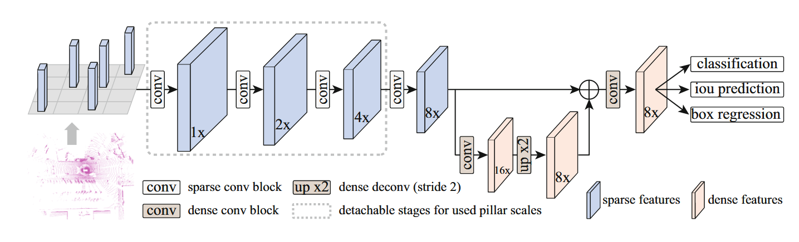
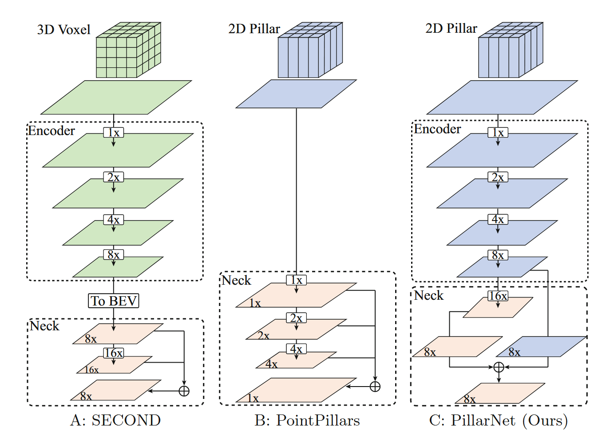
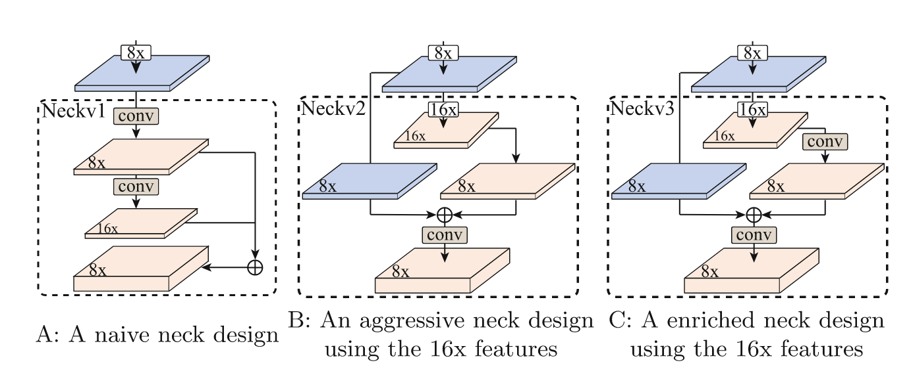
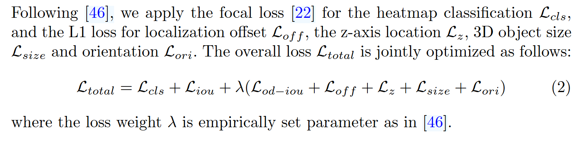
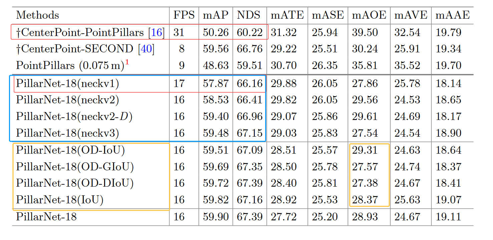
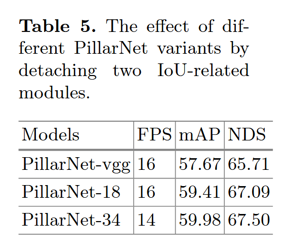

# PillarNet: Real-Time and High-Performance Pillar-based 3D Object Detection

**出处会议：** ECCV 2022（arXiv [2205.07403](https://arxiv.org/abs/2205.07403)，v1 2022-05-16 / v2 2022-05-19 / v3 2022-05-31 / v4 2022-06-14 / v5 2022-08-26；abs 页 Comments 仅写 "ECCV 2022"，无更多收录信息）
**是否开源：** 开源，https://github.com/agent-sgs/PillarNet（论文摘要末句 "Code is available at" 给出；本次仅抓取论文页，未访问该仓库核对内容）
**关键词：** pillar-based 3D 目标检测、稀疏 2D 卷积 encoder、spatial-semantic 特征融合 neck、Orientation-Decoupled IoU（OD-IoU）、IoU-Aware rectification、nuScenes、Waymo Open Dataset

> 来源说明（2026-11-03 经入库前 QA 后入库，本班授权直写 `library/`）：正文数字、表格行、英文引句均取自本次（2026-11-02）实际抓取的 arXiv abs 页与 ar5iv 全文 HTML。标题核对：arXiv abs 页 `<title>`/`citation_title` 与 ar5iv `<h1>` 均为 "PillarNet: Real-Time and High-Performance Pillar-based 3D Object Detection"，与任务给定标题逐字符一致（本次抓取前曾误抓 2203.13315（一篇拓扑学论文），已弃用）。ar5iv 页面未标注对应 arXiv 版本号（LaTeXML oxide 0.7.5 渲染，URL 不带版本后缀），按 ar5iv 惯例应为当时最新版 v5，此判断为推断。abs 页摘要中代码链接被 arXiv 占位渲染为 "this https URL"，ar5iv 中正常显示为完整 GitHub 地址，本文以 ar5iv 为准。作者：Guangsheng Shi、Ruifeng Li（哈尔滨工业大学机器人技术与系统全国重点实验室）、Chao Ma（上海交通大学，通讯作者；ar5iv 作者区注明 "Work done while G. Shi visits the Vision and Learning Group at Shanghai Jiao Tong University"）。抓取记录详见文末。

------

## 1. 概述

### 1.1 动机与定位

论文出发点：当时的顶级点云 3D 检测器（point-based 或 3D voxel-based 卷积）算力开销大，不适合车载部署；pillar-based 方法只用 2D 卷积、算力省，但精度远落后于 voxel-based（Abstract）。作者把 pillar/voxel 两类的性能差距归因于 pillar 特征编码太弱："We observe that previous pillar-based methods do not have powerful pillar feature encoding, which is the main cause of the unsatisfied performance."（§1 Introduction）

第二个观察是 pillar size 与输出特征图大小解耦的可能性："progressively downsampling pillar scales can help to decouple the output feature map size and the initial pseudo-image projection scale"（§1）——即可以先取细 pillar、再逐级下采样，而不是像 PointPillars 那样让整个网络都建立在粗 pillar 的伪图像上。

与已有 pillar 系改进（MVF、HVNet、HVPR 等，§2.1）在"精巧的 pillar 特征投影/多尺度聚合"上做文章不同，本文的做法是 "we resort to a powerful backbone network to address the above issues and boost 3D detection performance."（§2.1）

### 1.2 架构总览与主要变体

PillarNet 仍是 "encoder-neck-head" 三段式（§1、§3.2，Fig. 3），由三个组件构成：用于深层 pillar 特征提取的 encoder、用于 spatial-semantic 特征融合的 neck、以及常用的 CenterPoint 系 center-based 检测头。摘要概括："The proposed PillarNet consists of a powerful encoder network for effective pillar feature learning, a neck network for spatial-semantic feature fusion and the commonly used detect head."（Abstract）

Encoder 共 5 个 stage（§1）："the powerful encoder network involves 5 stages. Stage 1 to 4 follow the same setting as the conventional 2D detection networks such as VGG [36] and ResNet [12] but substituted 2D convolutions with its sparse counterparts for resource savings."（§1，引文按 ar5iv 原文照抄，引用编号属原文）"Stage 5 with standard 2D convolutions possesses a larger receptive field and feeds semantic features to the following neck network."（§1）

pillar size 灵活性（§1）："PillarNet offers an effective solution by skillfully detaching the corresponding encoder stages for the chosen pillar scale"——例如 nuScenes 上 8 倍 pillar（0.075×8 m）输入时，"we can simply remove the 1x, 2x, and 4x downsampled encoder stages"（§1）。

变体与骨干：PillarNet-vgg / PillarNet-18 / PillarNet-34，复杂度分别对齐 VGGNet / ResNet-18 / ResNet-34（§3.2；注意 §3.2 原文将 "PillarNet" 误拼为 "PilllarNet-vgg/18/34"，本笔记照抄该处）。详细网络配置在补充材料中，主文未给出（§3.2）。检测头沿用 CenterPoint [46] 的 center-based head（§1、§3.2）。

### 1.3 主要结果速览（数字来自 §4.1 正文与 Table 1/2，详细见 §3）

- nuScenes test set（LiDAR-only、非集成，§4.1 + Table 1）：PillarNet-vgg/18/34 分别 69.6/70.8/71.4 NDS、63.3/65.0/66.0 mAP，实时速度 14/13/12 FPS；论文声称 "surpasses all the published LiDAR-only non-ensemble methods on the nuScenes Detection leaderboard on Mar 7, 2022"（§4.1）。
- PillarNet-18 对比 AFDetV2："PillarNet-18 surprisingly surpasses the most advanced AFDetV2 by +2.3% NDS or +2.6% mAP."（§4.1）
- Waymo test set（§4.1 + Table 2）：单帧 PillarNet-34 vehicle L1 mAP/mAPH 82.47/82.03，多帧 83.23/82.80；"Our PillarNet-34 outperforms all the previous single-frame and multi-frame LiDAR-only models for the vehicle and pedestrian categories while running at a speed of 19 FPS separately."（§4.1）
- 以上均为论文声称的基准快照（截至 v5 提交日 2022-08-26），尚未独立验证。

------

## 2. 方法

### 2.1 Preliminaries：SECOND / PointPillars 的架构瓶颈（§3.1，Fig. 2）

三类架构对比（§3.1，Fig. 2）：SECOND 用稀疏 3D CNN encoder，PointPillars 用 tiny PointNet 投影 + 2D CNN；PillarNet 与二者的区别在于稀疏 2D CNN encoder。Fig. 2 图注给出 nuScenes 上的量化尺寸："the 3D voxel size in SECOND [40] is (0.075m, 0.075m, 0.2m), and the 2D pillar size in PointPillars and our proposed PillarNet is (0.2m, 0.2m) and (0.075m, 0.075m) respectively."（§3.1 Fig. 2 图注）

- **SECOND**（§3.1）：encoder 以 1×/2×/4×/8× 下采样分级编码非空 voxel 特征；neck 在 BEV 空间自顶向下多尺度抽象；head 在融合后的多尺度 BEV 特征上做分类回归。
- **PointPillars**（§3.1）：2D CNN top-down 网络以 stride 1x/2x/4x 卷积块处理伪图像，然后拼接多尺度特征给检测头。
- **瓶颈分析**（§3.1 Analysis）："PointPillars directly applies the feature pyramid network to fuse multi-scale features on the projected dense 2D pseudo-image, lacking the sparse encoder network for effective pillar feature encoding as in SECOND." 另一问题："PointPillars couples the size of the final output feature maps with the initial projected pillar scale, increasing the entire calculation and memory cost sharply as the pillar scale gets finer."（§3.1）

作者的总体判断（§3.1）："the performance bottleneck of pillar-based methods mainly lies in the sparse encoder network for spatial feature learning and effective neck module for sufficient spatial-semantic features fusion"（引文按 ar5iv 原文照抄，句子以句号收尾于 "fusion."）。

### 2.2 Encoder design（§3.2）

Encoder 从投影后的稀疏 2D pillar 特征出发，stage 1–4 可拆卸（detachable）且逐级用稀疏 2D CNN 下采样（§3.2）。两个优点（§3.2）：

1. "The sparse encoder network can take the progress on image-based 2D object detection, such as VGGNet [35] and ResNet [12]. The simple encoder for pillar feature learning can largely improve 3D detection performance."（§3.2）
2. "The hierarchically downsampling structure allows PillarNet to skillfully operate the sparse pillar features with different pillar sizes, which alleviates the limitation of coupling pillar size in previous pillar-based methods."（§3.2）

变体句（§3.2 原文照抄，含拼写 "PilllarNet"）："Our constructed PillarNet with variant backbones, PilllarNet-vgg/18/34, with the similar complexities of VGGNet/ResNet-18/ResNet-34."（§3.2）

### 2.3 Neck design（§3.2，Fig. 4）

Neck 的职责（§3.2）："The additional 16X downsampled dense feature maps further abstracts high-level semantic feature using a group of dense 2D CNNs, to enrich receptive field for large objects and populate object center-positioned features for center-based detect head."（§3.2；原文 "16X" 大写 X、"abstracts" 第三人称单数均照抄）

三种设计（§3.2，Fig. 4）：

- **neckv1**（Fig. 4 A，naive，继承自 SECOND [40]）："applies a top-down network to generate multi-scale features and concatenate multi-scale dense feature maps as the final output"（§3.2）
- **neckv2**（Fig. 4 B，aggressive）："considers sufficient information exchange between high-level semantic feature from additional 16X downsampled dense feature maps and low-level spatial feature from sparse encoder network using a group of convolution layers"（§3.2）
- **neckv3**（Fig. 4 C，enriched）："further enriches the high-level semantic features on 16X downsampled dense feature maps through a group of convolution layers and fuses the spatial-semantic features with the other group of convolution layers for robust feature extraction"（§3.2）
- 另有 **neckv2-D**：仅在 §4.2 消融与 Table 4 中出现（表内方法名 "PillarNet-18(neckv2-D)"），主文 §3.2 的三种 neck 列表未定义它；§4.2 对比 neckv2 与 neckv2-D 的解释（引句跨原文斜体字符 "D"，按 ar5iv 拼合）："The performance difference between neckv2 and neckv2-D shows that the dense convolutions enable stronger semantic abstraction at the object center than its sparse counterparts, due to LiDAR points sparsely scattering on the surface of the objects."（§4.2）——即 D = dense 版本。

### 2.4 Orientation-Decoupled IoU 回归损失与 IoU-Aware rectification（§3.3，Fig. 5）

**IoU-Aware rectification（分类分支，§3.3，式(1)）**：沿用 IoU-rectification 方案把 IoU 信息并入置信度，后处理阶段的 rectification 函数为

$$\hat{S}=S^{1-\beta}*W_{\rm{IoU}}^{\beta} \tag{1}$$

其中 $S$ 为分类分数、$W_{\rm{IoU}}$ 为 IoU 分数、$\beta$ 为超参。IoU 分数用 L1 损失 $\mathcal{L}_{iou}$ 监督，"to supervise the IoU regression"（§3.3），目标 3D IoU 编码为 $2*(W-0.5)\in[-1,1]$（§3.3）。

**OD-IoU（回归分支，§3.3，Fig. 5）**：动机是把方向 $\theta$ 从七参数 $(x,y,z,w,l,h,\theta)$ 的耦合中拆出来。§3.3 用一个典型 2D 框 $[x,y,l,w,\theta]=[0,0,3.9,1.6,0]$ 展示 IoU 优化中的三类交叉效应（Fig. 5）：

1. "The training phase easily settles into a local optimum, if the box center deviates far"（§3.3，中心偏差对方向回归的影响，Fig. 5 A 红线为局部最优）
2. "The training phase settles into the notorious optimization plateau, if box sizes change largely"（§3.3，尺寸变化对方向回归的影响，Fig. 5 B 红区为优化平台）
3. "The optimization direction remains consistent even if the orientation deviation is significant"（§3.3，方向偏差对中心和尺寸回归的影响）

结论句（§3.3）：原文提出 "we present an alternative Orientation-Decoupled IoU-related regression loss by decoupling the orientation"（§3.3），即把方向 $\theta$ 从七个互相耦合的参数 $(x,y,z,w,l,h,\theta)$ 中解耦出来。具体地，"we extend the IoU regression loss" $\mathcal{L}_{od-iou}$（OD-IoU/OD-GIoU/OD-DIoU）"from the IoU loss [31], GIoU loss [31] and DIoU loss [50], respectively."（§3.3；引文按 ar5iv 拼合，注意原文 IoU loss 与 GIoU loss 均引 [31]，属原文引用编号原样）

### 2.5 总损失（§3.4，式(2)）

沿用 CenterPoint [46]：heatmap 分类用 focal loss $\mathcal{L}_{cls}$，定位 offset $\mathcal{L}_{off}$、z 轴位置 $\mathcal{L}_{z}$、3D 尺寸 $\mathcal{L}_{size}$、方向 $\mathcal{L}_{ori}$ 用 L1 loss（§3.4）。总损失：

$$\mathcal{L}_{total}=\mathcal{L}_{cls}+\mathcal{L}_{iou}+\lambda(\mathcal{L}_{od-iou}+\mathcal{L}_{off}+\mathcal{L}_{z}+\mathcal{L}_{size}+\mathcal{L}_{ori}) \tag{2}$$

其中权重 $\lambda$ 按文献 [46] 经验设置（§3.4）。

------

## 3. 实验

### 3.1 实验设置（§4）

- **数据集（§4）**：nuScenes——"contains 1000 driving sequences, with 700, 150, 150 sequences for training, validation, and testing"（§4），每序列约 20 秒、LiDAR 20 FPS；"nuScenes uses a 32 lanes LiDAR, which produces approximately 30k points per frame"（§4）；"The annotations include 10 classes with a long-tail distribution"（§4）；训练时 "We follow the convention to accumulate 10 LiDAR sweeps to densify the point clouds and report results by using the official evaluation protocol"（§4）。Waymo——"There are total 798 training sequences with around 160k LiDAR samples, and 202 validation sequences with 40k LiDAR samples"（§4）；"The 3D IoU threshold is set as 0.7 for vehicle detection and 0.5 for pedestrian/cyclist detection"（§4）；评价指标为 mAP 与 mAPH（"mean average precision weighted by heading (mAPH) are used for evaluation"，§4）。
- **训练（§4）**："We use the same training schedules as prior CenterPoint-SECOND [46], where Adam optimizer is used with one-cycle learning rate policy, weight decay 0.01, and momentum 0.85 to 0.95 on 4 Tesla V100 GPUs."（§4）pillar 化用 "we apply one-layer MLP-based PointNet associated with" atomic max 式池化，"based pooling on augmented point-wise feature of all inside points per pillar"（§4；引文按 ar5iv 拼合，中间为行内公式 atomic max）。数据增强沿用 [46]："including the random scene flipping along, random rotation, random scene scaling, and random translation"（§4；"flipping along" 后直接接逗号系原文如此照抄）。
- **nuScenes 参数（§4）**：检测范围 X/Y 轴 $[-54m, 54m]$、Z 轴 $[-5m, 3m]$；基础 pillar size 取 $(0.075m, 0.075m)$；"We train the PillarNet from scratch with batch size 16, max learning rate 1e-3 for 20 epochs"（§4）。推理后处理沿用 [46]："we use class-agnostic NMS with the score threshold set to 0.1 and rectification factor" $\beta$ 取 0.5（"to 0.5 for all 10 classes"，§4）；nuScenes test 上 "we do not use any model ensembling except double-flip test-time augmentation as CenterPoint"（§4）。
- **Waymo 参数（§4）**：检测范围 X/Y 轴 $[-75.2m, 75.2m]$、Z 轴 $[-2m, 4m]$；基础 pillar size $(0.1m, 0.1m)$（原文该句主语误拼为 "W use"，应为 "We use"，本笔记照录该瑕疵不改正文语义）；batch size 16、max learning rate 3e-3、36 epochs（§4，"max learning rate 3e-3 for 36 epochs"）。推理 "by using class-specific NMS with the IoU thresholds (0.8, 0.55, 0.55) and rectification factor" $\beta$ 取 (0.68, 0.71, 0.65)，分别对应 vehicle/pedestrian/cyclist（§4）。
- **速度口径（§4）**：与两个基线（CenterPoint-SECOND、CenterPoint-PointPillars）的 runtime 对比在一台 i9 CPU + RTX 3090 的桌面机上进行（§4）。

### 3.2 nuScenes test set（§4.1，Table 1）

Table 1：LiDAR-only 非集成方法在 nuScenes test set 的对比，"The table is mainly sorted by nuScenes detection score (NDS) which is the official ranking metric."（Table 1 图注）——逐行照抄 ar5iv 渲染（14 列；NDS/mAP 与 10 类 AP，数值为百分数）：

<!-- verbatim-table:T5 -->

| Methods | Stages | NDS | mAP | Car | Truck | Bus | Trailer | Cons.Veh. | Ped. | Motor. | Bicycle | Tr.Cone | Barrier |
|---|---|---|---|---|---|---|---|---|---|---|---|---|---|
| WYSIWYG [13] | One | 41.9 | 35.0 | 79.1 | 30.4 | 46.6 | 40.1 | 7.1 | 65.0 | 18.2 | 0.1 | 28.8 | 34.7 |
| PointPillars [16] | One | 45.3 | 30.5 | 68.4 | 23.0 | 28.2 | 23.4 | 4.1 | 59.7 | 27.4 | 1.1 | 30.8 | 38.9 |
| 3DVID [45] | One | 53.1 | 45.4 | 79.7 | 33.6 | 47.1 | 43.1 | 18.1 | 76.5 | 40.7 | 7.9 | 58.8 | 48.8 |
| 3DSSD [41] | One | 56.4 | 42.6 | 81.2 | 47.2 | 61.4 | 30.5 | 12.6 | 70.2 | 36.0 | 8.6 | 31.1 | 47.9 |
| Cylinder3D [53] | One | 61.6 | 50.6 | - | - | - | - | - | - | - | - | - | - |
| CGBS [52] | One | 63.3 | 52.8 | 81.1 | 48.5 | 54.9 | 42.9 | 10.5 | 80.1 | 51.5 | 22.3 | 70.9 | 65.7 |
| CVCNet [3] | One | 64.2 | 55.8 | 82.6 | 49.5 | 59.4 | 51.1 | 16.2 | 83.0 | 61.8 | 38.8 | 69.7 | 69.7 |
| CenterPoint [46] | Two | 65.5 | 58.0 | 84.6 | 51.0 | 60.2 | 53.2 | 17.5 | 83.4 | 53.7 | 28.7 | 76.7 | 70.9 |
| HotSpotNet [4] | One | 66.0 | 59.3 | 83.1 | 50.9 | 56.4 | 53.3 | 23.0 | 81.3 | 63.5 | 36.6 | 73.0 | 71.6 |
| AFDetV2 [14] | One | 68.5 | 62.4 | 86.3 | 54.2 | 62.5 | 58.9 | 26.7 | 85.8 | 63.8 | 34.3 | 80.1 | 71.0 |
| PillarNet-vgg | One | 69.6 | 63.3 | 86.9 | 56.0 | 62.2 | 62.0 | 28.6 | 86.3 | 62.6 | 33.5 | 79.6 | 75.6 |
| PillarNet-18 | One | 70.8 | 65.0 | 87.4 | 56.7 | 60.9 | 61.8 | 30.4 | 87.2 | 67.4 | 40.3 | 82.1 | 76.0 |
| PillarNet-34 | One | 71.4 | 66.0 | 87.6 | 57.5 | 63.6 | 63.1 | 27.9 | 87.3 | 70.1 | 42.3 | 83.3 | 77.2 |

正文要点（§4.1）：

- "all our PillarNet-vgg/18/34 go beyond the stage-of-the-art methods by a large margin while running at a real-time speed of 14, 13 and 12 FPS, respectively"（§4.1；原文将 state-of-the-art 误拼为 "stage-of-the-art"，照抄）
- "PillarNet-18 surprisingly surpasses the most advanced AFDetV2 by +2.3% NDS or +2.6% mAP."（§4.1；按 Table 1 数值验算：NDS 70.8−68.5=+2.3、mAP 65.0−62.4=+2.6，一致）
- "surpasses all the published LiDAR-only non-ensemble methods on the nuScenes Detection leaderboard on Mar 7, 2022"（§4.1）
- 论文对可扩展性的表述："the performance behaves more favorably as the computational complexity rises"（§4.1）

### 3.3 Waymo Open Dataset（§4.1，Table 2 / Table 3）

Table 2：Waymo test set，单帧（上组）与多帧（下组）LiDAR-only 非集成对比。图注："”L” and ”LT” mean ”all LiDARs” and ”top-LiDAR only”, respectively. † denotes the reported results from RSN [38]."（Table 2 图注；引号为原文弯引号）——逐行照抄 ar5iv 渲染（原表两行表头：类别名跨 mAP/mAPH 两列，此处以空单元格拆行）：

<!-- verbatim-table:T6 -->

| Methods | Stages | Sensors | Frames | Vehicle (L1) | | Vehicle (L2) | | Ped. (L1) | | Ped. (L2) | | Cyc. (L1) | | Cyc. (L2) | |
|---|---|---|---|---|---|---|---|---|---|---|---|---|---|---|---|
| | | | | mAP | mAPH | mAP | mAPH | mAP | mAPH | mAP | mAPH | mAP | mAPH | mAP | mAPH |
| † PointPillars [16] | One | LT | 1 | 68.60 | 68.10 | 60.50 | 60.10 | 68.00 | 55.50 | 61.40 | 50.10 | - | - | - | - |
| RCD [1] | Two | - | 1 | 71.97 | 71.59 | 65.06 | 64.70 | - | - | - | - | - | - | - | - |
| CenterPoint [46] | Two | LT | 1 | 80.20 | 79.70 | 72.20 | 71.80 | 78.30 | 72.10 | 72.20 | 66.40 | - | - | - | - |
| AFDetV2 [14] | One | LT | 1 | 80.49 | 80.43 | 72.98 | 72.55 | 79.76 | 74.35 | 73.71 | 68.61 | 72.43 | 71.23 | 69.84 | 68.67 |
| PillarNet-vgg | One | LT | 1 | 81.16 | 80.68 | 73.64 | 73.20 | 78.30 | 70.28 | 72.23 | 64.68 | 67.26 | 66.07 | 64.79 | 63.65 |
| PillarNet-18 | One | LT | 1 | 81.85 | 81.40 | 74.46 | 74.03 | 79.97 | 72.68 | 73.95 | 67.09 | 67.98 | 66.80 | 65.50 | 64.36 |
| PillarNet-34 | One | LT | 1 | 82.47 | 82.03 | 75.07 | 74.65 | 80.82 | 74.13 | 74.83 | 68.54 | 69.08 | 67.91 | 66.60 | 65.47 |
| 3D-MAN [43] | Multi | L | 15 | 78.71 | 78.28 | 70.37 | 69.98 | 69.97 | 65.98 | 63.98 | 60.26 | - | - | - | - |
| RSN [38] | Two | LT | 3 | 80.70 | 80.30 | 71.90 | 71.60 | 78.90 | 75.60 | 70.70 | 67.80 | - | - | - | - |
| CenterPoint [46] | Two | L | 2 | 81.05 | 80.59 | 73.42 | 72.99 | 80.47 | 77.28 | 74.56 | 71.52 | 74.60 | 73.68 | 72.17 | 71.28 |
| Pyramid R-CNN [26] | Two | L | 2 | 81.77 | 81.32 | 74.87 | 74.43 | - | - | - | - | - | - | - | - |
| AFDetV2 [14] | One | LT | 2 | 81.65 | 81.22 | 74.30 | 73.89 | 81.26 | 78.05 | 75.47 | 72.41 | 76.41 | 75.37 | 74.05 | 73.04 |
| PillarNet-vgg | One | LT | 2 | 82.18 | 81.73 | 74.93 | 74.49 | 80.41 | 76.86 | 74.52 | 71.14 | 68.75 | 67.89 | 66.52 | 65.68 |
| PillarNet-18 | One | LT | 2 | 82.68 | 82.25 | 75.53 | 75.12 | 81.71 | 78.29 | 75.91 | 72.66 | 70.19 | 69.30 | 68.01 | 67.15 |
| PillarNet-34 | One | LT | 2 | 83.23 | 82.80 | 76.09 | 75.69 | 82.38 | 79.02 | 76.66 | 73.46 | 71.44 | 70.51 | 69.20 | 68.29 |

Table 3：Waymo val set，单帧 LiDAR-only 非集成 3D AP/APH 对比，"†: reported by [17]"（Table 3 图注）。表末含一组 "Two-frame 3D detection results of PillarNet variants for reference."（表内分组行；注意该组三行的 Stages 列在原表中仍写 "One"，与两帧输入的表述冲突，系原表原样，见文末遗留问题）——逐行照抄 ar5iv 渲染：

<!-- verbatim-table:T7 -->

| Methods | Stages | Vehicle (L1) | | Vehicle (L2) | | Ped. (L1) | | Ped. (L2) | | Cyc. (L1) | | Cyc. (L2) | |
|---|---|---|---|---|---|---|---|---|---|---|---|---|---|
| | | mAP | mAPH | mAP | mAPH | mAP | mAPH | mAP | mAPH | mAP | mAPH | mAP | mAPH |
| MVF [6] | One | 62.93 | - | - | - | 65.33 | - | - | - | - | - | - | |
| 3D-MAN [43] | Multi | 69.03 | 68.52 | 60.16 | 59.71 | 71.71 | 67.74 | 62.58 | 59.04 | - | - | - | - |
| RCD [1] | Two | 69.59 | 69.16 | - | - | - | - | - | - | - | - | - | - |
| † SECOND [40] | One | 72.27 | 71.69 | 63.85 | 63.33 | 68.70 | 58.18 | 60.72 | 51.31 | 60.62 | 59.28 | 58.34 | 57.05 |
| † PointPillar [16] | One | 56.62 | - | - | - | 59.25 | - | - | - | - | - | - | - |
| LiDAR R-CNN [17] | Two | 73.50 | 73.00 | 64.70 | 64.20 | 71.20 | 58.70 | 63.10 | 51.70 | 68.60 | 66.90 | 66.10 | 64.40 |
| RangeDet [8] | One | 72.85 | - | - | - | 75.94 | - | - | - | 65.80 | - | - | - |
| MVF++ [29] | One | 74.64 | - | - | - | 78.01 | - | - | - | - | - | - | - |
| RSN [38] | Two | 75.10 | 74.60 | 66.00 | 65.50 | 77.80 | 72.70 | 68.30 | 63.70 | - | - | - | - |
| Voxel R-CNN [7] | Two | 75.59 | - | 66.59 | - | - | - | - | - | - | - | - | - |
| CenterPoint [46] | Two | 76.70 | 76.20 | 68.80 | 68.30 | 79.00 | 72.90 | 71.00 | 65.30 | - | - | - | - |
| Part-A 2 [34] | Two | 77.05 | 76.51 | 68.47 | 67.97 | 75.24 | 66.87 | 66.18 | 58.62 | 68.60 | 67.36 | 66.13 | 64.93 |
| PV-RCNN [32] | Two | 77.51 | 76.89 | 68.98 | 68.41 | 75.01 | 65.65 | 66.04 | 57.61 | 67.81 | 66.35 | 65.39 | 63.98 |
| AFDetV2 [14] | One | 77.64 | 77.14 | 69.68 | 69.22 | 80.19 | 74.62 | 72.16 | 66.95 | 73.72 | 72.74 | 71.06 | 70.12 |
| PillarNet-vgg | One | 77.41 | 76.86 | 69.46 | 68.96 | 78.30 | 70.32 | 70.00 | 62.62 | 69.48 | 68.35 | 66.87 | 65.78 |
| PillarNet-18 | One | 78.24 | 77.73 | 70.40 | 69.92 | 79.80 | 72.59 | 71.57 | 64.90 | 70.40 | 69.29 | 67.75 | 66.68 |
| PillarNet-34 | One | 79.09 | 78.59 | 70.92 | 70.46 | 80.59 | 74.01 | 72.28 | 66.17 | 72.29 | 71.21 | 69.72 | 68.67 |
| Two-frame 3D detection results of PillarNet variants for reference. | | | | | | | | | | | | | |
| PillarNet-vgg | One | 78.26 | 77.73 | 70.56 | 70.07 | 80.88 | 77.53 | 72.73 | 69.58 | 67.72 | 66.88 | 65.54 | 64.72 |
| PillarNet-18 | One | 79.59 | 79.06 | 71.56 | 71.08 | 82.11 | 78.82 | 74.49 | 71.35 | 70.41 | 69.57 | 68.27 | 67.46 |
| PillarNet-34 | One | 79.98 | 79.47 | 72.00 | 71.53 | 82.52 | 79.33 | 75.00 | 71.95 | 70.51 | 69.69 | 68.38 | 67.58 |

正文要点（§4.1）：

- Waymo test："Our PillarNet-34 outperforms all the previous single-frame and multi-frame LiDAR-only models for the vehicle and pedestrian categories while running at a speed of 19 FPS separately. Our lightweight PillarNet-vgg still achieves the comparable performance for the vehicle while running at a faster speed of 24 FPS."（§4.1）
- Waymo val："PillarNet-18 achieves the state-of-the-art performance on the vehicle category"（§4.1）；"PillarNet-34 outperforms previous state-of-the-art works with remarkable performance gains (+1.24 for the vehicle in terms of mAPH of LEVEL_2 difficulty)"（§4.1；按 Table 3 验算：70.46−69.22=+1.24，对比对象 AFDetV2 L2 mAPH，一致）；"Excluding the latest voxel-based detector AFDetV2 with self-calibrated module and channel-wise and spatial-wise attention, PillarNet-34 outperforms the previous one-stage and two-stage 3D detectors for the vehicle and pedestrian detection while operating at super real-time speed."（§4.1）
- 两帧输入："PillarNet on variant backbones consistently show the superior performance compared with their single-frame counterparts. However, for the cyclist detection, two-frame results are not the best."（§4.1）作者归因于类别样本不均衡："The number of vehicles, pedestrians and cyclists scattered in the Waymo train set are 4352210, 2037627 and 49518 respectively."（§4.1）

### 3.4 消融研究（§4.2，Table 4 / Table 5 / Table 6）

消融范围（§4.2）："The key contribution can be summarized into two parts: the designed PillarNet architecture"（即 encoder 与 neck 网络）"and the IoU-related modules"（即 OD-IoU 回归损失与 IoU-Aware rectification）（§4.2；引文按 ar5iv 拼合）。全部在 nuScenes val set 上进行（§4.2）。

Table 4：各组件分析，训练日程与 SECOND 相同，并与两个基线（PointPillars、SECOND）对比；"†: reported by used codebase"（Table 4 图注）——逐行照抄 ar5iv 渲染（表内第 3 行方法名 "PointPillars (0.075m)" 带上标 ¹，ar5iv HTML 中未见该脚注正文，见文末遗留问题）：

<!-- verbatim-table:T8 -->

| Methods | FPS | mAP | NDS | mATE | mASE | mAOE | mAVE | mAAE |
|---|---|---|---|---|---|---|---|---|
| † CenterPoint-PointPillars [16] | 31 | 50.26 | 60.22 | 31.32 | 25.94 | 39.50 | 32.54 | 19.79 |
| † CenterPoint-SECOND [40] | 8 | 59.56 | 66.76 | 29.22 | 25.51 | 30.24 | 25.91 | 19.34 |
| PointPillars (0.075m)¹ | 9 | 48.63 | 59.51 | 30.70 | 26.35 | 35.81 | 35.52 | 19.70 |
| PillarNet-18(neckv1) | 17 | 57.87 | 66.16 | 29.88 | 26.05 | 27.86 | 25.78 | 18.14 |
| PillarNet-18(neckv2) | 16 | 58.53 | 66.41 | 29.82 | 26.05 | 29.56 | 24.53 | 18.65 |
| PillarNet-18(neckv2-D) | 16 | 59.40 | 66.96 | 29.07 | 25.86 | 29.61 | 24.69 | 18.17 |
| PillarNet-18(neckv3) | 16 | 59.48 | 67.15 | 29.03 | 25.83 | 27.54 | 24.54 | 18.90 |
| PillarNet-18(OD-IoU) | 16 | 59.51 | 67.09 | 28.51 | 25.57 | 29.31 | 24.63 | 18.64 |
| PillarNet-18(OD-GIoU) | 16 | 59.69 | 67.35 | 28.50 | 25.78 | 27.57 | 24.74 | 18.37 |
| PillarNet-18(OD-DIoU) | 16 | 59.72 | 67.39 | 28.40 | 25.81 | 27.38 | 24.67 | 18.41 |
| PillarNet-18(IoU) | 16 | 59.82 | 67.16 | 28.92 | 25.53 | 28.37 | 25.63 | 19.07 |
| PillarNet-18 | 16 | 59.90 | 67.39 | 27.72 | 25.20 | 28.93 | 24.67 | 19.11 |

正文要点（§4.2；注意原文多处用 "第 N 行" 引用 Table 4，按上表行序这些引用无法全部自洽，详见文末遗留问题第 2 条）：

- **Encoder**：以 CenterPoint-PointPillars [16] 为基线（原文称其位于第 1 行），新 encoder "can significantly improve the detection performance by about +7.61% mAP and +5.94% NDS"（§4.2；验算：57.87−50.26=+7.61、66.16−60.22=+5.94，对应上表 PillarNet-18(neckv1) 行，一致）。"Using the heavy encoder with extra stage 5 in" 第 3–6 行 "can boost the 3D detection performance by a large margin"（§4.2；引文按 ar5iv 拼合，行号引用原文如此）。"Therein, the enriched semantic features from encoder stage 5 in" 第 4–5 行优于第 6 行的 aggressive 融合策略（§4.2，原文表述照抄）。
- **Neck**："Compared with the naive neck module neckv1"，第 4–6 行的融合设计 "a group of convolution layers can improve detection performance by a large margin"（§4.2；引文按 ar5iv 拼合）。neckv2-D vs neckv2 的 dense 优势解释见 §2.3 末引文（§4.2）。
- **OD-IoU**："All three types of losses ( i.e., OD-IoU, OD-GIoU and OD-DIoU) play a role in the critical positioning accuracy, while the OD-DIoU loss brings a maximum boost with +0.24% mAP or +0.24% NDS."（§4.2；验算：59.72−59.48=+0.24、67.39−67.15=+0.24，对比对象为上表 PillarNet-18(neckv3) 行，一致）
- **IoU-Aware rectification**："Adding IoU-Aware rectification benefits the IoU-based mAP with +0.34% increase."（§4.2；该 +0.34 无法由 Table 4 行间差直接对上——PillarNet-18 59.90 对 PillarNet-18(IoU) 59.82 为 +0.08，见文末遗留问题第 3 条）

Table 5：detach 两个 IoU 相关模块后的变体对比——逐行照抄：

<!-- verbatim-table:T9 -->

| Models | FPS | mAP | NDS |
|---|---|---|---|
| PillarNet-vgg | 16 | 57.67 | 65.71 |
| PillarNet-18 | 16 | 59.41 | 67.09 |
| PillarNet-34 | 14 | 59.98 | 67.50 |

Table 6：不同 pillar size 及对应 encoder stage 组合（PillarNet-18）——逐行照抄：

<!-- verbatim-table:T10 -->

| Pillar size | FPS | encoder stages | mAP | NDS |
|---|---|---|---|---|
| 0.075m | 16 | (1x 2x 4x 8x 16x) | 59.48 | 67.15 |
| 0.075*2m | 16 | (2x 4x 8x 16x) | 58.70 | 66.56 |
| 0.075*4m | 16 | (4x 8x 16x) | 57.87 | 66.05 |
| 0.075*8m | 14 | (8x 16x) | 55.37 | 64.20 |

- **模型变体分析（§4.2）**："We investigate PillarNet-vgg/18/34 with different model complexity by detaching IoU-related modules for a clean comparison"（§4.2）；随后一句原文写作 "Table 6 shows that our PillarNet architecture can benefit from increasing model capacity with slightly more FLOPs and inference time"（§4.2；引文按 ar5iv 拼合。该处内容实为 Table 5 的三行变体对比，原文交叉引用写作 Table 6，照抄并存疑，见文末遗留问题第 4 条）。
- **pillar size 分析（§4.2）**："We investigate pillar size on detection performance by detaching IoU-related modules for a clean comparison"（§4.2）；"where a larger pillar size requires fewer encoder stages"（§4.2）。结论："benefit more from finer pillar scale and deeper pillar feature encoding"（§4.2，主语 PillarNet）；"The much higher performance of PillarNet with 0.3m and 0.6m over PointPillars with 0.2m manifests the effectiveness of our architectural design."（§4.2；0.3m/0.6m 即 0.075×4、0.075×8）；PointPillars 换 0.075m 反而 "performs slightly worse than that of 0.2m"（§4.2，对应 Table 4 第 3 行），原因是 "That is because the used lightweight encoder network hinders the gain from small pillar size."（§4.2）
- **Runtime 分析（§4.2）**："our PillarNet-18 achieves a good speed-accuracy trade-off with 16 FPS than CenterPoint-SECOND of 8 FPS on nuScenes Dataset, and 21 FPS than CenterPoint-PointPillars of 19 FPS on Waymo Open Dataset."（§4.2）Table 6 中粗 pillar 配置反而更慢的解释："operation struggles to handle more inside points per pillar based on global memory"（§4.2，主语为 cuda 的 atomic max 操作）；缓解办法："This issue can be alleviated by the input point cloud sub-sampling or other efficient operation"（§4.2，如 streaming pillarization）。

------

## 4. 核心结论

1. PillarNet 的主张：在 "encoder-neck-head" 框架内，把 pillar 系方法的短板定位为"弱 encoder + pillar size 与特征图尺寸耦合"，用稀疏 2D CNN 多 stage encoder（1–4 可拆卸 + stage 5 稠密语义）与 spatial-semantic fusion neck（v1/v2/v2-D/v3）替代 PointPillars 的浅 backbone，并用 OD-IoU 损失 + IoU-Aware rectification 稳定回归与置信度（§1、§3.2–3.4）。结论句："PillarNet achieves the scalability and flexibility for the hard-balanced pillar size and model complexities"（§5 Conclusions；原文自称 "we propose a real-time and high-performance one-stage 3D object detector"，§5）。
2. 精度快照（论文声称，尚未独立验证；截至 v5 2022-08-26）：nuScenes test LiDAR-only 非集成 NDS 69.6/70.8/71.4（vgg/18/34），超过当时榜上全部已发表同类方法（§4.1，Table 1）；Waymo test 单帧 vehicle L1 mAP/mAPH 82.47/82.03（PillarNet-34，§4.1，Table 2）。
3. 消融给出的量化结论（nuScenes val）：encoder 带来 +7.61% mAP / +5.94% NDS（对 CenterPoint-PointPillars 基线，§4.2 Table 4）；OD-DIoU 在三种 OD 损失中增益最大（+0.24% mAP / +0.24% NDS，§4.2）；IoU-Aware rectification 声称 +0.34% mAP（§4.2，数值对不上 Table 4 行差，见遗留问题）；pillar size 越细 + encoder 越深越好，粗 pillar 配置可通过拆卸 stage 换速度（§4.2，Table 6：0.075m 59.48/67.15 → 0.075×8m 55.37/64.20）。
4. 代价与边界：nuScenes test 14/13/12 FPS（vgg/18/34，§4.1）、val 16 FPS（PillarNet-18，Table 4；RTX 3090 桌面机口径，§4）；粗 pillar + 少 stage 配置受 cuda atomic max 全局内存操作拖慢（§4.2）；Waymo 两帧输入对 cyclist 无益，作者归因于 4352210/2037627/49518 的类别不均衡（§4.1）。

------

## 配图说明（2026-11-03 入库时逐张人工核对图像内容后嵌入，不轻信文件名）

`library/assets/PillarNet/` 现已存在（草稿撰写时尚无）。素材文件名为主人命名，与论文编号不完全对应，引用以核对后的实际内容为准：

| 素材文件 | 实际内容（已核对） | 嵌入位置 |
|---|---|---|
| Figure_Compare.png | 论文 Fig. 2：SECOND / PointPillars / PillarNet 三类架构对比 | §2.1 |
| Figure3.png | 论文 Fig. 3：总体架构（encoder→neck→head + IoU prediction） | §1.2 |
| Figure4_Neck.png | 论文 Fig. 4：neck v1/v2/v3 三种设计 | §2.3 |
| Figure_Loss.png | **论文式(2)总损失公式段落截图（非 Fig. 5 曲线图，文件名易误导）** | §2.5 |
| Table4_Ablation.png | 论文 Table 4：各组件消融（无表题版本，与正文表格逐值一致） | §3.4 |
| Table4_EncoderAblation.png | **与 Table4_Ablation.png 为同一张表**（含表题 "Table 4. The analysis of each component of PillarNet..."），未重复引用 | — |
| Table5_Encoder.png | 论文 Table 5：vgg/18/34 三变体对比（后缀 "Encoder" 易误导） | §3.4 |

仍缺：论文 Fig. 1（三变体 + 两基线在不同 pillar size 下的 nuScenes val NDS 散点）、Fig. 5（IoU 与方向/中心/尺寸的交互曲面与曲线，A–D 四子图）、Table 6（pillar size 消融）的截图，需补抓后回填。

------

## 遗留问题（请调度班次转 QUESTIONS.md 或由人工决定）

1. ar5iv 渲染版本无法从页面内确认（URL 不带版本号、HTML 无版本标注）；按其惯例应为最新版 v5（2022-08-26），本笔记按该渲染转写。若需严格对版，请以 arXiv PDF v5 复核一遍表格。
2. 原文对 Table 4 的"第 N 行"引用与 ar5iv 行序对不齐：§4.2 明确第 1 行为 CenterPoint-PointPillars（+7.61/+5.94 验算对应 neckv1 行），§4.2 另一处又以"第 3 行"指 PointPillars (0.075m)（与"第 1 行"计数一致），但"第 3–6 行 / 第 4–5 行优于第 6 行"等句在两种自洽数法下均不能完全对上（疑为早版本表格行序残留在正文）。本笔记全部照抄原文并注明验算结果，未做取舍。
3. §4.2 "Adding IoU-Aware rectification benefits the IoU-based mAP with +0.34% increase" 无法由 Table 4 行间差直接验证（59.90 vs 59.82 为 +0.08）；+0.24 的 OD-DIoU 增益与 +7.61/+5.94 的 encoder 增益可由表内数值验算一致。是否为笔误或另有计算口径，需查论文补充材料/ECCV 版确认。
4. §4.2 "Analysis of model variants" 段落称 Table 6 显示模型容量增大带来收益（原句见 §3.4 该条），但其描述内容对应 Table 5（vgg/18/34 变体对比），疑为原文交叉引用笔误（应为 Table 5）；本笔记照抄原文并标注。
5. 原文若干拼写/表内瑕疵（均照抄）：§3.2 "PilllarNet-vgg/18/34"、§4.1 "stage-of-the-art"、§4 Waymo 段 "W use (0.1m, 0.1m)"、Table 3 中 "† PointPillar [16]"（单数）；Table 3 末组 two-frame 结果行的 Stages 列仍写 "One"。
6. Table 4 第 3 行 "PointPillars (0.075m)" 带上标 ¹，但 ar5iv HTML 无任何脚注正文区块（LaTeXML 未见 doc-footnote），该脚注内容本次抓取不可得。
7. neckv2-D 仅在 §4.2/Table 4 出现，§3.2 正文三种 neck（Fig. 4 A/B/C）未定义 "D" 后缀，本笔记按 §4.2 的 dense/sparse 对比语句推断其含义（dense 版本），推断处已注明。
8. 本笔记已按调度班次指定落位 `library/BEV_Detection/PillarNet.md`（2026-11-03 入库）。注意 `library/Classical_Detection/PointNet & PointPillars.md` 已有一节非引文式的 PillarNet 概述（含 neck v1/v2/v2-D/v3 与 OD-IoU 的自述理解），与本笔记并存，是否合并去重由主人决定。

------

## 来源与抓取记录

- arXiv abs 页：https://arxiv.org/abs/2205.07403 （抓取日期 2026-11-02，curl 全页保存至本地临时目录；`citation_title` = "PillarNet: Real-Time and High-Performance Pillar-based 3D Object Detection"，与任务给定标题逐字符一致；作者 Shi, Guangsheng / Li, Ruifeng / Ma, Chao；Comments "ECCV 2022"；提交历史 v1 2022-05-16 / v2 2022-05-19 / v3 2022-05-31 / v4 2022-06-14 / v5 2022-08-26）
- ar5iv 全文 HTML：https://ar5iv.labs.arxiv.org/html/2205.07403 （抓取日期 2026-11-02，curl 全页保存；LaTeXML oxide 0.7.5 渲染；`<title>` 与 `<h1>` 与目标标题逐字符一致；页面未标注 arXiv 版本，推断为 v5）
- 关键词（ar5iv Keywords 区）："3D object detection, point cloud, autonomous driving"
- 引文核验方式：笔记中所有英文引句先以固定字符串在 ar5iv 原始 HTML 中 grep 命中（脚本逐条 PASS/FAIL 校验，跨行内标签的句子只引用无标签连续片段）后才写入；表格全部 6 张（论文 Table 1–6）逐行逐格从 ar5iv HTML 表格元素提取（含 rowspan/colspan 展开），并以脚本与本笔记 markdown 表格逐格比对通过。
- 本地抓取产物（临时目录，未入库）：/tmp/pillarnet_abs/abs.html、/tmp/pillarnet_ar5iv/full.html、/tmp/pillarnet_ar5iv/extracted.txt、/tmp/pillarnet_ar5iv/tables.txt（2026-11-03 入库时已不存在，未能对 ar5iv 原文二次核验，引句以草稿记录的逐条 PASS 校验为准）
- 入库前 QA（2026-11-03）：本笔记 115 条英文引句逐一用 Grep 验证在笔记文本中逐字存在（自洽检查全部通过）；正文-表格数字交叉验算 10 处一致（+2.3/+2.6、+7.61/+5.94、+0.24/+0.24、+1.24、Table 4 行差 59.90−59.82=+0.08 对 §4.2 "+0.34" 声明的不自洽已照抄并标注、Table 6 两端 0.075m 59.48/67.15 与 0.075×8m 55.37/64.20 等）；7 张素材图逐张核对（发现 Table4 两张截图为同表重复、Figure_Loss.png 实为式(2) 截图）。
