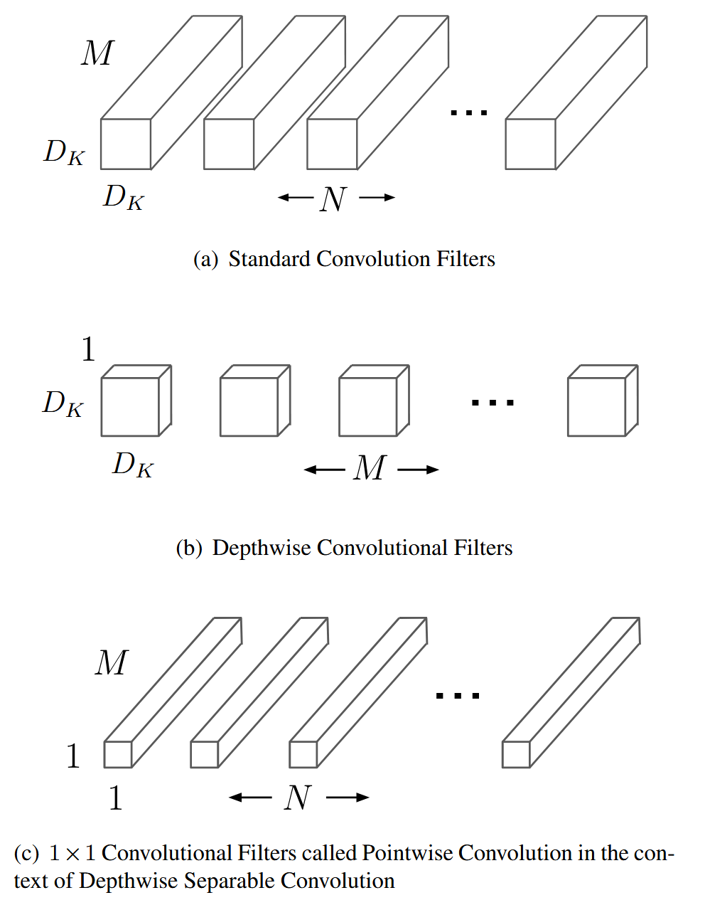
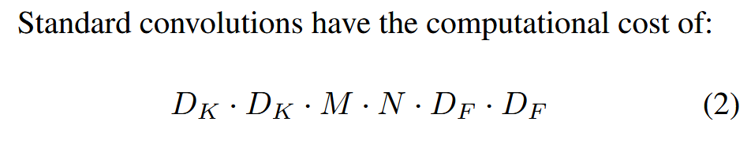
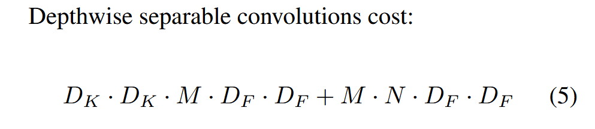
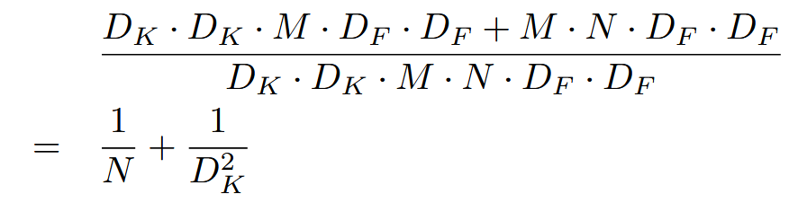
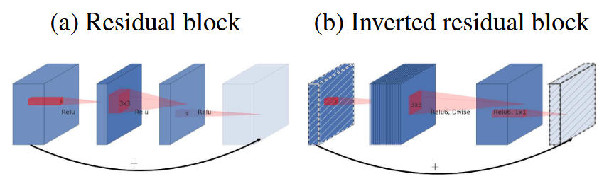
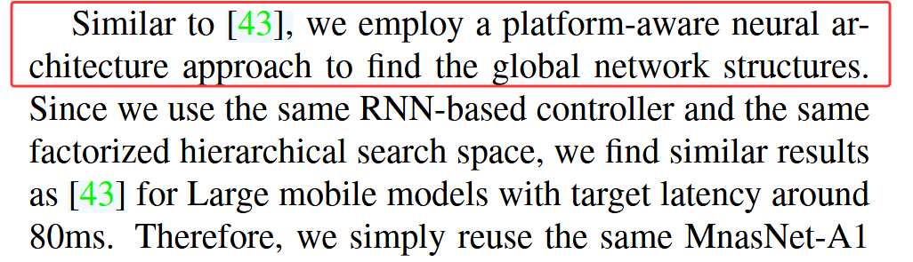
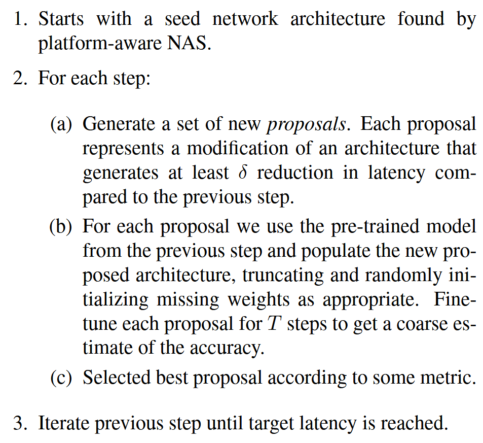
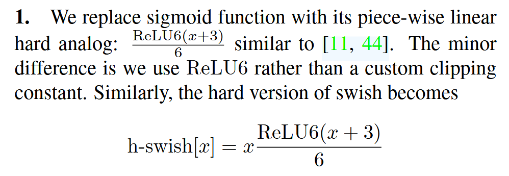

# MobileNet：MobileNets（V1）→ MobileNetV2 → Searching for MobileNetV3 演进笔记

**出处会议：** MobileNetV1（MobileNets）: arXiv 2017（arXiv:1704.04861，v1 2017-04-17，abs 页无 Comments 收录标注）；MobileNetV2: CVPR 2018（arXiv:1801.04381，v1 2018-01-13 / v4 2019-03-21；**abs 页无 Comments 字段**，"CVPR 2018" 出处来自任务给定信息，本次未在 arXiv 页面核对到收录标注）；MobileNetV3（Searching for MobileNetV3）: ICCV 2019（arXiv:1905.02244，v1 2019-05-06 / v5 2019-11-20，abs 页 Comments 栏为 "ICCV 2019"，已核对）
**是否开源：** V1 论文全文未见代码 URL，仅 §5 称 "we plan on releasing models in Tensor Flow."（V1 §5）；V2 论文 §1 称官方实现 "available as part of TensorFlow-Slim model library"，其参考文献 [4] 给出 URL https://github.com/tensorflow/models/tree/master/research/slim/nets/mobilenet（V1/V2 同库，本笔记未访问该仓库核对内容）；V3 摘要称 "we create two new MobileNet models for release"，但全文未给出代码 URL（本次抓取未见）
**关键词：** depthwise separable convolution（深度可分离卷积）、width multiplier / resolution multiplier、inverted residual（倒残差）、linear bottleneck（线性瓶颈）、expansion factor、SSDLite、Mobile DeepLabv3、hardware-aware NAS（MnasNet）、NetAdapt、h-swish、squeeze-and-excitation（SE）、LR-ASPP

> 草稿来源说明：正文数字、表格行、英文引句均取自本次（2026-11-02）实际抓取的 arXiv abs 页与 ar5iv 全文 HTML。**标题核对：三篇全部通过，逐字符一致**——V1 abs 页 `<title>`/`citation_title` 与 ar5iv `<h1>` 均为 "MobileNets: Efficient Convolutional Neural Networks for Mobile Vision Applications"；V2 均为 "MobileNetV2: Inverted Residuals and Linear Bottlenecks"；V3 均为 "Searching for MobileNetV3"。三篇全部采用，无弃用篇目。
>
> **版本警示（重要）**：ar5iv 页面不标注所渲染的 arXiv 版本号（LaTeXML oxide 0.7.5，URL 不带版本后缀）。本次将 ar5iv 摘要与 arXiv abs 页（各版本）逐一比对后发现：**V2、V3 的 ar5iv 摘要与 arXiv 全部已发布版本（V3 v1–v5、V2 v1–v4）的 abs 页摘要不一致**——V3 ar5iv 摘要写 "reducing latency by 20%" 与 "6.6% more accurate"，而 abs 页摘要（v1 至 v5 一致）写 "15\%" 与 "4.6\%"（反斜杠为 abs 页元数据原样）；V2 ar5iv 摘要写 "inverted residual structure where the shortcut connections are between the thin bottleneck layers"，而 abs 页摘要同位置写 "inverted residual structure where the input and output of the residual block are thin bottleneck layers"（两处均实际抓取）。即 ar5iv 渲染来源无法对应到任何单一 arXiv 版本，本笔记正文引句一律按 ar5iv 渲染转写并如此标注，摘要引句标注其出自 abs 页还是 ar5iv。需要严格对版时请以 arXiv PDF 复核（见文末遗留问题 1/2）。
>
> 引用约定：英文引句先在 ar5iv 原始 HTML 的归一化文本（剔除标签、数学取 alttext、空白折叠）中逐条脚本核验命中后写入，成稿后再反向抽取笔记内全部英文引句复核（153 处全部命中）；跨行内标签处引句为连续片段，不保留标签边界空格；数学公式从 alttext 逐字转写（个别展示公式仅去掉 alttext 的 `\displaystyle` 前缀）。V1/V2 的 ar5iv 正文引用文献去标签后呈 bibkey（如 "krizhevsky2012imagenet"、"liu2016ssd"、"MobilenetV1"），V3 呈数字编号且方括号内侧带空格（如 "[ 43 ]"），本笔记引句保留该形式照抄；标点紧随行内标签处产生的边界空格则按约定不保留。原文拼写/语法瑕疵以（原文如此）标注。表格 26 张全部从 ar5iv HTML 表格元素逐格提取（含 rowspan/colspan 展开）并以脚本与本笔记 markdown 表格逐格比对通过。抓取记录详见文末。

------

## 1. 概述

### 1.1 三部曲演进主线

三篇论文是同一批作者（Google）在 2017–2019 年对"移动端高效 CNN"的连续改造，每一代都明确声明以前一代为基座：

- **V1（2017）打地基**：提出 depthwise separable convolution 作为标准卷积的低成本替代，并用两个全局超参（width multiplier α、resolution multiplier ρ）做"精度—开销"旋钮。摘要（abs 页）："We present a class of efficient models called MobileNets for mobile and embedded vision applications."、"We introduce two simple global hyper-parameters that efficiently trade off between latency and accuracy."（V1 Abstract）
- **V2（2018）改块结构**：自述 "Our network design is based on MobileNetV1 MobilenetV1. It retains its simplicity and does not require any special operators while significantly improves its accuracy, achieving state of the art on multiple image classification and detection tasks for mobile applications."（V2 §2，bibkey 照抄）。贡献是把 bottleneck 设计成"先扩张后压缩"的倒残差块，并在窄层去掉非线性："Our main contribution is a novel layer module: the inverted residual with linear bottleneck."（V2 §1）
- **V3（2019）搜索+手工改造**：V3 在 related work 里对前两代的定位一句话讲清："MobileNetV1 [ 19 ] employs depthwise separable convolution to substantially improve computation efficiency. MobileNetV2 [ 39 ] expands on this by introducing a resource-efficient block with inverted residuals and linear bottlenecks."（V3 §2，编号及其空格照抄）。V3 自己的路径是 "hardware-aware network architecture search (NAS) complemented by the NetAdapt algorithm and then subsequently improved through novel architecture advances"（V3 Abstract，ar5iv），具体四件事："we introduce (1) complementary search techniques, (2) new efficient versions of nonlinearities practical for the mobile setting, (3) new efficient network design, (4) a new efficient segmentation decoder."（V3 §1）

贯穿三代的评价主线（论文声称，尚未独立验证）：同样的"depthwise separable + 窄 bottleneck"骨架下，V2 用块结构改造把 ImageNet top-1 从 70.6 提到 72.0 且 MAdds 从 569M 降到 300M（V1 Table 6 / V2 Table 4），V3 再靠搜索+改造提到 75.2 / 219M（V3 Table 3）。

### 1.2 主要结果速览（本笔记自制汇总，非论文原表；数字逐项出自下文引用的原表）

| 代 | 块结构 | 缩放/搜索手段 | ImageNet top-1（1.0 倍） | MAdds | 参数 | 出处 locator |
|---|---|---|---|---|---|---|
| V1 | depthwise separable conv | α ∈ {1, 0.75, 0.5, 0.25}、分辨率 {224,192,160,128} 手选 | 70.6% | 569M Mult-Adds | 4.2M | V1 Table 6 |
| V2 | + inverted residual + linear bottleneck（t=6） | 同 V1 思路：分辨率 96–224、width 0.35–1.4 | 72.0 | 300M | 3.4M | V2 Table 4 |
| V3 | + SE + h-swish + 重设计首尾层；块结构由 NAS+NetAdapt 搜索 | platform-aware NAS + NetAdapt（latency 目标约束） | 75.2 | 219 | 5.4M | V3 Table 3 |

------

## 2. 方法

### 2.1 MobileNetV1（arXiv 2017）：depthwise separable convolution + 两个全局缩放超参

#### 2.1.1 Depthwise Separable Convolution（V1 §3.1）

V1 的出发点是精度竞赛没有顾及效率："However, these advances to improve accuracy are not necessarily making networks more efficient with respect to size and speed."（V1 §1）。核心构件定义："The MobileNet model is based on depthwise separable convolutions which is a form of factorized convolutions"——把标准卷积拆成逐通道滤波的 depthwise 卷积和做线性组合的 1×1 pointwise 卷积两层（V1 §3.1）。

*图：V1 Figure 2——(a) 标准卷积滤波器、(b) depthwise 滤波器、(c) 1×1 pointwise 滤波器（素材 `library/assets/MobileNet/Figure_DWPW.png`，论文原文截图；已于入库时逐张查看图片内容核对，图中 (a)(b)(c) 小标题与论文 Figure 2 一致）。*

记号与开销（V1 §3.1，式 (2)/(4)/(5)，alttext 转写）：标准卷积计算量

$$D_{K}\cdot D_{K}\cdot M\cdot N\cdot D_{F}\cdot D_{F} \tag{V1 式2}$$

*图：V1 §3.1 原文截图——"Standard convolutions have the computational cost of:" 即式 (2)（素材 `library/assets/MobileNet/Figure_StandardConvCost.png`；已于入库时查看图片内容核对，截图内公式号 (2) 与本笔记 locator 一致）。*

depthwise 卷积计算量 $D_{K}\cdot D_{K}\cdot M\cdot D_{F}\cdot D_{F}$（V1 式4），depthwise separable 合计

$$D_{K}\cdot D_{K}\cdot M\cdot D_{F}\cdot D_{F}+M\cdot N\cdot D_{F}\cdot D_{F} \tag{V1 式5}$$

*图：V1 §3.1 原文截图——"Depthwise separable convolutions cost:" 即式 (5)（素材 `library/assets/MobileNet/Figure_SeparableConvCost.png`；已于入库时查看图片内容核对，截图内公式号 (5) 与本笔记 locator 一致）。*

"By expressing convolution as a two step process of filtering and combining we get a reduction in computation of:" $\frac{1}{N}+\frac{1}{D_{K}^{2}}$（V1 §3.1，式 (5) 下方；原 alttext 带 \displaystyle 前缀）。因此 "MobileNet uses $3\times 3$ depthwise separable convolutions which uses between 8 to 9 times less computation than standard convolutions"（V1 §3.1，"8 to 9 times" 原文如此）。作者强调分工："Depthwise convolution is extremely efficient relative to standard convolution. However it only filters input channels, it does not combine them to create new features."（V1 §3.1）

*图：V1 §3.1 原文截图——计算量约简比 $(D_K D_K M D_F D_F + M N D_F D_F)/(D_K D_K M N D_F D_F) = 1/N + 1/D_K^2$（素材 `library/assets/MobileNet/Figure_ReductionAmount.png`；已于入库时查看图片内容核对，文件名以 Figure 开头但实为公式截图，按内容引用）。*

#### 2.1.2 网络结构与训练（V1 §3.2，Table 1 / Table 2）

"Counting depthwise and pointwise convolutions as separate layers, MobileNet has 28 layers."（V1 §3.2）首层为全卷积，下采样靠 strided depthwise："Down sampling is handled with strided convolution in the depthwise convolutions as well as in the first layer."（V1 §3.2）主体结构逐行照抄如下（Table 1，"MobileNet Body Architecture"）：

<!-- verbatim-table:V1-T1 -->

| Type / Stride | Filter Shape | Input Size |
|---|---|---|
| Conv / s2 | $3\times 3\times 3\times 32$ | $224\times 224\times 3$ |
| Conv dw / s1 | $3\times 3\times 32$ dw | $112\times 112\times 32$ |
| Conv / s1 | $1\times 1\times 32\times 64$ | $112\times 112\times 32$ |
| Conv dw / s2 | $3\times 3\times 64$ dw | $112\times 112\times 64$ |
| Conv / s1 | $1\times 1\times 64\times 128$ | $56\times 56\times 64$ |
| Conv dw / s1 | $3\times 3\times 128$ dw | $56\times 56\times 128$ |
| Conv / s1 | $1\times 1\times 128\times 128$ | $56\times 56\times 128$ |
| Conv dw / s2 | $3\times 3\times 128$ dw | $56\times 56\times 128$ |
| Conv / s1 | $1\times 1\times 128\times 256$ | $28\times 28\times 128$ |
| Conv dw / s1 | $3\times 3\times 256$ dw | $28\times 28\times 256$ |
| Conv / s1 | $1\times 1\times 256\times 256$ | $28\times 28\times 256$ |
| Conv dw / s2 | $3\times 3\times 256$ dw | $28\times 28\times 256$ |
| Conv / s1 | $1\times 1\times 256\times 512$ | $14\times 14\times 256$ |
| $5\times$ Conv dw / s1 | $3\times 3\times 512$ dw | $14\times 14\times 512$ |
| Conv / s1 | $1\times 1\times 512\times 512$ | $14\times 14\times 512$ |
| Conv dw / s2 | $3\times 3\times 512$ dw | $14\times 14\times 512$ |
| Conv / s1 | $1\times 1\times 512\times 1024$ | $7\times 7\times 512$ |
| Conv dw / s2 | $3\times 3\times 1024$ dw | $7\times 7\times 1024$ |
| Conv / s1 | $1\times 1\times 1024\times 1024$ | $7\times 7\times 1024$ |
| Avg Pool / s1 | Pool $7\times 7$ | $7\times 7\times 1024$ |
| FC / s1 | $1024\times 1000$ | $1\times 1\times 1024$ |
| Softmax / s1 | Classifier | $1\times 1\times 1000$ |

计算放在哪一层是 V1 明确的部署论点："It is not enough to simply define networks in terms of a small number of Mult-Adds."——"Our model structure puts nearly all of the computation into dense $1\times 1$ convolutions."，而 "$1\times 1$ convolutions do not require this reordering in memory and can be implemented directly with GEMM which is one of the most optimized numerical linear algebra algorithms."（V1 §3.2）原文（"it’s" 原文如此）："MobileNet spends $95\%$ of it’s computation time in $1\times 1$ convolutions which also has $75\%$ of the parameters as can be seen in Table 2"（V1 §3.2）。Table 2（Resource Per Layer Type）逐行照抄：

<!-- verbatim-table:V1-T2 -->

| Type | Mult-Adds | Parameters |
|---|---|---|
| Conv $1\times 1$ | 94.86% | 74.59% |
| Conv DW $3\times 3$ | 3.06% | 1.06% |
| Conv $3\times 3$ | 1.19% | 0.02% |
| Fully Connected | 0.18% | 24.33% |

训练（V1 §3.2）：TensorFlow + RMSprop 异步梯度下降；"we use less regularization and data augmentation techniques because small models have less trouble with overfitting"（V1 §3.2）；"Additionally, we found that it was important to put very little or no weight decay (l2 regularization) on the depthwise filters since their are so few parameters in them."（V1 §3.2，"their are" 原文如此）

#### 2.1.3 Width Multiplier α 与 Resolution Multiplier ρ（V1 §3.3 / §3.4）

"The role of the width multiplier $\alpha$ is to thin a network uniformly at each layer."（V1 §3.3）输入/输出通道同乘 α 后，depthwise separable 计算量为

$$D_{K}\cdot D_{K}\cdot\alpha M\cdot D_{F}\cdot D_{F}+\alpha M\cdot\alpha N\cdot D_{F}\cdot D_{F} \tag{V1 式6}$$

"where $\alpha\in(0,1]$ with typical settings of 1, 0.75, 0.5 and 0.25."（V1 §3.3）"Width multiplier has the effect of reducing computational cost and the number of parameters quadratically by roughly $\alpha^{2}$"（V1 §3.3）。

第二个超参作用在输入分辨率上："where $\rho\in(0,1]$ which is typically set implicitly so that the input resolution of the network is 224, 192, 160 or 128."（V1 §3.4）"Resolution multiplier has the effect of reducing computational cost by $\rho^{2}$."（V1 §3.4）两项叠加后的核心层计算量：

$$D_{K}\cdot D_{K}\cdot\alpha M\cdot\rho D_{F}\cdot\rho D_{F}+\alpha M\cdot\alpha N\cdot\rho D_{F}\cdot\rho D_{F} \tag{V1 式7}$$

Table 3 给出一个内部层（$D_K=3, M=512, N=512, D_F=14$）逐级收紧的累计效果，逐行照抄（两行表头照原表拆行）：

<!-- verbatim-table:V1-T3 -->

| Layer/Modification | Million | Million |
|---|---|---|
|  | Mult-Adds | Parameters |
| Convolution | 462 | 2.36 |
| Depthwise Separable Conv | 52.3 | 0.27 |
| $\alpha=0.75$ | 29.6 | 0.15 |
| $\rho=0.714$ | 15.1 | 0.15 |

### 2.2 MobileNetV2（CVPR 2018）：linear bottleneck + inverted residual

#### 2.2.1 基座复用（V2 §3.1）

V2 直接继承 V1 构件并复述其收益："MobileNetV2 uses $k=3$ ( $3\times 3$ depthwise separable convolutions) so the computational cost is $8$ to $9$ times smaller than that of standard convolutions at only a small reduction in accuracy"（V2 §3.1，句末引文键 MobilenetV1 略去）。separable 卷积计算量 $h_{i}\cdot w_{i}\cdot d_{i}(k^{2}+d_{j})$（V2 式1），相对标准卷积 "reduces computation compared to traditional layers by almost a factor of" $k^2$，"more precisely, by a factor $k^{2}d_{j}/(k^{2}+d_{j})$."（V2 §3.1）

#### 2.2.2 Linear Bottlenecks（V2 §3.2）

V2 的理论出发点是"interest manifold 低维可嵌入 + ReLU 在低维上不可逆地丢信息"："However, this intuition breaks down when we recall that deep convolutional neural networks actually have non-linear per coordinate transformations, such as" ReLU（V2 §3.2）。核心论断："deep networks only have the power of a linear classifier on the non-zero volume part of the output domain."（V2 §3.2）由此给出两条性质（V2 §3.2 列表）：若 ReLU 变换后 manifold 仍非零体积，则对应线性变换；ReLU 能完整保留输入 manifold 信息的前提是它位于激活空间的低维子空间。设计推论："we can capture this by inserting linear bottleneck layers into the convolutional blocks."（V2 §3.2）实证预告："we show empirically that using non-linear layers in bottlenecks indeed hurts the performance by several percent, further validating our hypothesis"（V2 §3.2）。术语定义："We will refer to the ratio between the size of the input bottleneck and the inner size as the expansion ratio"（V2 §3.2）。

#### 2.2.3 Inverted residuals（V2 §3.3）

与经典残差"两头宽中间窄"相反，V2 把 shortcut 接在两个窄 bottleneck 之间："However, inspired by the intuition that the bottlenecks actually contain all the necessary information, while an expansion layer acts merely as an implementation detail that accompanies a non-linear transformation of the tensor, we use shortcuts directly between the bottlenecks."（V2 §3.3）代价收益："However, the inverted design is considerably more memory efficient (see Section 4 for details), as well as works slightly better in our experiments."（V2 §3.3）开销公式：对 $h\times w$ 块、扩张率 $t$、核 $k$、输入/输出通道 $d'/d''$，"the total number of multiply add required is"（"multiply add" 原文如此）

$$h\cdot w\cdot d^{\prime}\cdot t(d^{\prime}+k^{2}+d^{\prime\prime})$$

（V2 §3.3，式 (1) 下方段落）。块的三个算子构成 $\mathcal{F}(x)=[A\circ\mathcal{N}\circ B]x$，其中 $\mathcal{N}=\operatorname{ReLU6}\circ\operatorname{dwise}\circ\operatorname{ReLU6}$（V2 §5.1）。

*图：V2 Figure 3——(a) residual block（两头宽中间窄）vs (b) inverted residual block（shortcut 接两个窄 bottleneck，先 1×1 扩张、3×3 depthwise、再线性 1×1 投影）（素材 `library/assets/MobileNetV2/inres.png`，论文原文截图；已于入库时查看图片内容核对，图中 (a)(b) 小标题与论文 Figure 3 一致）。*

#### 2.2.4 网络结构与开销（V2 §4，Table 1 / Table 2）

"The architecture of MobileNetV2 contains the initial fully convolution layer with $32$ filters, followed by $19$ residual bottleneck layers described in the Table 2"（V2 §4，"the Table 2" 原文如此）。非线性沿用 V1："We use ${\operatorname{\mathop{ReLU6}\,}}$ as the non-linearity because of its robustness when used with low-precision computation"（V2 §4；ReLU6 在原文为行内公式，alttext 逐字转写）。扩张率固定："For all our main experiments we use expansion factor of $6$ applied to the size of the input tensor."（V2 §4）并且 "In our experiments we find that expansion rates between $5$ and $10$ result in nearly identical performance curves, with smaller networks being better off with slightly smaller expansion rates and larger networks having slightly better performance with larger expansion rates."（V2 §4）

bottleneck 块定义（Table 1）逐行照抄：

<!-- verbatim-table:V2-T1 -->

| Input | Operator | Output |
|---|---|---|
| $h\times w\times k$ | 1x1 $\operatorname{\mathop{conv2d}\,}$ , $\operatorname{\mathop{ReLU6}\,}$ | $h\times w\times(tk)$ |
| $h\times w\times tk$ | 3x3 $\operatorname{\mathop{dwise}\,}$ s= $s$ , $\operatorname{\mathop{ReLU6}\,}$ | $\frac{h}{s}\times\frac{w}{s}\times(tk)$ |
| $\frac{h}{s}\times\frac{w}{s}\times tk$ | linear 1x1 $\operatorname{\mathop{conv2d}\,}$ | $\frac{h}{s}\times\frac{w}{s}\times k^{\prime}$ |

整体架构（Table 2）逐行照抄（注意 $t=1$ 只出现在首个 bottleneck，其余均为 $t=6$；最后一行 stride 列原表为空）：

<!-- verbatim-table:V2-T2 -->

| Input | Operator | $t$ | $c$ | $n$ | $s$ |
|---|---|---|---|---|---|
| $224^{2}\times 3$ | conv2d | - | 32 | 1 | 2 |
| $112^{2}\times 32$ | bottleneck | 1 | 16 | 1 | 1 |
| $112^{2}\times 16$ | bottleneck | 6 | 24 | 2 | 2 |
| $56^{2}\times 24$ | bottleneck | 6 | 32 | 3 | 2 |
| $28^{2}\times 32$ | bottleneck | 6 | 64 | 4 | 2 |
| $14^{2}\times 64$ | bottleneck | 6 | 96 | 3 | 1 |
| $14^{2}\times 96$ | bottleneck | 6 | 160 | 3 | 2 |
| $7^{2}\times 160$ | bottleneck | 6 | 320 | 1 | 1 |
| $7^{2}\times 320$ | conv2d 1x1 | - | 1280 | 1 | 1 |
| $7^{2}\times 1280$ | avgpool 7x7 | - | - | 1 | - |
| $1\times 1\times 1280$ | conv2d 1x1 | - | k | - |  |

缩放超参沿用 V1："As in MobilenetV1 we tailor our architecture to different performance points, by using the input image resolution and width multiplier as tunable hyper parameters"（V2 §4）。基线规模："Our primary network (width multiplier $1$ , $224\times 224$ ), has a computational cost of 300 million multiply-adds and uses 3.4 million parameters."（V2 §4）与 V1 的一处实现差异："for multipliers less than one, we apply width multiplier to all layers except the very last convolutional layer."（V2 §4，"with MobilenetV1 is that" 句式照原文）

#### 2.2.5 内存高效推理（V2 §5.1）

"The inverted residual bottleneck layers allow a particularly memory efficient implementation which is very important for mobile applications."（V2 §5.1）把整个 bottleneck 块视为单算子时，推理内存由算子输入/输出张量之和决定（V2 式2）。技巧是按通道分块累加："by accumulating the sum, we only require one intermediate block of size $n/t$ to be kept in memory at all times."（V2 §5.1）"Using $n=t$ we end up having to keep only a single channel of the intermediate representation at all times."（V2 §5.1）启用条件与实测：该技巧 "most helpful to be used with $t$ being a small constant between $2$ and $5$"（V2 §5.1）。Table 3（各分辨率需物化的最大通道数/内存，Kb）逐行照抄：

<!-- verbatim-table:V2-T3 -->

| Size | MobileNetV1 | MobileNetV2 | ShuffleNet |
|---|---|---|---|
|  |  |  | (2x,g=3) |
| 112x112 | 64/1600 | 16/400 | 32/800 |
| 56x56 | 128/800 | 32/200 | 48/300 |
| 28x28 | 256/400 | 64/100 | 400/600K |
| 14x14 | 512/200 | 160/62 | 800/310 |
| 7x7 | 1024/199 | 320/32 | 1600/156 |
| 1x1 | 1024/2 | 1280/2 | 1600/3 |
| max | 1600K | 400K | 600K |

#### 2.2.6 SSDLite 与 Mobile DeepLabv3（V2 Abstract、§6.2、§6.3）

检测侧："SSDLite : In this paper, we introduce a mobile friendly variant of regular SSD."（V2 §6.2，"SSDLite :" 冒号前空格为 ar5iv 渲染）做法是 "We replace all the regular convolutions with separable convolutions (depthwise followed by $1\times 1$ projection) in SSD prediction layers."（V2 §6.2）。分割侧：摘要（abs 页）称 "Additionally, we demonstrate how to build mobile semantic segmentation models through a reduced form of DeepLabv3 which we call Mobile DeepLabv3."

### 2.3 MobileNetV3（ICCV 2019）：hardware-aware NAS + 手工网络改造

#### 2.3.1 Building blocks 回顾（V3 §3）

V3 的块 = MobileNetV2 倒残差 + MnasNet 式 SE + swish 系非线性。SE 位置沿用 MnasNet 的摆放："The module is placed after the depthwise filters in the expansion in order for attention to be applied on the largest representation as shown on Figure 4"（V3 §3）。非线性升级动机："Both squeeze and excitation as well as the swish nonlinearity use the sigmoid which can be inefficient to compute as well challenging to maintain accuracy in fixed point arithmetic so we replace this with the hard sigmoid"（V3 §3，"as well challenging" 原文如此）。

#### 2.3.2 两级搜索：platform-aware NAS + NetAdapt（V3 §4）

"For MobileNetV3 we use platform-aware NAS to search for the global network structures by optimizing each network block. We then use the NetAdapt algorithm to search per layer for the number of filters."（V3 §4）

- **块级搜索（V3 §4.1）**：沿用 MnasNet 的 RNN controller 与 factorized hierarchical search space，奖励函数为 $ACC(m)\times\left[LAT(m)/TAR\right]^{w}$（V3 §4.1）。针对小模型的修正："However, we observe the original reward design is not optimized for small mobile models."——"We observe that accuracy changes much more dramatically with latency for small models; therefore, we need a smaller weight factor $w=-0.15$ (vs the original $w=-0.07$ in [ 43 ]) to compensate for the larger accuracy change for different latencies."（V3 §4.1；方括号内侧空格为去标签渲染，照抄）。Large 模型直接复用搜索结果："Therefore, we simply reuse the same MnasNet-A1 [ 43 ] as our initial Large mobile model, and then apply NetAdapt [ 48 ] and other optimizations on top of it."（V3 §4.1，同上）

*图：V3 §4.1 原文截图——"Similar to [43], we employ a platform-aware neural architecture approach…" 段（沿用 MnasNet 的 RNN controller 与 factorized hierarchical search space；Large 档直接复用 MnasNet-A1）（素材 `library/assets/MobileV3/NAS.png`，论文正文文字截图而非论文插图；已于入库时查看图片内容核对，截图句子与本节引句一致）。*
- **层级搜索（V3 §4.2）**：NetAdapt 从 NAS 种子出发逐步剪层，V3 把选案指标改为 "We modify this algorithm and minimize the ratio between latency change and accuracy change."——即最大化 $\frac{\Delta\text{Acc}}{|\Delta\text{latency}|},$（V3 §4.2，逗号在 alttext 内照抄）。"The intuition is that because our proposals are discrete, we prefer proposals that maximize the slope of the trade-off curve."（V3 §4.2）两类候选："Reduce the size of any expansion layer;" 与 "Reduce bottleneck in all blocks that share the same bottleneck size - to maintain residual connections."（V3 §4.2 列表）超参："For our experiments we used $T=10000$ and find that while it increases the accuracy of the initial fine-tuning of the proposals, it does not however, change the final accuracy when trained from scratch."（V3 §4.2）"This process is repeated until the latency reaches its target, and then we re-train the new architecture from scratch."（V3 §4.2）

*图：V3 §4.2 原文截图——NetAdapt 算法步骤（seed network → 每步生成 proposals / 预训练权重截断微调 T 步 / 按指标选最优 → 迭代至目标时延）（素材 `library/assets/MobileV3/NetAdapt.png`，论文正文文字截图而非论文插图；已于入库时查看图片内容核对）。*

#### 2.3.3 Redesigning expensive layers（V3 §5.1）

尾部：V2 系网络在 pooling 前有 1×1 升维层，V3 把它移到 pooling 之后——"To reduce latency and preserve the high dimensional features, we move this layer past the final average pooling."，"This final set of features is now computed at 1x1 spatial resolution instead of 7x7 spatial resolution."（V3 §5.1）进而 "Once the cost of this feature generation layer has been mitigated, the previous bottleneck projection layer is no longer needed to reduce computation."（V3 §5.1）收益："The efficient last stage reduces the latency by 7 milliseconds which is 11% of the running time and reduces the number of operations by 30 millions MAdds with almost no loss of accuracy."（V3 §5.1，"30 millions" 原文如此）

头部："Current mobile models tend to use 32 filters in a full 3x3 convolution to build initial filter banks for edge detection. Often these filters are mirror images of each other."（V3 §5.1）"We were able to reduce the number of filters to 16 while maintaining the same accuracy as 32 filters using either ReLU or swish. This saves an additional 2 milliseconds and 10 million MAdds."（V3 §5.1）

#### 2.3.4 h-swish（V3 §5.2）

swish 定义（V3 §5.2）：$\operatorname{swish}x=x\cdot\operatorname{\sigma}(x)$。硬化的做法："We replace sigmoid function with its piece-wise linear hard analog:" $\frac{\operatorname{ReLU6}(x+3)}{6}$，于是

$$\operatorname{h-swish}[x]=x\frac{\operatorname{ReLU6}(x+3)}{6}$$

（V3 §5.2）。选择理由："Our choice of constants was motivated by simplicity and being a good match to the original smooth version."（V3 §5.2）三点部署收益：精度上 "we found hard-version of all these functions to have no discernible difference in accuracy, but multiple advantages from a deployment perspective"（V3 §5.2）；ReLU6 实现普及（"are available on virtually all software and hardware frameworks."，V3 §5.2）；量化友好——"in quantized mode, it eliminates potential numerical precision loss caused by different implementations of the approximate sigmoid."（V3 §5.2）。放置策略："Thus in our architectures we only use $\operatorname{h-swish}$ at the second half of the model."（V3 §5.2，引句跨行内公式按 ar5iv 拼合）

*图：V3 §5.2 原文截图——"We replace sigmoid function with its piece-wise linear hard analog: ReLU6(x+3)/6…" 与 h-swish[x] = x·ReLU6(x+3)/6 定义（素材 `library/assets/MobileV3/Figure_ActivationHSwish.png`，论文正文文字截图而非论文插图；已于入库时查看图片内容核对，截图公式与本节公式一致）。*

#### 2.3.5 Large squeeze-and-excite 与网络定义（V3 §5.3–5.4，Table 1 / Table 2）

SE 瓶颈从相对改为固定比例："Instead, we replace them all to fixed to be 1/4 of the number of channels in expansion layer."（V3 §5.3，"replace them all to fixed to be" 原文如此）"We find that doing so increases the accuracy, at the modest increase of number of parameters, and no discernible latency cost."（V3 §5.3）模型定义："The models are created through applying platform-aware NAS and NetAdapt for network search and incorporating the network improvements defined in this section."（V3 §5.4）

MobileNetV3-Large 规格（Table 1）逐行照抄（SE 列 "✓" 表示该块有 Squeeze-And-Excite；NL 列 HS=h-swish、RE=ReLU；NBN=no batch norm；逐字符照抄）：

<!-- verbatim-table:V3-T1 -->

| Input | Operator | exp size | $\#out$ | SE | NL | $s$ |
|---|---|---|---|---|---|---|
| $224^{2}\times 3$ | conv2d | - | 16 | - | HS | 2 |
| $112^{2}\times 16$ | bneck, 3x3 | 16 | 16 | - | RE | 1 |
| $112^{2}\times 16$ | bneck, 3x3 | 64 | 24 | - | RE | 2 |
| $56^{2}\times 24$ | bneck, 3x3 | 72 | 24 | - | RE | 1 |
| $56^{2}\times 24$ | bneck, 5x5 | 72 | 40 | ✓ | RE | 2 |
| $28^{2}\times 40$ | bneck, 5x5 | 120 | 40 | ✓ | RE | 1 |
| $28^{2}\times 40$ | bneck, 5x5 | 120 | 40 | ✓ | RE | 1 |
| $28^{2}\times 40$ | bneck, 3x3 | 240 | 80 | - | HS | 2 |
| $14^{2}\times 80$ | bneck, 3x3 | 200 | 80 | - | HS | 1 |
| $14^{2}\times 80$ | bneck, 3x3 | 184 | 80 | - | HS | 1 |
| $14^{2}\times 80$ | bneck, 3x3 | 184 | 80 | - | HS | 1 |
| $14^{2}\times 80$ | bneck, 3x3 | 480 | 112 | ✓ | HS | 1 |
| $14^{2}\times 112$ | bneck, 3x3 | 672 | 112 | ✓ | HS | 1 |
| $14^{2}\times 112$ | bneck, 5x5 | 672 | 160 | ✓ | HS | 2 |
| $7^{2}\times 160$ | bneck, 5x5 | 960 | 160 | ✓ | HS | 1 |
| $7^{2}\times 160$ | bneck, 5x5 | 960 | 160 | ✓ | HS | 1 |
| $7^{2}\times 160$ | conv2d, 1x1 | - | 960 | - | HS | 1 |
| $7^{2}\times 960$ | pool, 7x7 | - | - | - | - | 1 |
| $1^{2}\times 960$ | conv2d 1x1, NBN | - | 1280 | - | HS | 1 |
| $1^{2}\times 1280$ | conv2d 1x1, NBN | - | k | - | - | 1 |

MobileNetV3-Small 规格（Table 2）逐行照抄：

<!-- verbatim-table:V3-T2 -->

| Input | Operator | exp size | $\#out$ | SE | NL | $s$ |
|---|---|---|---|---|---|---|
| $224^{2}\times 3$ | conv2d, 3x3 | - | 16 | - | HS | 2 |
| $112^{2}\times 16$ | bneck, 3x3 | 16 | 16 | ✓ | RE | 2 |
| $56^{2}\times 16$ | bneck, 3x3 | 72 | 24 | - | RE | 2 |
| $28^{2}\times 24$ | bneck, 3x3 | 88 | 24 | - | RE | 1 |
| $28^{2}\times 24$ | bneck, 5x5 | 96 | 40 | ✓ | HS | 2 |
| $14^{2}\times 40$ | bneck, 5x5 | 240 | 40 | ✓ | HS | 1 |
| $14^{2}\times 40$ | bneck, 5x5 | 240 | 40 | ✓ | HS | 1 |
| $14^{2}\times 40$ | bneck, 5x5 | 120 | 48 | ✓ | HS | 1 |
| $14^{2}\times 48$ | bneck, 5x5 | 144 | 48 | ✓ | HS | 1 |
| $14^{2}\times 48$ | bneck, 5x5 | 288 | 96 | ✓ | HS | 2 |
| $7^{2}\times 96$ | bneck, 5x5 | 576 | 96 | ✓ | HS | 1 |
| $7^{2}\times 96$ | bneck, 5x5 | 576 | 96 | ✓ | HS | 1 |
| $7^{2}\times 96$ | conv2d, 1x1 | - | 576 | ✓ | HS | 1 |
| $7^{2}\times 576$ | pool, 7x7 | - | - | - | - | 1 |
| $1^{2}\times 576$ | conv2d 1x1, NBN | - | 1024 | - | HS | 1 |
| $1^{2}\times 1024$ | conv2d 1x1, NBN | - | k | - | - | 1 |

------

## 3. 实验

### 3.1 MobileNetV1（V1 §4）

**设计选择消融（V1 §4.1，Tables 4–5）**。depthwise separable vs 全卷积（Table 4 逐行照抄；正文句子 "was saving tremendously" 原文如此）：

<!-- verbatim-table:V1-T4 -->

| Model | ImageNet | Million | Million |
|---|---|---|---|
|  | Accuracy | Mult-Adds | Parameters |
| Conv MobileNet | 71.7% | 4866 | 29.3 |
| MobileNet | 70.6% | 569 | 4.2 |

正文（V1 §4.1）："In Table 4 we see that using depthwise separable convolutions compared to full convolutions only reduces accuracy by $1\%$ on ImageNet was saving tremendously on mult-adds and parameters."（原文如此）

窄模型 vs 浅模型（Table 5 逐行照抄；去掉了 14×14×512 的 5 层 separable filter 得到 Shallow）：

<!-- verbatim-table:V1-T5 -->

| Model | ImageNet | Million | Million |
|---|---|---|---|
|  | Accuracy | Mult-Adds | Parameters |
| 0.75 MobileNet | 68.4% | 325 | 2.6 |
| Shallow MobileNet | 65.3% | 307 | 2.9 |

正文（V1 §4.1）："We next show results comparing thinner models with width multiplier to shallower models using less layers."，结论 "Table 5 shows that at similar computation and number of parameters, that making MobileNets thinner is $3\%$ better than making them shallower."（双 "that" 原文如此；验算：68.4−65.3=+3.1，本笔记验算）

**两个超参的扫参（V1 §4.2，Tables 6–7）**。α 扫描（Table 6）："Accuracy drops off smoothly until the architecture is made too small at $\alpha=0.25$."（V1 §4.2）

<!-- verbatim-table:V1-T6 -->

| Width Multiplier | ImageNet | Million | Million |
|---|---|---|---|
|  | Accuracy | Mult-Adds | Parameters |
| 1.0 MobileNet-224 | 70.6% | 569 | 4.2 |
| 0.75 MobileNet-224 | 68.4% | 325 | 2.6 |
| 0.5 MobileNet-224 | 63.7% | 149 | 1.3 |
| 0.25 MobileNet-224 | 50.6% | 41 | 0.5 |

分辨率扫描（Table 7）：

<!-- verbatim-table:V1-T7 -->

| Resolution | ImageNet | Million | Million |
|---|---|---|---|
|  | Accuracy | Mult-Adds | Parameters |
| 1.0 MobileNet-224 | 70.6% | 569 | 4.2 |
| 1.0 MobileNet-192 | 69.1% | 418 | 4.2 |
| 1.0 MobileNet-160 | 67.2% | 290 | 4.2 |
| 1.0 MobileNet-128 | 64.4% | 186 | 4.2 |

**与大模型对比（V1 §4.2，Tables 8–9）**。正文（V1 §4.2）："MobileNet is nearly as accurate as VGG16 while being 32 times smaller and 27 times less compute intensive. It is more accurate than GoogleNet while being smaller and more than 2.5 times less computation."（验算：138/4.2≈32.9、15300/569≈26.9，本笔记验算，与正文 32/27 大体一致）

<!-- verbatim-table:V1-T8 -->

| Model | ImageNet | Million | Million |
|---|---|---|---|
|  | Accuracy | Mult-Adds | Parameters |
| 1.0 MobileNet-224 | 70.6% | 569 | 4.2 |
| GoogleNet | 69.8% | 1550 | 6.8 |
| VGG 16 | 71.5% | 15300 | 138 |

小模型档（V1 §4.2）："Reduced MobileNet is $4\%$ better than AlexNet krizhevsky2012imagenet while being $45\times$ smaller and $9.4\times$ less compute than AlexNet. It is also $4\%$ better than Squeezenet iandola2016squeezenet at about the same size and $22\times$ less computation."（bibkey 照抄）

<!-- verbatim-table:V1-T9 -->

| Model | ImageNet | Million | Million |
|---|---|---|---|
|  | Accuracy | Mult-Adds | Parameters |
| 0.50 MobileNet-160 | 60.2% | 76 | 1.32 |
| Squeezenet | 57.5% | 1700 | 1.25 |
| AlexNet | 57.2% | 720 | 60 |

**跨任务应用（V1 §4.3–4.7，数字均出自对应原表，此处仅散文摘录）**：Stanford Dogs 上 1.0 MobileNet-224 83.3% top-1（对比 Inception V3 84%，V1 Table 10）；地理定位以 MobileNet 重训 PlaNet，"The MobileNet model has only 13 million parameters with the usual 3 million for the body and 10 million for the final layer and 0.58 Million mult-adds."，"the MobileNet version delivers only slightly decreased performance compared to PlaNet despite being much more compact"（V1 §4.4； continent 档 79.3% 对 PlaNet 77.6%，V1 Table 11）；人脸属性蒸馏 "it achieves a similar mean average precision across attributes (mean AP) as the in-house while consuming only $1\%$ the Multi-Adds."（V1 §4.5；1.0 MobileNet-224 88.7% 对 Baseline 86.9%，V1 Table 12）；FaceNet 蒸馏最高 79.4%（1.0 MobileNet-160，V1 Table 14）。

**COCO 目标检测（V1 §4.6，Table 13）**："For both frameworks, MobileNet achieves comparable results to other networks with only a fraction of computational complexity and model size."（V1 §4.6）逐行照抄（mAP 为 COCO 主赛指标 AP@[0.50:0.05:0.95]；"deeplab-VGG" 行 Framework/Resolution 列原表为空）：

<!-- verbatim-table:V1-T13 -->

| Framework | Model | mAP | Billion | Million |
|---|---|---|---|---|
| Resolution |  |  | Mult-Adds | Parameters |
|  | deeplab-VGG | 21.1% | 34.9 | 33.1 |
| SSD 300 | Inception V2 | 22.0% | 3.8 | 13.7 |
|  | MobileNet | 19.3% | 1.2 | 6.8 |
| Faster-RCNN | VGG | 22.9% | 64.3 | 138.5 |
| 300 | Inception V2 | 15.4% | 118.2 | 13.3 |
|  | MobileNet | 16.4% | 25.2 | 6.1 |
| Faster-RCNN | VGG | 25.7% | 149.6 | 138.5 |
| 600 | Inception V2 | 21.9% | 129.6 | 13.3 |
|  | Mobilenet | 19.8% | 30.5 | 6.1 |

### 3.2 MobileNetV2（V2 §6）

**训练设置（V2 §6.1）**："We use the standard RMSPropOptimizer with both decay and momentum set to $0.9$."；weight decay 0.00004；"Following MobileNetV1 MobilenetV1 setup we use initial learning rate of $0.045$, and learning rate decay rate of $0.98$ per epoch."（bibkey 重复渲染照抄）；"We use 16 GPU asynchronous workers, and a batch size of $96$."（V2 §6.1）

**ImageNet 分类（V2 §6.1，Table 4）**——与 V1 同点对比（V2 引用 V1 的 70.6 与 V1 原表一致）：

<!-- verbatim-table:V2-T4 -->

| Network | Top 1 | Params | MAdds | CPU |
|---|---|---|---|---|
| MobileNetV1 | 70.6 | 4.2M | 575M | 113ms |
| ShuffleNet (1.5) | 71.5 | 3.4M | 292M | - |
| ShuffleNet (x2) | 73.7 | 5.4M | 524M | - |
| NasNet-A | 74.0 | 5.3M | 564M | 183ms |
| MobileNetV2 | 72.0 | 3.4M | 300M | 75ms |
| MobileNetV2 (1.4) | 74.7 | 6.9M | 585M | 143ms |

图注说明（Table 4）：CPU 时间为 Google Pixel 1 单大核（TF-Lite），"We do not report ShuffleNet numbers as efficient group convolutions and shuffling are not yet supported."（V2 Table 4 图注）

**COCO 检测（V2 §6.2，Tables 5–6）**。SSD vs SSDLite（均配 MobileNetV2、80 类预测；Table 5；"SSD liu2016ssd" bibkey 照抄）：

<!-- verbatim-table:V2-T5 -->

|  | Params | MAdds |
|---|---|---|
| SSD liu2016ssd | 14.8M | 1.25B |
| SSDLite | 2.1M | 0.35B |

整体检测对比（Table 6；输入 320×320；trainval35k 训练、test-dev 评测；Pixel 1 大核计时）：

<!-- verbatim-table:V2-T6 -->

| Network | mAP | Params | MAdd | CPU |
|---|---|---|---|---|
| SSD300 liu2016ssd | 23.2 | 36.1M | 35.2B | - |
| SSD512 liu2016ssd | 26.8 | 36.1M | 99.5B | - |
| YOLOv2 redmon2016yolo9000 | 21.6 | 50.7M | 17.5B | - |
| MNet V1 + SSDLite | 22.2 | 5.1M | 1.3B | 270ms |
| MNet V2 + SSDLite | 22.1 | 4.3M | 0.8B | 200ms |

正文（V2 §6.2）："MobileNetV2 SSDLite is not only the most efficient model, but also the most accurate of the three."——"Notably, MobileNetV2 SSDLite is $20\times$ more efficient and $10\times$ smaller while still outperforms YOLOv2 on COCO dataset."（验算：17.5B/0.8B≈21.9、50.7M/4.3M≈11.8，本笔记验算，与 20×/10× 量级一致）

**语义分割（V2 §6.3，Table 7）**。MobileNetV1/V2 + DeepLabv3 在 PASCAL VOC 2012 val（均 COCO 预训练）。观察（V2 §6.3 列表 c/e）："MobileNetV1 is already a powerful feature extractor and only requires about $4.9-5.7$ times fewer MAdds than ResNet-101 ResNet"（bibkey 照抄）；"(e) DeepLabv3 heads are computationally expensive and removing the ASPP module significantly reduces the MAdds with only a slight performance degradation."。on-device 候选："which attains $75.32\%$ mIOU and only requires $2.75$ B MAdds."（V2 §6.3）。表尾设计点：DeepLabv3 头搭在倒数第二特征图上（320 通道而非 1280），"require about $2.5$ times fewer operations than the MobileNetV1 counterparts"（V2 §6.3 列表 d）。逐行照抄（Network 列空格为原表 rowspan 展开；✓ 为原表符号）：

<!-- verbatim-table:V2-T7 -->

| Network | OS | ASPP | MF | mIOU | Params | MAdds |
|---|---|---|---|---|---|---|
| MNet V1 | 16 | ✓ |  | 75.29 | 11.15M | 14.25B |
|  | 8 | ✓ | ✓ | 78.56 | 11.15M | 941.9B |
| MNet V2* | 16 | ✓ |  | 75.70 | 4.52M | 5.8B |
|  | 8 | ✓ | ✓ | 78.42 | 4.52M | 387B |
| MNet V2* | 16 |  |  | 75.32 | 2.11M | 2.75B |
|  | 8 |  | ✓ | 77.33 | 2.11M | 152.6B |
| ResNet-101 | 16 | ✓ |  | 80.49 | 58.16M | 81.0B |
|  | 8 | ✓ | ✓ | 82.70 | 58.16M | 4870.6B |

**消融（V2 §6.4）**。倒残差的贡献："The new result reported in this paper is that the shortcut connecting bottleneck perform better than shortcuts connecting the expanded layers (see Figure 6(b) for comparison)."（V2 §6.4，"perform" 原文如此）。线性瓶颈的贡献："linear bottlenecks improve performance, providing support that non-linearity destroys information in low-dimensional space."（V2 §6.4；数值曲线在其 Figure 6(a)，ar5iv 未给数值表）

### 3.3 MobileNetV3（V3 §6）

**训练与测量（V3 §6.1）**：4×4 TPU Pod 同步训练，RMSProp momentum 0.9；"We use the initial learning rate of 0.1, with batch size 4096 (128 images per chip), and learning rate decay rate of 0.01 every 3 epochs."（V3 §6.1.1）。测量："We use single-threaded large core in all our measurements."（V3 §6.1.2）；"We contributed an atomic h-swish operator to tensorflow lite, and it is now default in the latest version."（V3 §6.1.2）

**分类（V3 §6.2，Table 3）**。"As can be seen on figure 1 our models outperform the current state of the art such as MnasNet [ 43 ], ProxylessNas [ 5 ] and MobileNetV2 [ 39 ]."（V3 §6.2；方括号内侧空格为去标签渲染，照抄）"We report the floating point performance on different Pixel phones in the table 3"（"the table 3" 原文如此）。逐行照抄（P-1/P-2/P-3 为 Pixel-1/2/3 大核单线程时延 ms）：

<!-- verbatim-table:V3-T3 -->

| Network | Top-1 | MAdds | Params | P-1 | P-2 | P-3 |
|---|---|---|---|---|---|---|
| V3-Large 1.0 | 75.2 | 219 | 5.4M | 51 | 61 | 44 |
| V3-Large 0.75 | 73.3 | 155 | 4.0M | 39 | 46 | 40 |
| MnasNet-A1 | 75.2 | 315 | 3.9M | 71 | 86 | 61 |
| Proxyless [ 5 ] | 74.6 | 320 | 4.0M | 72 | 84 | 60 |
| V2 1.0 | 72.0 | 300 | 3.4M | 64 | 76 | 56 |
| V3-Small 1.0 | 67.4 | 56 | 2.5M | 15.8 | 19.4 | 14.4 |
| V3-Small 0.75 | 65.4 | 44 | 2.0M | 12.8 | 15.6 | 11.7 |
| Mnas-small [ 43 ] | 64.9 | 65.1 | 1.9M | 20.3 | 24.2 | 17.2 |
| V2 0.35 | 60.8 | 59.2 | 1.6M | 16.6 | 19.6 | 13.9 |

multiplier vs 分辨率（V3 §6.2）："Note how MobileNetV3-Small outperforms the MobileNetV3-Large with multiplier scaled to match the performance by nearly 3%."；"resolution provides an even better trade-offs than multiplier"（"trade-offs" 原文如此）。

量化结果（Table 4 逐行照抄）：

<!-- verbatim-table:V3-T4 -->

| Network | Top-1 | P-1 | P-2 | P-3 |
|---|---|---|---|---|
| V3-Large 1.0 | 73.8 | 44 | 42.5 | 31.7 |
| V2 1.0 | 70.9 | 52 | 48.3 | 37.0 |
| V3-Small | 64.9 | 15.5 | 14.9 | 10.7 |
| V2 0.35 | 57.2 | 16.7 | 15.6 | 11.9 |

**非线性消融（V3 §6.2.1，Table 5）**。"It can be seen that using an optimized implementation of $\operatorname{h-swish}$ saves 6ms (more than $10\%$ of the runtime). Optimized $\operatorname{h-swish}$ only adds an additional 1ms compared to traditional ReLU."（V3 §6.2.1）。逐行照抄（h-swish@N 的 N 为首个启用 h-swish 的层的通道数；no-opt 为未优化实现）：

<!-- verbatim-table:V3-T5 -->

|  | Top-1 | P-1 | P-1 (no-opt) |
|---|---|---|---|
| V3-Large 1.0 | 75.2 | 51.4 | 57.5 |
| $\operatorname{ReLU}$ | 74.5 ( -.7% ) | 50.5 ( -1% ) | 50.5 |
| $\operatorname{h-swish}@16$ | 75.4 (+.2%) | 53.5 ( +4% ) | 68.9 |
| $\operatorname{h-swish}@112$ | 75.0 (-.3%) | 51 (-0.5%) | 54.4 |

**COCO 检测（V3 §6.3，Table 6）**。SSDLite 换 backbone；C4/C5 挂载与 V2 相同，另把 C4–C5 之间特征层通道数减半（†）："With the channel reduction, MobileNetV3-Large is $27\%$ faster than MobileNetV2 with near identical mAP."（验算：162→119 ms 即 −26.5%，本笔记验算）；"MobileNetV3-Small with channel reduction is also $2.4$ and $0.5$ mAP higher than MobileNetV2 and MnasNet while being $35\%$ faster."；"the channel reduction trick contributes to approximately $15\%$ latency reduction with no mAP loss, suggesting that Imagenet classification and COCO object detection may prefer different feature extractor shapes."（V3 §6.3，"Imagenet" 原文如此）。逐行照抄：

<!-- verbatim-table:V3-T6 -->

| Backbone | mAP | Latency (ms) | Params (M) | MAdds (B) |
|---|---|---|---|---|
| V1 | 22.2 | 228 | 5.1 | 1.3 |
| V2 | 22.1 | 162 | 4.3 | 0.80 |
| MnasNet | 23.0 | 174 | 4.88 | 0.84 |
| V3 | 22.0 | 137 | 4.97 | 0.62 |
| V3 † | 22.0 | 119 | 3.22 | 0.51 |
| V2 $0.35$ | 13.7 | 66 | 0.93 | 0.16 |
| V2 $0.5$ | 16.6 | 79 | 1.54 | 0.27 |
| MnasNet $0.35$ | 15.6 | 68 | 1.02 | 0.18 |
| MnasNet $0.5$ | 18.5 | 85 | 1.68 | 0.29 |
| V3-Small | 16.0 | 52 | 2.49 | 0.21 |
| V3-Small † | 16.1 | 43 | 1.77 | 0.16 |

**语义分割（V3 §6.4，Tables 7–8）**。提出 LR-ASPP：R-ASPP（V2 提出）只有 1×1 卷积 + 全局平均池化两个分支，"Lite R-ASPP, improving over R-ASPP, deploys the global-average pooling in a fashion similar to the Squeeze-and-Excitation module"——用大池化核大步长 + 仅一个 1×1 卷积；"We apply atrous convolution" 于 V3 末块提取稠密特征，"and further add a skip connection" 从低层特征补细节（V3 §6.4，引句为原文片段拼合）。Cityscapes（只用 fine 标注、从头训练、单尺度）："We think it is because the backbone is designed for 1000 classes ImageNet image classification"（V3 §6.4，承接"把末块通道减半掉点不大"的解释），"implying there is some channel redundancy in the backbone"（V3 §6.4）。

Cityscapes val（Table 7 逐行照抄；RF2=末块通道减半；SH=✓ 用 LR-ASPP、× 用 R-ASPP；F=分割头滤波数；CPU(f)/(h)=Pixel 3 大核全/半分辨率）：

<!-- verbatim-table:V3-T7 -->

| N | Backbone | RF2 | SH | F | mIOU | Params | MAdds | CPU (f) | CPU (h) |
|---|---|---|---|---|---|---|---|---|---|
| 1 | V2 | - | $\times$ | 256 | 72.84 | 2.11M | 21.29B | 3.90s | 1.02s |
| 2 | V2 | ✓ | $\times$ | 256 | 72.56 | 1.15M | 13.68B | 3.03s | 793ms |
| 3 | V2 | ✓ | ✓ | 256 | 72.97 | 1.02M | 12.83B | 2.98s | 786ms |
| 4 | V2 | ✓ | ✓ | 128 | 72.74 | 0.98M | 12.57B | 2.89s | 766ms |
| 5 | V3 | - | $\times$ | 256 | 72.64 | 3.60M | 18.43B | 3.55s | 906ms |
| 6 | V3 | ✓ | $\times$ | 256 | 71.91 | 1.76M | 11.24B | 2.60s | 668ms |
| 7 | V3 | ✓ | ✓ | 256 | 72.37 | 1.63M | 10.33B | 2.55s | 659ms |
| 8 | V3 | ✓ | ✓ | 128 | 72.36 | 1.51M | 9.74B | 2.47s | 657ms |
| 9 | V2 0.5 | ✓ | ✓ | 128 | 68.57 | 0.28M | 4.00B | 1.59s | 415ms |
| 10 | V2 0.35 | ✓ | ✓ | 128 | 66.83 | 0.16M | 2.54B | 1.27s | 354ms |
| 11 | V3-Small | ✓ | ✓ | 128 | 68.38 | 0.47M | 2.90B | 1.21s | 327ms |

图注明示 "Row 8, and 11 are our MobileNetV3 segmentation candidates."（Table 7 图注）

Cityscapes test（Table 8 逐行照抄）：

<!-- verbatim-table:V3-T8 -->

| Backbone | OS | mIOU | MAdds (f) | MAdds (h) | CPU (f) | CPU (h) |
|---|---|---|---|---|---|---|
| V3 | 16 | 72.6 | 9.74B | 2.48B | 2.47s | 657ms |
| V3 | 32 | 72.0 | 7.74B | 1.98B | 2.06s | 534ms |
| V3-Small | 16 | 69.4 | 2.90B | 0.74B | 1.21s | 327ms |
| V3-Small | 32 | 68.3 | 2.06B | 0.53B | 1.03s | 275ms |
| ESPNetv2 [ 32 ] | - | 66.2 | - | 2.7B | - | - |
| CCC2 [ 34 ] | - | 62.0 | - | 3.15B | - | - |
| ESPNetv1 [ 31 ] | - | 60.3 | - | 4.5B | - | - |

正文对比（V3 §6.4）："Our segmentation models with MobileNetV3 as network backbone outperforms ESPNetv2 [ 32 ], CCC2 [ 34 ], and ESPNetv1 [ 32 ] by 6.4%, 10.6%, 12.3%, respectively while being faster in terms of MAdds."（正文引用编号 " [ 32 ] " 同时对应 ESPNetv2 与 ESPNetv1，编号空格照抄；验算：72.6−66.2=6.4、72.6−62.0=10.6、72.6−60.3=12.3，本笔记验算一致）

**附录扫参（V3 Appendix A1，Table 9）**。不同分辨率/multiplier 的浮点性能逐行照抄（Madds 单位 M、P-1 单位 ms；注意 large 224/1.0 行 Madds 217 与正文 Table 3 的 219 不一致、small 224/1.0 行 Accuracy 67.5 与 Table 3 的 67.4 不一致，见遗留问题 3）：

<!-- verbatim-table:V3-T9 -->

| Network | Accuracy | Madds | Params | P-1 |
|---|---|---|---|---|
|  |  | (M) | (M) | (ms) |
| large 224/1.25 | 76.6 | 356 | 7.5 | 77.0 |
| large 224/1.0 | 75.2 | 217 | 5.4 | 51.2 |
| large 224/0.75 | 73.3 | 155 | 4.0 | 39.8 |
| large 224/0.5 | 68.8 | 69 | 2.6 | 21.7 |
| large 224/0.35 | 64.2 | 40 | 2.2 | 15.1 |
| large 256/1.0 | 76.0 | 282 | 5.4 | 65.6 |
| large 192/1.0 | 73.7 | 160 | 5.4 | 38.0 |
| large 160/1.0 | 71.7 | 112 | 5.4 | 27.8 |
| large 128/1.0 | 68.4 | 73 | 5.4 | 17.8 |
| large 96/1.0 | 63.3 | 43 | 5.4 | 12.5 |
| small 224/1.25 | 70.4 | 91 | 3.6 | 23.6 |
| small 224/1.0 | 67.5 | 57 | 2.5 | 15.8 |
| small 224/0.75 | 65.4 | 44 | 2.0 | 12.8 |
| small 224/0.5 | 58.0 | 21 | 1.6 | 7.7 |
| small 224/0.35 | 49.8 | 12 | 1.4 | 5.7 |
| small 256/1.0 | 68.5 | 74 | 2.5 | 20.0 |
| small 160/1.0 | 62.8 | 30 | 2.5 | 8.6 |
| small 128/1.0 | 57.3 | 20 | 2.5 | 5.8 |
| small 96/1.0 | 51.7 | 12 | 2.5 | 4.4 |

------

## 4. 核心结论

1. **演进主线（论文自述口径）**：V1 确立 depthwise separable convolution（8~9× 计算节省）+ 两个全局缩放超参；V2 保持骨架，把块改成"1×1 扩张（t=6）→ depthwise → 线性 1×1 投影、shortcut 接窄端"的倒残差线性瓶颈，换来同点 70.6→72.0 / 569M→300M MAdds / 4.2M→3.4M 参数与峰值物化内存 1600K→400K 通道（V1 Table 6、V2 Table 4、V2 Table 3）；V3 在 V2 块上加 SE（固定 1/4 扩张通道）、h-swish（后半段启用）、首尾层重设计，并把结构交给 platform-aware NAS + NetAdapt 搜索，达到 75.2 / 219M / 5.4M（V3 Table 3）。V3 的方法论自白："This paper starts the exploration of how automated search algorithms and network design can work together to harness complementary approaches improving the overall state of the art."（V3 Abstract，ar5iv）
2. **精度—开销快照（论文声称，尚未独立验证）**：分类 ImageNet top-1 70.6（V1-224，569M Mult-Adds）→ 72.0（V2-224，300M）→ 75.2（V3-Large，219M MAdds，P-1 51ms）；量化后 V3-Large 73.8 / 44ms（P-1）（V3 Table 4）。检测 SSDLite 骨架演进：V1 19.3% mAP / 1.2B（V1 Table 13，SSD 框架）→ MNet V2 + SSDLite 22.1 / 0.8B / 200ms（V2 Table 6）→ V3† 22.0 / 119ms / 0.51B（V3 Table 6，通道减半）。分割：V2 on-device 候选 75.32% mIOU / 2.75B（VOC，V2 Table 7）→ V3 LR-ASPP Cityscapes val 72.36 / 9.74B（Table 7 行 8）、test 72.6（Table 8）。
3. **部署相关结论**：V1 把 94.86% Mult-Adds 放进可用 GEMM 直算的 1×1 卷积（V1 Table 2）；V2 倒残差使推理内存只取决于 bottleneck 端而非扩张层（"never fully materializing large intermediate tensors"，V2 §1；分块累加可只驻留单通道，V2 §5.1）；V3 的 h-swish 用 ReLU6 分段线性实现，量化模式消除近似 sigmoid 的精度损失，TFLite 已收编原子算子（V3 §5.2、§6.1.2）。
4. **适用边界**：三代的数字都是各自论文在特定硬件口径（Pixel 1/2/3 大核单线程、TFLite）下的快照，跨论文时延不能直接混比（V1 用 TF-Lite Pixel 1 单核；V2 同；V3 加了 TFLite h-swish 优化算子，且自述 "we simply reuse the same MnasNet-A1 [ 43 ] as our initial Large mobile model"，V3 §4.1）；V1/V2 的 α/ρ 扫描显示精度随收缩平滑下降但在最小档（α=0.25）跳水（V1 Table 6、V1 §4.2）。

------

## 配图回填 TODO

- [x] 配图已回填（2026-11-03 入库）：三个既有素材目录共 8 张截图，逐张查看图片内容核对后嵌入正文——`library/assets/MobileNet/`：`Figure_DWPW.png` = V1 Figure 2（standard/depthwise/pointwise 滤波示意）、`Figure_StandardConvCost.png` = V1 式 (2) 截图、`Figure_SeparableConvCost.png` = V1 式 (5) 截图、`Figure_ReductionAmount.png` = V1 式 (5) 下方约简公式截图（文件名以 Figure 开头但实为公式截图，按内容引用）；`library/assets/MobileNetV2/`：`inres.png` = V2 Figure 3（residual vs inverted residual）；`library/assets/MobileV3/`：`NAS.png` = V3 §4.1 platform-aware NAS 段落截图、`NetAdapt.png` = V3 §4.2 NetAdapt 算法步骤截图、`Figure_ActivationHSwish.png` = V3 §5.2 h-swish 定义截图（后三张为正文文字截图而非论文插图，图注已如实标注）。
- [ ] 配图仍缺（不新建 assets 目录）：V2 Figure 4（四家卷积块对比）、V3 Figure 5（原始 vs 高效 last stage）、V3 Figure 6（sigmoid/swish 与 hard 版曲线对比）等论文原图未截图，留 TODO。

------

## 遗留问题（请调度班次转 QUESTIONS.md 或由人工决定）

1. **ar5iv 渲染版本无法确定且与 arXiv 各版摘要冲突（V2/V3）**：ar5iv 页面无版本标注；V3 的 ar5iv 摘要写 "reducing latency by 20%"、"6.6% more accurate"、"over 25% faster"、"34% faster"，与 arXiv v1–v5 全部 abs 页摘要（各版一致地写 "15\%"、"4.6\%"、"25\%"、"30\%"，反斜杠为 abs 页元数据原样）不一致；V2 的 ar5iv 摘要句式（"shortcut connections are between the thin bottleneck layers"）也与 v1–v4 abs 页摘要（"input and output of the residual block are thin bottleneck layers" 起句）不一致，即 ar5iv 来源无法对应任何已发布 arXiv 版本。本笔记正文引句按 ar5iv 转写、摘要引句按 abs 页转写并分别标注；若需严格对版（尤其 V3 摘要百分点与 ICCV 正式版），请以 arXiv PDF v5 / IEEE 版复核。
2. V3 摘要数字与 Table 3 的关系存在两套口径：按 Table 3 验算（本笔记验算），V3-Large 75.2 对 V2 72.0 为 +3.2 点、P-1 时延 64→51ms 为 −20.3%，与 ar5iv 摘要的 "3.2%" 与 "20%" 吻合；而 abs 页摘要写 "15\%"。V3-Small 的 abs 页摘要 "4.6\% more accurate"（并称时延降 "5\%"）同样无法由 Table 3 行直接得出；ar5iv 摘要则写 "6.6% more accurate compared to a MobileNetV2 model with comparable latency"，对应 V2 0.35 行 60.8→67.4 为 +6.6。两套口径哪套属于最终出版版，需人工比对 ICCV 正式版。
3. V3 论文内部数字不一致（均照抄）：Table 3 的 V3-Large 1.0 行 MAdds 219，对附录 Table 9 的 large 224/1.0 行 Madds 217；Table 3 的 V3-Small 1.0 行 Top-1 67.4，对 Table 9 的 small 224/1.0 行 Accuracy 67.5；Table 3 的 V3-Large 0.75 行 P-1 39，对 Table 9 的 large 224/0.75 行 P-1 39.8。疑为不同测量批次或舍入口径，需查证。
4. V2 收录信息：arXiv abs 页无 Comments 字段，"CVPR 2018" 仅来自任务给定信息（公开常识亦为 CVPR 2018），本次抓取未在 arXiv 页面内核对到。
5. 原文拼写/语法瑕疵（照抄不改）：V1 §4.1 全句见 §3.1 所引（"was saving tremendously" 处）；V1 §3.2 "of it’s computation time"（撇号为原文弯撇号）、"since their are so few parameters"；V2 §4 "described in the Table 2"、§6.2 "SSDLite : "（ar5iv 冒号前空格）；V3 §5.3 "we replace them all to fixed to be 1/4"、§6.2 "in the table 3"、"resolution provides an even better trade-offs than multiplier"。另 V3 §6.4 正文把 ESPNetv1 与 ESPNetv2 都引作 " [ 32 ] "（照抄）。
6. 三篇开源信息未访问代码仓库核对（V1 无 URL 只有计划句；V2 URL 出自其参考文献 [4]；V3 无 URL）。如需确凿的开源状态（仓库活跃度、许可证、模型权重是否齐），需另行核查。
7. 落位：已于 2026-11-03 经入库前逐字 QA 后写入 `library/Efficient_Backbone/MobileNet.md`（本班按主人授权新建 `library/Efficient_Backbone/` 目录，对应 TODO.md「高效骨干 / 压缩」组）；草稿保留于 `nightshift/drafts/MobileNet.md` 未删除。`library/assets/` 下 MobileNet、MobileNetV2、MobileV3 三个素材目录已按内容核对回填（见配图 TODO）。
8. 同一模型跨论文口径不一（QA 抽查时发现，两处均照抄未调和）：MobileNetV1 1.0-224 的 MAdds 在 V1 Table 6 作 569M，在 V2 Table 4 作 575M（同模型同分辨率）；引用时注意出处口径。

------

## 来源与抓取记录

- **MobileNetV1**
  - arXiv abs 页：https://arxiv.org/abs/1704.04861 （抓取 2026-11-02；`citation_title` = "MobileNets: Efficient Convolutional Neural Networks for Mobile Vision Applications"，与任务标题逐字符一致；作者 Howard/Zhu/Chen/Kalenichenko/Wang/Weyand/Andreetto/Adam（Google Inc.）；无 Comments 字段；提交历史仅 v1 2017-04-17）
  - ar5iv 全文：https://ar5iv.labs.arxiv.org/html/1704.04861 （抓取 2026-11-02；LaTeXML oxide 0.7.5；`<title>` 与 `<h1>` 同上；无版本标注）
- **MobileNetV2**
  - arXiv abs 页：https://arxiv.org/abs/1801.04381 （抓取 2026-11-02；`citation_title` = "MobileNetV2: Inverted Residuals and Linear Bottlenecks"，逐字符一致；作者 Sandler/Howard/Zhu/Zhmoginov/Chen（Google Inc.）；无 Comments 字段；v1 2018-01-13 / v2 2018-01-16 / v3 2018-04-02 / v4 2019-03-21；另抓取 v1/v2/v3 版 abs 页核对摘要：四版摘要一致）
  - ar5iv 全文：https://ar5iv.labs.arxiv.org/html/1801.04381 （抓取 2026-11-02；同上无版本标注；其摘要与 abs 页摘要不一致，见遗留问题 1）
- **MobileNetV3**
  - arXiv abs 页：https://arxiv.org/abs/1905.02244 （抓取 2026-11-02；`citation_title` = "Searching for MobileNetV3"，逐字符一致；作者 Howard/Sandler/Chu/Chen/Chen/Tan/Wang/Zhu/Pang/Vasudevan/Le/Adam（Google AI / Google Brain）；Comments = "ICCV 2019"；v1 2019-05-06 / v2 2019-05-14 / v3 2019-06-12 / v4 2019-08-24 / v5 2019-11-20；另抓取 v1–v4 版 abs 页核对摘要：五版摘要百分点一致（"MobileNetV2-Small is 4." 处笔误见 v1/v2，v3 起更正为 "MobileNetV3-Small is 4.6\% more accurate while reducing latency by 5\% compared to MobileNetV2."））
  - ar5iv 全文：https://ar5iv.labs.arxiv.org/html/1905.02244 （抓取 2026-11-02；同上无版本标注；其摘要百分点与 abs 页不一致，见遗留问题 1）
- **核验方式**：所有英文引句在对应 ar5iv HTML / abs 页的归一化文本中逐条脚本命中（正向清单 150 条 + 成稿后对笔记内 153 处英文引句反向复核，全部 PASS）后才写入；26 张表格全部从 ar5iv HTML `<table>` 元素逐格提取（含 rowspan/colspan 展开成矩形网格），并以脚本将提取网格与本笔记 markdown 表格逐格比对通过。
- 本地抓取产物（临时目录，未入库）：/tmp/mnv1_abs/abs.html、/tmp/mnv1_ar5iv/full.html（含 extracted.txt、tables.json）、/tmp/mnv2_abs/ 与 /tmp/mnv2_abs_v1|v2|v3/、/tmp/mnv2_ar5iv/、/tmp/mnv3_abs/ 与 /tmp/mnv3_abs_v1|v2|v3|v4/、/tmp/mnv3_ar5iv/；脚本：/tmp/mn_scripts/（extract.py、tables.py、verify_quotes.py、quotes.json、tables_md.txt、check_note.py）
- 入库：2026-11-03，经逐字 QA 后写入 `library/Efficient_Backbone/MobileNet.md`（草稿保留于 `nightshift/drafts/MobileNet.md` 未删除；上述 /tmp 抓取产物现已不在，未重抓）。
- 入库 QA 记录（2026-11-03）：英文引句 187 条（含重复出现共 200 处）经脚本验证在草稿文本中逐字存在（自洽检查；论文源核验于草稿创建时完成，见上）；8 处数字抽查与表格行一致——§1.2 汇总表 V1 70.6%/569M/4.2M = V1 Table 6 行、V2 72.0/300M/3.4M = V2 Table 4 行、V3 75.2/219/5.4M = V3 Table 3 行；V1 §4.1 1.1 差值（71.7−70.6）与 3% 差值（68.4−65.3=3.1）验算成立；V2 §6.2 "20× more efficient / 10× smaller" 与 V2 Table 6（17.5B/0.8B≈21.9、50.7M/4.3M≈11.8）同量级；V3 量化 73.8/44ms（P-1）= V3 Table 4 行；V3 Table 3 vs 附录 Table 9 的 219/217、67.4/67.5、39/39.8 自不一致已在遗留问题 3 记录；另发现 V1 Table 6 569M vs V2 Table 4 575M 跨论文口径差（遗留问题 8）。尚未经用户审阅。
