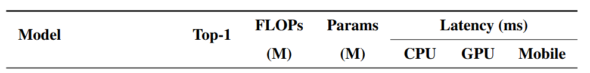
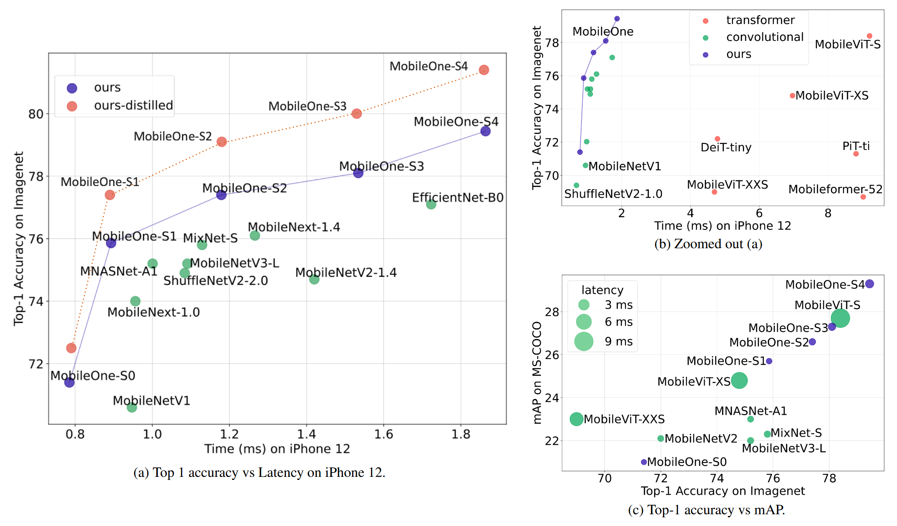

# MobileOne: An Improved One millisecond Mobile Backbone

**出处会议：** CVPR 2023（arXiv:2206.04040；v1 2022-06-08 / v2 2023-03-28，abs 页 Comments 字段 "Accepted at CVPR 2023"。作者 Pavan Kumar Anasosalu Vasu, James Gabriel, Jeff Zhu, Oncel Tuzel, Anurag Ranjan，Apple）  
**是否开源：** 官方开源（Abstract 末句明示 "Code and models are available at https://github.com/apple/ml-mobileone"；§1 另声称将发布训练模型与 iOS 基准应用；该 GitHub 仓库本次连通性确认 HTTP 200，2026-11-02）  
**关键词：** 移动端骨干网络（mobile backbone）、结构重参数化（structural re-parameterization）、平凡过参数化（trivial over-parameterization）、延迟-精度权衡、iPhone12 真机延迟基准、ImageNet / MS-COCO / Pascal-VOC / ADE20k

> **Locator 约定：** 本笔记章节号（§1–§5、Appendix A–F）、表号（Table 1–19）、图号（Figure 1–9）均指 arXiv:2206.04040 的 ar5iv HTML 版（https://ar5iv.labs.arxiv.org/html/2206.04040 ，抓取日期 2026-11-02；ar5iv 渲染对应 arXiv v2，内容与 CVPR 2023 接收版一致——abs 页 Comments 字段为证）。英文引号内文字为本次实际抓取的逐字原文；其中形如 `sandler2018mobilenetv2` 的小写键是 ar5iv 未解析的参考文献 cite 元素（正式版应为编号引用），按原样保留。正文与表格中的数学片段按 ar5iv 的 LaTeX alttext 以 `$...$` 转写（如 `$224\times 224$`、`$\bm{\mu}$`），与论文 LaTeX 源一致。ar5iv 把多行表头/跨行跨列单元格展平为逐行 `<tr>`，本笔记照抄展平结果并用空单元格补齐跨列占位（非空单元格逐字照抄）；原文粗体照抄；Table 4 源行末的 colspan 残留空列已省略。全部表格逐行、全部引文均经脚本对抓取文本逐字核验。所有数字均为论文声称。

---

## 1. 概述

MobileOne 要解决的问题：移动端高效网络普遍按 **FLOPs / 参数量** 优化，但这两个指标与**真机部署延迟**相关性差——FLOPs 不计内存访问成本（memory access cost）与并行度，参数共享、skip 连接、多分支等无参/少参结构反而推高访存开销（§1）。作者的做法是直接把一批 mobile-friendly 网络部署到 iPhone12（CoreML）实测延迟，从**架构**与**优化**两侧找瓶颈（§1）。

摘要自述（Abstract）：

> "To this end, we design an efficient backbone MobileOne, with variants achieving an inference time under 1 ms on an iPhone12 with 75.9% top-1 accuracy on ImageNet. We show that MobileOne achieves state-of-the-art performance within the efficient architectures while being many times faster on mobile."

（该 75.9% 即 MobileOne-S1：Table 9 中 S1 为 75.9 top-1 / 0.89ms Mobile 延迟。）

两条主线（§1）：

1. **架构侧**：推理期采用无分支、无 skip 连接的直筒前馈结构，降低访存成本，从而可以**放宽层宽**换取表征容量——"MobileOne-S1 has 4.8M parameters and incurs a latency of 0.89ms, while MobileNet-V2 sandler2018mobilenetv2 has 3.4M (29.2% less than MobileOne-S1) parameters and incurs a latency of 0.98ms. At this operating point, MobileOne attains 3.9% better top-1 accuracy than MobileNet-V2."（§1）；
2. **优化侧**：训练期引入线性过参数化分支、推理期重参数化折叠（承 RepVGG/DBBNet 一系），训练中**动态退火权重衰减**防止小模型过正则（§1）。

与其他重参数化工作的差异自述（§1）：

> "However, a key difference between our model and prior structural re-parameterization works is the introduction of trivial over-parameterization branches, which provides further improvements in low parameter regime and model scaling strategy."

论文声称的结果量级（Abstract / §1）：

- 最优模型与 MobileFormer 精度相当且快 38×（Abstract；§4：MobileFormer 79.3% @ 70.76ms vs MobileOne-S4 79.4% @ 1.86ms）；
- 同级延迟下比 EfficientNet-B0 高 2.3% top-1（Abstract；按 Table 9 为 S4 79.4 vs B0 77.1 的绝对差 2.3 个点，延迟 1.86 vs 1.72ms）；
- 检测：最佳变体超最佳 MobileViT 6.1%、超 MNASNet 27.8%（§1，相对提升，见 §3.3）；分割：VOC 超 MobileViT 1.3%、ADE20k 超 MobileNetV2 12.0%（§1，相对提升）。

四条贡献（§1）：① 提出 <1ms、高效架构族内 ImageNet 精度 SOTA 的 MobileOne（并泛化到桌面 CPU/GPU）；② 分析激活函数与分支结构在手机上的延迟开销；③ 分析训练期可重参数化分支 + 正则动态放松对优化瓶颈的缓解；④ 验证向目标检测、语义分割的泛化。

开源声明（§1）：

> "We will release our trained networks and code for research purposes. We will also release the code for iOS application to enable benchmarking of networks on iPhone."

---

## 2. 方法

### 2.1 延迟与 FLOPs/参数量的相关性（§3.1，Table 1）

流程（§3.1）：各模型 PyTorch 实现 → ONNX → Core ML Tools 转 coreml 包 → 自研 iOS 应用在 iPhone12 上测延迟。

结论自述（§3.1）：

> "We find that latency is moderately correlated with FLOPs and weakly correlated with parameter counts for efficient architectures on a mobile device. This correlation is even lower on a desktop CPU."

**Table 1: Spearman rank correlation coeff. between latency-flops.**（§3.1，逐行照抄）

| | **FLOPs** | | **Parameters** | |
| :--- | :--- | :--- | :--- | :--- |
| **Type** | **corr.** | **p-value** | **corr.** | **p-value** |
| **Mobile Latency** | 0.47 | 0.03 | 0.30 | 0.18 |
| **CPU Latency** | 0.06 | 0.80 | 0.07 | 0.77 |

（Table 1 原表首列跨两行、FLOPs/Parameters 各跨两列，HTML 展平后如上；表中 20 个模型见 §4 Table 9。）

### 2.2 两个瓶颈：激活函数与分支结构（§3.2，Table 2 / Table 3）

**激活函数**（§3.2）：用同一 30 层 CNN 只换激活函数，在 iPhone12 上实测：

> "All models in Table 2 have the same architecture except for activations, but their latencies are drastically different."

**Table 2: Comparison of latency on mobile device of different activation functions in a 30-layer convolutional neural network.**（§3.2，逐行照抄）

| **Activation Function** | **Latency (ms)** |
| :--- | ---: |
| ReLU agarap2018deep_relu | 1.53 |
| GELU hendrycks2016gelu | 1.63 |
| SE-ReLU hu2018senet | 2.10 |
| SiLU silu_2017_elfwing | 2.54 |
| Dynamic Shift-Max Li_2021_ICCV_micronet | 57.04 |
| DynamicReLU-A chen2020dynamic | 273.49 |
| DynamicReLU-B chen2020dynamic | 242.14 |

归因于同步开销（synchronization costs），结论（§3.2）：

> "Therefore we use only ReLU activations in MobileOne."

**分支结构**（§3.2）：多分支架构要把各分支激活都存下来再算下一张量，访存成本大增；SE 块里的全局池化强制同步（§3.2）：

> "Memory access cost increases significantly in multi-branch architectures as activations from each branch have to be stored to compute the next tensor in the graph."

**Table 3: Ablation on latency of different architectural blocks in a 30-layer convolutional neural network.**（§3.2，逐行照抄；原表首两行首列跨行、后三列跨行）

| **Architectural** | Baseline | + Squeeze | + Skip |
| :--- | :--- | :--- | :--- |
| **Blocks** | Excite hu2018senet | Connections He2015 | |
| **Latency (ms)** | 1.53 | 2.10 | 2.62 |

设计决策自述（§3.2）：

> "Therefore we adopt an architecture with no branches at inference, which results in smaller memory access cost. In addition, we limit the use of Squeeze-Excite blocks to our biggest variant in order to improve accuracy."

（即：推理期无分支；SE 只用在最大变体——Table 7 中仅 S4 的两个 stage 标注 SE-ReLU。）

### 2.3 MobileOne 块：训练期多分支，推理期单路（§3.3）

块结构（§3.3，Figure 3 跳过未抓）：基础块沿用 MobileNet-V1 的 3×3 depthwise 卷积 + 1×1 pointwise 卷积，加**带 BN 的可重参数化 skip 连接**，再加**复制同结构的分支**；"The trivial over-parameterization factor $k$ is a hyperparameter which is varied from 1 to 5."（§3.3，原句含 $ALT:k$ 标记，此处按转写约定剥去前缀）。推理期：

> "At inference, MobileOne model does not have any branches."

重参数化过程（§3.3，原文无编号公式，按 alttext 转写）：卷积+BN 均为线性，可折叠为单卷积

$$\widehat{\mathbf{W}}=\mathbf{W}^{\prime}*\frac{\bm{\gamma}}{\bm{\sigma}},\qquad \widehat{\mathbf{b}}=(\mathbf{b}^{\prime}-\bm{\mu})*\frac{\bm{\gamma}}{\bm{\sigma}}+\bm{\beta}$$

其中 $\mathbf{W}^{\prime}\in\mathbb{R}^{C_{out}\times C_{in}\times K\times K}$ 为卷积核、$\bm{\mu}/\bm{\sigma}/\bm{\gamma}/\bm{\beta}$ 为 BN 的累积均值/标准差/尺度/偏置；skip 分支的 BN 折叠到 identity 1×1 核并按 RepVGG 式做 $K-1$ 零填充；$M$ 个分支折叠后合并为

$$\mathbf{W}=\sum_{i}^{M}\widehat{\mathbf{W}}_{i},\qquad \mathbf{b}=\sum_{i}^{M}\widehat{\mathbf{b}}_{i}$$

**重参数化分支的收益消融**（§3.3，Table 5）：

**Table 5: Effect re-parametrizable branches on Top-1 ImageNet accuracy.**（逐行照抄）

| **Re-param.** | **MobileOne-S0** | **MobileOne-S1** | **MobileOne-S3** |
| :--- | ---: | ---: | ---: |
| **with** | 71.4 | 75.9 | 78.1 |
| **without** | 69.6 | 74.6 | 77.2 |

（三个变体分别 +1.8 / +1.3 / +0.9 个点；正文另称 Figure 4 显示加分支后训练/验证 loss 同时更低——Figure 4 caption："From no branches to adding re-parameterizable branches with $k$ =1, leads to 3.4% lower train loss. Adding more branches ( $k$ =4) lowers train loss by an additional $\sim$ 1%. From no branches to the variant with re-parameterizable branches ( $k$ =4), validation loss improves by 3.1%"。）

**平凡过参数化因子 k 的消融**（§3.3，Table 6）：

**Table 6: Comparison of Top-1 on ImageNet for various values of trivial over-parameterization factor $k$ .**（逐行照抄）

| **Model** | **Top-1** | | | | |
| :--- | :--- | :--- | :--- | :--- | :--- |
| | k=1 | k=2 | k=3 | k=4 | k-5 |
| MobileOne-S0 | 70.9 | 70.7 | 71.3 | 71.4 | 71.1 |
| MobileOne-S1 | 75.9 | 75.7 | 75.6 | 75.6 | 75.2 |

⚠ 原文表头末列为 "k-5"（应为 k=5，原文笔误，照抄）。正文结论（§3.3）："For larger variants of MobileOne, the improvements from trivial over-parameterization starts diminishing. For smaller variant like MobileOne-S0, we see improvements of 0.5% by using trivial over-parameterization branches."（S0 以 k=4 取 71.4，与 Table 7 中 S0 各 stage 取 k=4 一致。）

**与训练期过参数化工作对比**（§3.3，Table 4；参数量为推理期口径）：

**Table 4: Comparison of Top-1 Accuracy on ImageNet against recent train time over-parameterization works. Number of parameters listed above is at inference.**（逐行照抄，源行末 colspan 残留空列已省略）

| **Model** | **# Params.** | **Top-1** |
| :--- | ---: | ---: |
| ExpandNet-CL MobileNetV1 NEURIPS2020_expandnets | 4.2 | 69.4 |
| RepVGG-A0 Ding_2021_repvgg | 8.3 | 72.4 |
| RepVGG-A1 Ding_2021_repvgg | 12.8 | 74.5 |
| RepVGG-B0 Ding_2021_repvgg | 14.3 | 75.1 |
| ACNet MobileNetV1 Ding_2019_ICCV | 4.2 | 72.1 |
| ACNet ResNet18 Ding_2019_ICCV | 11.7 | 71.1 |
| DBBNet MobileNetV1 ding2021diverse | 4.2 | 72.9 |
| DBBNet ResNet18 ding2021diverse | 11.7 | 71.0 |
| **MobileOne-S0** | 2.1 | 71.4 |
| **MobileOne-S1** | 4.8 | 75.9 |
| **MobileOne-S2** | 7.8 | 77.4 |
| **MobileOne-S3** | 10.1 | 78.1 |
| **MobileOne-S4** | 14.8 | 79.4 |

模型缩放策略（§3.3 末）：深度缩放同 MobileNet-V2（早期大分辨率 stage 更浅）；引入 5 档宽度缩放（Table 7 的 $\alpha$）；**不放大输入分辨率**（FLOPs 与内存同涨，损移动端运行时）。推理期无分支带来的参数余量自述："This enables us to aggressively scale model parameters compared to competing multi-branched architectures like MobileNet-V2, EfficientNets, etc. without incurring significant latency cost."（§3.3）；"In Table 4, we compare against recent train time over-parameterization works Ding_2021_repvgg; ding2021diverse; Ding_2019_ICCV; NEURIPS2020_expandnets and show that MobileOne-S1 variant outperforms RepVGG-B0 which is $\sim$ 3 $\times$ bigger."（§3.3；4.8M vs 14.3M ≈ 3.0×。）

**网络规格**（§3.3，Table 7）：

**Table 7: MobileOne Network Specifications**（逐行照抄；原表 7 列表头中末列跨 5 子列，HTML 展平为 11 列，空占位已补齐）

| **Stage** | **Input** | **# Blocks** | **Stride** | **Block Type** | **# Channels** | **MobileOne Block Parameters ( $\alpha$ , $k$ , act=ReLU)** | | | | |
| :--- | :--- | :--- | :--- | :--- | :--- | :--- | :--- | :--- | :--- | :--- |
| | | | | | | **S0** | **S1** | **S2** | **S3** | **S4** |
| 1 | $224\times 224$ | 1 | 2 | MobileOne-Block | 64 $\times\alpha$ | (0.75, 4) | (1.5, 1) | (1.5, 1) | (2.0, 1) | (3.0, 1) |
| 2 | $112\times 112$ | 2 | 2 | MobileOne-Block | 64 $\times\alpha$ | (0.75, 4) | (1.5, 1) | (1.5, 1) | (2.0, 1) | (3.0, 1) |
| 3 | $56\times 56$ | 8 | 2 | MobileOne-Block | 128 $\times\alpha$ | (1.0, 4) | (1.5, 1) | (2.0, 1) | (2.5, 1) | (3.5, 1) |
| 4 | $28\times 28$ | 5 | 2 | MobileOne-Block | 256 $\times\alpha$ | (1.0, 4) | (2.0, 1) | (2.5, 1) | (3.0, 1) | (3.5, 1) |
| 5 | $14\times 14$ | 5 | 1 | MobileOne-Block | 256 $\times\alpha$ | (1.0, 4) | (2.0, 1) | (2.5, 1) | (3.0, 1) | (3.5, 1, SE-ReLU) |
| 6 | $14\times 14$ | 1 | 2 | MobileOne-Block | 512 $\times\alpha$ | (2.0, 4) | (2.5, 1) | (4.0, 1) | (4.0, 1) | (4.0, 1, SE-ReLU) |
| 7 | $7\times 7$ | 1 | 1 | AvgPool | - | - | - | - | - | - |
| 8 | $1\times 1$ | 1 | 1 | Linear | 512 $\times\alpha$ | 2.0 | 2.5 | 4.0 | 4.0 | 4.0 |

### 2.4 训练配方：退火权重衰减（§3.4，Table 8）

动机自述（§3.4）：

> "As opposed to large models, small models need less regularization to combat overfitting."

> "Instead of completely removing weight decay regularization as studied in time_matters_weightdecay, we find that annealing the loss incurred by weight decay regularization over the course of training is more effective."

具体做法（§3.4）：学习率用 cosine schedule，**同一 cosine 日程也用于退火权重衰减系数**；另采用 EfficientNetV2 式渐进学习课程（progressive learning）。

**Table 8: Ablation on various train settings for MobileOne-S2 showing Top-1 accuracy on ImageNet.**（逐行照抄；原表首两行前两列跨行跨列，HTML 展平如上）

| | **Baseline** | **+ Progressive** | **+ Annealing** | **+ EMA** |
| :--- | ---: | ---: | ---: | ---: |
| | | **Learning** | **Weight Decay** | |
| **Top-1** | 76.4 | 76.8 | 77.3 | 77.4 |

结论自述（§3.4）：

> "We see that annealing the weight decay coefficient gives a 0.5% improvement."

### 2.5 延迟测量协议（§3.5）

- iPhone 12 无命令行访问、无法独占计算资源、拿不到往返延迟分解（初始化/数据搬运/执行），故报告**完整 round-trip 延迟**（§3.5）；
- 自研 iOS 应用（Swift + Core ML），预热一次后连跑多次（默认 1000 次）累积统计；跑分时关闭手机上其他应用（§3.5）；
- 报告口径（§3.5）：

> "In order to filter out interrupts from other processes, we report the minimum latency for all the models."

- CPU：Ubuntu 桌面，2.3 GHz – Intel Xeon Gold 5118；GPU：NVIDIA TensorRT v8.0.1.6 编译，RTX-2080Ti，batch size 1，**100 次取中位数**（§3.5）；
- 附录补充：MobileNetV3 的 H-swish 为平台特定算子，测延迟时统一替换为 ReLU 后再测——"Therefore, while benchmarking for latency, we replace the H-swish layers with ReLU layers and then report the latency of MobileNetV3."（Appendix B）。

---

## 3. 实验

### 3.1 ImageNet-1K 分类（§4，Table 9）

训练配置（§4）：ImageNet 1.28M 训练图 / 5 万张验证图；PyTorch，8 卡，300 epochs，有效 batch 256，SGD with momentum；label smoothing 0.1；初始 LR 0.1 cosine 退火；初始权重衰减 $10^{-4}$ 退火到 $10^{-5}$（同一 cosine 日程）；AutoAugment 只用于 S2/S3/S4（强度与分辨率渐进增大，详见 Appendix C）；S0/S1 只用随机缩放裁剪 + 水平翻转；EMA 权重平均 decay 0.9995；测试分辨率 $224\times 224$；FLOPs 用 fvcore 统计。对比范围：同分辨率、参数量 <20M、**均不用蒸馏**的近期高效模型（§4）。

**Table 9: Performance of various models on ImageNet-1k validation set. Note: All results are without distillation for a fair comparison. Results are grouped based on latency on mobile device. Models which could not be reliably exported either by TensorRT or Core ML Tools are annotated by “-”.**（§4，逐行照抄；原表 Latency 列跨 CPU/GPU/Mobile 三子列）

*图：Table 9 表头原文截图——Model / Top-1 / FLOPs (M) / Params (M) / Latency (ms): CPU·GPU·Mobile（素材 `library/assets/MobileOne/Figure_ExperimentTableHeader.png`，论文原文截图；已于入库时查看图片内容核对，与本表列名一致）。*

| **Model** | **Top-1** | **FLOPs** | **Params** | **Latency (ms)** | | |
| :--- | ---: | ---: | ---: | ---: | ---: | ---: |
| | **(M)** | **(M)** | | **CPU** | **GPU** | **Mobile** |
| **Transformer Architectures** | | | | | | |
| Mobileformer-96 mobileformer_cvpr2022 | 72.8 | 96 | 4.6 | 37.36 | - | 16.95 |
| ConViT-tiny d2021convit | 73.1 | 1000 | 5.7 | 28.95 | - | 10.99 |
| MobileViT-S mobilevit_iclr2022 | 78.4 | 1792 | 5.6 | 30.76 | - | 9.21 |
| Mobileformer-52 mobileformer_cvpr2022 | 68.7 | 52 | 3.6 | 29.23 | - | 9.02 |
| PiT-ti heo2021pit | 71.3 | 710 | 4.9 | 16.37 | 1.97 | 8.81 |
| MobileViT-XS mobilevit_iclr2022 | 74.8 | 941 | 2.3 | 27.21 | - | 6.97 |
| DeiT-tiny Touvron_2021_ICCV | 72.2 | 1300 | 5.9 | 16.68 | 1.78 | 4.78 |
| MobileViT-XXS mobilevit_iclr2022 | 69.0 | 373 | 1.3 | 23.03 | - | 4.70 |
| **Convolutional Architectures** | | | | | | |
| RepVGG-B1 Ding_2021_repvgg | 78.4 | 11800 | 51.8 | 193.7 | 3.17 | 3.73 |
| RepVGG-A2 Ding_2021_repvgg | 76.5 | 5100 | 25.5 | 93.43 | 2.41 | 2.41 |
| **MobileOne-S4** | 79.4 | 2978 | 14.8 | 26.60 | **0.95** | **1.86** |
| RepVGG-B0 Ding_2021_repvgg | 75.1 | 3100 | 14.3 | 55.97 | 1.45 | 1.82 |
| EfficientNet-B0 efficientnet_v1_plmr | 77.1 | 390 | 5.3 | 28.71 | 1.35 | 1.72 |
| RepVGG-A1 Ding_2021_repvgg | 74.5 | 2400 | 12.8 | 47.15 | 1.42 | 1.68 |
| **MobileOne-S3** | 78.1 | 1896 | 10.1 | 16.47 | **0.76** | **1.53** |
| MobileNetV2-x1.4 sandler2018mobilenetv2 | 74.7 | 585 | 6.9 | 15.67 | 0.80 | 1.36 |
| RepVGG-A0 Ding_2021_repvgg | 72.4 | 1400 | 8.3 | 43.61 | 1.23 | 1.28 |
| MobileNeXt-x1.4 mobilenext_eccv2020 | 76.1 | 590 | 6.1 | 18.06 | 1.04 | 1.27 |
| **MobileOne-S2** | 77.4 | 1299 | 7.8 | 14.87 | **0.72** | **1.18** |
| MixNet-S mixconv_bmvc_2019 | 75.8 | 256 | 4.1 | 40.09 | 2.41 | 1.13 |
| MobileNetV3-L Howard2019MobilenetV3 | 75.2 | 219 | 5.4 | 17.09 | 3.8 | 1.09 |
| ShuffleNetV2-2.0 Ma_2018_shufflenetv2 | 74.9 | 591 | 7.4 | 20.85 | 4.76 | 1.08 |
| MNASNet-A1 mnasnet_cvpr | 75.2 | 312 | 3.9 | 24.06 | 0.95 | 1.00 |
| MobileNetV2-x1.0 sandler2018mobilenetv2 | 72.0 | 300 | 3.4 | 13.65 | 0.69 | 0.98 |
| MobileNetV1 Howard2017MobileNets | 70.6 | 575 | 4.2 | 10.65 | 0.58 | 0.95 |
| MobileNeXt-x1.0 mobilenext_eccv2020 | 74.0 | 311 | 3.4 | 16.04 | 1.02 | 0.92 |
| **MobileOne-S1** | 75.9 | 825 | 4.8 | 13.04 | **0.66** | **0.89** |
| MobileNetV3-S Howard2019MobilenetV3 | 67.4 | 56 | 2.5 | 10.38 | 3.74 | 0.83 |
| ShuffleNetV2-1.0 Ma_2018_shufflenetv2 | 69.4 | 146 | 2.3 | 16.60 | 4.58 | 0.68 |
| **MobileOne-S0** | 71.4 | 275 | 2.1 | 10.55 | **0.56** | **0.79** |

头条对比自述（§4）：

> "Current state-of-the-art MobileFormer mobileformer_cvpr2022 attains top-1 accuracy of 79.3% with a latency of 70.76ms, while MobileOne-S4 attains 79.4% with a latency of only 1.86ms"

（续句为 $\sim$38$\times$ faster on mobile，含数学标记故截断于此，70.76/1.86 ≈ 38。）

> "MobileOne-S3 has 1% better top-1 accuracy than EfficientNet-B0 and is faster by 11% on mobile."

另称（§4）："even the smallest variants of transformer architectures have a latency upwards of 4ms on mobile device"；MobileOne 在 CPU 与 GPU 上延迟也更低（§4）。

*图：论文 Figure 1——(a) ImageNet Top-1 vs iPhone12 时延（含蒸馏版）、(b) 为 (a) 放大、(c) Top-1 vs COCO mAP（气泡=时延）（素材 `library/assets/MobileOne/Figure_ExperimentPerformance.png`，论文原文截图；已于入库时查看图片内容核对：文件名为语义命名，实际内容即论文 Figure 1 三个面板，图内 MobileOne-S0–S4 各点与 Table 9 数值走势一致）。*

### 3.2 知识蒸馏（§4，Table 10）

用 MEAL V2 蒸馏配方（shen2020mealv2）：

> "In fact, MobileOne-S4 outperforms even ResNet-50 model which has 72.9% more parameters. MobileOne-S0 has 0.4M less parameters at inference than MobileNetV3-Small and obtains 2.8% better top-1 accuracy on ImageNet-1k dataset."

（按 Table 10 核算：ResNet-50 25.6M vs S4 14.8M = +72.9%；MobileNetV3-Small 2.5M vs S0 2.1M = −0.4M；蒸馏后 72.5 vs 69.7 = +2.8。）

**Table 10: Performance of various models on ImageNet-1k validation set using MEAL-V2 shen2020mealv2 distillation recipe. Results of competing models are reported from shen2020mealv2. Models grouped based on parameter count.**（§4，逐行照抄）

| **Model** | **Params** | **Latency** | **Top-1 Accuracy** | |
| :--- | ---: | ---: | ---: | ---: |
| | **(M)** | **(ms)** | **Baseline** | **Distillation** |
| MobileNet V3-Small x1.0 | 2.5 | 0.83 | 67.4 | 69.7 |
| **MobileOne-S0** | 2.1 | 0.79 | 71.4 | **72.5** |
| MobileNet V3-Large 1.0 | 5.5 | 1.09 | 75.2 | 76.9 |
| **MobileOne-S1** | 4.8 | 0.89 | 75.9 | **77.4** |
| EfficientNet-B0 | 5.3 | 1.72 | 77.1 | 78.3 |
| **MobileOne-S2** | 7.8 | 1.18 | 77.4 | **79.1** |
| ResNet-18 | 11.7 | 2.10 | 69.8 | 73.2 |
| **MobileOne-S3** | 10.1 | 1.53 | 78.1 | **80.0** |
| ResNet-50 | 25.6 | 2.69 | 79.0 | 81.0 |
| **MobileOne-S4** | 14.8 | 1.86 | 79.4 | **81.4** |

### 3.3 目标检测与语义分割（§4，Table 11a/11b）

检测（§4）：SSDLite 头（SSD 卷积换成可分离卷积，沿 MobileNetV2 做法），mmdetection 训练，输入 $320\times 320$，200 epochs（沿 MobileViT 配置），报 MS-COCO 验证集 mAP@IoU 0.50:0.05:0.95。分割（§4）：DeepLabV3（cvnets 库），VOC 增强集 50 epochs（沿 MobileViT 流程），ADE20k 同超参；Appendix F.1 补充：VOC 分割同时在 MS-COCO + VOC 上联合训练。

论文口径的提升数字（§1/§4 均为**相对**百分比）：检测最佳变体超最佳 MobileViT 6.1%、超 MNASNet 27.8%（按 Table 11a 绝对差为 29.4−27.7=+1.7 与 29.4−23.0=+6.4）；VOC 分割超 MobileViT 1.3%、超 MobileNetV2 5.8%（Table 11b 绝对差 +1.0 / +4.4）；ADE20k 超 MobileNetV2 12.0%（绝对差 +4.1）、MobileOne-S1 骨干超 MobileNetV2-x1.0 2.1%（VOC）/ 2.9%（ADE20k）。

**Table 11（a 列）：目标检测（MS-COCO）**（§4，逐行照抄）

| **Feature backbone** | **mAP ( $\uparrow$ )** |
| :--- | ---: |
| MobileNetV3 Howard2019MobilenetV3 | 22.0 |
| MobileNetV2 sandler2018mobilenetv2 | 22.1 |
| MobileNetV1 Howard2017MobileNets | 22.2 |
| MixNet mixconv_bmvc_2019 | 22.3 |
| MNASNet-A1 mnasnet_cvpr | 23.0 |
| MobileVit-XS mobilevit_iclr2022 | 24.8 |
| MobileViT-S mobilevit_iclr2022 | 27.7 |
| **MobileOne-S1** | 25.7 |
| **MobileOne-S2** | 26.6 |
| **MobileOne-S3** | 27.3 |
| **MobileOne-S4** | 29.4 |

**Table 11（b 列）：语义分割（Pascal-VOC / ADE20k）**（§4，逐行照抄）

| **Feature backbone** | **mIoU ( $\uparrow$ )** | |
| :--- | ---: | ---: |
| | **VOC** | **ADE20k** |
| MobileNetV2-x0.5 | 70.2 | - |
| MobileNetV2-x1.0 | 75.7 | 34.1 |
| MobileViT-XXS | 73.6 | - |
| MobileViT-XS | 77.1 | - |
| MobileViT-S | 79.1 | - |
| **MobileOne-S0** | 73.7 | 33.1 |
| **MobileOne-S1** | 77.3 | 35.1 |
| **MobileOne-S2** | 77.9 | 35.7 |
| **MobileOne-S3** | 78.8 | 36.2 |
| **MobileOne-S4†** | 80.1 | 38.2 |

> "Table 11: (a) Quantitative performance of object detection on MS-COCO. (b) Quantitative performance of semantic segmentation on Pascal-VOC and ADE20k datasets. †This model was trained without Squeeze-Excite layers."

（原文 Table 11 caption 逐字如上；† 仅指 S4 分割行未用 SE 层。）

### 3.4 鲁棒性（§4，Table 12）

基准：ImageNet-A（自然误分类样本）/ ImageNet-R（再演绎）/ ImageNet-Sketch（素描）/ ImageNet-C（算法腐蚀），协议沿 mao2022robust，预训练权重取自 Timm 库（§4）。结论自述（§4）：

> "Our model is less robust to corruption when compared to MobileNetV3-L, but outperforms MobileNetV3-L on out-of-distribution benchmarks."

**Table 12: Results on robustness benchmark datasets following protocol set by mao2022robust. For ImageNet-C mean corruption error is reported (lower is better) and for other datasets Top-1 accuracy is reported (higher is better). Results are grouped following Table 9**（§4，逐行照抄，粗体为原文所标）

| **Model** | **Latency(ms)** | **Clean** | **IN-C ( $\downarrow$ )** | **IN-A** | **IN-R** | **IN-SK** |
| :--- | ---: | ---: | ---: | ---: | ---: | ---: |
| MobileNetV3-S | 0.83 | 67.9 | 86.5 | 2.0 | 27.3 | 16.2 |
| **MobileOne-S0** | 0.79 | **71.4** | **86.4** | **2.3** | **32.9** | **19.3** |
| MixNet-S | 1.13 | 75.7 | 77.7 | **3.8** | 32.2 | 20.5 |
| MobileNetV3-L | 1.09 | 75.6 | **77.1** | 3.5 | 33.9 | 22.6 |
| MobileNetV2-x1.0 | 0.98 | 73.0 | 84.1 | 2.1 | 32.5 | 20.8 |
| **MobileOne-S1** | 0.89 | **75.9** | 80.4 | 2.7 | **36.7** | **22.6** |
| MobileNetV2-x1.4 | 1.36 | 76.5 | 78.9 | 3.7 | 36.0 | 23.7 |
| **MobileOne-S2** | 1.18 | **77.4** | **73.6** | **4.8** | **40.0** | **26.4** |
| EfficientNet-B0 | 1.72 | 77.6 | 72.2 | 7.2 | 36.6 | 25.0 |
| **MobileOne-S3** | 1.53 | 78.1 | 71.6 | 7.1 | **42.1** | 28.5 |
| **MobileOne-S4** | 1.86 | **79.4** | **68.1** | **10.8** | 41.8 | **29.2** |

### 3.5 微型架构对比（§4，Table 13）

微型变体 $\mu$ 系列与 TinyNet / MicroNet 对比；论文声称（§4，含数学标记处已按转写约定剥前缀）："MobileOne- $\mu$ 1, is 2 $\times$ smaller and has 6.3% better top-1 accuracy while having similar latency as TinyNet-E."（按 Table 13：0.98M vs 2.0M 参数、66.2 vs 59.9 top-1、0.47 vs 0.49ms。）

**Table 13: Performance of various micro-architecture models on ImageNet-1k validation set. Note, we replace swish activations with ReLU in TinyNets for a fair comparison.**（§4，逐行照抄，粗体为原文所标）

| **Model** | **Top-1** | **FLOPs** | **Params** | **Mobile** |
| :--- | ---: | ---: | ---: | ---: |
| | **(M)** | **(M)** | | **Latency (ms)** |
| TinyNet-D tinynet_neurips | 67.0 | 52 | 2.3 | 0.51 |
| **MobileOne- $\bm{\mu}$ 2** | **69.0** | 214 | 1.3 | **0.50** |
| MicroNet-M3 Li_2021_ICCV_micronet | 62.5 | 20 | 2.6 | 12.02 |
| MicroNet-M2 Li_2021_ICCV_micronet | 59.4 | 12 | 2.4 | 9.49 |
| TinyNet-E tinynet_neurips | 59.9 | 24 | 2.0 | 0.49 |
| **MobileOne- $\bm{\mu}$ 1** | **66.2** | 139 | 0.98 | **0.47** |
| MicroNet-M1 Li_2021_ICCV_micronet | 51.4 | 6 | 1.8 | 3.33 |
| **MobileOne- $\bm{\mu}$ 0** | **58.5** | 68 | 0.57 | **0.45** |

（MicroNet 的动态激活延迟劣势已在 Table 2 量化——DynamicReLU-A 273.49ms。）

### 3.6 附录补充（Appendix B–D，Table 14–19）

**跨平台对比**（Appendix B.1，Table 14；Pixel-6 TPU 为 int8，其余平台 fp16）：

> "Additionally, in Table 14, we port existing architectures to Pixel-6 TPU and compare with our model. We observe that MobileOne achieves state-of-the-art accuracy-latency trade-off on TPU as well."

**Table 14: Comparison with mobile architectures on Intel Xeon CPU, NVIDIA 2080Ti GPU, iPhone 12 and Pixel-6. “ $\dagger$ ” denotes models on Pixel-6 TPU, where weights and activations were converted to int8 format. For all other compute platforms, models were evaluated in fp16 format.**（Appendix B.1，逐行照抄，粗体为原文所标）

| | | **Latency (ms) $\downarrow$** | | | |
| :--- | ---: | ---: | ---: | ---: | ---: |
| **Model** | Top1 $\uparrow$ | CPU | iPhone12 | TensorRT | Pixel-6† |
| | | (x86) | (ANE) | (2080Ti) | (TPU) |
| RepVGG-B2 | 78.8 | 492.8 | 6.38 | 4.79 | 6.83 |
| RepVGG-B1 | 78.4 | 193.7 | 3.73 | 3.17 | 4.28 |
| RepVGG-A2 | 76.5 | 93.43 | 2.41 | 2.41 | 2.28 |
| **MobileOne-S4** | 79.4 | 26.6 | 1.86 | 0.95 | 2.17 |
| EfficientNet-B0 | 77.1 | 28.71 | 1.72 | 1.35 | 2.49 |
| **MobileOne-S3** | 78.1 | 16.47 | 1.53 | 0.76 | 1.28 |
| RepVGG-B0 | 75.1 | 55.97 | 1.82 | 1.42 | 1.43 |
| RepVGG-A1 | 74.5 | 47.15 | 1.68 | 1.42 | 1.21 |
| **MobileOne-S2** | 77.4 | 14.87 | 1.18 | 0.72 | 1.07 |
| RepVGG-A0 | 72.4 | 43.61 | 1.23 | 1.28 | 1.01 |
| MobileNetV3-L | 75.2 | 17.09 | 1.09 | 3.8 | 1.01 |
| MobileNetV2-x1.4 | 74.7 | 15.67 | 1.36 | 0.8 | 0.98 |
| MNASNet-A1 | 75.8 | 24.06 | 1.00 | 0.95 | 0.88 |
| MobileNetV2-x1.0 | 72.0 | 13.65 | 0.98 | 0.69 | 0.77 |
| **MobileOne-S1** | 75.9 | 13.04 | 0.89 | 0.66 | 0.79 |
| MobileNetV3-S | 67.4 | 10.38 | 0.83 | 3.74 | 0.67 |
| ShuffleNetV2-x1.0 | 69.4 | 16.6 | 0.68 | 4.58 | - |
| MobileNetV1 | 70.6 | 10.65 | 0.95 | 0.58 | 0.73 |
| **MobileOne-S0** | 71.4 | 10.55 | 0.79 | 0.56 | 0.59 |

⚠ 原文自不一致：MNASNet-A1 的 Top-1 在 Table 9 为 **75.2**、在 Table 14 为 **75.8**（两处均照抄，建 claim 时勿混用）。

**渐进训练日程**（Appendix C.1，Table 15）：

**Table 15: Progressive training settings. AutoAugment is used only for training MobileOne-S2,S3,S4 variants.**（逐行照抄）

| **Epoch Range** | **Image Resolution** | **AutoAugment** |
| :--- | :--- | ---: |
| | | **Strength** |
| 0 - 38 | 160 | 0.3 |
| 39 - 113 | 192 | 0.6 |
| 114 - 300 | 224 | 1.0 |

**训练配方横向消融**（Appendix C.2，Table 16；对竞品分别用：原作者配方 / Timm 复现基线 / 原配方+EMA+PL+AWD / MobileOne 配方，300 epochs，全部 Timm 复现）：

**Table 16: Top-1 Accuracy on ImageNet-1k for various training recipes.**（Appendix C.2，逐行照抄；本表原文无粗体）

| Model | Top-1 | Mobile | Training Recipe |
| :--- | ---: | ---: | :--- |
| | Accuracy | Latency(ms) | |
| MobileOne-S4 (Ours) | 79.4 | 1.86 | CosLR + EMA + AA + PL + AWD |
| MobileOne-S3 (Ours) | 78.1 | 1.53 | CosLR + EMA + AA + PL + AWD |
| EfficientNet-B0 | 77.1 | 1.72 | Baseline reported by respective authors |
| EfficientNet-B0 | 77.4 | 1.72 | WCosLR + EMA + RA + RandE + DropPath + Dropout (Baseline reproduced) |
| EfficientNet-B0 | 77.8 | 1.72 | WCosLR + EMA + RA + RandE + DropPath + Dropout + PL + AWD |
| EfficientNet-B0 | 74.9 | 1.72 | CosLR + EMA + AA + PL + AWD |
| MobileOne-S2 (Ours) | 77.4 | 1.18 | CosLR + EMA + AA + PL + AWD |
| MobileNetV2 $\times$ 1.4 | 74.7 | 1.36 | Baseline reported by respective authors |
| MobileNetV2 $\times$ 1.4 | 75.7 | 1.36 | WCosLR + EMA + RA + RandE + DropPath + Dropout (Baseline reproduced) |
| MobileNetV2 $\times$ 1.4 | 76.2 | 1.36 | WCosLR + EMA + RA + RandE + DropPath + Dropout + PL + AWD |
| MobileNetV2 $\times$ 1.4 | 76.0 | 1.36 | CosLR + EMA + AA + PL + AWD |
| MobileOne-S1 (Ours) | 75.9 | 0.89 | CosLR + EMA + PL + AWD |
| MixNet-S | 75.8 | 1.13 | Baseline reported by respective authors |
| MixNet-S | 75.6 | 1.13 | WCosLR + EMA + DropPath (Baseline reproduced) |
| MixNet-S | 75.4 | 1.13 | WCosLR + EMA + DropPath + PL + AWD |
| MixNet-S | 75.5 | 1.13 | CosLR + EMA + PL + AWD |
| MobileNetV3-L | 75.2 | 1.09 | Baseline reported by respective authors |
| MobileNetV3-L | 75.4 | 1.09 | WCosLR + EMA + RA + RandE + DropPath + Dropout + LR Noise (Baseline reproduced) |
| MobileNetV3-L | 75.6 | 1.09 | WCosLR + EMA + RA + RandE + DropPath + Dropout + LR Noise + PL + AWD |
| MobileNetV3-L | 72.5 | 1.09 | CosLR + EMA + AA + PL + AWD |
| MobileNetV2 $\times$ 1.0 | 72.0 | 0.98 | Baseline reported by respective authors |
| MobileNetV2 $\times$ 1.0 | 72.9 | 0.98 | WCosLR + EMA (Baseline reproduced) |
| MobileNetV2 $\times$ 1.0 | 73.0 | 0.98 | WCosLR + EMA + PL + AWD |
| MobileNetV1 | 70.6 | 0.95 | Baseline reported by respective authors |
| MobileNetV1 | 72.7 | 0.95 | CosLR + EMA (Baseline reproduced) |
| MobileNetV1 | 73.7 | 0.95 | CosLR + EMA + PL + AWD |

（Table 16 图例，A2.T16.4.1，逐行照抄：AA=AutoAugment；RA=RandAugment；PL=Progressive Learning；AWD=Annealing Weight Decay；RandE=Random Erasing；EMA=Exponential Moving Average；CosLR=Cosine learning rate schedule；WCosLR=Cosine learning rate schedule with Warmup；LR Noise=Learning Rate Noise schedule in Timm。）

> "From Table 16, we observe that our models use less regularization techniques as opposed to competing models like EfficientNet, MobileNetV3-L and MixNet-S to reach competitive accuracies."

（C.2 补充：把 MobileOne 配方套到 EfficientNet/MobileNetV3-L/MixNet-S 上无提升，MobileNetV2/V1 有小幅提升——MobileNetV1 +1%、MobileNetV2×1.4 +0.5%。）

**微型变体规格与稳定性**（Appendix C.3 / D）：

**Table 17: MobileOne micro variant specifications.**（Appendix C.1，逐行照抄；原表末列表头跨 3 子列，HTML 展平为 8 列）

| **Stage** | **Input** | **Stride** | **Block Type** | **# Channels** | **(# Blocks, $\alpha$ , $k$ ) act=ReLU** | | |
| :--- | :--- | :--- | :--- | :--- | :--- | :--- | :--- |
| | | | | | **$\bm{\mu}$ 0** | **$\bm{\mu}$ 1** | **$\bm{\mu}$ 2** |
| 1 | $224\times 224$ | 2 | MobileOne-Block | 64 $\times\alpha$ | (1, 0.75, 3) | (1, 0.75, 2) | (1, 0.75, 2) |
| 2 | $112\times 112$ | 2 | MobileOne-Block | 64 $\times\alpha$ | (2, 0.75, 3) | (2, 0.75, 2) | (2, 0.75, 2) |
| 3 | $56\times 56$ | 2 | MobileOne-Block | 128 $\times\alpha$ | (4, 0.5, 3) | (6, 0.75, 2) | (6, 1.0, 2) |
| 4 | $28\times 28$ | 2 | MobileOne-Block | 256 $\times\alpha$ | (3, 0.5, 3) | (4, 0.75, 2) | (4, 1.0, 2) |
| 5 | $14\times 14$ | 1 | MobileOne-Block | 256 $\times\alpha$ | (3, 0.5, 3) | (4, 0.75, 2) | (4, 1.0, 2) |
| 6 | $14\times 14$ | 2 | MobileOne-Block | 512 $\times\alpha$ | (1, 0.75, 3) | (1, 1.0, 2) | (1, 1.0, 2) |
| 7 | $7\times 7$ | 1 | AvgPool | - | - | - | - |
| 8 | $1\times 1$ | 1 | Linear | 512 $\times\alpha$ | 0.75 | 1.0 | 1.0 |

**Table 18: Runs from 2 different seeds for all variants of MobileOne**（Appendix C.3，逐行照抄）

| **Model** | **Run #1** | **Run #2** |
| :--- | ---: | ---: |
| MobileOne-S0 | 71.402 | 71.304 |
| MobileOne-S1 | 75.858 | 75.877 |
| MobileOne-S2 | 77.372 | 77.234 |
| MobileOne-S3 | 78.082 | 78.008 |
| MobileOne-S4 | 79.436 | 79.376 |

**Table 19: Effect of over-parametrization factor $k$ on MobileOne variants. Top-1 accuracy on ImageNet is reported.**（Appendix D.1，逐行照抄）

| | $k=1$ | $k=2$ | $k=3$ |
| :--- | ---: | ---: | ---: |
| MobileOne- $\mu 1$ | 65.7 | 66.2 | 65.9 |
| MobileOne- $\mu 2$ | 68.6 | 69.0 | 68.8 |
| MobileOne-S0 | 70.9 | 70.7 | 71.3 |

（D.1 结论自述："We find that additional overparameterization branches benefits smaller variants more than it does for larger variants."；S0 行与 Table 6 的 k=1/2/3 三列一致。）

（另：§1 的 Figure 2 面板内嵌一张"网络编号 1–12"对照表，属图件而非数据表，抄录如下供回填配图时解码：1=MobileNetV1, 2=EfficientNet-B0, 3=ShuffleNetV2-2.0, 4=ShuffleNetV2-1.0, 5=MobileNext-1.4, 6=MobileNetV2, 7=MobileNetV3-S, 8=MobileNetV3-L, 9=MixNet-S, 10=MNASNet-A1, 11=MobileOne-S1, 12=MobileOne-S0。）

---

## 4. 核心结论

1. **指标与延迟解耦**：移动端延迟与 FLOPs 仅中等相关（Spearman 0.47, p=0.03）、与参数量弱相关（0.30, p=0.18），桌面 CPU 上相关性近乎消失（0.06/0.07）——高效架构必须真机实测（§3.1，Table 1）。
2. **瓶颈清单可量化**：同一 30 层 CNN 仅换激活，DynamicReLU-A 273.49ms vs ReLU 1.53ms（178×）；加 skip / SE 分别把延迟从 1.53ms 推到 2.62 / 2.10ms（§3.2，Table 2/3）→ MobileOne 推理期只用 ReLU、无分支、SE 仅限最大变体。
3. **重参数化 + 平凡过参数化 = 优化增益**：去重参数化分支三个变体掉 1.8/1.3/0.9 个点（Table 5）；trivial over-parameterization 对小模型更有效（S0 +0.5 个点，大变体收益递减）（§3.3，Table 6/19）。
4. **训练侧（AWD）与小模型适配**：小模型需要更少正则，cosine 退火权重衰减 +0.5 个点（§3.4，Table 8）；该配方套用到 EfficientNet/MobileNetV3-L/MixNet-S 无提升（Appendix C.2）——与架构设计配套，非通用免费午餐。
5. **效率 SOTA（论文声称）**：S4 79.4 top-1 @ 1.86ms（§4 称比取得 79.3% 的 MobileFormer 变体快 38×——该 70.76ms 变体未列于 Table 9，笔记按 70.76/1.86≈38 换算；对 Table 9 所列 Mobileformer-96/52 则约 9.1×/4.9×）；蒸馏后 81.4 超 ResNet-50；TPU (int8) 上同为最优 trade-off（Table 9/10/14）。
6. **泛化与代价**：检测/分割同步领先（Table 11）；OOD 鲁棒性（IN-R/IN-SK）更好但 IN-C 腐蚀鲁棒性差于 MobileNetV3-L（Table 12）；精度仍落后大型模型（§5）：

> "Although, our models are state-of-the-art within the regime of efficient architectures, the accuracy lags large models liu2022convnext; liu2021swin. Future work will aim at improving the accuracy of these lightweight models."

## 5. 与库内笔记的关系

- MobileOne 的"训练期复杂分支、推理期折叠回单路卷积"（结构分支重参数化，承 RepVGG 系）与 `library/Quantization/RepQ-ViT.md` 的"量化期复杂量化器、推理期尺度重参数化折叠"同属**训练/推理解耦**思路，但机制不同——前者折叠的是网络结构分支，后者折叠的是量化尺度，二者不在同一技术线上，仅思路同型。

---

## TODO

- [x] 配图已回填（2026-11-03 入库）：`library/assets/MobileOne/` 2 张截图逐张查看图片内容核对后嵌入正文——`Figure_ExperimentPerformance.png` = 论文 **Figure 1**（(a) Top-1 vs iPhone12 时延、(b) 放大、(c) Top-1 vs mAP），`Figure_ExperimentTableHeader.png` = **Table 9 表头**截图；两文件名为语义命名而非论文图号，已按内容核对定位，未发现内容错位。
- [ ] 配图仍缺（不新建 assets 目录）：Figure 2（FLOPs/参数量 vs 延迟散点）、Figure 3（MobileOne 块训练/推理结构对比，重参数化示意核心图）、Figure 4（训练/验证 loss 曲线）、Figure 5–7（Figure 1 放大版）、Figure 8/9（检测/分割定性图）未截图，留 TODO。
- [ ] CVPR 2023 正式版（CVF Open Access）页码级 locator 未核对，如需页码引用需补抓。
- [ ] 引文/表格中保留的 ar5iv 未解析参考文献键（如 sandler2018mobilenetv2、Ding_2021_repvgg）未逐一还原为正式版编号。
- [ ] 本文所有对比基线数字（Table 9/10/12/13/14 中竞品行）均为论文转述，未对原始论文复核。
- [ ] 入库 QA 记录（2026-11-03）：本笔记由草稿（`nightshift/drafts/MobileOne.md`，保留不删）逐字复制入库；英文引句 39 条（含重复出现共 40 处）经脚本验证在草稿文本中逐字存在（自洽检查；论文源核验于草稿创建时完成，见「抓取记录」，本次 /tmp 抓取产物已不在，未重抓）；8 处数字抽查与表格行一致——Abstract 75.9%/<1ms = Table 9 S1 行 75.9/0.89；§1 S1 4.8M/0.89ms、MobileNet-V2 3.4M/0.98ms、29.2% less（(4.8−3.4)/4.8=29.2 验算）、3.9% better（75.9−72.0）均与 Table 9 相容；S4 79.4/1.86 = Table 9 行；DynamicReLU-A 273.49/ReLU 1.53 = 178.8×≈178×（Table 2）；Table 5 重参数化增益 +1.8/+1.3/+0.9（71.4−69.6 等）验算成立；Table 10 S0 72.5 vs V3-Small 69.7 = +2.8、ResNet-50 25.6/14.8=+72.9% 验算成立；⚠ MNASNet-A1 Table 9=75.2 vs Table 14=75.8 原文自不一致两处均照抄保留（正文 ⚠ 注记未动）。尚未经用户审阅。

## 抓取记录

- abs 页：https://arxiv.org/abs/2206.04040 （抓取日期 2026-11-02；标题 "MobileOne: An Improved One millisecond Mobile Backbone" 已核对与任务给定标题一致；Comments 字段 "Accepted at CVPR 2023"；摘要内代码链接 https://github.com/apple/ml-mobileone ，该仓库 HEAD 请求确认 HTTP 200）
- 全文：https://ar5iv.labs.arxiv.org/html/2206.04040 （抓取日期 2026-11-02，LaTeXML 渲染版，对应 arXiv v2；Table 1–19 与全部引文出自该版并经脚本逐字核验）
- 入库：2026-11-03，经逐字 QA 后写入 `library/Efficient_Backbone/MobileOne.md`（草稿保留于 `nightshift/drafts/MobileOne.md` 未删除）。
