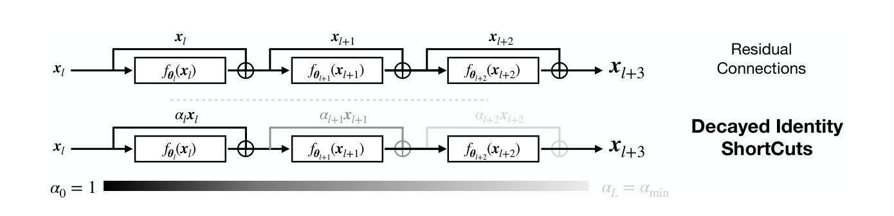
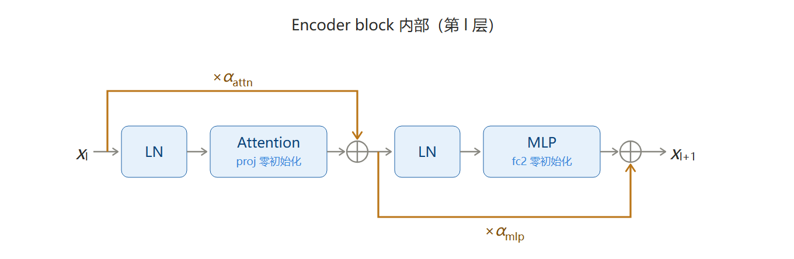
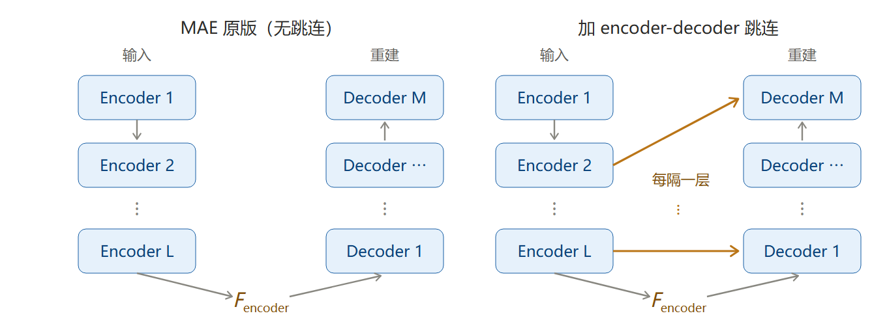

# Residual Connections Harm Generative Representation Learning

**类型：** 特定来源
**出处会议：** CVPR 2026
**是否开源：** https://github.com/xiao7199/decayed_Identity_shortcuts
**关键词：** 残差连接、衰减恒等捷径（decayed identity shortcuts）、表征学习、MAE、扩散模型、有效秩

---

## 1. 概述

论文主张：残差连接的恒等捷径在解决梯度传播问题的同时，会把浅层表征以「回声」形式注入深层，压低深层特征的抽象度；这一副作用在生成式表征学习（MAE、扩散模型）中最为明显，因为重建/去噪这类间接代理目标允许网络「抄近路」。

对策是给捷径分支乘一个随层深单调下降的固定系数，整网从残差平滑过渡到前馈。只增加一个超参 $\alpha_{\min}$，不增加可学习参数，不改训练目标与损失函数。

> **本笔记范围：** 只整理 **§3 Method**，即 §3.1 Decayed Identity Shortcuts 与 §3.2 Implementation Strategy。实验（§4、§5）、特征秩讨论（§6）与结论（§7）未整理，见文末「待补」。

## 2. 方法（§3 Method）

§3 开头的定位：本节给出「用衰减方案引入低秩归纳偏置」的方法论，并讨论为稳定训练所需的额外实现策略。

### 2.1 衰减恒等捷径（§3.1）

这一小节的写法是层层递进：先立两个基线（前馈、残差），指出残差的具体代价，再给出改法。

#### 2.1.1 基线一：纯前馈层

设网络共 $L$ 层，第 $l$ 层参数记为 $\theta_l$，前馈网络的一次前向为

**式 (1)**
$$
x_{l+1}=f_{\theta_l}(x_l)
$$

其中 $x_l\in\mathbb{R}^d$ 是上一层的输出，$f_{\theta_l}$ 是作用在当前层的网络块。

原文在此处插了一句为后文铺垫的观察：纯前馈结构加深时确实容易梯度消失，但 Huh et al. [32] 表明前馈模块自带隐式结构正则，使深模型能在瓶颈处产生抽象表示。这句话是后面「深层应当更像前馈」的依据。

#### 2.1.2 基线二：残差连接

为缓解深层网络的梯度消失，ResNet [25] 把每层写成残差函数：

**式 (2)**
$$
x_{l+1}=x_l+f_{\theta_l}(x_l)
$$

捷径使梯度幅度不随深度衰减。但原文紧接着指出代价，这是全文论证的转折点：

> 这一设计的一个后果是，实践中输出会紧贴输入 [23]，从而使「跨深度构造复杂变换」这件事失去必要性。

（原文：*a consequence of this design is that the output stays close to the input in practice [23], defeating the need to construct complex transformations over depth.*）

作为对照，Highway 网络用可学习门控同时调制两条分支：

$$
x_{l+1}=H_\phi(x_l)\cdot x_l+\bigl(1-H_\phi(x_l)\bigr)\cdot f_{\theta_l}(x_l),\qquad H_\phi(x)\in[0,1]^d
$$

原文引 Srivastava et al. [60] 指出：多数单元学出的 $H_\phi\to 1$，即模型倾向于复制输入。这解释了为什么「让网络自己学门控」并不奏效，也是本文坚持用**固定**衰减而非可学习门控的动机之一。

#### 2.1.3 面向无监督表征学习的衰减恒等捷径

动机由两点合成：

1. 抽象可视为「对输入局部变化的不变性」，对特征空间的解耦至关重要 [9]。
2. 已有工作表明残差捷径倾向于保留高频、细粒度的输入信息 [23]，因而降低特征抽象度。

由此得到本文的核心假设：抽象不足会损害模型学习有意义的低层特征；**确保深层具备抽象结构有助于表征学习，对那些使用间接代理目标（如逐像素重建损失）的无监督任务尤其如此**。

具体做法是给捷径分支降权：

**式 (3)**
$$
x_{l+1}=\alpha_l x_l+f_{\theta_l}(x_l),\qquad \alpha_l\in[0,1]
$$

$\alpha_l$ 是作用于残差路径的重缩放因子，控制通过 skip 连接的信息流量。

把该递推对 $L$ 层（$l=1,\dots,L$）完全展开：

**式 (4)**
$$
x_{L+1}=\left(\prod_{l=1}^{L}\alpha_l\right)x_0+\sum_{l=1}^{L-1}\left(\prod_{i=l+1}^{L}\alpha_i\right)f_{\theta_l}(x_l)+f_{\theta_L}(x_L)
$$

原文对这一式的解读是全文最关键的一句：

> 输入 $x_0$ 的贡献被每一个 $\alpha_l\neq1$ 所缩放，而每个后续网络块的输出 $f_{\theta_l}(x_l)$ 省略了直到 $\alpha_l$ 为止的缩放因子。因此网络早期特征的贡献被特别地降权，阻止网络把细粒度细节信息传递到瓶颈 $x_{L+1}$。

（原文：*the contribution of the input $x_0$ is scaled by each $\alpha_l\neq1$ while each subsequent network block output $f_{\theta_l}(x_l)$ omits scaling factors up to $\alpha_l$. Hence, the contribution of early features of the network is especially downweighted, preventing the network from passing fine-grained detailed information to the bottleneck $X_{L+1}$.*）

原文还记录了一条来自实验的经验：**最后一层的有效衰减因子 $\alpha_L^{\mathrm{eff}}=\prod_{l=1}^{L}\alpha_l$，在改变网络深度 $L$ 时决定最优衰减率怎么取**。这一条是 §4.2 中所有与深度相关的调参依据。

> **读式 (4) 时容易混的两个量。** 原文未显式区分，此处补注：
>
> - $\alpha_l$：第 $l$ 层这一步的保留率，$l$ 越大越小（前高后低）。论文正文中「捷径通路的贡献随 $l$ 增大单调递减」说的就是它。
> - $w_l=\prod_{i=l+1}^{L}\alpha_i$（此处自定义记号）：第 $l$ 层的输出活着走到 $x_{L+1}$ 的累积权重，$l$ 越大越大（前低后高）。
>
> 两者方向相反并不矛盾：正因为 $\alpha_l$ 前高后低，浅层信号要穿过一串「越往后越小」的折扣，连乘下来反而剩得最少。以 $L=12$、$\alpha_{\min}=0.6$ 计，$x_0$ 的权重约 $0.047$，而 $f_{\theta_L}(x_L)$ 的权重是 $1$。另注意式 (4) 末项的 $f_{\theta_L}(x_L)$ 前面没有任何 $\alpha$，所以「$\alpha_L$ 最小」压的是承接下来的那条残差流，而不是第 $L$ 层自己算出的新增量。

<em>论文 Figure 1（p.2）：上为标准残差，下为衰减恒等捷径。底部色条标出 $\alpha_0=1$ 到 $\alpha_L=\alpha_{\min}$ 的深度渐变。</em>

#### 2.1.4 衰减方案（Decay schema）

$\alpha_l$ 不取全体常数，而是写成层索引的函数，并保证捷径通路的贡献随 $l$ 单调递减：

**式 (5)**
$$
\alpha_l=1-\delta_\alpha l,\qquad \delta_\alpha:=\frac{1-\alpha_{\min}}{L}
$$

其中 $\delta_\alpha:=\dfrac{1-\alpha_{\min}}{L}$ 是每层固定下降的步长，$\alpha_L\equiv\alpha_{\min}$ 是施加在最后一层 $L$ 上的最小缩放因子；$l$ 每增 $1$，$\alpha_l$ 就减少 $\delta_\alpha$。

原文给出这种取法的两点好处：

1. **$\alpha_l$ 兼作「残差/前馈」的混合比例。** 它是 $0$ 与 $1$ 之间的线性插值，$\alpha_l=1$ 对应纯残差、$\alpha_l=0$ 对应纯前馈，于是整网从浅到深完成一次从残差到前馈的平滑过渡：既拿到残差连接在优化上的好处，又同时鼓励深层学更抽象的表征。
2. **代价仍只有一个超参。** 与朴素写法一致，本方法只多引入 $\alpha_{\min}$ 一个量，它不依赖数据、也不需要学习。

> **实现层：$\alpha$ 的粒度是子层，不是层。** 式 (5) 按层索引写，官方代码按子层排布：`np.linspace(0, 1, 2*depth)` 生成 $2L$ 个值，`reshape(-1, 2)` 成 $L$ 组、每组两个，分别用于该层 attention 与 MLP 两条支路。以 `depth=12`、$\alpha_{\min}=0.6$ 计，第 0 层得 $(1.000,\ 0.983)$，第 11 层得 $(0.617,\ 0.600)$。所以实际衰减系数有 $2L$ 个，同一层两条支路的值并不相等，$\alpha_L\equiv\alpha_{\min}$ 只在最后一条支路上精确成立；Figure 1 标的 $\alpha_0=1$ 对应第一个子层。

<em>自绘示意图（非论文原图）：一个 Encoder block 内两条残差各自乘以不同的 $\alpha$；框内第二行标出零初始化的位置（对应 §2.2.2）。</em>

### 2.2 实现策略（§3.2）

式 (3) 单独使用会破坏训练，必须配两个补丁。

#### 2.2.1 自编码器的跳连（skip connections for autoencoders）

衰减把最抽象的特征推向靠后的层，但「学出一个抽象的瓶颈」与「逐像素重建」这一目标直接冲突：重建要求瓶颈保留细节信息。作者的处理是在 encoder 与 decoder 之间加入标准 skip connections，让 encoder 把浅层信息直接送给 decoder，从而允许更深的 encoder 层专心学抽象表征。

<em>自绘示意图（非论文原图）：左为 MAE 原版，右为加入 encoder-decoder 跳连后。橙色 $F_{encoder}$ 是 encoder 末端的特征张量，不是网络层；右图从第 2 层起每隔一层引出一条捷径。</em>

（对应 §4.2 的消融：去掉这一跳连，linear probing 从 83.6 掉到 61.5。）

**实现（按官方代码 `MAE/models_mae.py`，ViT-B/16）**

- encoder 侧取 `skip_id = [1, 3, 5, 7, 9, 11]`，即每隔一层取一次输出，共 6 个注入点，不是逐层都取。
- decoder 共 8 层，前 6 层各接一条 skip，最后两层不接。
- 对应关系是**反序**的：decoder 第 0 层接 encoder 第 11 层（最深），decoder 第 5 层接 encoder 第 1 层（最浅），整体呈 U 形对称。
- 融合由 `SkipLayer` 完成：encoder 特征只覆盖可见 patch，先用可学习的 `mask_token` 补齐到全长，按 `ids_restore` 还原空间顺序，再与 decoder 当前特征做通道拼接（768 + 512），过 `Linear → SiLU → Linear` 后**相加**到 decoder 特征上。该 MLP 最后一层权重初始化为 0，训练起点是恒等。

> 论文 §4 的描述是 "injected encoder features are combined with learnable masked tokens before channel-wise concatenation"，与代码一致。但同段写 "twice the number of encoder layers as decoder layers"，与 ViT-B 的 12 : 8 不符，注入点数量与层号映射应以代码为准。

#### 2.2.2 残差零初始化（residual zero initialization）

**问题。** 当 $\alpha_{\min}$ 取到 $0.7$ 附近时，训练初期出现特征范数快速增长，训练变得不稳，并损害收敛。

**作者给的解释。** 残差流每层都被 $\alpha_l$ 打折，输出量级撑不住，于是模型学会放大 $f_{\theta_l}(x)$ 的输出特征范数来补偿这个衰减。补偿发生在梯度最猛的训练初期，会把优化带偏。

**原本怎么做、为什么不行。** 各线性层原本按 Xavier uniform 随机初始化 [21]，$f$ 一开始就输出一个小的非零值。于是每个 block 的输出

$$
\alpha_l x_l+f_{\theta_l}(x_l)
$$

两项都有数，但一边被打折、一边没有，量级对不上。网络得先把两者调平才能开始学正事，作者认为这个调整过程就是范数暴涨的来源。

**做法。** 沿用前人工作 [28] 的做法，把每个 $f_{\theta_l}$ 的**出口线性层**权重初始化为 $0$。注意 $f$ 是一个子网络而不是单个权重矩阵，出口层具体指 Attention 的输出投影 $\mathrm{proj}$ 与 MLP 的第二层 $\mathrm{fc_2}$。这两个线性层把权重乘成零之后，无论前面算出什么，子网络的输出恒为 $0$：

$$
f_{\theta_l}(x)=\mathrm{fc_2}(\cdots)=0\cdot(\cdots)=0
$$

**效果。** 初始化那一刻所有 $f$ 都没有输出，每个 block 只剩一条路：

$$
x_{l+1}=\alpha_l x_l
$$

也就是一条被打折的残差链，信号按 $\prod_l\alpha_l$ 一路缩下去。等训练开始，$f$ 再从这个零起点慢慢长出来，增长节奏由梯度决定，而不是在初始化瞬间被一次性顶上去。原文的表述是这能控制特征范数的增长，$\alpha_{\min}$ 越小时作用越明显。

**与标准残差零初始化的区别。** 标准残差里，零初始化让网络从**恒等**起步（$x_{l+1}=x_l+0=x_l$）；这里残差被 $\alpha$ 打了折，零初始化让网络从**衰减**起步（$x_{l+1}=\alpha_l x_l$）。方向相反，因为残差本身已经不是恒等映射了。

**适用范围。** 这不是提升可训练性的通用技巧，而是 $\alpha$ 衰减的配套条件：衰减越狠，补偿冲动越强，零初始化就越不可少。

## 4. 待补

- [ ] 本笔记只覆盖 §3。§4 实验（Table 1–4）、§5 扩散模型（Table 2、Table 5）、§6 特征秩讨论与 §7 结论待整理。
- [ ] §4 整理时需先核的存疑点（暂记为待查，不写入正文）：① KNN 从 27.4 涨到 63.9 的幅度可能受特征各向异性影响，linear probing 的 +4.9 才是更可信的信号，而同表 fine-tuning 反而从 83.6 降到 82.9；② Table 4b 第一行写的是 $0.5(x_l+f)$，但 pre-LN ViT 下这种全局缩放近似恒等变换，与报出的 82.6 对不上；③ 正文称最优 $\alpha_L^{\mathrm{eff}}$ 落在 $[10^{-3},10^{-2})$，而按式 (5) 复算 L=12、$\alpha_{\min}=0.6$ 得 $4.7\times10^{-2}$，与该区间不符。
- [ ] 插图的取用状态：`Figure1.png` 已插入 §2.1.3；`Figure2.png`（表征可视化 + LP/rank/FID + 生成，p.3）、`Figure3.png`（COCO 特征 RGB 投影，p.7）、`Figure4.png`（有效秩与 accuracy 训练曲线，p.8）已裁好存放在 `library/assets/Decayed-Identity-Shortcuts/`，等对应章节补写时再插入。
- [ ] 与 §6 的接口：文中用 effective rank（归一化奇异值的 Shannon 熵）作为诊断量，定义式待随 §6 一并整理（Figure 4 即该节数据）。
