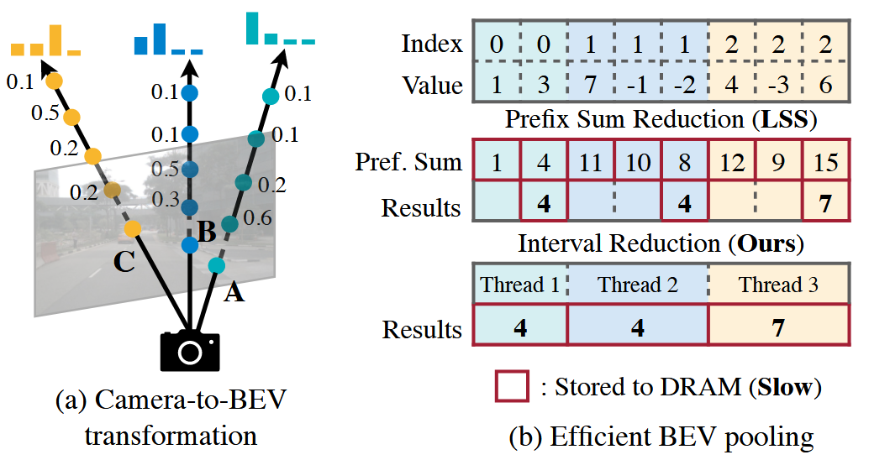
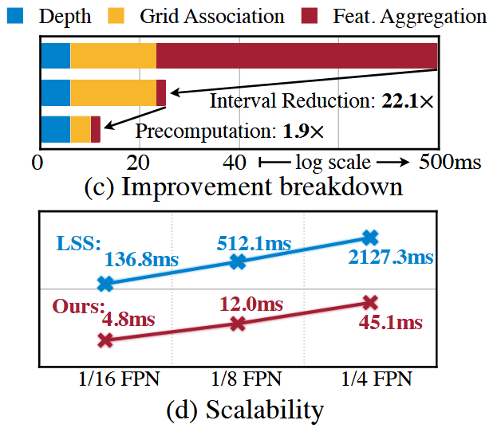
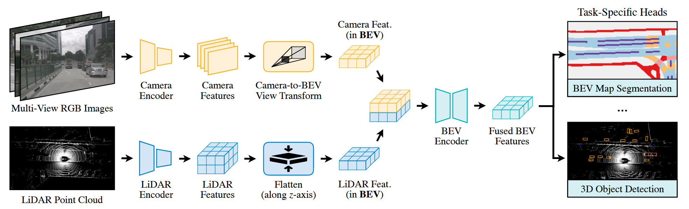
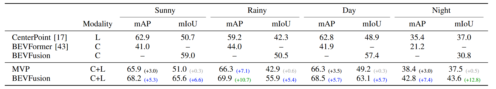

# BEVFusion: Multi-Task Multi-Sensor Fusion with Unified Bird's-Eye View Representation

**出处会议：** ICRA 2023（arXiv abs 页 Comments 字段为空；官方仓库 mit-han-lab/bevfusion README News 行 "BEVFusion is accepted to ICRA 2023!"，其 BibTeX 作 `booktitle={IEEE International Conference on Robotics and Automation (ICRA)}`，均本次抓取核验）
**是否开源：** https://github.com/mit-han-lab/bevfusion （论文摘要末句 "Code to reproduce our results is available at https://github.com/mit-han-lab/bevfusion."，见 arXiv HTML v3 摘要）
**关键词：** 多任务多传感器融合、统一 BEV 表示、BEV pooling 加速（预计算 + interval reduction）、相机-LiDAR 融合、3D 检测 + BEV 地图分割、nuScenes、Waymo

> **与库内 Ali-BEVFusion 的区分**：本笔记是 MIT Han Lab（Song Han 组）的 BEVFusion（ICRA 2023，任务无关的多任务多传感器融合框架，开源库 `mit-han-lab/bevfusion`）。库内另有 `library/Multimodal_Fusion/Ali-BEVFusion.md`，是 **NeurIPS 2022** 的同名缩写论文（ADLab-AutoDrive 出品，动态融合模块，仓库 `ADLab-AutoDrive/BEVFusion`）。两篇是完全不同的论文，引用时勿混。本笔记已于 2026-11-03 入库 `library/Multimodal_Fusion/`；是否在 Ali-BEVFusion.md 头部加指向本笔记的回链仍待用户同意（见 TODO）。

> 来源与核验（抓取日期 2026-11-02）：
> - arXiv abs 页 https://arxiv.org/abs/2205.13542 ，页面标题 "BEVFusion: Multi-Task Multi-Sensor Fusion with Unified Bird's-Eye View Representation"，与任务给定标题逐字一致，允许使用。作者：Zhijian Liu, Haotian Tang, Alexander Amini, Xinyu Yang, Huizi Mao, Daniela Rus, Song Han（v1 2022-05-26；v2 2022-06-16；v3 2024-09-01）。注：检索时先试了 2205.13590，为无关物理论文，已弃用；正确 id 经 arXiv API 标题精确匹配确认为 2205.13542。
> - 全文 arXiv 官方 HTML v3 https://arxiv.org/html/2205.13542v3 （页面 title 核对一致），并与 ar5iv https://ar5iv.labs.arxiv.org/html/2205.13542 交叉核对：四张表逐行 diff 一致、正文段落 diff 一致（差异仅官方 HTML 页尾多一节 arXiv 平台的 "Instructions for reporting errors"）。以下 locator（§I、§III-B、Table I 等）均指该论文正文的 IEEE 风格罗马数字章节与表格编号。
> - 已知差异：arXiv abs 页摘要与 HTML v3 正文摘要有少量措辞出入，逐字对照：abs 页作 "we break this deeply-rooted convention with BEVFusion"（HTML 正文作 "we propose BEVFusion"）、abs 页作 "lift key efficiency bottlenecks"（正文作 "lift the key efficiency bottlenecks"）、abs 页作 "reducing latency by more than 40x"（正文作 "reducing latency by more than 40 \times ."）、abs 页作 "on nuScenes"（正文作 "on the nuScenes benchmark"）。两处均为本次实际抓取文本；本笔记引摘要句时标注出自哪一页。
> - 引句约定：引号内为本次抓取文本的逐字摘录；其中 `\times`、`[1,60]` 等为官方 HTML 的 math alttext 形态（未做排版还原），alttext 替换可能引入多余空格；方括号数字（如 [49]）为论文自身参考文献编号，照抄未改。表格中 – 为原文 dash（表示无该结果），照抄。
> - 本笔记已入库（2026-11-03），未经用户独立核阅，所有结论均属"论文声称 / 尚未独立验证"。

------

## 1. 概述

- 论文动机：主流多传感器融合是 point-level fusion（把图像特征涂到 LiDAR 点云上），camera-to-LiDAR 投影丢掉相机特征的语义密度，对语义导向任务（如 3D 场景分割）尤其有害。§I 原句："This is because the camera-to-LiDAR projection is semantically lossy (see Figure 1b): for a typical 32-beam LiDAR scanner, only 5% camera features will be matched to a LiDAR point while all others will be dropped."
- 核心主张：把多模态特征统一到共享 BEV 表示空间做融合，同时保留 LiDAR 的几何结构与相机的语义密度，框架任务无关。摘要原句（arXiv abs 页）："we break this deeply-rooted convention with BEVFusion, an efficient and generic multi-task multi-sensor fusion framework. It unifies multi-modal features in the shared bird's-eye view (BEV) representation space, which nicely preserves both geometric and semantic information."
- 论文声称的摘要结果（arXiv abs 页）："It establishes the new state of the art on nuScenes, achieving 1.3% higher mAP and NDS on 3D object detection and 13.6% higher mIoU on BEV map segmentation, with 1.9x lower computation cost."
- 效率视角（§I）：视图变换是主要瓶颈，原句："While converting all features to BEV, we identify the major prohibitive efficiency bottleneck in the view transformation: i.e., the BEV pooling operation alone takes more than 80% of the model’s runtime."；随后用预计算 + interval reduction 专用 kernel 拿到 40× 以上加速（§I）。
- 分割上的反差（§I）："It achieves 6% higher mIoU than camera-only models and 13.6% higher mIoU than LiDAR-only models, while existing fusion methods hardly work."（即语义任务上相机比 LiDAR 更重要，与检测相反）
- 相关工作定位（§II）：现有融合方法分 proposal-level（MV3D、FUTR3D、TransFusion 等，object-centric，难以泛化到分割）与 point-level（PointPainting、MVP、DeepFusion 等，既 object-centric 又 geometric-centric）。BEVFusion 的差异原句（§II）："In contrast to all existing methods, BEVFusion performs sensor fusion in a shared BEV space and treats foreground and background, geometric and semantic information equally. It is a generic multi-task multi-sensor perception framework."
- 作者对工作定位的自述（§I）："We hope this work will serve as a simple yet strong baseline for future sensor fusion research and inspire the researchers to rethink the design and paradigm for generic multi-task multi-sensor fusion."

## 2. 方法

### 2.1 统一表示（§III-A）

- 候选统一空间两个、被否：To Camera（LiDAR→2.5D 稀疏深度，"this conversion is geometrically lossy"，深度图上相邻两点在 3D 空间可能很远）；To LiDAR（语义有损）。原句（§III-A）："Camera and LiDAR features have drastically different densities, resulting in only less than 5% of camera features being matched to a LiDAR point (for a 32-channel LiDAR scanner)."（§I 用 32-beam 说法给出同一 5% 数字）
- 采纳 BEV 的两条理由（§III-A）：几乎所有感知任务的输出空间本身就在 BEV；LiDAR→BEV 只是沿高度维压平（"thus does not create geometric distortion in Figure 1a"），camera→BEV 把每个像素投回 3D 射线，能生成保留完整语义的稠密 BEV 特征（Figure 1c）。
- 注意（§III-A）：对 latent-space 融合（object query 类，如 FUTR3D/TransFusion）也提示了同样缺点："Similar drawbacks also apply to more recent fusion methods in the latent space (e.g., object query) [48, 49]."

### 2.2 高效相机-BEV 变换（§III-B）

- 做法：沿 LSS [6]，显式预测每像素离散深度分布，把特征像素散射到相机射线上 D 个离散点并按深度概率缩放，得到 NHWD 的相机特征点云；沿 x,y 以步长 r（如 0.4m）量化，用 BEV pooling 聚合每个 r×r 网格内特征并沿 z 轴压平（§III-B）。
- 瓶颈量级（§III-B）："Though simple, BEV pooling is surprisingly inefficient and slow, taking more than 500ms on an RTX 3090 GPU (while the rest of our model only takes around 100ms)."；典型 workload 脚注数字（footnote 1，§III-B）：N=6、(H,W)=(32,88)、D=(60-1)/0.5=118；对应 6 个环视相机、32×88 特征图（由 256×704 下采样 8×）、深度离散到 [1,60] 米步长 0.5 米；每帧约生成 200 万点，"two orders of magnitudes denser than a LiDAR feature point cloud"（§III-B）。

- Precomputation（§III-B）：相机内外参固定 ⇒ 每点的 3D 坐标与 BEV 网格索引、排序与秩可离线预计算，推理时只需按预计算的秩重排特征。原句："This caching mechanism can reduce the latency of grid association from 17ms to 4ms."
- Interval reduction（§III-B）：LSS 原实现用 prefix sum 再扣边界（需要 GPU 树归约、且写出大量无用的部分和）；本文为每个 BEV 网格分配一个 GPU 线程直接算区间和。原句："This kernel removes the dependency between outputs (thus does not require multi-level tree reduction) and avoids writing the partial sums to the DRAM, reducing the latency of feature aggregation from 500ms to 2ms (Figure 3c)."
- 总收益（§III-B）："The camera-to-BEV transformation is 40 \times faster with our optimized BEV pooling: the latency is reduced from more than 500ms to 12ms (only 10% of our model’s end-to-end runtime) and scales well across different feature resolutions (Figure 3d)."

- 与两篇并发工作（camera-only 3D 检测）的对比（§III-B）：M2BEV [41] 假设均匀深度分布、BEVDet [40] 截断每个 BEV 网格内的点，均为近似；原句："In contrast, our techniques are exact without any approximation, while still being faster."

### 2.3 全卷积融合与多任务头（§III-C、§III-D）

- 融合（§III-C）：两路 BEV 特征用 elementwise 算子（如拼接）合并；由于视图变换深度不准，LiDAR/相机 BEV 特征仍可能局部错位。原句："To this end, we apply a convolution-based BEV encoder (with a few residual blocks) to compensate for such local misalignments."；用真值深度监督视图 transformer（如 [42, 53]）留作 future work。
- 检测头（§III-D）："we follow [17, 49] to use a class-specific center heatmap head to predict the center location of all objects and a few regression heads to estimate the object size, rotation, and velocity."
- 分割头（§III-D）：地图类别可能重叠（如 crosswalk 是 drivable space 子集），因此 "we formulate this problem as multiple binary semantic segmentation, one for each class. We follow CVT [8] to train the segmentation head with the standard focal loss [54]."

### 2.4 模型与数据集（§IV Experiments 开头两段）

- 模型（§IV）："We use Swin-T [57] as our image backbone and VoxelNet [11] as our LiDAR backbone."；FPN 融合多尺度相机特征到 1/8 输入尺寸。
- 输入规格（§IV）："We downsample camera images to 256 \times 704 and voxelize the LiDAR point cloud with 0.075m (for detection) and 0.1m (for segmentation)."
- 两任务 BEV 分辨率不同 ⇒ 任务头前做转换，原句（§IV）："we apply grid sampling with bilinear interpolation before each task-specific head to explicitly transform between different BEV feature maps."
- 数据集（§IV）：nuScenes [59] 与 Waymo [60]，均为 > 40k 标注场景、LiDAR + 环视相机。
- 检测指标（§IV-A）：10 类前景 mAP 与 NDS；对开源方法测 single-inference #MACs 与 RTX3090 延迟；"We use a single model without any test-time augmentation for both val and test results."（§IV-A）
- 可扩展性声明（§IV）："Our framework can be easily extended to support other types of sensors (such as radars and event-based cameras) and other 3D perception tasks (such as 3D object tracking and motion forecasting)."（注意是论文声称，本笔记未抓取到相应实验表）

## 3. 实验

### 3.1 nuScenes 3D 检测（Table I，§IV-A）

Table I caption 逐字："TABLE I: BEVFusion achieves state-of-the-art 3D object detection performance on nuScenes (val and test) without bells and whistles. It breaks the convention of decorating camera features onto the LiDAR point cloud and delivers at least 1.3% higher mAP and NDS with 1.5-2 \times lower computation cost. (∗: our re-implementation; †: with test-time augmentation)"

Table I 逐字转录（列序：Modality / mAP (test) / NDS (test) / mAP (val) / NDS (val) / MACs (G) / Latency (ms)；首列表头在原文 HTML 中即为空，照抄）：

| | Modality | mAP (test) | NDS (test) | mAP (val) | NDS (val) | MACs (G) | Latency (ms) |
| --- | --- | --- | --- | --- | --- | --- | --- |
| M2BEV [41] | C | 42.9 | 47.4 | 41.7 | 47.0 | – | – |
| BEVFormer [43] | C | 44.5 | 53.5 | 41.6 | 51.7 | – | – |
| PointPillars [10] | L | – | – | 52.3 | 61.3 | 65.5 | 34.4 |
| SECOND [11] | L | 52.8 | 63.3 | 52.6 | 63.0 | 85.0 | 69.8 |
| CenterPoint [17] | L | 60.3 | 67.3 | 59.6 | 66.8 | 153.5 | 80.7 |
| PointPainting [1] | C+L | – | – | 65.8∗ | 69.6∗ | 370.0 | 185.8 |
| PointAugmenting [2] | C+L | 66.8† | 71.0† | – | – | 408.5 | 234.4 |
| MVP [4] | C+L | 66.4 | 70.5 | 66.1∗ | 70.0∗ | 371.7 | 187.1 |
| FusionPainting [50] | C+L | 68.1 | 71.6 | 66.5 | 70.7 | – | – |
| AutoAlign [51] | C+L | – | – | 66.6 | 71.1 | – | – |
| FUTR3D [48] | C+L | – | – | 64.5 | 68.3 | 1069.0 | 321.4 |
| TransFusion [49] | C+L | 68.9 | 71.6 | 67.5 | 71.3 | 485.8 | 156.6 |
| BEVFusion (Ours) | C+L | 70.2 | 72.9 | 68.5 | 71.4 | 253.2 | 119.2 |

- 正文总结原句（§IV-A）："As in Table I, BEVFusion achieves state-of-the-art results on the nuScenes detection benchmark, with close-to-real-time (8.4 FPS) inference speed on a desktop GPU."
- 对 TransFusion（§IV-A）："Compared with TransFusion [49], BEVFusion offers 1.3% improvement in test split mAP and NDS, while significantly reduces the MACs by 1.9 \times and measured latency by 1.3 \times ."（test 70.2/72.9 vs 68.9/71.6，MACs 253.2 vs 485.8，延迟 119.2 vs 156.6，均与上表一致；val 上为 68.5/71.4 vs 67.5/71.3，caption 的 "at least 1.3%" 指 test 口径）
- 对 point-level 方法（§IV-A）："It also compares favorably against representative point-level fusion methods PointPainting [1] and MVP [4] with 1.6 \times speedup, 1.5 \times MACs reduction and 3.8% higher mAP on the test set."（70.2 vs 66.8/66.4，latency 119.2 vs 185.8/187.1，一致）
- 效率来源的论文解释（§IV-A）："we choose the BEV space as the shared fusion space, which fully utilizes all camera features instead of just a 5% sparse set. Consequently, BEVFusion can achieve the same performance with much smaller resolution for the camera inputs, resulting in significantly lower MACs."

### 3.2 Waymo 3D 检测（Table II，§IV-A）

Table II caption 逐字："TABLE II: BEVFusion achieves state-of-the-art 3D object detection performance among all submissions on Waymo open dataset (test). (†: with test-time augmentation, ‡: with both test-time augmentation and model ensemble)"

Table II 逐字转录（列序：Frames / mAP/L1 / mAPH/L1 / mAP/L2 / mAPH/L2；首列表头原文为空，照抄。HTML 单元格内符号以 `{\dagger}`/`{\ddagger}` 原文形态出现，此处按 caption 图例转写为 †/‡，两个 HTML 源一致）：

| | Frames | mAP/L1 | mAPH/L1 | mAP/L2 | mAPH/L2 |
| --- | --- | --- | --- | --- | --- |
| AFDetV2-Ens [18] ‡ | 3 | 84.1 | 82.6 | 79.0 | 77.6 |
| InceptionLiDAR | 10 | 83.8 | 82.5 | 79.2 | 77.8 |
| 3DAL-Ens [20] | 5 | 84.6 | 83.1 | 79.7 | 78.2 |
| DeepFusion-Ens [3] ‡ | 5 | 84.4 | 83.2 | 79.5 | 78.4 |
| MT-Net ‡ [55] | 3 | 84.7 | 83.2 | 79.9 | 78.5 |
| MT3D | 4 | 85.0 | 83.7 | 80.1 | 78.7 |
| LIVOX-Detection | 7 | 84.8 | 83.5 | 80.2 | 79.0 |
| MPPNet-Ens ‡ [56] | 16 | 85.0 | 83.7 | 80.5 | 79.1 |
| 3DAM-Ens | 5 | 85.3 | 83.8 | 80.7 | 79.2 |
| BEVFusion (Ours) † | 3 | 85.7 | 84.4 | 80.8 | 79.5 |

- 正文原句（§IV-A）："BEVFusion outperforms the previous state-of-the-art multi-modal detector, DeepFusion [3] with 60% of input frames. Furthermore, DeepFusion ensembles 25 models evaluated with test-time augmentation, while we deliver better performance by applying test-time augmentation to a single BEVFusion model."（DeepFusion-Ens 用 5 帧、BEVFusion 用 3 帧；85.7 vs 84.4 mAP/L1）

### 3.3 BEV 地图分割（Table III，§IV-B）

Table III caption 逐字："TABLE III: BEVFusion outperforms the state-of-the-art multi-sensor fusion methods by 13.6% on BEV map segmentation on nuScenes (val) with consistent improvements across different categories."

Table III 逐字转录（列序：Modality / Drivable / Ped. Cross. / Walkway / Stop Line / Carpark / Divider / Mean；数值为 IoU；首列表头原文为空，照抄）：

| | Modality | Drivable | Ped. Cross. | Walkway | Stop Line | Carpark | Divider | Mean |
| --- | --- | --- | --- | --- | --- | --- | --- | --- |
| OFT [38] | C | 74.0 | 35.3 | 45.9 | 27.5 | 35.9 | 33.9 | 42.1 |
| LSS [6] | C | 75.4 | 38.8 | 46.3 | 30.3 | 39.1 | 36.5 | 44.4 |
| CVT [8] | C | 74.3 | 36.8 | 39.9 | 25.8 | 35.0 | 29.4 | 40.2 |
| M2BEV [41] | C | 77.2 | – | – | – | – | 40.5 | – |
| BEVFusion (Ours) | C | 81.7 | 54.8 | 58.4 | 47.4 | 50.7 | 46.4 | 56.6 |
| PointPillars [10] | L | 72.0 | 43.1 | 53.1 | 29.7 | 27.7 | 37.5 | 43.8 |
| CenterPoint [17] | L | 75.6 | 48.4 | 57.5 | 36.5 | 31.7 | 41.9 | 48.6 |
| PointPainting [1] | C+L | 75.9 | 48.5 | 57.1 | 36.9 | 34.5 | 41.9 | 49.1 |
| MVP [4] | C+L | 76.1 | 48.7 | 57.0 | 36.9 | 33.0 | 42.2 | 49.0 |
| BEVFusion (Ours) | C+L | 85.5 | 60.5 | 67.6 | 52.0 | 57.0 | 53.7 | 62.7 |

- 评测口径（§IV-B）："We report the Intersection-over-Union (IoU) on 6 background classes and the class-averaged mean IoU as our evaluation metric."；每类二值分割在多个阈值上取最高 IoU（follow [8]）；"For each frame, we only perform the evaluation in the [-50m, 50m] \times [-50m, 50m] region around the ego car following [6, 8, 41, 43]."（§IV-B）
- 模态反差原句（§IV-B）："As a result, our camera-only BEVFusion model outperforms LiDAR-only baselines by 8-13%. This observation is the exact opposite of results in Table I, where state-of-the-art camera-only 3D detectors got outperformed by LiDAR-only detectors by almost 20 mAP."
- 相机单目基线提升（§IV-B）："Our camera-only model boosts the performance of existing monocular BEV map segmentation methods by at least 12%."（56.6 vs LSS 44.4 / OFT 42.1 / CVT 40.2）
- 多模态结果（§IV-B）："In the multi-modality setting, we further improve the performance of the monocular BEVFusion by 6 mIoU and achieved > 13% improvement over state-of-the-art sensor fusion methods [1, 4]."（62.7 vs 56.6，vs PointPainting 49.1 / MVP 49.0）
- 对 baseline 失效的解释（§IV-B）："PointPainting [1] only decorates the foreground LiDAR points and MVP only densifies foreground 3D objects. Both approaches are not helpful for segmenting map components. Worse still, both methods assume that LiDAR should be the more effective modality in sensor fusion, which is not true according to our observations in Table III."

### 3.4 天气/光照鲁棒性（Table IV，§V）

Table IV caption 逐字："TABLE IV: BEVFusion is robust under different lighting and weather conditions, significantly boosting the performance single-modality models under challenging rainy(+10.7) and nighttime(+12.8) scenes."（caption 原文即如此，"boosting the performance single-modality models" 疑漏 of，照抄）

Table IV 逐字转录（原表两级表头：第一级表头行原文仅 6 个单元格、逐字为「(空) | (空) | Sunny | Rainy | Day | Night」，其中每个场景名在原表跨 mAP/mIoU 两列；第二级表头行 10 个单元格，用作下表 markdown 表头、照抄。数据行列序：Modality / Sunny mAP / Sunny mIoU / Rainy mAP / Rainy mIoU / Day mAP / Day mIoU / Night mAP / Night mIoU）：

| | Modality | mAP | mIoU | mAP | mIoU | mAP | mIoU | mAP | mIoU |
| --- | --- | --- | --- | --- | --- | --- | --- | --- | --- |
| CenterPoint [17] | L | 62.9 | 50.7 | 59.2 | 42.3 | 62.8 | 48.9 | 35.4 | 37.0 |
| BEVFormer [43] | C | 41.0 | – | 44.0 | – | 41.9 | – | 21.2 | – |
| BEVFusion | C | – | 59.0 | – | 50.5 | – | 57.4 | – | 30.8 |
| MVP | C+L | 65.9 (+3.0) | 51.0 (+0.3) | 66.3 (+7.1) | 42.9 (+0.6) | 66.3 (+3.5) | 49.2 (+0.3) | 38.4 (+3.0) | 37.5 (+0.5) |
| BEVFusion | C+L | 68.2 (+5.3) | 65.6 (+6.6) | 69.9 (+10.7) | 55.9 (+5.4) | 68.5 (+5.7) | 63.1 (+5.7) | 42.8 (+7.4) | 43.6 (+12.8) |

注：括号内增量为原表自带（相对对应单模态基线 CenterPoint/BEVFormer/BEVFusion-C）。BEVFormer 行只有 mAP 无 mIoU，BEVFusion-C 行只有 mIoU 无 mAP，均为原表 – 照抄。四列从左到右依次对应 Sunny/Rainy/Day/Night（第一级表头跨列信息见上）。

- 雨天（§V）："BEVFusion leverages the robustness of camera sensors to achieve a 10.7 mAP improvement, which largely narrows the performance gap between sunny and rainy scenarios."
- 夜间分割（§V）："However, multi-modal BEVFusion achieves a 12.8 mIoU improvement, even greater than its improvement in the daytime, demonstrating the importance of leveraging geometric clues when camera sensors fail."
- 夜间检测对比 MVP（§V）："MVP’s improvement is relatively small compared to BEVFusion, which relies less on accurate 2D instance segmentations to generate virtual points and therefore performs better in dark or overexposed scenes."

### 3.5 物体尺寸、距离与 LiDAR 稀疏度（§V，Figure 4）

- 尺寸与距离（§V）："BEVFusion achieves consistent improvements over its LiDAR-only counterpart for both small and large objects, while MVP has only negligible improvements for objects larger than 4m."（解释：大物体点云更密，虚拟点增益更小）；对更小、更远物体收益更大（§V，对应 Figure 4a/4b）。
- 稀疏 LiDAR（§V）："BEVFusion consistently outperforms MVP across all sparsity levels with a 1.6 \times reduction in #MACs and achieves a 12% improvement in the 1-beam LiDAR scenario."；MVP 在 1-beam 下退化（§V）："which is not valid under sparse LiDAR settings (i.e., 35.8 NDS with 1-beam input in Figure 4(c))."；BEVFusion 不依赖强 LiDAR-only 检测器。
- 注：Figure 4 为曲线图，本笔记（抓取 HTML）未逐点转录其数值，见 TODO。

## 4. 核心结论

1. 论文声称：把多传感器融合从 point-level 搬到统一 BEV 空间，可以同时改善几何导向任务（3D 检测：nuScenes test mAP/NDS 70.2/72.9，Table I）与语义导向任务（BEV 分割：mIoU 62.7，Table III），且计算更低（MACs 253.2G、RTX3090 延迟 119.2ms、8.4 FPS，Table I/§IV-A）。注意此为论文声称、尚未独立验证。
2. 关键使能是 BEV pooling 的工程优化（预计算 + interval reduction 专用 kernel）：视图变换 500ms+ → 12ms（40×，§III-B），且"exact without any approximation"（§III-B）——这使得 BEV 空间融合从"算不起"变为可行。
3. 模态权衡随任务改变：检测上 LiDAR 主导（Table I），分割上相机信息更关键（Table III 中 camera-only 56.6 已超 LiDAR-only 48.6）；融合收益在雨天/夜间、小/远物体、稀疏 LiDAR 下更大（Table IV、§V）。
4. 结论段的量化总述原句（§VI）："BEVFusion rethinks the effectiveness of point-level fusion in multi-sensor perception systems and achieves superior performance on both nuScenes 3D detection and BEV map segmentation tasks with 1.5-1.9 \times less computation and 1.3-1.6 \times measured speedup over existing solutions. BEVFusion also outperforms all existing sensor fusion methods on Waymo open dataset."（注意：Table I caption 作 "1.5-2 \times"，§VI 作 "1.5-1.9 \times"，两处措辞不同，照抄保留）
5. 与库内 Ali-BEVFusion（NeurIPS 2022）的关系：两文同名不同作——Ali 版是单任务（检测）的 LiDAR+camera 双流框架，融合发生在 LiDAR BEV 特征上的动态通道注意力（见 library/Multimodal_Fusion/Ali-BEVFusion.md）；MIT 版把"在哪个空间融合"本身作为主张（BEV 空间、任务无关、支持分割）。MIT 版正文（本次抓取的 HTML v3）未引用 Ali 版论文，两者无直接引用关系可述。

------

## TODO

- 配图：2026-11-03 入库时已嵌入 Fig. 2（F2.png）、Fig. 3(a)(b)（F3.png）、Fig. 3(c)(d)（3C.png）、Table IV（T4.png），均逐张人工核对内容后引用。仍缺 Fig. 1（三种融合空间对比）与 Fig. 4（尺寸/距离/稀疏度曲线）截图，需补抓。
- Figure 4 曲线中的具体数值（不同 beam 数下的 mAP/NDS 等）未逐点转录，正文仅记录了 §V 文中引用的 35.8 NDS（1-beam）与 12%（1-beam 改善）；需要时对照 PDF 补全。
- ICRA 2023 出处目前依据为官方仓库 README News 行与 BibTeX（arXiv abs 页 Comments/journal-ref 字段为空）；如需 IEEE Xplore 收录页/DOI 待人工补充核验。
- arXiv abs 页摘要与 HTML v3 正文摘要的少量措辞差异（见头部"已知差异"）建议定稿时以其一为准并统一；本笔记引句均已标注出处页。
- `library/Multimodal_Fusion/Ali-BEVFusion.md` 头部加指向本笔记的区分回链，涉及修改 library/，须待用户同意（本草稿未动 library/）。
- Table II 中 Waymo 提交名（3DAM-Ens、MT3D、InceptionLiDAR 等无引文编号的行）在正文无展开说明，如需背景待查 Waymo leaderboard 2022 存档。

- 抓取 URL 与日期（均为 2026-11-02）：
  - https://arxiv.org/abs/2205.13542 （abs 页，标题/摘要/作者/版本史）
  - https://arxiv.org/html/2205.13542v3 （官方 HTML 全文 v3，本笔记主要来源）
  - https://ar5iv.labs.arxiv.org/html/2205.13542 （ar5iv 全文，交叉核对）
  - http://export.arxiv.org/api/query?search_query=ti:%22BEVFusion...%22 （arXiv API 标题精确匹配，确认 id）
  - https://api.github.com/repos/mit-han-lab/bevfusion/readme （raw 方式，ICRA 2023 出处与开源确认）
- 入库前 QA（2026-11-03）：本笔记 68 条英文引句逐一用 Grep 验证在笔记文本中逐字存在（自洽检查全部通过）；正文-表格数字交叉验算 12 处一致（test 对 TransFusion +1.3/+1.3、MACs 485.8/253.2=1.9×、latency 156.6/119.2=1.3×、分割对 PointPainting +13.6、camera-only 对 LiDAR-only 8.0–12.8、雨天 +10.7、夜间 +12.8、1000/119.2ms=8.4 FPS 等）；4 张素材图逐张核对（F3/3C 为论文 Fig. 3 的 (a)(b) 与 (c)(d) 两部分）。
