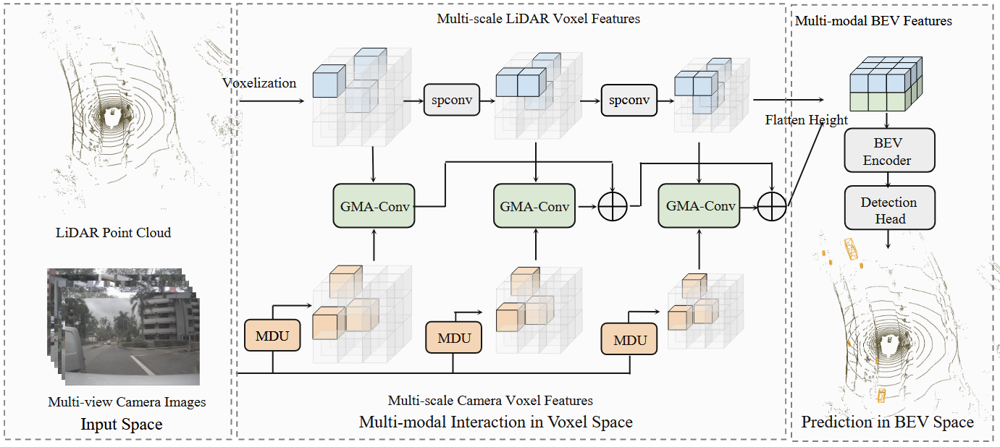
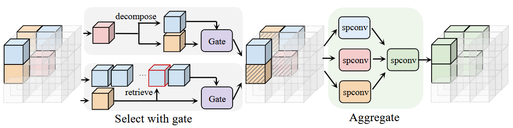
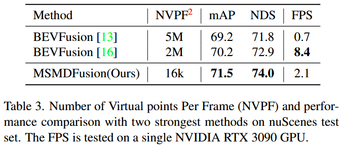
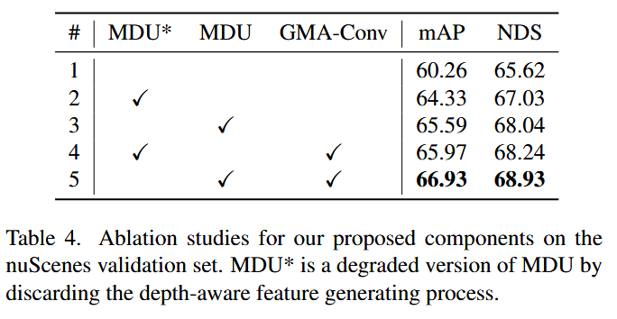
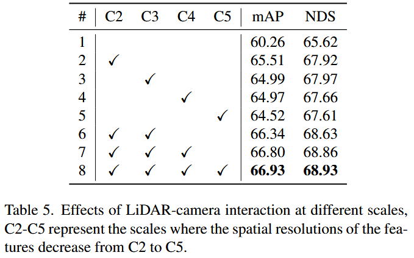
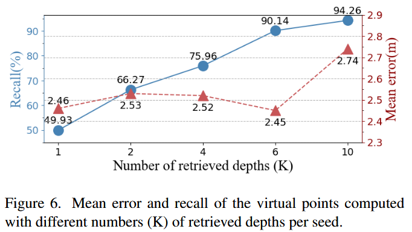

# MSMDFusion: Fusing LiDAR and Camera at Multiple Scales with Multi-Depth Seeds for 3D Object Detection

**出处会议：** CVPR 2023（arXiv:2209.03102；v1 2022-09-07，v2 2022-11-16，v3 2023-03-03；abs 页 Comments 字段为 "Accepted by CVPR 2023"；CVF Open Access 页标题 "MSMDFusion: Fusing LiDAR and Camera at Multiple Scales With Multi-Depth Seeds for 3D Object Detection" 与 arXiv 标题仅大小写差异）  
**是否开源：** https://github.com/SxJyJay/MSMDFusion （摘要末句原话："The code is available at https://github.com/SxJyJay/MSMDFusion."）  
**关键词：** LiDAR-相机融合、虚拟点（virtual points）、多深度种子（Multi-Depth Unprojection, MDU）、门控模态感知卷积（GMA-Conv）、多尺度体素空间交互、nuScenes 3D 检测/跟踪

> **与库内笔记的关系：** 本文 Table 1 直接对比的两篇同名 BEVFusion 中，[13]（Liang et al., "BEVFusion: A Simple and Robust LiDAR-Camera Fusion Framework", arXiv:2205.13790）即库内笔记 `library/Multimodal_Fusion/Ali-BEVFusion.md`，[16]（Liu et al., "BEVFusion: Multi-Task Multi-Sensor Fusion with Unified Bird's-Eye View Representation", arXiv:2205.13542）即库内草稿 `nightshift/drafts/MIT-BEVFusion.md`（编号对应关系据本文 References 列表核实）；与库内雷达-相机融合笔记（RCBEVDet、HGSFusion 等）不同，本文融合对象是 LiDAR-相机。
>
> **Locator 约定：** 本笔记章节号（§1–§5）、表号（Table 1–6）、公式号（Eq. 1–3）均指 arXiv HTML v3（2209.03102v3，LaTeXML 生成）的编号；英文引号内文字为本次从该 HTML 抓取的逐字文本（含原文笔误，已用 PDF v3 交叉核对，见文末 TODO），行内数学符号按该页 alttext 转写为 $...$。

---

## 一、概述

### 1.1 任务背景与两条问题线

论文面向 nuScenes 上的 LiDAR-相机融合 3D 检测。讨论的主线范式是「把 2D 图像像素（论文称为 seeds）lift 到 3D 空间生成虚拟点（virtual points）再与点云融合」，摘要原话：

> "Recent approaches aim at exploring the semantic densities of camera features through lifting points in 2D camera images (referred to as "seeds") into 3D space, and then incorporate 2D semantics via cross-modal interaction or fusion techniques."（Abstract）

论文认为该范式有两个未解决的问题（Abstract / §1）：

1. **lift 时的深度没有被认真对待**：

   > "However, depth information is under-investigated in these approaches when lifting points into 3D space, thus 2D semantics can not be reliably fused with 3D points."（Abstract）

   正文进一步说："First, depth, as the key to the quality of virtual points, is under-investigated in generating virtual points."（§1）——深度既决定 seed 投到 3D 的位置，也影响虚拟点携带的语义。

2. **体素空间里缺乏细粒度的跨模态交互**：现有做法要么在体素空间做简单 concat/add，要么把交互推迟到压缩后的 BEV 空间做 cross-attention（§1）；且 "Generated virtual points are geometrically and semantically inconsistent with real LiDAR points due to imperfect depths and inherent modality gap."（§1）

### 1.2 方法一句话与结果

每个尺度上两个组件（Abstract 原话）：

> "First, a Multi-Depth Unprojection (MDU) method with depth-aware designs is used to enhance the depth quality of the lifted points at each interaction level."
>
> "Second, a Gated Modality-Aware Convolution (GMA-Conv) block is applied to modulate voxels involved with the camera modality in a fine-grained manner and then aggregate multi-modal features into a unified space."

结果（Abstract 原话）：

> "On the nuScenes test benchmark, our proposed method, abbreviated as MSMDFusion, achieves state-of-the-art 3D object detection results with 71.5% mAP and 74.0% NDS, and strong tracking results with 74.0% AMOTA without using test-time-augmentation and ensemble techniques."

效率卖点（§1 原话）：

> "As shown in the Table 3, with 100 times fewer generated virtual points than the two BEVFusion methods [13, 16], our MSMDFusion can still achieve state-of-the-art performances."

### 1.3 论文声明的三点贡献（§1）

- "(1) We propose a novel MSMDFusion approach, which encourages sufficient LiDAR-Camera feature fusion in the multi-scale voxel space."（§1）
- "(2) Within each scale, we propose a Multi-Depth Unprojection strategy (MDU) to promote virtual points generation with better locations and semantics by fully leveraging depth of pixels, as well as a Gated Modality-Aware Convolution (GMA-Conv) to achieve fine-grained controllable multi-modal interaction."（§1）
- "(3) Extensive experimental results on the large-scale nuScenes dataset prove the effectiveness of our MSMDFusion and its components. We achieve state-of-the-art performances with 71.5% mAP and 74.0% NDS on the challenging nuScenes detection track using single model"（§1；其后脚注："We do not use Test-Time Augmentation (TTA) and model ensemble technique."）

---

## 二、方法

### 2.1 框架总览（§3.1）

双分支进多尺度体素空间：LiDAR 点云体素化后用 3D 稀疏卷积块提多尺度特征；多视角图像用 ResNet50+FPN 提多尺度特征；每个尺度上做一次「MDU 生成虚拟点 + GMA-Conv 融合」；跨尺度用级联连接聚合；最后压平到 BEV 过 BEV encoder 与检测头（§3.1、Figure 2）。

（配图注：`library/assets/MSMDFusion/Figure2.png`，2026-11-03 入库时目视核对，内容 = 论文 Figure 2 总框架，与本节描述一致。）

### 2.2 特征提取（§3.2）

- LiDAR："we voxelize the points and extract their features in the voxel space using a set of 3D sparse convolutional blocks [4] following prior arts [1, 16, 13]. Each convolutional block outputs voxel features of different scales"（§3.2）
- 相机："we adopt ResNet50 with FPN as the image backbone to extract multi-scale image features, which contains rich object semantics."（§3.2）

### 2.3 Multi-Depth Unprojection（MDU，§3.3.1）

**基线做法（MVP）**：把 3D 点投影到图像、落在前景实例掩码内的保留为参考点 $\mathcal{R}=\{(u_{i},v_{i},d_{i})\}_{i=1}^{N_{R}}$（$d_i$ 为真实深度）；从每个实例掩码均匀采样 seeds $\mathcal{S}=\{(u^{s}_{i},v^{s}_{i})\}_{i=1}^{N_{S}}$，每个 seed 取**最近**参考点的深度做估计深度，然后 unproject 成虚拟点（§3.3.1）。

**MDU 的改动——每个 seed 配多个深度**：

> "Toward this end, we propose to equip every seed with multiple depths by retrieving K-nearest reference points, which can be regarded as a soft strategy to achieve more reliable depth estimation."（§3.3.1）
>
> "each seed can be unprojected using multiple (K) depths from neighboring reference points, which generates K virtual points to improve its recall of the actual 3D points."（§3.3.1）

动机是 "spatial proximity in 2D images can not be guaranteed in 3D"（§3.3.1），MVP 的最近邻取深可能取到 3D 中不相干的点（Figure 3 红圈）。

**深度感知语义装饰**：与 MVP 用预训练 2D 检测器的类别分数装饰虚拟点不同（"But different from MVP [28] that simply decorates virtual points with class scores predicted by a pretrained 2D detector"，§3.3.1），MDU 把图像特征与稀疏深度图先做一次融合得到深度感知语义特征 $C^d$（"we concatenate the camera image feature $C$ with a sparse depth map containing all depths of reference points $\mathcal{R}$ in that image, and then fuse them with a convolutional layer to obtain the depth-aware semantic feature $C^{d}$."，§3.3.1）。同一 seed 的 K 个虚拟点沿投影射线共享像素语义但深度不同，因此按深度逐点调制（Eq. 1，公式由 HTML alttext 转写）：

$$
\begin{split}
&s^{k}_{i}=\mathtt{Sigmoid}(\mathtt{Linear}([C^{d}[u^{s}_{i},v^{s}_{i}];d^{s,k}_{i}]))\\
&c^{k}_{i}=C^{d}[u^{s}_{i},v^{s}_{i}]*s^{k}_{i}
\end{split}
$$

其中 $d^{s,k}_{i}$ 是该 seed 的第 k 个估计深度，$s^{k}_{i}\in[0,1]$ 是权重因子，$c^k$ 为调制后的语义特征，用于装饰虚拟点 $(u^{s}_{i},v^{s}_{i},d^{s,k}_{i})$（§3.3.1）。论文强调整条链路端到端可训："The whole process can be trained end-to-end."（§3.3.1）

### 2.4 Gated Modality-Aware Convolution（GMA-Conv，§3.3.2）

**分组**：按模态把体素分三组——LiDAR-only $f^{L}$、camera-only $f^{C}$、LiDAR-camera combined $f^{LC}$（§3.3.2）。

**Select（门控选择）**：以 LiDAR 为引导模态，"Motivated by the fact that LiDAR-based detectors usually surpass their camera-based counterparts with a large margin, we take LiDAR as the guiding modality to select useful information from camera features. Specifically, we design a gate conditioned on the LiDAR feature to control and update its camera counterpart"（§3.3.2）。门控公式（Eq. 2，HTML alttext 原样，tilde 位置照抄）：

$$\tilde{f^{C}_{i}}=\mathtt{ReLU}(\mathtt{Linear}(f^{L}_{j}))*f^{C}_{i}$$

其中 $i$、$j$ 是配对的相机/LiDAR 体素索引，$f^{L}_{j}$ 视为 $f^{C}_{i}$ 的参考体素（§3.3.2）。

**Aggregate**：原始 $f^L$ 与更新后的 $\tilde{f}^C$、$\tilde{f}^{LC}$ 先经 3D 稀疏卷积变换到联合空间，再经另一个 3D 稀疏卷积组合全部体素，输出多模态体素特征 $F^M$（§3.3.2）。

（配图注：`library/assets/MSMDFusion/Figure4.png`，2026-11-03 入库时目视核对，内容 = 论文 Figure 4 的 GMA-Conv select-then-aggregate 结构，与本节 Select/Aggregate 两段一致。）

**高效实现（为什么不用成对距离/注意力）**：LiDAR、相机体素数 N、M 在 $10^5$ 量级，二次复杂度（$\mathcal{O}(N^2)$、$\mathcal{O}(MN)$，如 standard cross-attention）不可行；Swin 式局部注意力在体素数据上也要算成对距离找近邻，仍是二次复杂度（§3.3.2）。论文的实现：

> "we first subsample L elements from $f^{C}$ with the Farthest Point Sampling (FPS) [19] strategy. Then, we retrieve nearest LiDAR voxels for these L camera voxels with exhaustive pairwise distance calculation."（§3.3.2）

再让这 L 个相机体素把各自最近 LiDAR 体素的索引分发给预定义半径球内的邻居，即球内相机体素共享同一 LiDAR 参考体素（§3.3.2）。复杂度原话：

> "The overall computation complexity of our implementation is $\mathcal{O}(\rm{LM+LN+LN})=\mathcal{O}(L(\rm{M+N}))$, since L is a small constant compared with N and M (we set L to 2048 in practice), and the 3D sparse convolution is efficiently implemented with complexity linear to N and M, thus the overall computation complexity of our GMA-Conv is $\mathcal{O}(\rm{M+N})$."（§3.3.2）

### 2.5 多尺度渐进交互与 BEV 预测（§3.3.3、§3.4）

各尺度输出 $\{F^{M}_{i}\}$ 后，用跨尺度级联连接逐级聚合（Eq. 3，HTML alttext 转写）：

$$\hat{F}^{M}_{i+1}=F^{M}_{i+1}+\mathtt{DownSample}(\hat{F}^{M}_{i}),$$

即下一尺度的多模态特征加上上一尺度结果的下采样，$\hat{F}^{M}_{i+1}$ 同时携带当前与之前尺度的信息（§3.3.3）。预测端："we compress the height of voxel features to transform them into the BEV (bird’s-eye view) space."，先用轻量 2D 卷积块融合 LiDAR 与多模态 BEV 特征，再进常规 BEV encoder 与检测头（§3.4）。

---

## 三、实验

### 3.1 实验设置（§4.1）

- 数据："The nuScenes [2] dataset is a large-scale autonomous driving benchmark including 10,000 driving scenarios in total, which are split into 700, 150, and 150 scenes for training, validation, and testing, respectively."（§4.1.1）
- 实现："We use ResNet-50 [5] with FPN [14] as the image backbone and VoxelNet [25] as the LiDAR backbone. We set the image size to 448 $\times$ 800, and voxel size as (0.075m, 0.075m, 0.2m) following [1]."（§4.1.1，Implementation Details）
- 多尺度来源："To make the best use of multi-scale semantics, we extract features from four levels of the FPN (C2 to C5)."（§4.1.1）
- 虚拟点生成："Following MVP [28], we use CenterNet2 [31] as 2D detector when generating virtual points, and 50 seeds are selected on each instance unless otherwise specified."（§4.1.1）
- 两阶段训练："Our model training has two stages: (1) We first train a LiDAR-only detector for 20 epochs as our 3D backbone. (2) We then connect the proposed LiDAR-camera fusion modules with the 3D backbone for a joint training of another 6 epochs."（§4.1.1）
- "We do not use Test-Time Augmentation (TTA) or multi-model ensemble during inference."（§4.1.1）
- 消融数据规模："Following UVTR [9], we conduct the following ablation studies on a randomly sampled 1/4 split of nuScenes training set for efficiency."（§4.3）

### 3.2 nuScenes test 3D 检测 SOTA 对比（§4.2）

**Table 1：nuScenes test set 与 SOTA 对比**（表题："Comparison with state-of-the-art methods on nuScenes test set. Note that these are all single-model results without ensemble or test-time augmentation. We highlight the best performances across all methods with bold."，§4.2；逐行照抄；原表最优值加粗在 markdown 中未重现）：

| Method | Modality | mAP | NDS | Car | Truck | C.V. | Bus | Trailer | Barrier | Motor. | Bike | Ped. | T.C. |
|---|---|---|---|---|---|---|---|---|---|---|---|---|---|
| PointPillar [8] | L | 40.1 | 55.0 | 76.0 | 31.0 | 11.3 | 32.1 | 36.6 | 56.4 | 34.2 | 14.0 | 64.0 | 45.6 |
| CenterPoint [27] | L | 60.3 | 67.3 | 85.2 | 53.5 | 20.0 | 63.6 | 56.0 | 71.1 | 59.5 | 30.7 | 84.6 | 78.4 |
| TransFusion-L [1] | L | 65.5 | 70.2 | 86.2 | 56.7 | 28.2 | 66.3 | 58.8 | 78.2 | 68.3 | 44.2 | 86.1 | 82.0 |
| PointPainting [22] | LC | 46.4 | 58.1 | 77.9 | 35.8 | 15.8 | 36.2 | 37.3 | 60.2 | 41.5 | 24.1 | 73.3 | 62.4 |
| 3D-CVF [29] | LC | 52.7 | 62.3 | 83.0 | 45.0 | 15.9 | 48.8 | 49.6 | 65.9 | 51.2 | 30.4 | 74.2 | 62.9 |
| PointAugmenting [23] | LC | 66.8 | 71.0 | 87.5 | 57.3 | 28.0 | 65.2 | 60.7 | 72.6 | 74.3 | 50.9 | 87.9 | 83.6 |
| MVP [28] | LC | 66.4 | 70.5 | 86.8 | 58.5 | 26.1 | 67.4 | 57.3 | 74.8 | 70.0 | 49.3 | 89.1 | 85.0 |
| TransFusion [1] | LC | 68.9 | 71.7 | 87.1 | 60.0 | 33.1 | 68.3 | 60.8 | 78.1 | 73.6 | 52.9 | 88.4 | 86.7 |
| VFF [10] | LC | 68.4 | 72.4 | 86.8 | 58.1 | 32.1 | 70.2 | 61.0 | 73.9 | 78.5 | 52.9 | 87.1 | 83.8 |
| BEVFusion [13] | LC | 69.2 | 71.8 | 88.1 | 60.9 | 34.4 | 69.3 | 62.1 | 78.2 | 72.2 | 52.2 | 89.2 | 85.2 |
| BEVFusion [16] | LC | 70.2 | 72.9 | 88.6 | 60.1 | 39.3 | 69.8 | 63.8 | 80.0 | 74.1 | 51.0 | 89.2 | 86.5 |
| UVTR [9] | LC | 67.1 | 71.1 | 87.5 | 56.0 | 33.8 | 67.5 | 59.5 | 73.0 | 73.4 | 54.8 | 86.3 | 79.6 |
| DeepInteraction [26] | LC | 70.8 | 73.4 | 87.9 | 60.2 | 37.5 | 70.8 | 63.8 | 80.4 | 75.4 | 54.5 | 90.3 | 87.0 |
| MSMDFusion (Ours) | LC | 71.5 | 74.0 | 88.4 | 61.0 | 35.2 | 71.4 | 64.2 | 80.7 | 76.9 | 58.3 | 90.6 | 88.1 |

正文结论原话（§4.2）：

> "Overall, Table 1 shows that our method surpasses all existing methods, and achieves the new state-of-the-art performances of 71.5 mAP and 74.0 NDS. Meanwhile, our method maintains consistent performance advantages on most object categories, especially on the challenging category: Bike, where a 3.5% absolute AP gain over the strongest competitor is achieved."

（笔记作者观察：Bike 列最强对手是 UVTR 的 54.8，MSMDFusion 58.3，差 +3.5，与论文 "+3.5%" 口径一致，数字均见表 1。另：MSMDFusion 的 C.V.（construction vehicle）35.2 低于 BEVFusion [16] 的 39.3 与 DeepInteraction 的 37.5，并非全类别领先。）

### 3.3 虚拟点数量与速度对比（§4.2）

**Table 3：NVPF 与性能对比**（表题："Table 3: Number of Virtual points Per Frame (NVPF) and performance comparison with two strongest methods on nuScenes test set. The FPS is tested on a single NVIDIA RTX 3090 GPU."，§4.2；逐行照抄。原表列名 "NVPF" 带脚注角标 2，脚注原话："NVPF of BEVFusion [13] is calculated with its official code. BEVFusion [16] reports its NVPF in the paper. The former has a higher NVPF because it generates virtual points from image features of larger resolution."）：

| Method | NVPF | mAP | NDS | FPS |
|---|---|---|---|---|
| BEVFusion [13] | 5M | 69.2 | 71.8 | 0.7 |
| BEVFusion [16] | 2M | 70.2 | 72.9 | 8.4 |
| MSMDFusion(Ours) | 16k | 71.5 | 74.0 | 2.1 |

（配图注：`library/assets/MSMDFusion/Table3.png`，2026-11-03 入库时目视核对，内容 = 论文 Table 3，与上表逐格一致。）

正文原话（§4.2）：

> "The results suggest that although with 100 times fewer generated virtual points (16k vs 2M/5M) than them, our MSMDFusion still outperforms them in terms of both mAP and NDS, which proves that our method can better utilize 2D semantics."
>
> "BEVFusion [16] can achieve the fastest inference speed due to its efficient camera-to-BEV transformation implemented with CUDA. Without such a hardware-friendly implementation, BEVFusion [13] suffers from processing a huge amount of virtual points, while our MSMDFusion runs much faster although performing multi-scale fine-grained fusion in the voxel space."

### 3.4 nuScenes 跟踪（§4.2）

**Table 2：单模型 greedy tracker 跟踪对比**（表题："Comparison with leading detectors that use a greedy tracker on nuScenes tracking task. * represents that BEVFusion uses an ensemble model, while we only use a single model. We use bold to denote the best performances among all approaches with a single model."，§4.2；逐行照抄）：

| Method | Modality | AMOTA ↑ | AMOTP ↓ | TP ↑ | FP ↓ | FN ↓ | Recall ↑ |
|---|---|---|---|---|---|---|---|
| CenterPoint [27] | L | 63.8 | 0.606 | 95877 | 18612 | 22928 | 67.5 |
| TransFusion [1] | LC | 71.8 | 0.551 | 96775 | 16232 | 21846 | 75.8 |
| UVTR [9] | LC | 70.1 | 0.686 | 98434 | 15615 | 20190 | 75.0 |
| BEVFusion [16]* | LC | 74.1 | 0.403 | 99664 | 19997 | 19395 | 77.9 |
| MSMDFusion (Ours) | LC | 74.0 | 0.549 | 98624 | 14789 | 19853 | 76.3 |

正文原话（§4.2，原文 "consistent outperforms""also achieve" 为原文笔误）：

> "As shown in Table 2, our method consistent outperforms other single model competitors across all evaluation metrics. Meanwhile, although without using ensemble techniques, our method also achieve competitive results with the ensemble BEVFusion [16] method."

### 3.5 组件消融（§4.3.1）

**Table 4：组件消融**（表题："Ablation studies for our proposed components on the nuScenes validation set. MDU* is a degraded version of MDU by discarding the depth-aware feature generating process."，§4.3.1；逐行照抄；基线设置："We use TransFusion-L [1] as our baseline (#1), and perform multi-scale fusion across all experiments."）：

| # | MDU* | MDU | GMA-Conv | mAP | NDS |
|---|---|---|---|---|---|
| 1 |  |  |  | 60.26 | 65.62 |
| 2 | ✓ |  |  | 64.33 | 67.03 |
| 3 |  | ✓ |  | 65.59 | 68.04 |
| 4 | ✓ |  | ✓ | 65.97 | 68.24 |
| 5 |  | ✓ | ✓ | 66.93 | 68.93 |

（配图注：`library/assets/MSMDFusion/Table4.png`，2026-11-03 入库时目视核对，内容 = 论文 Table 4，与上表逐格一致。）

论文四条观察（§4.3.1，此处摘 (ii)(iv)，原文编号）：

> "(ii) An early depth-color interaction (#2 and #3) can provide stronger semantics, which further boosts the benefits of interaction between LiDAR and virtual points."
>
> "(iv) With all these components combined (#5), the final mAP and NDS are significantly improved from 60.26% to 66.93% and 65.62% to 68.93%, respectively, which proves the effectiveness of our designs."

（笔记作者观察：按 Table 4 表题，MDU* 是 MDU 去掉深度感知特征生成过程的退化版。#1→#2（+4.07 mAP / +1.41 NDS）是 MDU* 的贡献，#2→#3（+1.26 mAP / +1.01 NDS）是补回深度感知语义特征的增量；GMA-Conv 叠加在两种 MDU 之上都有增益（#4 vs #2：+1.64 mAP；#5 vs #3：+1.34 mAP）。完整配置 #5 对基线 #1 总增量 +6.67 mAP / +3.31 NDS。数字均见表 4。）

### 3.6 多尺度交互的作用（§4.3.2）

**Table 5：不同尺度做交互的效果**（表题："Effects of LiDAR-camera interaction at different scales, C2-C5 represent the scales where the spatial resolutions of the features decrease from C2 to C5."，§4.3.2；逐行照抄）：

| # | C2 | C3 | C4 | C5 | mAP | NDS |
|---|---|---|---|---|---|---|
| 1 |  |  |  |  | 60.26 | 65.62 |
| 2 | ✓ |  |  |  | 65.51 | 67.92 |
| 3 |  | ✓ |  |  | 64.99 | 67.97 |
| 4 |  |  | ✓ |  | 64.97 | 67.66 |
| 5 |  |  |  | ✓ | 64.52 | 67.61 |
| 6 | ✓ | ✓ |  |  | 66.34 | 68.63 |
| 7 | ✓ | ✓ | ✓ |  | 66.80 | 68.86 |
| 8 | ✓ | ✓ | ✓ | ✓ | 66.93 | 68.93 |

（配图注：`library/assets/MSMDFusion/Table5.png`，2026-11-03 入库时目视核对，内容 = 论文 Table 5，与上表逐格一致。）

正文原话（§4.3.2）：

> "As shown in Table 5, for models with single-scale interaction (#2-#4), interacting at scales of larger spatial resolution generally leads to larger performance gains over the baseline (#1), which mainly benefits from more fine-grained image and LiDAR features."
>
> "The complete multi-scale interaction model achieves performance gains of $\sim$ 2% mAP and $\sim$ 1% NDS over the best single-scale model, which indicates that multi-scale interaction is beneficial for comprehensive multi-modal fusion."

### 3.7 MDU 讨论：多深度会不会引入噪声（§4.3.3）

论文构造了一个量化实验：保留部分参考点 $\mathcal{R}^{e}$，把它们全部当 seeds，按 MDU 的方式从其余参考点 $\mathcal{R}-\mathcal{R}^{e}$ 取真实深度生成虚拟点；由于这些点的真实 3D 坐标已知，可以度量 (1) 生成虚拟点与真实点的 3D 平均距离误差、(2) recall——真实点落在至少一个虚拟点小邻域内的比例（邻域定义为最小体素对角线长 0.23m，见原文脚注 3）。结论原话：

> "As shown in Fig.6, when the number of K increases from 1 to 6, the recall rate of real points improves dramatically, meanwhile, the mean distance error does not increase significantly. But a too large value of K (e.g., 10) can inevitably introduce noise."
>
> "This proves that with a properly chosen number of depths, MDU does not lead to increased noise in depth estimation and can generate virtual points with reliable depths while also covering more real points than a single-depth strategy."

（配图注 / **文件名错位 caveat**：`library/assets/MSMDFusion/Table7.png` 文件名叫 Table7，但 2026-11-03 入库时目视核对其内容 = 论文 **Figure 6**（横轴 Number of retrieved depths (K)，左轴 Recall(%)，右轴 Mean error(m)；图内标注 K=1/2/4/6/10 的 recall 49.93/66.27/75.96/90.14/94.26、mean error 2.46/2.53/2.52/2.45/2.74，其中 K=10 处 error 跳升至 2.74，与上文 "a too large value of K (e.g., 10) can inevitably introduce noise" 一致）。图内数值系入库时目视抄录、未与原文数值表对版（原文无对应表格），引用时以图为凭。）

落到检测指标上（**Table 6：K 与每实例 seed 数 N 的影响**，表题："Effects of the number of depths per seed (K) and number of seeds per instance (N) in multi-depth unprojection. NVPF represents the number of virtual points per frame."，§4.3.3；逐行照抄）：

| K | N | NVPF | mAP | NDS |
|---|---|---|---|---|
| 1 | 50 | 2.6K | 65.86 | 68.24 |
| 3 | 50 | 8.0K | 66.49 | 68.88 |
| 6 | 50 | 16.0K | 66.93 | 68.93 |
| 10 | 50 | 26.6K | 66.61 | 68.85 |
| 1 | 200 | 10.6K | 65.59 | 68.00 |

正文原话（§4.3.3）：

> "However, when K increases to 10, the model’s performance drops because the extra noise diminishes the benefits of correctly generated virtual points."
>
> "It can be seen that simply increasing seeds cannot bring improvements as our multi-depth strategy, but can even hurt performance due to more noise from single-depth unprojection."

（即：K=1→6 单调涨到 66.93 mAP / 68.93 NDS，K=10 回落；同为 K=1 时把每实例 seed 数 N 从 50 加到 200（NVPF 2.6K→10.6K）不涨反跌（65.86→65.59 mAP），而多深度策略 K=3/N=50 用 8.0K 虚拟点即达 66.49 mAP——多深度优于多 seed。数字均见表 6。Figure 6 的逐 K recall/误差数值本次未从图转抄，见文末 TODO。）

---

## 四、核心结论

1. **论文自述结论（§5 原话）**：

   > "In this paper, we present MSMDFusion, a novel LiDAR-camera fusion framework for 3D object detection which performs multi-modal interaction across multiple scales. We adopt a Multi-Depth Unprojection (MDU) strategy to obtain reliable virtual points with depth-aware semantics from images, and apply Gated Modality-Aware Convolution (GMA-Conv) in each scale to encourage fine-grained controllable multi-modal LiDAR-camera fusion. Multi-granularity information is further combined across scales to form comprehensive features for the prediction head. Extensive experiments demonstrate the effectiveness of these components and our method finally achieves state-of-the-art performances on the nuScenes dataset."

2. **对工程选型的含义（均为论文声称，未经本库独立验证）**：
   - 虚拟点范式里，lift 深度的质量比虚拟点数量更关键：16k 个多深度虚拟点（Table 3）在 mAP/NDS 上超过 2M/5M 的两版 BEVFusion，且每实例多 seed（K=1, N=200）不如多深度（Table 6）。
   - MDU 的两级拆解（Table 4）：退化版 MDU*（去掉深度感知特征生成过程）对基线 +4.07 mAP / +1.41 NDS（#1 60.26→#2 64.33），补上深度感知语义特征后 +1.26 mAP / +1.01 NDS（#2→#3 65.59）。
   - 多尺度体素空间交互优于单尺度，且分辨率更高的浅层尺度（C2）单尺度收益最大（Table 5：#2 65.51 mAP > #5 64.52）。
   - 以 LiDAR 为引导的门控"选择-聚合"（GMA-Conv，Eq. 2）+ FPS 子采样（L=2048）把体素空间细粒度交互做到整体 $\mathcal{O}(\rm{M+N})$ 复杂度（§3.3.2），是"不想付 cross-attention 二次代价又想要细粒度交互"时的一个参考设计。
   - 速度上本文不是最快：单卡 RTX 3090 上 2.1 FPS，远低于 BEVFusion [16] 的 8.4 FPS（Table 3），选型时需按延迟预算权衡。

3. **本笔记与 claim 的边界**：以上全部结果均为论文声称（nuScenes test/val，单模型无 TTA/ensemble）。若后续要建 claim 卡，需按 `templates/claim.md` 独立成卡并附 falsifiers，本笔记不承载 verified 结论。

---

## TODO

- [x] **结构图/表截图已回填（2026-11-03 入库）**：`library/assets/MSMDFusion/` 目录（9 张 PNG，2026-11-01 已在库内）中 5 张已按现有目录相对路径（`../assets/MSMDFusion/`）嵌入正文并逐张目视核对：`Figure2.png`（=论文 Figure 2 总框架 → §2.1）、`Figure4.png`（=论文 Figure 4 GMA-Conv select-then-aggregate → §2.4）、`Table3/4/5.png`（与 arXiv HTML Table 3/4/5 编号与数值逐格一致 → §3.3/§3.5/§3.6）；`Table7.png`（**文件名与内容不符，实为论文 Figure 6**，K–recall/mean error 曲线）嵌入 §3.7 并加文件名错位注记（未更名、未移动素材）。**公式截图三张未嵌入**（遗留约定保留）：`MDU.png`（=Eq. 1 截图）、`GMA.png`（=Eq. 2 截图）、`MPI.png`（=Eq. 3 截图）——三条公式已按 HTML alttext 转写为笔记内 LaTeX（2026-11-03 已对 alttext 逐字核验一致），无需再贴截图。
- [ ] 本笔记由草稿（`nightshift/drafts/MSMDFusion.md`，保留不删）经入库前 QA 后写入（2026-11-03）：quote 67 条经脚本验证在草稿文本中逐字存在（自洽检查），并全部对照本次实抓的 arXiv HTML v3（https://arxiv.org/html/2209.03102v3 ）逐字核验通过（含三处原文笔误的照抄确认）；数字抽查 8 处与表格行一致（Table 1 的 71.5/74.0 与 Bike 58.3−54.8=+3.5、Table 3 的 16k/2M/5M 与 FPS 0.7/8.4/2.1、Table 2 的 74.0 AMOTA、Table 4 的 #1→#5 60.26→66.93 / 65.62→68.93 及四条两两增量、Table 5 的 #2 65.51 > #5 64.52、Table 6 的 K=10 回落与 N=200 反降等）；Eq. 1–3 已对 HTML alttext 核验。尚未经用户审阅；引用规则遵循 AGENTS.md：论文结论均表述为「论文声称」，未做独立验证。
- [ ] **表格核验声明**：Table 1–6 共 6 张表全部存在于 arXiv HTML v3（无 PDF 专属缺失表），已由脚本从 HTML 逐格提取后照抄进本笔记，另与 `library/assets/MSMDFusion/Table3/4/5.png` 抽验一致。
- [ ] 抓取来源（本次实际抓取，日期 2026-11-02）：
  - arXiv abs 页：https://arxiv.org/abs/2209.03102 （核对标题 "MSMDFusion: Fusing LiDAR and Camera at Multiple Scales with Multi-Depth Seeds for 3D Object Detection"、作者 Yang Jiao, Zequn Jie, Shaoxiang Chen, Jingjing Chen, Lin Ma, Yu-Gang Jiang、Comments "Accepted by CVPR 2023"、v1 2022-09-07 / v3 2023-03-03）
  - arXiv HTML 全文（LaTeXML 生成，本次全部引文与表格的来源）：https://arxiv.org/html/2209.03102v3
  - arXiv PDF v3：https://arxiv.org/pdf/2209.03102v3 （仅用于交叉核对三处原文笔误，未作引文来源）
  - CVF Open Access 页：https://openaccess.thecvf.com/content/CVPR2023/html/Jiao_MSMDFusion_Fusing_LiDAR_and_Camera_at_Multiple_Scales_With_Multi-Depth_CVPR_2023_paper.html （仅核对 camera-ready 标题与作者）
  - 标题核验：arXiv 与 CVF 标题均含 "MSMDFusion" 字面，无连字符/全称展开差异；唯一出入是 "with"（arXiv）vs "With"（CVF 题注大小写），主题为 LiDAR-相机多传感器融合，与任务方向一致。
- [ ] 遗留观察（写笔记时发现，供调度班次参考）：
  1. 原文笔误三处，均经 HTML v3 与 PDF v3 双重核对为原文如此，本笔记引文照抄未改：① §1 "then aggregate them grouped sparse convolutions"（疑缺 "with"）；② §4.2 "our method consistent outperforms"（应为 consistently）与 "our method also achieve"（应为 achieves）；③ §4.3.3 "We fist preserve a subset"（应为 first）。
  2. 本地资产 `Table7.png` 文件名与内容（论文 Figure 6）不符；图内数值（K=1/2/4/6/10 的 recall 与 mean error）已于 2026-11-03 入库时目视转抄进 §3.7 配图注（recall 49.93/66.27/75.96/90.14/94.26，mean error 2.46/2.53/2.52/2.45/2.74）——系目视抄录，论文无对应数值表可对版，引用时以图为凭。
  3. 论文正文 §1 脚注句在 HTML v3 中以双句号结尾（"We do not use Test-Time Augmentation (TTA) and model ensemble technique.."，HTML 全文如此），而 PDF v3 的脚注经 pdftotext 提取为单句号，两版本标点有出入；本笔记 1.3 节引用时截取至第一个句号，不受影响。
