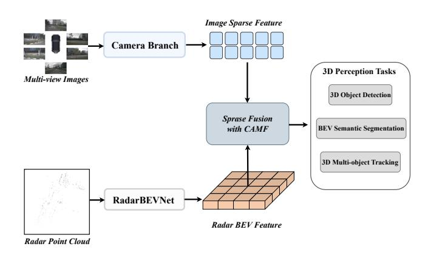
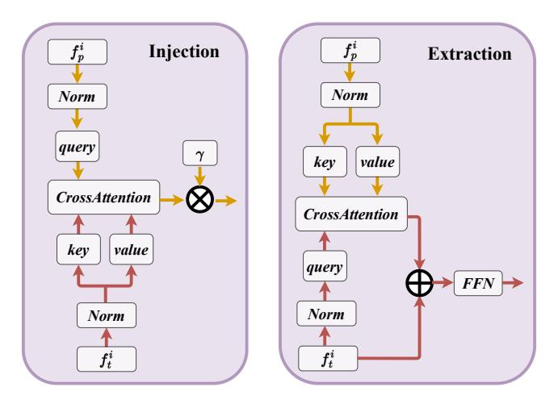
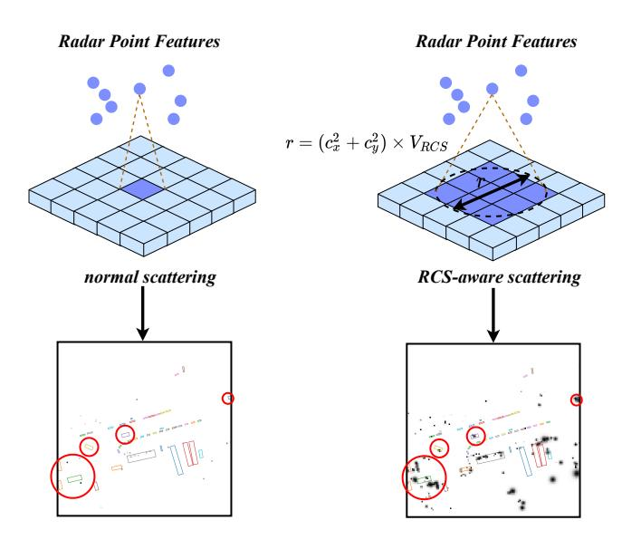
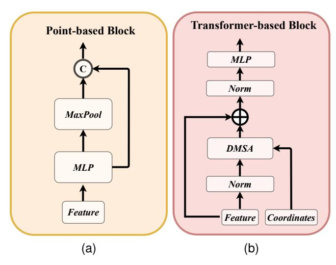
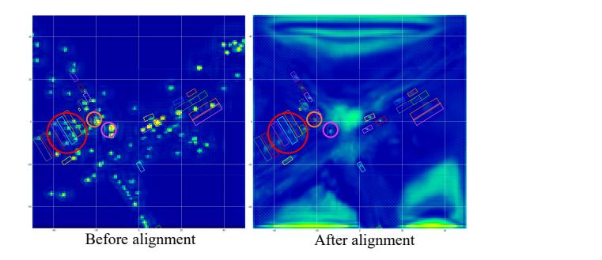
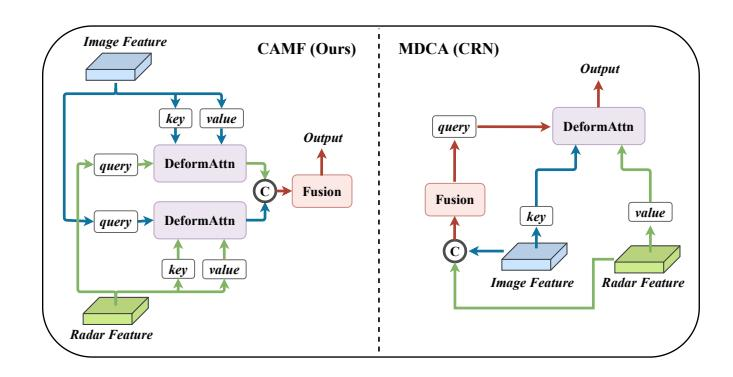

# RCBEVDet++: Toward High-accuracy Radar-Camera Fusion 3D Perception Network

**出处会议：** arXiv:2409.04979（v1，2024-09-08，cs.CV）；未见会议/期刊收录标注。arXiv Comments 字段为 "The extended work of RCBEVDet (CVPR2024)"，正文脚注自述 "A preliminary version of this manuscript was published in [1]"（[1] 即 RCBEVDet, CVPR 2024）  
**是否开源：** https://github.com/VDIGPKU/RCBEVDet（论文摘要原句："The source code and models will be released at https://github.com/VDIGPKU/RCBEVDet."）  
**关键词：** 雷达-摄像头融合、BEV、稀疏融合（Sparse Fusion）、query-based 相机感知、RadarBEVNet、CAMF、3D 检测 / BEV 语义分割 / 3D 多目标跟踪

> **关联笔记：** 本文是 [RCBEVDet](RCBEVDet.md)（CVPR 2024，库内笔记 `library/Multimodal_Fusion/RCBEVDet.md`）的期刊扩展版。RCBEVDet 部分（RadarBEVNet、CAMF 的原理与直觉解释）详见库内笔记，本笔记不重复其推导细节，只做提纲式回顾；重点放在扩展内容 **RCBEVDet++**（稀疏融合 + 支撑 query-based 相机模型 + 扩展到三个感知任务）。两笔记已互相链接：RCBEVDet.md 头部已加指向本笔记的回链（2026-11-03 本班授权写入）。
>
> **Locator 约定：** 本笔记所有章节号（§I–§VI）、表号（Table I–XIV）、公式号（Eq. 1–15）均指 arXiv HTML v1（2409.04979v1）的编号；本地 PDF 导出（Zotero）章节号为 1–6，二者内容一致但编号不同。英文引号内文字为本次从 arXiv HTML 抓取的逐字原文。

---

## 一、概述

### 1.1 与 RCBEVDet 的关系

RCBEVDet++ 不是一篇全新方法的论文，而是 RCBEVDet（CVPR 2024）的扩展版。论文在 §IV 明确写到：

> "As illustrated in Figure 6, to unleash the full potential of RCBEVDet, we extend the CAMF module to accommodate sparse fusion with query-based multi-view camera perception models, which achieve higher accuracy than BEV-based methods."（§IV）
>
> "To distinguish this updated version of RCBEVDet from the original one, we specially named it RCBEVDet++."（§IV）

扩展点有三个（§I）：

1. **CAMF 升级为稀疏融合（sparse fusion）**，从而支持 query-based 的多视角相机感知模型（如 SparseBEV）。论文动机原句（§I）：

   > "Specifically, to adapt the CAMF module for query-based multi-view camera methods, which lack explicit camera BEV features, we replace the original camera BEV features with camera object queries that incorporate 3D coordinates."（§I）

   关键障碍是：query-based 方法（DETR3D/PETR/SparseBEV 一类）**没有显式的相机 BEV 特征图**，而原版 CAMF 的对齐与融合都定义在 BEV 特征图上。RCBEVDet++ 的做法是用「带 3D 坐标的相机 object query」替代相机 BEV 特征参与融合。

2. **任务扩展**：从 3D 目标检测扩展到 3D 检测、BEV 语义分割、3D 多目标跟踪（MOT）三个任务（§IV-B）。

3. **更大骨干下的新 SOTA**：摘要原句：

   > "Notably, with ViT-L as the image backbone, RCBEVDet++ achieves 72.73 NDS and 67.34 mAP in 3D object detection without test-time augmentation or model ensembling."（Abstract）

   （注意 §VI 结论里同样给出 "72.73 NDS and 67.34 mAP"；§V-B1 正文与 Table II 里是四舍五入后的 "72.7 NDS and 67.3 mAP"。）

### 1.2 论文声明的三点贡献（§I）

- 提出 RCBEVDet 框架：RadarBEVNet（雷达 BEV 特征提取）+ CAMF（BEV 空间雷达-相机鲁棒融合）；
- 在 RCBEVDet 基础上提出 RCBEVDet++：扩展 CAMF 以兼容 query-based 多视角相机感知模型，"unleashes the full potential of RCBEVDet in various 3D perception tasks"；
- 在 nuScenes 上：RCBEVDet 提升各类相机检测器并对传感器失效鲁棒；RCBEVDet++ 在雷达-相机多模态 3D 检测、BEV 语义分割、3D MOT 三个任务上取得 SOTA。

---

## 二、方法

### 2.1 基座回顾：RCBEVDet（详见库内笔记 [RCBEVDet](RCBEVDet.md)）

整体是并行双流：多视角图像 → 图像编码器 → 视角转换 → 图像 BEV 特征；雷达点云 → RadarBEVNet → 雷达 BEV 特征；两者经 CAMF 融合后接检测头（§III，Figure 1）。本笔记只列组件名与论文关键表述，原理讲解见库内笔记：

- **RadarBEVNet**（§III-A）：双流雷达骨干（point-based 流学局部特征、transformer-based 流学全局信息，§III-A1）+ Injection and Extraction 模块（两个流逐 block 用 cross-attention 交互，Eq. 5/6）+ RCS-aware BEV 编码器（§III-A2）。RCS-aware 散射的设计动机原句：

  > "The key design of the RCS-aware BEV encoder is the RCS-aware scattering operation, which leverages the RCS as a prior estimate of the object's size"（§III-A2）

  散射时以 $(c_x^2+c_y^2)\times V_{RCS}$ 为半径把单点特征铺到多个 BEV 像素，重叠处用求和池化（原句片段："we perform summation pooling to aggregate these features"，§III-A2），再拼一张按 RCS 生成的高斯权重图（Eq. 7）过 MLP（Eq. 8）。

- **DMSA（距离调制自注意力）**（§III-A1）：

  > "we propose a distance-modulated self-attention mechanism (DMSA) to facilitate model convergence by aggregating neighbor information during the early training iterations."（§III-A1）

  高斯权重 $G_{i,j}=\exp(-D_{i,j}^2/\sigma^2)$（Eq. 2）以 log 形式加进注意力 logits（Eq. 3），$\sigma$ 可学习；多头时每头有独立 $\beta_i$（Eq. 4）。

- **CAMF**（§III-B）：先用双向 deformable cross-attention 对齐（雷达 query 查相机、相机 query 查雷达，Eq. 10），再做 channel & spatial fusion（concat 后过带残差的 CBR 块 + 3 个 CBR 块，§III-B2）。论文强调 deformable attention 把复杂度从 $O(H^2W^2C)$ 降到 $O(HWC^2K)$，$K$ 为参考点数（§III-B1）。

### 2.2 RCBEVDet++ 的核心改动：Sparse Fusion with CAMF（§IV-A）

原版 CAMF 作用在两张 dense BEV 图之间；query-based 相机模型只有一组稀疏的 object query。RCBEVDet++ 的处理流程（§IV-A，Figure 7）：

1. 用图像稀疏特征替换原来的图像 BEV 特征：

   > "Specifically, we first replace the original image BEV features with image sparse features."（§IV-A）

2. **project-and-sample**，用 3D 绝对位置把图像稀疏特征与雷达特征关联：

   > "Then, we perform a project-and-sample process to associate each image sparse feature with a radar feature using 3D absolute position."（§IV-A）
   >
   > "More specifically, we project the 3D absolute position into BEV and sample corresponding radar features with bilinear interpolation to obtain sparse radar features."（§IV-A）

   即：把每个相机 query 的 3D 坐标投影到 BEV 平面，双线性采样出对应的「稀疏雷达特征」，从而得到带 3D 坐标的雷达 object query（§I 里说 "matched with corresponding radar features to form radar object queries"）。

3. 用 MLP 组成的位置编码网络把 3D 绝对位置变成 3D 位置嵌入，加到多模态 query 上：

   > "Next, we utilize the positional encoding network composed of MLP to transform the 3D absolute position into 3D positional embedding and add them to the multi-modal queries."（§IV-A）

4. 对齐：图像稀疏特征与 dense 雷达 BEV 特征之间用 deformable cross-attention，稀疏雷达特征与稀疏图像特征之间用普通 cross-attention（Eq. 11，公式由 HTML 数学标注转写）：

   $$F_c^{sparse} \leftarrow \operatorname{DeformAttn}(z_{q_r},\, p_{q_r},\, F_c^{sparse}),\qquad F_r^{sparse} \leftarrow \operatorname{CrossAttn}(F_c^{sparse},\, F_r).$$

   （对比 RCBEVDet 的 Eq. 10：原版两路都是 DeformAttn，且都定义在 dense BEV 特征上；++ 版对稀疏雷达 query 用了普通 CrossAttn。）

5. 融合：不用原版的多层 CBR，而是一层线性层：

   > "Finally, we adopt a simple linear layer to fuse the sparse multi-modal features."（§IV-A）

   为什么线性层就够？§V-C4 消融给出解释："Lastly, unlike CAMF in RCBEVDet, linear fusion outperforms multi-layer fusion (MLP in Table IX). ... In contrast, sparse query features are 1D features; thus, a linear fusion layer is adequate for practice."——BEV dense 特征是 2D 的、需要空间+通道融合；稀疏 query 特征是 1D 的，线性层足矣。

### 2.3 三个下游任务的适配（§IV-B）

- **3D 检测**：

  > "To predict the 3D bounding boxes for 3D object detection, we adopt a query-based transformer decoder [33] and apply our sparse fusion with the CAMF module in every transformer decoder layer."（§IV-B）

  即在 SparseBEV 的每层 transformer decoder 里都做一次稀疏融合。

- **3D MOT**：沿用 tracking-by-detection，论文描述为 "we perform velocity-based greedy distance matching; that is, we calculate the center distance of each object in multiple frames with the predicted velocity compensation and assign the same ID for objects with the minimum center distance in a greedy way."（§IV-B）

- **BEV 语义分割**：query 特征不适合分割，所以要转回 dense：

  > "For BEV semantic segmentation, we transform multi-modal features into dense BEV features since this requires a dense BEV map with categories."（§IV-B）

  解码器沿用 CVT，每个子任务（vehicle / drivable area / lane）一个头，监督用 sigmoid + focal loss（§IV-B）。

---

## 三、实验

### 3.1 实验设置（§V-A）

- 数据：nuScenes，1000 个场景（Boston + Singapore），其中 850 训练+验证、150 测试（§V-A1）。
- 相机流：RCBEVDet 用 BEVDepth（含 BEVPoolv2），RCBEVDet++ 用 SparseBEV——原句："We adopt BEVDepth [29] with BEVPoolv2 [55] and SparseBEV [33] as the camera stream for RCBEVDet and RCBEVDet++, respectively."（§V-A2）
- 雷达输入："For radar, we accumulate multi-sweep radar points and use RCS and Doppler speed as input features in the same manner as GRIFNet [56] and CRN [13]."（§V-A2）双流雷达骨干的 stage 数 S=3（§V-A2）。
- 训练：两阶段——先训相机模型，再训雷达-相机融合模型，第二阶段冻结相机流参数；所有模型 12 epochs、AdamW；数据增强包括图像旋转/裁剪/缩放/翻转与雷达水平翻转/水平旋转/坐标缩放（§V-A2）。
- 消融默认配置：nuScenes val、ResNet-50、256×704 输入、128×128 BEV（§V-C）。

### 3.2 3D 目标检测：与 SOTA 对比（§V-B1）

**Table I：nuScenes val set 3D 检测结果**（表题："Comparison of 3D object detection results on nuScenes val set. 'C' and 'R' represent camera and radar, respectively."，§V-B1；逐行照抄）：

| Method | Input | Backbone | Image Size | NDS↑ | mAP↑ | mATE↓ | mASE↓ | mAOE↓ | mAVE↓ | mAAE↓ |
|---|---|---|---|---|---|---|---|---|---|---|
| CenterFusion [14] | C+R | DLA34 | 448×800 | 45.3 | 33.2 | 0.649 | 0.263 | 0.535 | 0.540 | 0.142 |
| CRAFT [12] | C+R | DLA34 | 448×800 | 51.7 | 41.1 | 0.494 | 0.276 | 0.454 | 0.486 | 0.176 |
| RCBEVDet (Ours) | C+R | DLA34 | 448×800 | 56.3 | 45.3 | 0.492 | 0.269 | 0.449 | 0.230 | 0.188 |
| RCBEV4d [59] | C+R | Swin-T | 256×704 | 49.7 | 38.1 | 0.526 | 0.272 | 0.445 | 0.465 | 0.185 |
| RCBEVDet (Ours) | C+R | Swin-T | 256×704 | 56.2 | 49.6 | 0.496 | 0.271 | 0.418 | 0.239 | 0.179 |
| CRN [13] | C+R | ResNet-18 | 256×704 | 54.3 | 44.8 | 0.518 | 0.283 | 0.552 | 0.279 | 0.180 |
| RCBEVDet (Ours) | C+R | ResNet-18 | 256×704 | 54.8 | 42.9 | 0.502 | 0.291 | 0.432 | 0.210 | 0.178 |
| BEVDet [16] | C | ResNet-50 | 256×704 | 39.2 | 31.2 | 0.691 | 0.272 | 0.523 | 0.909 | 0.247 |
| BEVDepth [29] | C | ResNet-50 | 256×704 | 47.5 | 35.1 | 0.639 | 0.267 | 0.479 | 0.428 | 0.198 |
| SOLOFusion [39] | C | ResNet-50 | 256×704 | 53.4 | 42.7 | 0.567 | 0.274 | 0.411 | 0.252 | 0.188 |
| StreamPETR [34] | C | ResNet-50 | 256×704 | 54.0 | 43.2 | 0.581 | 0.272 | 0.413 | 0.295 | 0.195 |
| SparseBEV [33] | C | ResNet-50 | 256×704 | 54.5 | 43.2 | 0.606 | 0.274 | 0.387 | 0.251 | 0.186 |
| CRN [13] | C+R | ResNet-50 | 256×704 | 56.0 | 49.0 | 0.487 | 0.277 | 0.542 | 0.344 | 0.197 |
| RCBEVDet (Ours) | C+R | ResNet-50 | 256×704 | 56.8 | 45.3 | 0.486 | 0.285 | 0.404 | 0.220 | 0.192 |
| RCBEVDet++ (Ours) | C+R | ResNet-50 | 256×704 | 60.4 | 51.9 | 0.488 | 0.268 | 0.408 | 0.221 | 0.177 |

**Table II：nuScenes test set 3D 检测结果**（表题："Comparison of 3D object detection results on nuScenes test set. 'L', 'C', and 'R' represent LiDAR, camera, and radar, respectively. † uses future frames. We do not use test-time data augmentation or ensemble for submission."，§V-B1；逐行照抄）：

| Method | Input | Backbone | NDS↑ | mAP↑ | mATE↓ | mASE↓ | mAOE↓ | mAVE↓ | mAAE↓ |
|---|---|---|---|---|---|---|---|---|---|
| CenterPoint [57] | L | VoxelNet | 67.3 | 60.3 | 0.262 | 0.239 | 0.361 | 0.288 | 0.136 |
| TransFusion-L [60] | L | VoxelNet | 70.2 | 65.5 | 0.256 | 0.240 | 0.351 | 0.278 | 0.129 |
| KPConvPillars [61] | R | Pillars | 13.9 | 4.9 | 0.823 | 0.428 | 0.607 | 2.081 | 1.000 |
| CenterFusion [14] | C+R | DLA34 | 44.9 | 32.6 | 0.631 | 0.261 | 0.516 | 0.614 | 0.115 |
| RCBEV [59] | C+R | Swin-T | 48.6 | 40.6 | 0.484 | 0.257 | 0.587 | 0.702 | 0.140 |
| MVFusion [44] | C+R | V2-99 | 51.7 | 45.3 | 0.569 | 0.246 | 0.379 | 0.781 | 0.128 |
| CRAFT [12] | C+R | DLA34 | 52.3 | 41.1 | 0.467 | 0.268 | 0.456 | 0.519 | 0.114 |
| BEVFormer [17] | C | V2-99 | 56.9 | 48.1 | 0.582 | 0.256 | 0.375 | 0.378 | 0.126 |
| PETRv2 [40] | C | V2-99 | 58.2 | 49.0 | 0.561 | 0.243 | 0.361 | 0.343 | 0.120 |
| BEVDepth [29] | C | V2-99 | 60.5 | 51.5 | 0.446 | 0.242 | 0.377 | 0.324 | 0.135 |
| BEVDepth [29] | C | ConvNeXt-B | 60.9 | 52.0 | 0.445 | 0.243 | 0.352 | 0.347 | 0.127 |
| BEVStereo [62] | C | V2-99 | 61.0 | 52.5 | 0.431 | 0.246 | 0.358 | 0.357 | 0.138 |
| SOLOFusion [39] | C | ConvNeXt-B | 61.9 | 54.0 | 0.453 | 0.257 | 0.376 | 0.276 | 0.148 |
| CRN [13] | C+R | ConvNeXt-B | 62.4 | 57.5 | 0.416 | 0.264 | 0.456 | 0.365 | 0.130 |
| StreamPETR [34] | C | V2-99 | 63.6 | 55.0 | 0.493 | 0.241 | 0.343 | 0.243 | 0.123 |
| SparseBEV [33] | C | V2-99 | 63.6 | 55.6 | 0.485 | 0.244 | 0.332 | 0.246 | 0.117 |
| SparseBEV† [33] | C | V2-99 | 67.5 | 60.3 | 0.425 | 0.239 | 0.311 | 0.172 | 0.116 |
| RCBEVDet (Ours) | C+R | V2-99 | 63.9 | 55.0 | 0.390 | 0.234 | 0.362 | 0.259 | 0.113 |
| RCBEVDet++ (Ours) | C+R | V2-99 | 68.7 | 62.6 | 0.437 | 0.252 | 0.181 | 0.203 | 0.191 |
| StreamPETR [34] | C | ViT-L | 67.6 | 62.0 | 0.470 | 0.241 | 0.258 | 0.236 | 0.134 |
| Far3D [63] | C | ViT-L | 68.7 | 63.5 | 0.432 | 0.237 | 0.278 | 0.227 | 0.130 |
| SparseBEV† [34] | C | ViT-L | 70.2 | - | - | - | - | - | - |
| RCBEVDet++† (Ours) | C+R | ViT-L | 72.7 | 67.3 | 0.341 | 0.234 | 0.241 | 0.147 | 0.130 |

正文关键结论（§V-B1，原句）：

> "As shown in Table I, RCBEVDet outperforms previous radar-camera multi-modal 3D object detection methods across various backbones. Besides, based on SparseBEV, RCBEVDet++ surpasses CRN by 4.4 NDS, showing the effectiveness of our fusion method."
>
> "Furthermore, RCBEVDet and RCBEVDet++ reduce the velocity error by 14.6% compared with the previous best method, demonstrating the efficiency of our method in utilizing radar information."
>
> "On test sets, with the V2-99 backbone, RCBEVDet++ improves the SparseBEV baseline by 5.1 NDS and 7.0 mAP and surpasses its offline version with future frames."
>
> "Moreover, RCBEVDet++ with the larger ViT-L backbone achieves 72.7 NDS and 67.3 mAP without test-time data augmentation, setting new state-of-the-art radar-camera 3D object detection results on nuScenes."

（笔记作者观察：Table II 中 "SparseBEV† [34]" 该行引用编号为 [34]（StreamPETR），与同表其余 SparseBEV 行的 [33] 不一致，疑为原文笔误；此处照原文抄录。另外 val 集上 RCBEVDet (ResNet-50) 的 mAP 45.3 低于 CRN 的 49.0，论文强调的是 NDS 与速度误差（mAVE 0.220 vs 0.344）优势——数字均见表 I。）

### 3.3 BEV 语义分割：与 SOTA 对比（§V-B2）

**Table III：nuScenes val set BEV 语义分割**（表题含 "'Driv. Area' denotes drivable area. 'mIoU' is the average IoU over Vehicle, Drivable Area, and Lane. † is a Simple-BEV [45] customized by BEVCar [37]."，§V-B2；逐行照抄）：

| Methods | Input | Backbone | mIoU↑ | Vehicle↑ | Driv. Area↑ | Lane↑ |
|---|---|---|---|---|---|---|
| CVT [35] | C | EfficientNet | 46.6 | 36.0 | 74.3 | 29.4 |
| BEVFormer-S [17] | C | ResNet-101 | 48.4 | 43.2 | 80.7 | 21.3 |
| CRN [13] | C+R | ResNet-50 | - | 58.8 | 82.1 | - |
| Simple-BEV++† [37] | C+R | ResNet-101 | 55.4 | 52.7 | 77.7 | 35.8 |
| BEVGuide [36] | C+R | EfficientNet | 60.0 | 59.2 | 76.7 | 44.2 |
| BEVCar [37] | C+R | ResNet-101 | 61.0 | 57.3 | 81.8 | 43.8 |
| RCBEVDet++ (Ours) | C+R | ResNet-101 | 62.8 | 55.3 | 82.7 | 50.5 |

正文原句（§V-B2）：

> "With the ResNet-101 backbone, RCBEVDet++ shows a favorable performance increase over CRN for the "Drivable Area" class (+0.6 IoU) and over BEVGuide for the "Lane" class (+6.3 IoU), respectively."
>
> "In the combined evaluation for all tasks, RCBEVDet++ achieves state-of-the-art performance with 62.8 mIoU, outperforming previous best results by 1.8 mIoU."

（笔记作者观察：RCBEVDet++ 的 Vehicle IoU 55.3 并非表内最高（BEVGuide 59.2、CRN 58.8），优势主要在 Lane。数字见表 III。）

### 3.4 3D 多目标跟踪：与 SOTA 对比（§V-B3）

**Table IV：nuScenes test set 3D MOT**（表题："Comparison of 3D multi-object tracking on nuScenes test set. 'L', 'C', and 'R' represent LiDAR, camera, and radar, respectively."，§V-B3；逐行照抄）：

| Methods | Input | AMOTA↑ | AMOTP↓ |
|---|---|---|---|
| CenterPoint [57] | L | 63.8 | 0.555 |
| UVTR [64] | C | 51.9 | 1.125 |
| Sparse4D [41] | C | 51.9 | 1.078 |
| ByteTrackV2 [65] | C | 56.4 | 1.005 |
| StreamPETR [34] | C | 56.6 | 0.975 |
| CRN [13] | C+R | 56.9 | 0.809 |
| RCBEVDet++ (Ours) | C+R | 59.6 | 0.713 |

正文原句（§V-B3）：

> "Due to the high accuracy of our method in estimating objects' locations and velocities, RCBEVDet++ achieves the best AMOTA and AMOTP simultaneously compared with state-of-the-art methods."

### 3.5 消融（§V-C）

**主组件消融（Table V，§V-C1，逐行照抄）**——从 BEVDepth 出发逐步加组件构成 RCBEVDet：

| Model Configuration | Input | NDS↑ | mAP↑ |
|---|---|---|---|
| BEVDepth [29] | C | 47.5 | 35.1 |
| + Temporal [30] | C | 51.9 ↑4.4 | 40.5 ↑5.4 |
| + PointPillar+BEVFusion | C+R | 53.6 ↑1.7 | 42.3 ↑1.8 |
| + RadarBEVNet | C+R | 55.7 ↑2.1 | 45.3 ↑3.0 |
| + CAMF | C+R | 56.4 ↑0.7 | 45.6 ↑0.3 |
| + Temporal Supervision | C+R | 56.8 ↑0.4 | 45.3 ↓0.3 |

正文原句（§V-C1）："Additionally, we follow Hop [66] to incorporate extra multi-frame losses, termed Temporal Supervision, resulting in a 0.4 NDS improvement alongside a 0.3 mAP reduction."

**RadarBEVNet 消融（Table VI，§V-C2，逐行照抄）**：

| Radar Backbone | NDS↑ | mAP↑ |
|---|---|---|
| PointPillar | 54.3 | 42.6 |
| + RCS-aware BEV encoder | 55.7 ↑1.4 | 44.5 ↑1.9 |
| + Transformer Backbone | 55.8 ↑0.1 | 44.8 ↑0.3 |
| + Injection and Extraction module | 56.4 ↑0.6 | 45.6 ↑0.8 |

要点：单独加 Transformer 流几乎无增益（+0.1 NDS），必须配合 Injection and Extraction 模块才有 +0.6 NDS / +0.8 mAP（§V-C2）。

**PointPillar vs RadarBEVNet 跨输入模态对比（Table VII，§V-C2，逐行照抄；"RadarBEVNet" 两行的 Input 列为竖向合并单元格，分别沿用上行的 R / C+R）**：

| Radar Backbone | Input | NDS↑ | mAP↑ |
|---|---|---|---|
| PointPillar | R | 20.3 | 7.3 |
| RadarBEVNet | | 22.0 ↑1.7 | 10.8 ↑3.5 |
| PointPillar | C+R | 54.3 | 42.6 |
| RadarBEVNet | | 56.4 ↑2.1 | 45.6 ↑3.0 |

正文原句（§V-C2）："Furthermore, we compare the proposed RadarBEVNet with PointPillar on different input modalities. As shown in Table VII, RadarBEVNet shows superior detection performance compared to PointPillar, with improvements of 1.7 NDS and 2.1 NDS for radar and radar-camera inputs, respectively."

**CAMF 消融（Table VIII，§V-C3，逐行照抄）**：

| Fusion Method | NDS↑ | mAP↑ |
|---|---|---|
| BEVFusion [4] | 55.7 | 45.3 |
| + Deformable Cross-Attention | 56.1 ↑0.4 | 45.5 ↑0.2 |
| + Channel and Spatial Fusion | 56.4 ↑0.3 | 45.6 ↑0.1 |

正文原句（§V-C3）："When the Deformable Cross Attention is incorporated for multi-modal BEV feature alignment, the 3D detection performance improves from 55.7 NDS and 45.3 mAP to 56.1 NDS and 45.5 mAP."

**Sparse Fusion with CAMF 消融（Table IX，§V-C4，逐行照抄）**——这是 RCBEVDet++ 增量部分的逐步拆解：

| DeformAttn-only | Radar Query Sample | Positional Encoding | Fusion Layer | NDS↑ | mAP↑ |
|---|---|---|---|---|---|
| × | × | - | - | 54.5 | 43.2 |
| ✓ | × | Learnable | MLP | 55.7↑1.2 | 45.5↑2.3 |
| ✓ | ✓ | Learnable | MLP | 58.1↑2.4 | 49.7↑4.2 |
| ✓ | ✓ | Sine | MLP | 60.0↑1.9 | 51.6↑1.9 |
| ✓ | ✓ | Sine | Linear | 60.4↑0.4 | 51.9↑0.3 |

正文原句（§V-C4）：

> "When only adopting deformable attention to align radar BEV features with image sparse features obtains performance gains of 1.2 NDS and 2.3 mAP."
>
> "After adding the radar query sample for multi-modal feature alignment further boosts detection performance by 2.4 NDS and 4.2 mAP."
>
> "Besides, we observe that replacing learnable positional encoding with non-parametric encoding (i.e., sine positional encoding) improves results by 1.9 NDS and 1.9 mAP."

（即从 SparseBEV 基线 54.5/43.2 到最终 60.4/51.9：deformable attention 对齐 +1.2 NDS，radar query sample +2.4 NDS，sine 位置编码 +1.9 NDS，linear 融合 +0.4 NDS；数字见表 IX 与 §V-C4 原句。）

### 3.6 BEV 分割的任务间权衡（§V-D）

**Table X（§V-D，逐行照抄）**——调整三个子任务的损失权重：

| Loss Weights | | | IoU | | | mIoU↑ |
|---|---|---|---|---|---|---|
| Vehicle | Driv. Area | Lane | Vehicle↑ | Driv. Area↑ | Lane↑ | |
| 100 | 100 | 100 | 48.7 | 79.2 | 45.3 | 57.7 |
| 200 | 50 | 150 | 51.2 | 78.8 | 46.2 | 58.7 |
| 400 | 80 | 200 | 52.8 | 79.8 | 46.0 | 59.5 |
| 500 | 75 | 175 | 52.8 | 78.7 | 44.6 | 58.7 |
| 600 | 70 | 300 | 52.7 | 78.1 | 45.9 | 58.9 |

（原文该表为两级表头：第一行 "Loss Weights | IoU | mIoU↑"，第二行 "Vehicle | Driv. Area | Lane | Vehicle↑ | Driv. Area↑ | Lane↑"；上表为 markdown 展示需要把两级表头排成三行，数据行逐字未动。）

正文原句（§V-D）：

> "We observe that applying equal loss weights for each task obtains 57.7 mIoU."
>
> "The best task trade-off is achieved with loss weights of 400, 80, and 200 for vehicle, drivable area, and lane, respectively; further increasing loss weights for vehicle and lane classes can hurt the segmentation performance of all three tasks."

### 3.7 鲁棒性（§V-E）

**传感器失效（Table XI，§V-E1，逐行照抄）**——报告 Car 类 mAP；原表为两级表头（"Input | Drop | # of view drops" / "0 | 1 | 3 | All"），BEVFusion/CRN/RCBEVDet 各有两行（Drop=C 与 Drop=R），续行的 Method/Input 列为竖向合并单元格：

| | Input | Drop | # of view drops | | | |
|---|---|---|---|---|---|---|
| | | | 0 | 1 | 3 | All |
| BEVDepth [29] | C | C | 49.4 | 41.1 | 24.2 | 0 |
| CenterPoint [57] | R | R | 30.6 | 25.3 | 14.9 | 0 |
| BEVFusion [4] | C+R | C | 63.9 | 58.5 | 45.7 | 14.3 |
| | | R | 59.9 | 50.9 | 34.4 | |
| CRN [13] | C+R | C | 68.8 | 62.4 | 48.9 | 12.8 |
| | | R | 64.3 | 57.0 | 43.8 | |
| RCBEVDet (Ours) | C+R | C | 72.5 | 66.9 | 53.5 | 16.5 |
| | | R | 71.6 | 66.1 | 62.1 | |

正文原句（§V-E1）：

> "Specifically, RCBEVDet consistently outperforms CRN and BEVFusion, showing higher mAP for the Car class in all sensor failure cases."
>
> "Notably, the performance of CRN decreases by 4.5, 11.8, and 25.0 mAP in three radar sensor failure cases, while RCBEVDet only experiences drops of 0.9, 6.4, and 10.4 mAP."

**雷达错位（Modal Alignment，Table XII，§V-E2，逐行照抄）**——对每个雷达点的 x/y 坐标均匀采样 $[-1,1]$ 噪声：

| Radar Input | RCBEVDet | | CRN | |
|---|---|---|---|---|
| | NDS↑ | mAP↑ | NDS↑ | mAP↑ |
| Original | 56.8 | 45.3 | 56.0 | 49.0 |
| Noise | 55.5 ↓1.3 | 43.7 ↓1.5 | 53.7 ↓2.3 | 43.9 ↓5.1 |

正文原句（§V-E2）：

> "As shown in Table XII, RCBEVDet only drops 1.3 NDS and 1.5 mAP with noise radar inputs, while CRN decreases by 2.3 NDS and 5.1 mAP."

**与 CRN 的机制对比（§V-E3）**：CRN 的 MDCA 是「先融合、后对齐」，CAMF 是「先对齐、后融合」。原句：

> "Thus, the fusion-then-alignment pipeline of MDCA in CRN has limited alignment precision because it still has feature mismatches in the camera and radar fusion process."
>
> "In comparison, our CAMF, which employs an alignment-then-fusion pipeline, fully leverages the alignment capabilities of deformable attention in the first step and achieves better feature fusion robustness."（§V-E3）

（与库内笔记 RCBEVDet.md 第三节的 CRN/CAMF 对比一致。）

### 3.8 泛化性（§V-F）

**骨干泛化（Table XIII，§V-F1，逐行照抄）**——RCBEVDet 挂在 BEVDepth+Temporal 上换骨干：

| Method | Input | Backbone | Image Size | NDS↑ | mAP↑ |
|---|---|---|---|---|---|
| BEVDepth + Temporal | C | DLA34 | 448×800 | 52.5 | 40.2 |
| RCBEVDet (Ours) | C+R | DLA34 | 448×800 | 56.3↑3.8 | 45.3↑5.1 |
| BEVDepth + Temporal | C | Swin-T | 256×704 | 51.8 | 39.4 |
| RCBEVDet (Ours) | C+R | Swin-T | 256×704 | 56.2↑4.4 | 49.6↑10.2 |
| BEVDepth + Temporal | C | ResNet-18 | 256×704 | 49.9 | 35.0 |
| RCBEVDet (Ours) | C+R | ResNet-18 | 256×704 | 54.8↑4.9 | 42.9↑7.9 |
| BEVDepth + Temporal | C | ResNet-50 | 256×704 | 51.9 | 40.5 |
| RCBEVDet (Ours) | C+R | ResNet-50 | 256×704 | 56.8↑4.9 | 45.3↑4.8 |

正文原句（§V-F1）："As shown in Table XIII, our method can improve baseline performance by over 3.8∼4.9 NDS and 4.8∼10.2 mAP across different backbones."

**检测器泛化（Table XIV，§V-F2，逐行照抄）**——RCBEVDet/RCBEVDet++ 挂到四类相机检测器：

| Method | Input | NDS↑ | mAP↑ |
|---|---|---|---|
| BEVDet + Temporal | C | 48.7 | 35.4 |
| RCBEVDet (Ours) | C+R | 54.3↑5.6 | 41.3↑5.9 |
| BEVDepth + Temporal | C | 51.9 | 40.5 |
| RCBEVDet (Ours) | C+R | 56.8↑4.9 | 45.3↑4.8 |
| StreamPETR | C | 54.0 | 43.2 |
| RCBEVDet++ (Ours) | C+R | 59.6↑5.6 | 51.5↑8.3 |
| SparseBEV | C | 54.5 | 43.2 |
| RCBEVDet++ (Ours) | C+R | 60.4↑5.9 | 51.9↑8.7 |

正文原句（§V-F2）：

> "Specifically, for the LSS-based method, RCBEVDet improves 5.6 NDS and 4.9 NDS for BEVDet and BEVDepth, respectively."
>
> "For the transformer-based detectors, RCBEVDet++ obtains similar performance gains in NDS, i.e., 5.6 NDS and 5.9 NDS improvement for StreamPETR and SparseBEV, respectively."
>
> "The reason is that LSS-based methods typically use depth supervision from LiDAR points for more accurate 3D position prediction, while transformer-based methods learn 3D position implicitly."

（即 transformer-based 相机检测器从雷达补充的深度信息中获益更多、mAP 提升更大。）

---

## 四、核心结论

1. **论文自述结论（§VI 原句）**：

   > "To unleash the full potential of RCBEVDet, we propose RCBEVDet++, which extends the CAMF module to support query-based multi-view camera perception models with sparse fusion and adapts to more perception tasks, including 3D object detection, BEV semantic segmentation, and 3D multi-object tracking."
   >
   > "Notably, without using test-time augmentation or model ensemble, RCBEVDet++ obtains 72.73 NDS and 67.34 mAP for 3D object detection with ViT-L as the image backbone."（§VI）

2. **对工程选型的含义（均为论文声称，未经本库独立验证）**：
   - 雷达-相机融合不必停在 BEV-BEV 拼接：query-based 相机检测器可以通过「3D 坐标投影 + 双线性采样雷达特征 + deformable/cross attention + 线性融合」的稀疏融合路径吃到雷达增益（§IV-A、Table IX：SparseBEV 54.5→60.4 NDS）。
   - 雷达对速度误差的收益最稳定：val 集上 mAVE 0.220/0.221（RCBEVDet/++）对比 CRN 0.344（Table I），论文称速度误差比此前最优低 14.6%（§V-B1）。
   - 稀疏 1D query 特征用 linear 融合反而优于 MLP 多层融合（§V-C4）；dense BEV 特征才需要 channel+spatial 多层融合。
   - 鲁棒性场景（雷达失效/雷达错位）下 alignment-then-fusion 的 CAMF 比 CRN 的 fusion-then-alignment 稳（Table XI/XII，§V-E3）。
   - 论文还有一个中间设计结论：RadarBEVNet 的 transformer 流单独加几乎无效（+0.1 NDS），必须与 point 流经 Injection & Extraction 交互才有效（Table VI，§V-C2）。

3. **本笔记与 claim 的边界**：以上结果均为论文声称（nuScenes val/test、未做 TTA/ensemble 的 Table II 条目）。若后续要建 claim 卡，需按 `templates/claim.md` 独立成卡并附 falsifiers，本笔记不承载 verified 结论。

---

## TODO

- [x] **配图已嵌入**（2026-11-03 入库时逐张人工核对图像内容后引用；论文图号经本地 Zotero PDF 导出的图题逐条核对确认）：Fig. 1（_page_2_Figure_1）、Fig. 2（_page_3_Picture_12）、Fig. 3（_page_4_Picture_1）、Fig. 4（_page_4_Picture_3）、Fig. 5（_page_4_Picture_8）、Fig. 6（_page_5_Picture_1）、Fig. 7（_page_5_Picture_11）、Fig. 8（_page_9_Figure_12）、Fig. 9（_page_10_Figure_12）。注意 `_page_N_M.jpeg` 为 PDF 导出自动编号，与论文图号无关（如 _page_10_Figure_12.jpeg 实为论文 Fig. 9）。
- [x] 本笔记已入库（2026-11-03，nightshift 本班授权直写 `library/`），未经用户独立核验；引用规则遵循 AGENTS.md：论文结论均表述为「论文声称」，未做独立验证。
- [ ] 抓取来源（本次实际抓取，日期 2026-11-02）：
  - arXiv abs 页：https://arxiv.org/abs/2409.04979 （核对标题 "RCBEVDet++: Toward High-accuracy Radar-Camera Fusion 3D Perception Network"、作者 Zhiwei Lin, Zhe Liu, Yongtao Wang, Le Zhang, Ce Zhu、v1 2024-09-08、Comments "The extended work of RCBEVDet (CVPR2024)"）
  - arXiv HTML 全文（LaTeXML 生成）：https://arxiv.org/html/2409.04979v1 （全部引文、表格、公式转写均来自此页；正文引文已脚本核验为该页逐字文本）
  - 本地辅助材料：`library/assets/RCBEVDet++/Lin 等 - 2024 - RCBEVDet++ Toward High-accuracy Radar-Camera Fusion 3D Perception Network.md`（Zotero PDF 导出，标题与 arXiv 一致，仅用于交叉确认，未作为引文来源）
- [ ] 遗留观察（写笔记时发现，供调度班次参考）：① Table II 中 "SparseBEV† [34]" 引用编号疑为原文笔误（其余 SparseBEV 行为 [33]）；② 论文 §V-A1 原文有拼写错误 "autonomous diving benchmark"（应为 driving），本笔记未引用该句；③ 本地 Zotero 导出章节编号为 1–6，与 arXiv HTML 的罗马数字编号 I–VI 对应，引用时注意区分。
- [x] 入库前 QA（2026-11-03）：本笔记 65 条英文引句逐一用 Grep 验证在笔记文本中逐字存在（自洽检查全部通过）；另对本地 Zotero PDF 导出做源级抽查，12 条关键引句全部逐字命中（含 DMSA、sparse fusion 流程、72.73/67.34、Table IX/XII 相关句子）；正文-表格数字交叉验算 16 处一致（对 CRN +4.4 NDS、test 对 SparseBEV +5.1/+7.0、分割 1.8/0.6/6.3、Table V 链式增量 4.4/1.7/2.1/0.7/0.4、Table XI 的 4.5/11.8/25.0 与 0.9/6.4/10.4、Table XIII/XIV 增量等）；9 张素材图逐张核对图号后嵌入。
