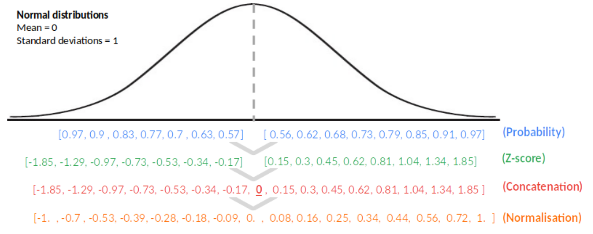
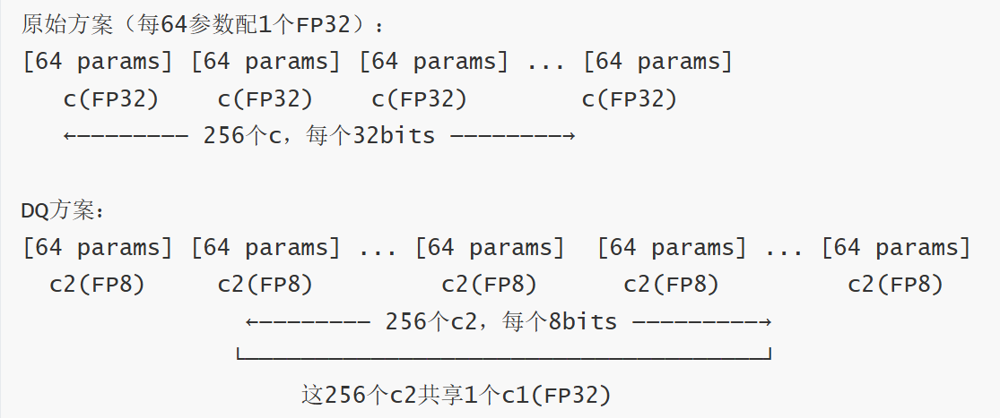
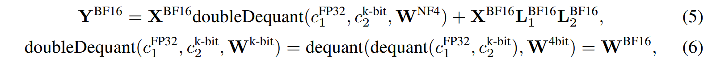
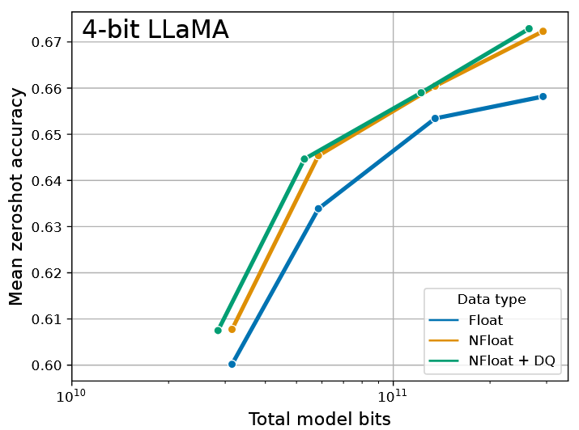
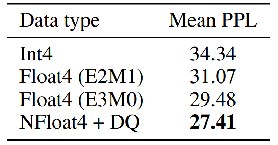
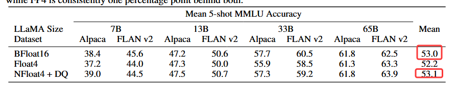
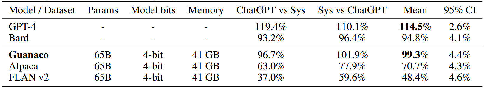

# QLoRA: Efficient Finetuning of Quantized LLMs

**出处会议：** NeurIPS 2023（官方 proceedings 页 https://papers.nips.cc/paper_files/paper/2023/hash/1feb87871436031bdc0f2beaa62a049b-Abstract-Conference.html ：标题一致，作者 Tim Dettmers, Artidoro Pagnoni, Ari Holtzman, Luke Zettlemoyer，"Advances in Neural Information Processing Systems 36 (NeurIPS 2023) Main Conference Track"，DOI: 10.52202/075280-0441；arXiv abs 页 Comments: "Extended NeurIPS submission"）。**机构注记（头部如实存疑）：** 本次抓取的全部材料仅见 University of Washington、未见 Meta 署名，任务给定"华盛顿大学 & Meta"中的 Meta 未能证实（详见下方来源核验与 TODO）  
**是否开源：** 是。论文脚注 1（§1）给出 "https://github.com/artidoro/qlora and https://github.com/TimDettmers/bitsandbytes"；摘要原句："We release all of our models and code, including CUDA kernels for 4-bit training." 并称开源 7/13/33/65B 四种规模 × 8 个指令数据集共 32 个微调适配器（§1）。本次抓取仅核实链接在论文文本中存在，未访问仓库核实内容。  
**关键词：** 4-bit NormalFloat（NF4）、Double Quantization（量化常数再量化）、Paged Optimizers（NVIDIA unified memory 页切换）、冻结 4-bit 底座 + LoRA 反传、Guanaco、65B 单卡 48GB 微调、MMLU/Vicuna/OA 基准、Elo + GPT-4 评估

> 来源与核验（抓取日期 2026-11-02）：
> - arXiv abs 页 https://arxiv.org/abs/2305.14314 ，标题 "QLoRA: Efficient Finetuning of Quantized LLMs"，与任务给定标题逐字一致，允许使用。作者：Tim Dettmers、Artidoro Pagnoni、Ari Holtzman、Luke Zettlemoyer；仅 v1（2023-05-23 提交，无后续版本）。
> - 全文引文底本为 arXiv 原生 HTML（LaTeXML 渲染）https://arxiv.org/html/2305.14314v1 ，并与 ar5iv https://ar5iv.labs.arxiv.org/html/2305.14314 与 arXiv v1 PDF https://arxiv.org/pdf/2305.14314v1 （26 页，2023-05-24 生成）交叉核对：全部 13 张表的行与 caption 在两个 HTML 源逐格一致；引文在两个 HTML 源中逐字存在；表格数字另做 PDF 抽查（v1 PDF 为双栏/侧浮动排版，正文引文的 PDF 逐句对齐不作为通过标准）。
> - 技术性转写约定（内容不变）：数学对象取 LaTeXML 可见渲染形式（如 K=32、τ=0.43、2k−1、[−1,1]、N(0,1)、NFk；下标/上标按可见顺序平写，如 c2、NFk），并将 ⋅ 统一为 ·、数学负号 − 与连字符 - 不区分；引文内方括号数字（如 [57]）为原文引用标记，ar5iv 将部分同类标记渲染为作者-年份（如 Chiang et al. 2023），脚本核验时两侧按机械规则剥离引用标记后比对，原生 HTML 与 PDF 中 [n] 逐字存在；原文拼写/语法问题（如 "wich does"、"the the Vicuna benchmark"、"to date finetunable"、"hown in Table 12"）保留原样。以上转写均经脚本对多源文本归一化核验。
> - 机构：v1 PDF 首页印 "University of Washington"（四位作者邮箱 @cs.washington.edu）；本次抓取的全部材料（abs 页、两个 HTML、PDF、NeurIPS proceedings 页）中均未出现 Meta 署名，任务给定"华盛顿大学 & Meta"中的 Meta 未能从本次素材证实，见 TODO。
> - 本笔记源自草稿（nightshift/drafts/QLoRA.md，保留不删；2026-11-03 经入库前 QA 后写入 library/Quantization/），未经用户核阅前所有结论均属"论文声称 / 尚未独立验证"。

------

## 1. 概述

- 任务与头条结果（Abstract 原句）："We present QLoRA, an efficient finetuning approach that reduces memory usage enough to finetune a 65B parameter model on a single 48GB GPU while preserving full 16-bit finetuning task performance." 机制一句话（Abstract）："QLoRA backpropagates gradients through a frozen, 4-bit quantized pretrained language model into Low Rank Adapters (LoRA)."
- 最佳模型（Abstract）："Our best model family, which we name Guanaco, outperforms all previous openly released models on the Vicuna benchmark, reaching 99.3% of the performance level of ChatGPT while only requiring 24 hours of finetuning on a single GPU."
- 三个组件（Abstract）："QLoRA introduces a number of innovations to save memory without sacrificing performance: (a) 4-bit NormalFloat (NF4), a new data type that is information theoretically optimal for normally distributed weights (b) Double Quantization to reduce the average memory footprint by quantizing the quantization constants, and (c) Paged Optimizers to manage memory spikes."
- 动机（§1）："However, finetuning very large models is prohibitively expensive; regular 16-bit finetuning of a LLaMA 65B parameter model [57] requires more than 780 GB of GPU memory." 而既有量化（§1）："While recent quantization methods can reduce the memory footprint of LLMs [14, 13, 18, 66], such techniques only work for inference and break down during training [65]."
- 首次声明（§1）："We demonstrate for the first time that it is possible to finetune a quantized 4-bit model without any performance degradation." 显存对比（§1，原文 >、< 为单字符数学符号）："QLoRA reduces the average memory requirements of finetuning a 65B parameter model from >780GB of GPU memory to <48GB without degrading the runtime or predictive performance compared to a 16-bit fully finetuned baseline."（§1 随后一句原文语法如此："This marks a significant shift in accessibility of LLM finetuning: now the largest publicly available models to date finetunable on a single GPU."）
- Guanaco 梯度（§1）："Using QLoRA, we train the Guanaco family of models, with the second best model reaching 97.8% of the performance level of ChatGPT on the Vicuna [10] benchmark, while being trainable in less than 12 hours on a single consumer GPU; using a single professional GPU over 24 hours we achieve 99.3% with our largest model, essentially closing the gap to ChatGPT on the Vicuna benchmark." 部署口径（§1）："When deployed, our smallest Guanaco model (7B parameters) requires just 5 GB of memory and outperforms a 26 GB Alpaca model by more than 20 percentage points on the Vicuna benchmark (Table 6)."
- 三个组件的展开（§1）："(1) 4-bit NormalFloat, an information theoretically optimal quantization data type for normally distributed data that yields better empirical results than 4-bit Integers and 4-bit Floats. (2) Double Quantization, a method that quantizes the quantization constants, saving an average of about 0.37 bits per parameter (approximately 3 GB for a 65B model). (3) Paged Optimizers, using NVIDIA unified memory to avoid the gradient checkpointing memory spikes that occur when processing a mini-batch with a long sequence length." 组合方式（§1）："We combine these contributions into a better tuned LoRA approach that includes adapters at every network layer and thereby avoids almost all of the accuracy tradeoffs seen in prior work."
- 规模化研究（§1）：训练超过 1,000 个模型、80M–65B 参数、8 个指令数据集。两条发现（§1 原句）："First, we find that data quality is far more important than dataset size, e.g., a 9k sample dataset (OASST1) outperformed a 450k sample dataset (FLAN v2, subsampled) on chatbot performance, even when both are meant to support instruction following generalization." 与 "Second, we show that strong Massive Multitask Language Understanding (MMLU) benchmark performance does not imply strong Vicuna chatbot benchmark performance and vice versa—in other words, dataset suitability matters more than size for a given task."
- 评估方法学（§1）：用 GPT-4 与人类评注做锦标赛式成对比较并汇总为 Elo；"We find that GPT-4 and human evaluations largely agree on the rank of model performance in the tournaments, but we also find there are instances of strong disagreement."（§1）
- 开源（Abstract）："We release all of our models and code, including CUDA kernels for 4-bit training."（§1 补充：开源 7/13/33/65B × 8 数据集共 32 个适配器，并集成进 Hugging Face transformers 栈。）

## 2. 方法

### 2.1 背景：分块 k-bit 量化、LoRA 与显存账（§2 Background）

- 分块量化的动机（§2 Block-wise k-bit Quantization）："Quantization is the process of discretizing an input from a representation that holds more information to a representation with less information." 离群值问题（§2）："To prevent the outlier issue, a common approach is to chunk the input tensor into blocks that are independently quantized, each with their own quantization constant c."（Eq.1 为 absmax 缩放 + round，Eq.2 为反量化，c 为量化常数。）
- LoRA（§2 Low-rank Adapters）："Low-rank Adapter (LoRA) finetuning [28] is a method that reduces memory requirements by using a small set of trainable parameters, often termed adapters, while not updating the full model parameters which remain fixed." 梯度路径（§2）："Gradients during stochastic gradient descent are passed through the fixed pretrained model weights to the adapter, which is updated to optimize the loss function." 形式：Y = XW + s·X·L1·L2（Eq.3，L1∈R^(h×r)、L2∈R^(r×o)，s 为标量）。
- 显存账（§2 Memory Requirement of Parameter-Efficient Finetuning）："While LoRA was designed as a Parameter Efficient Finetuning (PEFT) method, most of the memory footprint for LLM finetuning comes from activation gradients and not from the learned LoRA parameters." 7B LLaMA on FLAN v2、batch size 1、LoRA 占 0.2% 参数时："the LoRA input gradients have a memory footprint of 567 MB while the LoRA parameters take up only 26 MB"："With gradient checkpointing [9], the input gradients reduce to an average of 18 MB per sequence making them more memory intensive than all LoRA weights combined. In comparison, the 4-bit base model consumes 5,048 MB of memory."
- 推论（§2）："This highlights that gradient checkpointing is important but also that aggressively reducing the amount of LoRA parameter yields only minor memory benefits. This means we can use more adapters without significantly increasing the overall training memory footprint (see Appendix G for a detailed breakdown)." ——这是"每层都加 adapter"策略的依据。

### 2.2 4-bit NormalFloat（NF4）（§3 之 "4-bit NormalFloat Quantization" 小节）

- 依据：分位数量化（§3）："The NormalFloat (NF) data type builds on Quantile Quantization [15] which is an information-theoretically optimal data type that ensures each quantization bin has an equal number of values assigned from the input tensor." 但（§3）："The main limitation of quantile quantization is that the process of quantile estimation is expensive."
- NF4 的核心设定：预训练权重零均值正态（§3）："Since pretrained neural network weights usually have a zero-centered normal distribution with standard deviation σ (see Appendix F), we can transform all weights to a single fixed distribution by scaling σ such that the distribution fits exactly into the range of our data type." 于是分位数可以离线精确算出——把"估计分位数"的代价变成"按固定分布查表"。
- 构造步骤（§3）："The information theoretically optimal data type for zero-mean normal distributions with arbitrary standard deviations σ in the range [−1,1] is computed as follows: (1) estimate the 2k+1 quantiles of a theoretical N(0,1) distribution to obtain a k-bit quantile quantization data type for normal distributions, (2) take this data type and normalize its values into the [−1,1] range, (3) quantize an input weight tensor by normalizing it into the [−1,1] range through absolute maximum rescaling."（数据类型值由 Eq.4 对标准正态分位数取相邻均值得到。）
- 非对称化保证精确零点（§3）："A problem for a symmetric k-bit quantization is that this approach does not have an exact representation of zero, which is an important property to quantize padding and other zero-valued elements with no error." 处理（§3，可见形式，qi 为分位点）："To ensure a discrete zeropoint of 0 and to use all 2k bits for a k-bit datatype, we create an asymmetric data type by estimating the quantiles qi of two ranges qi: 2k−1 for the negative part and 2k−1+1 for the positive part and then we unify these sets of qi and remove one of the two zeros that occurs in both sets." 命名（§3）："We term the resulting data type that has equal expected number of values in each quantization bin k-bit NormalFloat (NFk), since the data type is information-theoretically optimal for zero-centered normally distributed data."（§3："The exact values of this data type can be found in Appendix E."）
- NF4 的 16 个精确值（Appendix E 原文照抄）：
  [-1.0, -0.6961928009986877, -0.5250730514526367, -0.39491748809814453, -0.28444138169288635, -0.18477343022823334, -0.09105003625154495, 0.0, 0.07958029955625534, 0.16093020141124725, 0.24611230194568634, 0.33791524171829224, 0.44070982933044434, 0.5626170039176941, 0.7229568362236023, 1.0]
  （负侧 8 个、正侧 7 个加零，共 16 个 4-bit 码点；负侧多一位是其非对称设计。）

*图：NF4 构造流程示意（素材 `library/assets/QLoRA/NF4.png`，**非论文原图**：正态分布→等概率分位→Z-score→拼接零点→归一化，与上文 §3 NF4 构造步骤对应，仅助记）。*

### 2.3 Double Quantization（§3 之 "Double Quantization" 小节）

- 定义（§3）："We introduce Double Quantization (DQ), the process of quantizing the quantization constants for additional memory savings." 背景（§3）："While a small blocksize is required for precise 4-bit quantization [13], it also has a considerable memory overhead. For example, using 32-bit constants and a blocksize of 64 for W, quantization constants add 32/64=0.5 bits per parameter on average."
- 机制：把第一重量化常数 c2（FP32）当作第二重量化的输入，得到 8-bit 的量化常数与第二级常数 c1（FP32）；"We use 8-bit Floats with a blocksize of 256 for the second quantization as no performance degradation is observed for 8-bit quantization, in line with results from Dettmers and Zettlemoyer [13]."（c2 均为正，先减均值再做对称量化，§3。）
- 收益（§3 原句，· 为原文乘号点）："On average, for a blocksize of 64, this quantization reduces the memory footprint per parameter from 32/64=0.5 bits, to 8/64+32/(64·256)=0.127 bits, a reduction of 0.373 bits per parameter."（即摘要"约 0.37 bit/参数、65B 约 3 GB"的出处。）

*图：Double Quantization 存储布局示意（素材 `library/assets/QLoRA/DoubleQ.png`，**非论文原图**：原始方案每 64 参数配 1 个 FP32 常数 vs DQ 方案 256 个 c2(FP8) 共享 1 个 c1(FP32)，按论文数字绘制，仅助记）。*

### 2.4 Paged Optimizers（§3 之 "Paged Optimizers" 小节）

- 机制（§3 小节正文与脚注 2，"wich" 为原文拼写）：段首句为 "Paged Optimizers use the NVIDIA unified memory"（脚注 2 给出 NVIDIA CUDA 文档链接），脚注续句："feature wich does automatic page-to-page transfers between the CPU and GPU for error-free GPU processing in the scenario where the GPU occasionally runs out-of-memory."（原文如此）
- 用法（§3 脚注 2）："The feature works like regular memory paging between CPU RAM and the disk. We use this feature to allocate paged memory for the optimizer states which are then automatically evicted to CPU RAM when the GPU runs out-of-memory and paged back into GPU memory when the memory is needed in the optimizer update step."
- 定位：只兜底梯度检查点引发的显存尖峰（长序列 mini-batch 时优化器状态被逐页换出/换入），不是常态加速手段（实测见 §4，正文原句："we do not provide hard measurements for Paged Optimizers since the paging only occurs when processing mini-batches with long sequence lengths, which is rare"）。

### 2.5 QLoRA 的形式化（§3 之 "QLoRA." 小节）

- 双数据类型（§3）："QLoRA has one low-precision storage data type, in our case usually 4-bit, and one computation data type that is usually BFloat16. In practice, this means whenever a QLoRA weight tensor is used, we dequantize the tensor to BFloat16, and then perform a matrix multiplication in 16-bit."
- 单层定义（Eq.5）：Y^BF16 = X^BF16 · doubleDequant(c1^FP32, c2^k-bit, W^NF4) + X^BF16 · L1^BF16 · L2^BF16；Eq.6 定义 doubleDequant 为两级反量化复合。

*图：Eq. (5) 与 Eq. (6)（素材 `library/assets/QLoRA/format.png`，论文原文截图）。*
- 具体配置（§3）："We use NF4 for W and FP8 for c2. We use a blocksize of 64 for W for higher quantization precision and a blocksize of 256 for c2 to conserve memory."
- 反传路径（§3）：只对 adapter 求梯度（∂E/∂Li），不存 4-bit 权重的梯度；但 ∂E/∂Li 的计算要经过 ∂X/∂W，即经由 Eq.5 把 W^NF4 反量化到 W^BF16 后在 BFloat16 精度下求导。
- 小结（§3 原句）："To summarize, QLoRA has one storage data type (usually 4-bit NormalFloat) and a computation data type (16-bit BrainFloat). We dequantize the storage data type to the computation data type to perform the forward and backward pass, but we only compute weight gradients for the LoRA parameters which use 16-bit BrainFloat."

## 3. 实验

### 3.1 实验设置（§4 QLoRA vs. Standard Finetuning）

- 架构与对比对象（§4 Experimental setup）："We consider three architectures (encoder, encoder-decoder, and decoder only) and compare QLoRA with 16-bit adapter-finetuning and with full-finetuning for models up to 3B." 评测（§4）："Our evaluations include GLUE [58] with RoBERTa-large [38], Super-NaturalInstructions (TKInstruct) [61] with T5 [49], and 5-shot MMLU [24] after finetuning LLaMA on Flan v2 [39] and Alpaca [55]."
- Paged Optimizers 的实测口径（§4）："While paged optimizers are critical to do 33B/65B QLoRA tuning on a single 24/48GB GPU, we do not provide hard measurements for Paged Optimizers since the paging only occurs when processing mini-batches with long sequence lengths, which is rare." 运行时（§4）："We do, however, perform an analysis of the runtime of paged optimizers for 65B models on 48GB GPUs and find that with a batch size of 16, paged optimizers provide the same training speed as regular optimizers."

### 3.2 默认 LoRA 超参不匹配 16-bit 性能（§4）

- 发现（§4）："When using the standard practice of applying LoRA to query and value attention projection matrices [28], we are not able to replicate full finetuning performance for large base models." 关键结论（§4）："we find that the most critical LoRA hyperparameter is how many LoRA adapters are used in total and that LoRA on all linear transformer block layers are required to match full finetuning performance. Other LoRA hyperparameters, such as the projection dimension r, do not affect performance (see Appendix A)."
- 超参搜索范围（Appendix A.1）：LoRA dropout {0.0, 0.05, 0.1}、LoRA r {8, 16, 32, 64, 128, 256}、LoRA 挂载层 {key+query, all attention layers, all FFN layers, all layers, attention + FFN output layers}；"We find that LoRA dropout 0.05 is useful for small models (7B, 13B), but not for larger models (33B, 65B)."

### 3.3 NF4 优于 FP4/Int4（§4，Table 2、Figure 3）

Table 2（§4，Pile Common Crawl 平均困惑度，逐行照抄；列：Data type / Mean PPL）：

| Data type | Mean PPL |
| --- | --- |
| Int4 | 34.34 |
| Float4 (E2M1) | 31.07 |
| Float4 (E3M0) | 29.48 |
| NFloat4 + DQ | 27.41 |

- 结论（§4 原句）："In Figure 3 and Table 2 we see that NF4 improves performance significantly over FP4 and Int4 and that double quantization reduces the memory footprint without degrading performance."（Figure 3 caption 补充：DQ 只带来 minor gains，价值在于让 33B/65B 恰好塞进 24/48GB GPU。）

*图：4-bit LLaMA 零样本平均精度（Winogrande/HellaSwag/PiQA/Arc-Easy/Arc-Challenge）vs 总比特数，Float / NFloat / NFloat+DQ（素材 `library/assets/QLoRA/Fig2.png`，论文原文截图；**内容为论文 Figure 3**，素材文件名 "Fig2" 与论文图号不一致，按原名引用未改名）。*

*图：Table 2（Pile Common Crawl mean PPL）截图（素材 `library/assets/QLoRA/Table2.png`，论文原文截图，与上方转录表格逐行一致）。*

### 3.4 k-bit QLoRA 匹配 16-bit 全量微调与 16-bit LoRA（§4，Table 3、Table 4）

Table 3（§4，GLUE 与 Super-NaturalInstructions 上复现 16-bit 性能，逐行照抄；原文表头为两行（第一行 Dataset 行：GLUE (Acc.) 归 RoBERTa-large 列、Super-NaturalInstructions (RougeL) 归 T5 各列），markdown 空单元格为跨列留白）：

| Dataset | GLUE (Acc.) | Super-NaturalInstructions (RougeL) | | | | |
| Model | RoBERTa-large | T5-80M | T5-250M | T5-780M | T5-3B | T5-11B |
| --- | --- | --- | --- | --- | --- | --- |
| BF16 | 88.6 | 40.1 | 42.1 | 48.0 | 54.3 | 62.0 |
| BF16 replication | 88.6 | 40.0 | 42.2 | 47.3 | 54.9 | - |
| LoRA BF16 | 88.8 | 40.5 | 42.6 | 47.1 | 55.4 | 60.7 |
| QLoRA Int8 | 88.8 | 40.4 | 42.9 | 45.4 | 56.5 | 60.7 |
| QLoRA FP4 | 88.6 | 40.3 | 42.4 | 47.5 | 55.6 | 60.9 |
| QLoRA NF4 + DQ | - | 40.4 | 42.7 | 47.7 | 55.3 | 60.9 |

- 125M–3B 结论（§4 原句）："In both datasets, we observe that 16-bit, 8-bit, and 4-bit adapter methods replicate the performance of the fully finetuned 16-bit baseline. This suggests that the performance lost due to the imprecise quantization can be fully recovered through adapter finetuning after quantization."
- 7B–65B 设置（§4）：LLaMA 7B–65B 在 Alpaca 与 FLAN v2 上以 adapter 微调，MMLU 5-shot 评测。

Table 4（§4，平均 5-shot MMLU 精度，逐行照抄；原文表头为两行：LLaMA Size 行（7B/13B/33B/65B 各跨 Alpaca、FLAN v2 两列）+ Dataset 行；行首行末的 Mean 在第一行。空单元格为跨列留白）：

| LLaMA Size | 7B | 13B | 33B | 65B | Mean | | | | |
| Dataset | Alpaca | FLAN v2 | Alpaca | FLAN v2 | Alpaca | FLAN v2 | Alpaca | FLAN v2 | |
| --- | --- | --- | --- | --- | --- | --- | --- | --- | --- |
| BFloat16 | 38.4 | 45.6 | 47.2 | 50.6 | 57.7 | 60.5 | 61.8 | 62.5 | 53.0 |
| Float4 | 37.2 | 44.0 | 47.3 | 50.0 | 55.9 | 58.5 | 61.3 | 63.3 | 52.2 |
| NFloat4 + DQ | 39.0 | 44.5 | 47.5 | 50.7 | 57.3 | 59.2 | 61.8 | 63.9 | 53.1 |

*图：Table 4（Mean 5-shot MMLU）截图，红框为原文标注的 Mean 列（素材 `library/assets/QLoRA/Table3.png`，论文原文截图；**内容为论文 Table 4**，素材文件名 "Table3" 与论文表号不一致，按原名引用未改名；与上方转录表格逐行一致）。*

- 结论（§4 原句）："Results are shown in Table 4 where we see that NF4 with double quantization fully recovers the 16-bit LoRA MMLU performance. In addition, we also note that QLoRA with FP4 lags behind the 16-bit brain float LoRA baseline by about 1 percentage point."
- 汇总（§4 Summary）："Our results consistently show that 4-bit QLoRA with NF4 data type matches 16-bit full finetuning and 16-bit LoRA finetuning performance on academic benchmarks with well-established evaluation setups." 以及算力分配取向（§4 Summary）："our MMLU and Elo results indicate that with a given finetuning and inference resource budget it is beneficial to increase the number of parameters in the base model while decreasing their precision."

### 3.5 聊天机器人研究（§5，Table 1、Table 5、Table 6、Table 7）

- 数据（§5.1 Data）："As, to our knowledge, there is no comprehensive study of recent instruction-following datasets, we select eight recent datasets."（众包 OASST1、HH-RLHF；蒸馏 Alpaca、self-instruct、unnatural-instructions；聚合 FLAN v2；混合 Chip2、Longform。）
- 训练协议（§5.1 Training Setup）："To avoid confounding effects from different training objectives, we perform QLoRA finetuning with cross-entropy loss (supervised learning) without reinforcement learning, even for datasets that include human judgments of different responses." 且 "In all of our experiments, we use NF4 QLoRA with double quantization and paged optimizers to prevent memory spikes during gradient checkpointing."
- 评估协议（§5.2）：GPT-4 打分制（相对 ChatGPT 的百分比）+ 成对比较（胜/平/负）+ AMT 人类评注；Elo 锦标赛（§5.2 Elo Rating）："We randomly sample from the set of labeled comparisons to compute Elo [16, 17]." "We start with a score of 1,000 and use K=32. Similar to Chiang et al. [10], we repeat this procedure 10,000 times with different random seeds to control for ordering effects, e.g., the effect of which model pairs compete with each other first." 打分制的顺序偏差（§5.2 Automated Evaluation）："We find a significant ordering effect with GPT-4 increasing the score of the response occurring earlier in the prompt. To control for such effects, we recommend reporting the mean score over both orders."
- 主结果定位（§5.3）："Based on our automated and human evaluations, we find that the top QLoRA tuned model, Guanaco 65B, which we finetune on a variant of OASST1, is the best-performing open-source chatbot model and offers performance competitive to ChatGPT. When compared to GPT-4, Guanaco 65B and 33B have an expected win probability of 30%, based on Elo rating from human annotators system-level pairwise comparisons - the highest reported to date."

Table 1（§1 引言页，Elo 竞赛，GPT-4 判胜，逐行照抄；列：Model / Size / Elo。caption 引句："The winner of a match is determined by GPT-4 which declares which response is better for a given prompt of the the Vicuna benchmark."（"the the" 为原文拼写），caption 末句："After GPT-4, Guanaco 33B and 65B win the most matches, while Guanaco 13B scores better than Bard."）：

| Model | Size | Elo |
| --- | --- | --- |
| GPT-4 | - | 1348 ± 1 |
| Guanaco 65B | 41 GB | 1022 ± 1 |
| Guanaco 33B | 21 GB | 992 ± 1 |
| Vicuna 13B | 26 GB | 974 ± 1 |
| ChatGPT | - | 966 ± 1 |
| Guanaco 13B | 10 GB | 916 ± 1 |
| Bard | - | 902 ± 1 |
| Guanaco 7B | 6 GB | 879 ± 1 |

Table 5（§5.2，QLoRA 微调后各规模 LLaMA 的 MMLU 5-shot，逐行照抄；列：Dataset / 7B / 13B / 33B / 65B）：

| Dataset | 7B | 13B | 33B | 65B |
| --- | --- | --- | --- | --- |
| LLaMA no tuning | 35.1 | 46.9 | 57.8 | 63.4 |
| Self-Instruct | 36.4 | 33.3 | 53.0 | 56.7 |
| Longform | 32.1 | 43.2 | 56.6 | 59.7 |
| Chip2 | 34.5 | 41.6 | 53.6 | 59.8 |
| HH-RLHF | 34.9 | 44.6 | 55.8 | 60.1 |
| Unnatural Instruct | 41.9 | 48.1 | 57.3 | 61.3 |
| Guanaco (OASST1) | 36.6 | 46.4 | 57.0 | 62.2 |
| Alpaca | 38.8 | 47.8 | 57.3 | 62.5 |
| FLAN v2 | 44.5 | 51.4 | 59.2 | 63.9 |

Table 6（§5.2，GPT-4 评的 Vicuna benchmark 得分（相对 ChatGPT 的百分比），逐行照抄；列：Model / Dataset / Params / Model bits / Memory / ChatGPT vs Sys / Sys vs ChatGPT / Mean / 95% CI。caption："Zero-shot Vicuna benchmark scores as a percentage of the score obtained by ChatGPT evaluated by GPT-4."）：

| Model / Dataset | Params | Model bits | Memory | ChatGPT vs Sys | Sys vs ChatGPT | Mean | 95% CI |
| --- | --- | --- | --- | --- | --- | --- | --- |
| GPT-4 | - | - | - | 119.4% | 110.1% | 114.5% | 2.6% |
| Bard | - | - | - | 93.2% | 96.4% | 94.8% | 4.1% |
| Guanaco | 65B | 4-bit | 41 GB | 96.7% | 101.9% | 99.3% | 4.4% |
| Alpaca | 65B | 4-bit | 41 GB | 63.0% | 77.9% | 70.7% | 4.3% |
| FLAN v2 | 65B | 4-bit | 41 GB | 37.0% | 59.6% | 48.4% | 4.6% |
| Guanaco | 33B | 4-bit | 21 GB | 96.5% | 99.2% | 97.8% | 4.4% |
| Open Assistant | 33B | 16-bit | 66 GB | 91.2% | 98.7% | 94.9% | 4.5% |
| Alpaca | 33B | 4-bit | 21 GB | 67.2% | 79.7% | 73.6% | 4.2% |
| FLAN v2 | 33B | 4-bit | 21 GB | 26.3% | 49.7% | 38.0% | 3.9% |
| Vicuna | 13B | 16-bit | 26 GB | 91.2% | 98.7% | 94.9% | 4.5% |
| Guanaco | 13B | 4-bit | 10 GB | 87.3% | 93.4% | 90.4% | 5.2% |
| Alpaca | 13B | 4-bit | 10 GB | 63.8% | 76.7% | 69.4% | 4.2% |
| HH-RLHF | 13B | 4-bit | 10 GB | 55.5% | 69.1% | 62.5% | 4.7% |
| Unnatural Instr. | 13B | 4-bit | 10 GB | 50.6% | 69.8% | 60.5% | 4.2% |
| Chip2 | 13B | 4-bit | 10 GB | 49.2% | 69.3% | 59.5% | 4.7% |
| Longform | 13B | 4-bit | 10 GB | 44.9% | 62.0% | 53.6% | 5.2% |
| Self-Instruct | 13B | 4-bit | 10 GB | 38.0% | 60.5% | 49.1% | 4.6% |
| FLAN v2 | 13B | 4-bit | 10 GB | 32.4% | 61.2% | 47.0% | 3.6% |
| Guanaco | 7B | 4-bit | 5 GB | 84.1% | 89.8% | 87.0% | 5.4% |
| Alpaca | 7B | 4-bit | 5 GB | 57.3% | 71.2% | 64.4% | 5.0% |
| FLAN v2 | 7B | 4-bit | 5 GB | 33.3% | 56.1% | 44.8% | 4.0% |

*图：Table 6 上半部截图（GPT-4 / Bard / Guanaco 65B / Alpaca 65B / FLAN v2 65B，Guanaco 65B Mean 99.3% 为原文加粗；素材 `library/assets/QLoRA/Table4.png`，论文原文截图；**内容为论文 Table 6**，素材文件名 "Table4" 与论文表号不一致，按原名引用未改名；完整 21 行见上方转录表格）。*

- 读表（§5.3）："We find that Guanaco 65B is the best-performing model after GPT-4, achieving 99.3% performance relative to ChatGPT." "Furthermore, Guanaco 7B easily fits on modern phones at a 5 GB footprint while still scoring nearly 20 percentage points higher than Alpaca 13B." 但置信区间很宽（§5.3）："However, Table 6 also has very wide confidence intervals, with many models overlapping in performance." 因此论文转推 Elo（§5.3）："As such, we instead recommend using the Elo ranking method [16], based on pairwise judgments from human annotators and GPT-4 to avoid the problem of grounding an absolute scale."

Table 7（§5.3，Elo 锦标赛，逐行照抄；原文表头为四行（Benchmark 行、# Prompts 行、Judge 行、Model 行），markdown 空单元格为跨列留白。caption 在原文即截断于 "According to human raters they have a"，随后另起一句 "Each 10-point difference in Elo is approximately a difference of 1.5% in win-rate."）：

| Benchmark | Vicuna | Vicuna | Open Assistant | | |
| # Prompts | 80 | 80 | 953 | | |
| Judge | Human raters | GPT-4 | GPT-4 | Median Rank | |
| Model | Elo | Rank | Elo | Rank | Elo | Rank | |
| --- | --- | --- | --- | --- | --- | --- | --- |
| GPT-4 | 1176 | 1 | 1348 | 1 | 1294 | 1 | 1 |
| Guanaco-65B | 1023 | 2 | 1022 | 2 | 1008 | 3 | 2 |
| Guanaco-33B | 1009 | 4 | 992 | 3 | 1002 | 4 | 4 |
| ChatGPT-3.5 Turbo | 916 | 7 | 966 | 5 | 1015 | 2 | 5 |
| Vicuna-13B | 984 | 5 | 974 | 4 | 936 | 5 | 5 |
| Guanaco-13B | 975 | 6 | 913 | 6 | 885 | 6 | 6 |
| Guanaco-7B | 1010 | 3 | 879 | 8 | 860 | 7 | 7 |
| Bard | 909 | 8 | 902 | 7 | - | - | 8 |

- 人机一致性（§5.3 原句）："human and GPT-4 ranking of models on the Vicuna benchmark disagree partially, particularly for Guanaco 7B, but are consistent for most models with a Kendall Tau of τ=0.43 and Spearman rank correlation of r=0.55 at the system level. At the example level, the agreement between GPT-4 and human annotators' majority vote is weaker with Fleiss κ=0.25."
- 数据集适配性（§5.3）："Finetuning Llama models on FLAN v2 does particularly well on MMLU, but performs worst on the Vicuna benchmark (similar trends are observed with other models). This also points to partial orthogonality in current evaluation benchmarks: strong MMLU performance does not imply strong chatbot performance (as measured by Vicuna or OA benchmarks) and vice versa."（对照 Table 5：FLAN v2 全规模 MMLU 最好；对照 Table 6：FLAN v2 在 Vicuna 上几乎垫底。）
- 开源数据声明（§5.3）："Guanaco is the only top model in our evaluation that is not trained on proprietary data as the OASST1 dataset collection guidelines explicitly forbid the use of GPT models. The next best model trained on only open-source data is the Anthropic HH-RLHF model, which scores 30 percentage points lower than Guanaco on the Vicuna benchmark (see Table 6)."
- 总结（§5.3）："Overall, these results show that 4-bit QLoRA is effective and can produce state-of-the-art chatbots that rival ChatGPT. Furthermore, our 33B Guanaco can be trained on 24 GB consumer GPUs in less than 12 hours."

### 3.6 定性分析与偏差评估（§6、Table 8）

- 方法（§6.1）：作者构造 prompt 诱导模型暴露模式，"We use this to find “lemons” where we manage to adversarially break the model and “cherries” where we fail to break the model, and present both."（考察维度：事实回忆、易被暗示、拒答、保密、数学、心智理论。）
- 自动评估的偏差（§6.2 Evaluation）："we observe strong order effects with GPT-4 assigning higher scores to the system appearing first in its prompt." 自评偏高（§6.2）："GPT-4 assigns significantly higher scores to its own outputs compared to human ratings, Elo of 1348 vs 1176, which represent an additional 20% probability of winning against an opponent." 人类评注自身（§6.2）："We report moderate agreement among human annotators (Fleiss κ=0.42) with additional deterioration when comparing two strong systems."
- 数据泄漏检查（§6.2 Data & Training）："We do not find overlapping prompts after performing fuzzy string matching in the two datasets and inspecting the closest matches manually."

Table 8（§8，CrowS 数据集偏见分数（越低越好），逐行照抄；列：（维度）/ LLaMA-65B / GPT-3 / OPT-175B / Guanaco-65B）：

| | LLaMA-65B | GPT-3 | OPT-175B | Guanaco-65B |
| --- | --- | --- | --- | --- |
| Gender | 70.6 | 62.6 | 65.7 | 47.5 |
| Religion | 79.0 | 73.3 | 68.6 | 38.7 |
| Race/Color | 57.0 | 64.7 | 68.6 | 45.3 |
| Sexual orientation | 81.0 | 76.2 | 78.6 | 59.1 |
| Age | 70.1 | 64.4 | 67.8 | 36.3 |
| Nationality | 64.2 | 61.6 | 62.9 | 32.4 |
| Disability | 66.7 | 76.7 | 76.7 | 33.9 |
| Physical appearance | 77.8 | 74.6 | 76.2 | 43.1 |
| Socioeconomic status | 71.5 | 73.8 | 76.2 | 55.3 |
| Average | 66.6 | 67.2 | 69.5 | 43.5 |

- 论文解读（§8 原句）："We see that the average score in Guanaco-65B is much lower than other raw pretrained models. As such, it seems that finetuning on the OASST1 dataset reduces the bias of the LLaMA base model."（同时自述这只是 limited responsible AI evaluation。）

### 3.7 附录 D：成对判定的传递性（Appendix D，Table 13）

- （Appendix D，"hown"、"depend" 为原文拼写）："While we found that the GPT-4 evaluation gave different results depend on which system was presented first, when averaged over both options the pairwise results were well-ordered. The aggregated pairwise judgments are hown in Table 12. On inspection, it is clear these judgments are transitive, i.e., when System A is judged better than System B and System B is judged better than System C, it is always the case that System A is judged better than System C. This yields a complete ordering, given in Table 13."

Table 13（Appendix D，GPT-4 成对判定诱导的完全排序，逐行照抄；列：Model / Params / Size。原 caption 即全题："The complete ordering induced by pairwise GPT-4 judgments between systems"）：

| Model | Params | Size |
| --- | --- | --- |
| Guanaco | 65B | 41 GB |
| Guanaco | 33B | 21 GB |
| Vicuna | 13B | 26 GB |
| ChatGPT-3.5 Turbo | N/A | N/A |
| Bard | N/A | N/A |
| Guanaco | 13B | 10 GB |
| Guanaco | 7B | 5 GB |

### 3.8 Related Work 定位（§7）

- （§7 Quantization of Large Language Models）："Quantization of LLMs has largely focused on quantization for inference time." "Major approaches for preserving 16-bit LLM quality focus on managing outlier features (e.g., SmoothQuant [66] and LLM.int8() [14]) while others use more sophisticated grouping methods [44, 69]." 反传方向（§7）："Besides our work, SwitchBack layers [65] is the only work that studies backpropagation through quantized weights at a scale beyond 1B parameters."

## 4. 核心结论

- 论文自述边界（§8 Limitations and Discussion 首段）："We have shown evidence that our method, QLoRA, can replicate 16-bit full finetuning performance with a 4-bit base model and Low-rank Adapters (LoRA). Despite this evidence, we did not establish that QLoRA can match full 16-bit finetuning performance at 33B and 65B scales. Due to the immense resource costs, we leave this study to future work."（即 16-bit 复现的直接证据在 ≤3B（全量微调对照）与 7B–65B（16-bit LoRA 对照）上，33B/65B 无全量微调基线。）
- 基准泛化自述（§8）："While we provide evaluations on MMLU, the Vicuna benchmark, and the OA benchmark, we did not evaluate on other benchmarks such as BigBench, RAFT, and HELM, and it is not ensured that our evaluations generalize to these benchmarks."
- 更激进度量的可能性（§8）："Since finetuning after quantization seems to recover most of the information that is lost during quantization this might enable much more aggressive quantization. For example, 3-bit GPTQ quantization of the basemodel with LoRA might also yield 16-bit full finetuning performance after finetuning."
- 方法层面的关键结论（论文声称，尚未独立验证）：(1) 分位数对固定分布（零均值正态）可离线精确算出，NF4 以信息论最优的 4-bit 数据类型超过 FP4/Int4（§3、§4 Table 2、Figure 3）；(2) 量化常数本身可再量化（DQ，0.5→0.127 bit/参数）而不掉点（§3、Figure 3）；(3) 量化后经 adapter 微调可恢复量化损失——LoRA 要挂全部线性层、r 不敏感（§4、Table 3/4、Appendix A）；(4) 存储用 NF4 4-bit、计算用 BF16，只对 adapter 反传（§3 Eq.5/6）；(5) 4-bit QLoRA 可产出与 ChatGPT 相当的聊天模型（Guanaco 65B，Table 1/6/7），但 GPT-4/人类评估分歧与置信区间宽度是评估方法的明确限制（§5.3、§6.2）。
- 硬件相关：Paged Optimizers 用 NVIDIA unified memory 兜显存尖峰，batch size 16 时 65B 训练速度与常规优化器相同（§3、§4）；显存账：7B 底座 4-bit 权重 5,048 MB vs LoRA 参数 26 MB vs 输入梯度 567 MB（§2、Appendix G）。

## 5. 与库内 Quantization/ 笔记的关系（笔记作者评述，非论文原文表述）

- QLoRA §7 自述其背景是 "Quantization of LLMs has largely focused on quantization for inference time." 并点名 SmoothQuant 与 LLM.int8() 为"管理 outlier features"的代表——库内 `library/Quantization/` 的 OmniQuant（LET 沿 SmoothQuant 的等价变换思路，见 OmniQuant 笔记 §6.2 的对比表）、QwT、RepQ-ViT 等正是这条推理期 PTQ 路线；QLoRA 则把权重量化放进微调回路（冻结 4-bit 底座 + LoRA 反传），只量化权重（NF4 + BF16 计算），与 W4A4 一类激活量化工作互补。
- 以上为笔记建立的联系；QLoRA 论文未引用 OmniQuant/QwT 等后续工作（2023 年 5 月 v1 早于其发表），引用时请注意区分。

## TODO

- [x] 配图已回填（2026-11-03 入库）：`library/assets/QLoRA/` 现已存在（8 个文件；草稿撰写时该目录尚不存在），入库版已嵌入论文衍生图。论文原图 Figure 1（各微调方法显存需求）、Figure 2（Alpaca RougeL 超参散点）、Figure 4（LoRA r 无关性）、Figure 5（AMT 众包表单）、Figure 6（LLaMA 各规模显存分解）素材中无对应文件，仍未抓取。素材登记：
  - **论文衍生、可作论文证据引用**：`format.png`（= Eq. (5)/(6) 截图）、`Fig2.png`（内容 = 论文 Figure 3 零样本精度曲线；文件名与图号不一致，按原名引用未改名）、`Table2.png`（= Table 2 截图）、`Table3.png`（内容 = 论文 Table 4 MMLU；文件名与表号不一致）、`Table4.png`（内容 = 论文 Table 6 上半部；文件名与表号不一致）。图/表号已于 2026-11-03 对 arXiv v1 HTML 逐条复核。
  - **非论文原图（仅助记，勿当论文截图引用）**：`NF4.png`（NF4 构造流程示意）、`DoubleQ.png`（DQ 存储布局中文标注示意）。
  - **来源不明、未嵌入正文**：`Fig3.png`（Speedup–Params 曲线，图例含 A40/RTX 3090、A100、RTX 6000、RTX 2080 Ti、RTX 4090；2026-11-03 在 arXiv v1 HTML 全文检索无 "A40"/"Speedup" 字样且论文图仅至 Figure 6，该图不在论文内；如需使用须先查明来源）。
- [ ] Appendix Table 9（QLoRA 训练超参全表，16 行）、Table 10（train on source+target vs train on target 消融，§B.3 Ablations）、Table 11（数据规模 × epoch 消融，§B.4）、Table 12（GPT-4 成对判定 7×7 矩阵，笔记仅转录其诱导排序 Table 13）未逐行转录；笔记仅记其正文结论（§B.3：仅训 target 更优，52,000 样本 7B 设置；§B.4 小节标题即 "Data set suitability is more important than dataset size."，正文称数据集间差距比规模/epoch 收益大至 40 倍；§B.2：LoRA r=64、α=16、constant LR、Adam beta2 0.999、max grad norm 0.3；Appendix D：成对判定可传递）。
- [ ] 任务给定机构"华盛顿大学 & Meta"：本次抓取的全部材料（abs 页、原生 HTML、ar5iv、v1 PDF 首页、NeurIPS proceedings 页）均只出现 University of Washington，未见 Meta 署名；如需确认（如作者自述页或后期版本）需另行核对。
- [ ] 引文底本为 arXiv 原生 HTML（LaTeXML）；v1 PDF 为双栏/侧浮动排版，PDF 端仅做了数字抽查与部分句段核对，未做全部引文的 PDF 逐句对齐。
- [ ] arXiv abs 页 Comments 仅为 "Extended NeurIPS submission"；NeurIPS 2023 收录经 papers.nips.cc proceedings 页独立核实（Main Conference Track，DOI: 10.52202/075280-0441），未核 oral/poster 类别（proceedings 页无该字段）。
- [ ] 入库前 QA（2026-11-03）：120 条 quote 经脚本验证在草稿中逐字存在（自洽检查；论文源核验于草稿创建时完成）、7 处数字抽查与表格行一致；草稿保留于 `nightshift/drafts/QLoRA.md` 未删除。本笔记尚未经用户审阅。

## 抓取记录

- 抓取日期：2026-11-02
- arXiv abs 页：https://arxiv.org/abs/2305.14314 （标题核对一致；作者四人；Comments "Extended NeurIPS submission"；仅 v1，2023-05-23）
- arXiv 原生 HTML 全文（引文底本）：https://arxiv.org/html/2305.14314v1
- ar5iv 全文（交叉核对）：https://ar5iv.labs.arxiv.org/html/2305.14314
- arXiv v1 PDF（数字抽查）：https://arxiv.org/pdf/2305.14314v1 （26 页）
- NeurIPS 2023 proceedings 页：https://papers.nips.cc/paper_files/paper/2023/hash/1feb87871436031bdc0f2beaa62a049b-Abstract-Conference.html （标题、作者、Main Conference Track、DOI 一致；列表页 https://papers.nips.cc/paper_files/paper/2023 中检索到同名条目）
- 核验方式：全部 13 张表的行与 caption 在原生 HTML 与 ar5iv 双源逐格一致（脚本比对）；笔记内全部英文引文与表格单元格经脚本对两个 HTML 源归一化（去零宽/不可见字符、去 LaTeX 注释重复渲染、统一 ⋅/·、引号/空白）后逐项匹配；表格数字另对 PDF 文本做逐 token 抽查。
