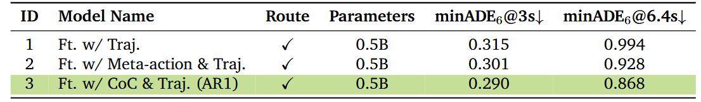
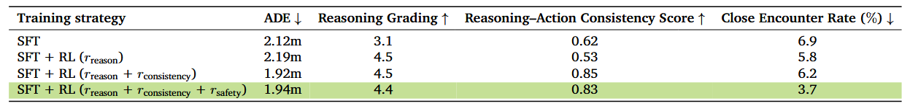
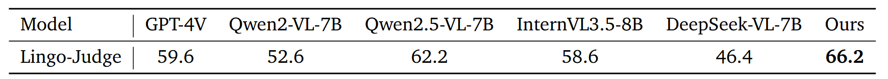
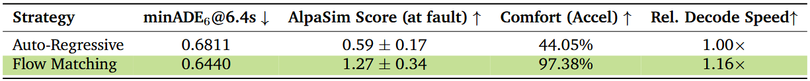

# Alpamayo-R1: Bridging Reasoning and Action Prediction for Generalizable Autonomous Driving in the Long Tail

> ⚠ 入库注记（QUESTIONS #8）：TODO/任务原用名 "Alpamago" 系笔误（arXiv ti:"Alpamago" 与 all:"Alpamago" 检索均 0 命中），实为 NVIDIA **Alpamayo-R1**（arXiv:2511.00088，身份已由预存 library/assets/Alpamago/ 表格截图与论文 HTML 逐值交叉确认）；本笔记 2026-11-03 入库时由 Alpamago.md 更名为 Alpamayo-R1.md，配图素材目录沿用现有 library/assets/Alpamago/ 未改名。

**出处会议：** 无会议标注，arXiv 预印本（arXiv:2511.00088；abs 页 Comments 字段本次抓取确认不存在，subjects 为 “Robotics (cs.RO); Artificial Intelligence (cs.AI); Machine Learning (cs.LG)”；作者栏首项为机构名 NVIDIA，后列 Yan Wang、Wenjie Luo 等 41 人）。v1 2025-10-30，v2 2026-01-07，本笔记基于 v2；GitHub README Updates 原文 “[January 2026] Following the release of [NVIDIA Alpamayo](https://nvidianews.nvidia.com/news/alpamayo-autonomous-vehicle-development) at CES 2026, Alpamayo-R1 has been renamed to Alpamayo 1.”（即产品化后改名为 Alpamayo 1，论文/权重名仍为 Alpamayo-R1）
**是否开源：** 是。GitHub https://github.com/NVlabs/alpamayo （本次抓取确认存在，license spdxId Apache-2.0；页面 title 原文 “GitHub - NVlabs/alpamayo: NVIDIA Alpamayo 1 Nano is an open 10B reasoning VLA model for autonomous vehicles that pairs driving trajectories with Chain-of-Causation reasoning. · GitHub”）；权重 Hugging Face https://huggingface.co/nvidia/Alpamayo-R1-10B （论文 §7 原文给出，README 自述模型为 gated、需申请访问；HF 页面本次直连抓取失败，见核验块）；README Updates：2026-04 发布 SFT/RL 微调脚本、2026-05 迁移至 https://github.com/NVlabs/alpamayo-recipes （SFT 与 RL recipes 均给出链接）；README 顶部 IMPORTANT 原文 “This repository is no longer under active development and will receive only limited maintenance updates.”（后续版本指向 Alpamayo 1.5，2026-03，与 alpamayo-recipes hub）
**关键词：** 自动驾驶 VLA（Vision-Language Action）、Chain of Causation（CoC）因果链推理数据集、Cosmos-Reason（Physical AI VLM）底座、离散轨迹 token（128 token/轨迹）+ flow matching action-expert 双表征解码、GRPO RL 后训练三奖励（推理质量 / 推理-动作一致性 / 轨迹质量）、AlpaSim 闭环仿真、minADE6、AlpaSim Score、99 ms 实车实时推理、0.5B–10B 模型族、LingoQA 零样本评测

> 来源与核验（抓取日期 2026-11-02）：
> - **标题核对（重要）**：任务给定名「Alpamago」在 arXiv 检索不到：arXiv API `ti:"Alpamago"` 与 `all:"Alpamago"` 均 totalResults=0（本次抓取），网络精确短语搜索亦无该名论文。`all:"Alpamayo"` 命中 3 篇：唯一提出模型本体的为 arXiv:2511.00088「Alpamayo-R1: Bridging Reasoning and Action Prediction for Generalizable Autonomous Driving in the Long Tail」（另两篇 arXiv:2605.08975 “Latency Analysis and Optimization of Alpamayo 1 via Efficient Trajectory Generation” 与 arXiv:2605.11678 “OOM-Free Alpamayo via CPU-GPU Memory Swapping for Vision-Language-Action Models” 是针对该模型的后续分析论文，非模型提出论文，未采用）。
> - **身份交叉核验（决定性）**：用户预存 `library/assets/Alpamago/`（2026-11-01 存入）的 Table7.png / Table9.png / Table11.png / Table12.png 与本文 HTML v2 的 Table 7 / 9 / 11 / 12 逐值一致（如 Table 7 三行 0.315/0.994、0.301/0.928、0.290/0.868；Table 9 的 SFT/RL 四行；Table 11 的 Lingo-Judge 59.6…66.2；Table 12 的 Auto-Regressive vs Flow Matching 行），图内 “AR1”“CoC”“AlpaSim”“Lingo-Judge”“Reasoning–Action Consistency Score” 等字样与论文术语一一对应。即「Alpamago」系「Alpamayo」的笔误变体（go↔yo），TODO.md「VLM / VLA」组与 assets 目录名沿用旧写法。本笔记以 arXiv 实际标题 **Alpamayo-R1** 为准；草稿文件名为 Alpamago.md，2026-11-03 入库时已更名为 library/VLM_VLA/Alpamayo-R1.md（assets 目录沿用 Alpamago 旧名未改）。
> - 主题核对：摘要自述 “a vision-language-action model (VLA) that integrates Chain of Causation reasoning with trajectory planning”，端到端自动驾驶方向，与「VLM / VLA」组（TODO.md 原文 “VLM / VLA：LLaVA、Qwen3-VL、OpenVLA、OpenDriveVLA、OneVL、DrivePI、Alpamago。”）吻合。
> - arXiv abs 页 v2（latest）https://arxiv.org/abs/2511.00088 与 v1 https://arxiv.org/abs/2511.00088v1 （本次同抓，两版标题一致）；摘要引文以 arXiv API atom（https://export.arxiv.org/api/query?id_list=2511.00088 ，本次抓取）为准，其与 abs 页摘要文字一致（仅 abs 页把两个 URL 渲染为 “this https URL”）。
> - 全文 arXiv 官方 HTML v2 https://arxiv.org/html/2511.00088v2 （LaTeXML 渲染，页面自标 “arXiv:2511.00088v2”，本次抓取）。以下 locator（§x.y / TABLE x）指该 v2 的章节与表格编号（正文 §1–§7，附录仅 A 贡献者/致谢）。引文中 «…» 为 HTML 数学元素，内为 alttext 属性原文（如 «\mathcal{D}_{\text{overall}}» 渲染为 𝒟_overall、«\checkmark» 为 ✓、«\times» 为 ×、«\pm» 为 ±、«\downarrow»/«\uparrow» 为 ↓/↑）；引号内为本次实际抓取文本的逐字摘录（含原文笔误），全部经脚本对照抓取文本验证存在（含表格逐单元格）。
> - 表格：HTML v2 含全部 14 张表（TABLE 1–14），无「PDF 专属而 HTML 缺失」的表；本笔记全抄 TABLE 6/7/8/9/10/11/12/13/14（实验数字表）并逐单元格脚本核验；TABLE 1–5 为标注指南类长表（16/8/17/5/5 行），仅摘录示例行。`library/assets/Alpamago/` 预存 4 张表图已逐张查看并与 HTML 解析对照（分别对应 TABLE 7/9/11/12，数值逐格一致）。
> - GitHub 仓库页面、raw README（main 分支）本次实际抓取；Hugging Face 模型页与 API 本次多次抓取均超时/SSL 失败，开源状态以论文 §7 原文 + GitHub 仓库与 README 为准（权重 gated 一事来自 README 原文）。
> - 本笔记 2026-11-03 经入库前逐字 QA（quote 自洽 + 数字抽查）后自 nightshift/drafts/ 入库至 library/VLM_VLA/（Alpamago.md → Alpamayo-R1.md）。

------

## 1. 概述

- 论文定位（Abstract 原句）：“We introduce Alpamayo-R1 (AR1), a vision-language-action model (VLA) that integrates Chain of Causation reasoning with trajectory planning for complex driving scenarios.” 谱系（§1 原句）：“we introduce Alpamayo-R1, a VLA that extends the vision-action (VA) model Alpamayo-VA (Wu, 2025) with structured reasoning capabilities, bridging reasoning and action prediction for generalizable autonomous driving.”
- 三项创新（Abstract 原句）：“(1) the Chain of Causation (CoC) dataset, built through a hybrid auto-labeling and human-in-the-loop pipeline producing decision-grounded, causally linked reasoning traces aligned with driving behaviors; (2) a modular VLA architecture combining Cosmos-Reason, a vision-language model pre-trained for Physical AI, with a diffusion-based trajectory decoder that generates dynamically feasible trajectories in real time; (3) a multi-stage training strategy using supervised fine-tuning to elicit reasoning and reinforcement learning (RL) to enforce reasoning-action consistency and optimize reasoning quality.”
- 头条数字（Abstract 原句）：“AR1 achieves up to a 12% improvement in planning accuracy on challenging cases compared to a trajectory-only baseline, with a 35% reduction in close encounter rate in closed-loop simulation. RL post-training improves reasoning quality by 45% and reasoning-action consistency by 37%. Model scaling from 0.5B to 7B parameters shows consistent improvements. On-vehicle road tests confirm real-time performance (99 ms latency) and successful urban deployment.”
- 问题动机（§1 原句）：端到端驾驶在长尾脆弱——“Despite these successes, current E2E approaches remain fragile in handling long-tail and safety-critical situations, where sparse supervision and the need for high-level reasoning pose significant challenges.. Consequently, a significant gap persists between the capabilities of existing E2E models and the requirements for achieving robust Level-4 autonomy with driving-specific reasoning capabilities.”（“challenges..” 双句号为原文照抄）
- 对现有 VLM/VLA 的批评（§1 原句）：“however, most approaches either lack explicit reasoning (Wu, 2025; Zhou et al., 2025b; Jiang et al., 2025) or perform reasoning in a free-form, unstructured manner (Luo et al., 2025a; Yuan et al., 2025; Rowe et al., 2025).” 设计原则（§1 原句）：“We argue that effective reasoning for autonomous driving must be causally grounded and structurally aligned with the task of driving.” 具体含义（§1 原句）：“reasoning traces should explicitly link observed scene evidence to concrete driving decisions through causal chains, and these decisions should directly condition or control low-level trajectory generation.”
- 三条贡献（§1 列表，逐条原句）：
  1. “We develop a structured Chain of Causation (CoC) labeling framework that produces decision-grounded, causally-linked reasoning traces aligned with driving scenarios, supported by a hybrid human-in-the-loop and auto-labeling pipeline for scalable high-quality data generation.”
  2. “We employ a diffusion-based action-expert trajectory decoder built on flow matching (Lipman et al., 2023; Driess et al., 2025) to efficiently generate continuous, multi-modal trajectory plans that align with the language reasoning outputs while meeting real-time inference requirements.”
  3. “We adopt a multi-stage training strategy that builds upon the Cosmos-Reason VLM backbone, injects action modality for trajectory prediction, elicits reasoning via supervised fine-tuning on CoC data, and employs reinforcement learning (RL) to boost the reasoning quality, reasoning-action consistency and trajectory quality.”
- 评测总括（§1 原句）：“Through extensive open-loop and closed-loop (simulation and onboard) evaluations, we demonstrate that AR1 achieves substantial improvements over end-to-end baselines, with the largest gains in rare, safety-critical scenarios, while maintaining real-time inference performance (99ms end-to-end latency).”
- 与本库笔记的关系（有据，一句带过）：论文 §2.1 原文引用并批评库内已入库笔记（library/VLM_VLA/OpenDriveVLA.md 等）的两篇 VLA——“OpenDriveVLA (Zhou et al., 2025a) autoregressively produces trajectory waypoints from structured vision-language tokens. AutoVLA (Zhou et al., 2025b) unifies reasoning and action with adaptive “think vs. act” control.”，随后给出来文定位：“However, these approaches largely operate reactively without explicit reasoning, struggling to generalize beyond training distributions in ambiguous or long-horizon scenarios requiring counterfactual reasoning.”；其自动标注 teacher VLM 举例 Qwen3-VL（§3.1 原句 “generated by prompting a teacher VLM (e.g., Qwen3-VL (Qwen Team, 2025)) with driving-specific priors”）。正文未出现 “OpenVLA”“LLaVA” 字样（本次 Grep 全文确认），与本组其他草稿是主题级（驾驶 VLA）关系而非引用关系。

## 2. 方法

### 2.1 问题形式与总体架构（§3）

- 任务形式（§3 原句，含数学）：“AR1 is trained to perform reasoning, denoted as Reason, and to predict the future trajectory of the ego vehicle”〔𝝉〕；输入-输出序列为〔[o_image, o_egomotion, Reason, τ]〕（Eq. 1，alttext `\bm{o}_{\text{image}},\bm{o}_{\text{egomotion}},\textsc{Reason},\bm{\tau}`，各分量以前序分量为条件）。“By default, the model is trained to predict the entire 6.4s-long future trajectory sequence”，64 个路点、10 Hz 采样（Eq. 2 alttext `\bm{\tau}=\{(x^{i},y^{i},\theta_{\text{yaw}}^{i})\}_{i=1}^{64}`）；实际预测对象是由 unicycle 动力学参数化的控制量〔a={(a^i,κ^i)}_{i=1}^{64}〕（Eq. 3，加速度与曲率）。
- 总体流程（§3 原句）：“The system processes multi-camera, multi-timestep observations as visual inputs, optionally augmented with textual inputs such as user commands and high-level navigation instructions. All inputs, including historical ego-motion data, are tokenized into a unified sequence of multimodal tokens following a predefined order. These tokens are then processed by the Cosmos-Reason (NVIDIA et al., 2025a) backbone, which produces output tokens representing reasoning traces, meta-actions, and predicted future trajectories.”
- 模块化主张（§3 原句）：“Our design philosophy emphasizes flexibility and modularity: the architecture can adopt any off-the-shelf VLM backbone while incorporating domain-specific components for efficient vision encoding and real-time action decoding.”

### 2.2 VLM 底座：Cosmos-Reason（§3.1）

- 选型（§3.1 原句）：“We adopt Cosmos-Reason (NVIDIA et al., 2025a) as the VLM backbone for Alpamayo-R1. Cosmos-Reason is a VLM specifically designed for Physical AI applications, post-trained on 3.7M Visual Question Answering (VQA) samples to develop physical common sense and embodied reasoning capabilities. The model incorporates 24.7K curated video VQA samples focused on driving scenarios, including scene descriptions, driving difficulty annotations, and reasoning traces distilled from DeepSeek-R1 (DeepSeek-AI, 2025) to predict the next action.”
- 领域继续预训练（§3.1 原句）：“To further enhance Cosmos-Reason for autonomous driving deployment, we curate supplementary datasets spanning multiple Physical AI domains, including autonomous driving, robotics, healthcare, smart cities, manufacturing, retail, and logistics.” 其中自动驾驶：“For autonomous driving specifically, we augment the training data with 100K new samples that include annotations for critical objects in the environment and reasoning for the next action.”
- 两条数据路线（§3.1 原句）：人工——“Human-labeled data includes comprehensive annotations covering the operational design domain (weather, lighting, road conditions), traffic regulations (traffic lights, signs), ego behaviors (interactive and non-interactive meta-actions), critical objects influencing ego behavior, and causal reasoning behind observed maneuvers.”；自动——“Automatically labeled data focuses on ego behavior reasoning and prediction, generated by prompting a teacher VLM (e.g., Qwen3-VL (Qwen Team, 2025)) with driving-specific priors that encode longitudinal, lateral, and lane-related meta-actions along with velocity information.”

### 2.3 视觉编码：单图 token 化为默认、多相机压缩为可选（§3.2.1）

- 默认（§3.2.1 原句，含数学）：“AR1’s default tokenizer (and the one used for all subsequent experiments) leverages this paradigm, employing the base VLM’s vision encoder (e.g., Zhai et al. (2023); Tschannen et al. (2025)) to encode a”〔W×H〕“px input image into patch features”〔𝐟∈ℝ^{W/14×H/14×D}〕“which are then”〔2×〕“bilinearly downsampled to”〔𝐟′∈ℝ^{W/28×H/28×D}〕“features per image. As an example, with”〔W=448,H=280〕“this process produces 160 tokens per image.”（数学 alttext 依次 `\mathbf{f}\in\mathbb{R}^{W/14\times H/14\times D}`、`\mathbf{f}^{\prime}\in\mathbb{R}^{W/28\times H/28\times D}` 等）
- 问题（§3.2.1 原句）：“While single-image tokenization is simple to implement, it produces token counts that scale linearly with image resolution and the number of cameras (Wang et al., 2025). To obtain a 360-degree view of their surroundings, AVs often use 6 to 10 cameras, the patch-based tokenization of which would yield thousands of tokens per timestep and preclude real-time inference.”
- Triplane 多相机 tokenizer（§3.2.1 原句，含数学）：“Specifically, AR1 can additionally use the efficient multi-camera tokenizer proposed in Ivanovic et al. (2025), which leverages triplanes as a 3D inductive bias, to simultaneously represent multiple camera images in an efficient manner. Crucially, since the triplane sizes are fixed, the input number of cameras and their resolution are decoupled from the resulting number of tokens.” 数值例（原句）：“As an example, for”〔S_x=S_y=96,S_z=48〕“, and”〔p_x=p_y=p_z=8〕“, only 288 tokens are needed to represent one timestep of observations, irrespective of the number of cameras or their resolution. For a 7-camera vehicle setup, this equates to approximately”〔41.1〕“tokens per image (”〔3.9×〕“less than single-image tokenization).”
- 选择原则（§3.2.1 原句）：“AR1 adopts single-image tokenization by default, as the optimal strategy can vary with the number of cameras, temporal frames, and camera resolutions. For example, a small number of cameras and short histories will favor single-image tokenization, more cameras and short histories will favor triplanes (Ivanovic et al., 2025), and more cameras and long history sequences will favor Flex (Yang et al., 2025).” 消融数据见 §3.6（TABLE 13）。

### 2.4 轨迹表征与解码：unicycle 控制量 + 双表征（§3.2.2）

- 弃用原始路点（§3.2.2 原句，含数学）：“Initially, we found that training the model in raw position (i.e., ”〔x,y〕“) waypoint space is susceptible to sensor noise, which often degrades model convergence. Moreover, the downstream low-level vehicle controllers typically smooth trajectory outputs to ensure consistent and stable execution on-vehicle. Thus, instead of directly learning”〔𝝉〕“in the raw position waypoint space, we adopt an action representation governed by unicycle dynamics that leads to better closed-loop performance.”（控制量 alttext `\bm{a}=\{(a^{i},\kappa^{i})\}_{i=1}^{64}`；Eq. 5 为 Euler 离散化的 unicycle 动力学，原句 “where”〔ΔT=0.1s〕“in our setup”）
- GT 控制量获取（§3.2.2 原句）：“During training, the ground-truth control sequence”〔𝒂〕“is derived from”〔𝝉〕“through a least-squares formulation with Tikhonov regularization to attenuate high-frequency noise. The model is trained to predict the control sequence”〔𝒂〕“and, during inference, we apply Eq. 5 to map it to”〔𝝉〕.
- 双表征（§3.2.2 原句，含数学）：“Furthermore, to enable AR1 to understand and generate trajectories, we encode”〔𝝉〕“either as discrete tokens or continuous embeddings. In the discrete representation, we uniformly quantize each continuous value in”〔𝒂〕“within a predefined range into equally spaced bins and represent the resulting indices as special tokens. For the continuous representation, we map”〔𝒂〕“into AR1’s embedding space using sinusoidal positional encoding followed by an MLP projection.” 策略来源（原句）：“Specifically, we adopt a strategy inspired by”〔π_{0.5}〕“-KI (Driess et al., 2025), combining discrete trajectory tokens learned within the VLM with an action-expert that decodes the same trajectories into continuous representations using a flow matching framework (Lipman et al., 2023). This framework facilitates streamlined VLM training, accelerates trajectory decoding, and achieves better closed-loop performance.”

### 2.5 CoC 数据集：结构、规模与标注流水线（§4）

- 动机——现有驾驶 CoT 数据三缺陷（§4 原句）：“(1) Vague behavior descriptions: free-form CoT annotations may fail to specify concrete driving actions or may choose words that weakly correlate with ego trajectories; (2) Superficial reasoning: some reasoning traces primarily describe contextual observations or hypothetical factors that lack a direct causal link to the ego vehicle’s behavior, providing limited benefit for improving post-training driving performance; (3) Causal confusion: reasoning traces may include causal factors that occur in future time windows, which are not observable to the model during training. This arises because the labeling process often exposes the entire video without distinguishing between historical and future segments.”
- 结构化方案（§4 原句）：“We first define a comprehensive set of high-level driving decisions that directly correspond to low-level ego trajectories. Each reasoning trace is associated with an explicit driving decision and includes only the causal factors that motivate that driving decision. By carefully selecting keyframes to split historical and future video segments, we ensure that all causal factors originate within the observable history window, thereby preventing causal confusion.”
- 三要素与三准则（§4.1 原句）：“our labeling framework decomposes each data sample into three structured components: the driving decision, the causal factors (critical components), and the composed CoC trace.” 准则（原句）：“the structured CoC protocol enforces: (1) decision grounding: each reasoning trace is anchored to a single, explicit decision at the critical moment; (2) causal locality: all evidence must originate from the observed history window; (3) annotation economy: only decision-relevant factors are included.”
- 决策闭集与因果因素开集（§4.1 原句）：“we define a closed set of high-level driving decisions as in Tab. 1. Each clip is annotated with at most one longitudinal and one lateral decision (or None for either channel), corresponding to the first action taken by the ego vehicle immediately after the critical reasoning moment.”“In contrast to the closed-set driving decisions, causal factors are defined as an open-ended set, with categories and example attributes described in Tab. 2.”
- 片段与关键帧（§4.2 原句）：场景分两类——“(1) Reactive - where the ego vehicle must immediately adapt its behavior in response to a specific event, such as stopping for a lead vehicle or red light, or adjusting its lateral position to maintain clearance from a nearby obstacle or hazard; (2) Proactive - where the ego vehicle is not required to react instantly but must actively assess and anticipate potential maneuver adjustments due to upcoming road events or obstacles.” 时间窗（原句）：“Each raw clip contains 20 seconds of data and can generate multiple training samples, given the configuration of using a 2-second history to predict a 6-second future during both training and evaluation.”（注意：此句写 “6-second future”，而 §3 任务定义与 §6.1 评测均为 6.4 s，见 ⚠ 措辞提示）关键帧规则（原句）：“For reactive scenarios, a keyframe is typically chosen by applying a short temporal buffer (approximately 0.5 seconds) before the ego vehicle initiates a behavior change corresponding to a driving decision.”
- 人工两阶段标注（§4.3.1 原句）：“Stage I (0–2 s): identify critical components from Tab. 2 within the observed history window (within 2s before the keyframe).”“Stage II (0–8 s): (a) apply a safety exclusion filter to remove invalid data with illegal or unsafe driving behavior, (b) select the first post-keyframe driving decision for each channel (longitudinal and lateral; or None), (c) write a CoC reasoning trace that references only the causal factors identified in Stage I that lead to the driving decision, along with routing or regulatory signals when applicable.” 防泄漏（原句）：“To enforce a clear separation between Stage I and Stage II and minimize causal leakage, we designed a labeling tool that explicitly distinguishes historical video segments (0-2 s) from future segments (2-8 s).”
- QA（§4.3.1 原句，含数学）：“Each labeled instance first undergoes a quality check performed by a different annotator. Moreover,”〔10%–20%〕“of labeled instances are selected, based on the performance of the assigned annotators, for an additional auditing process conducted by a dedicated team of experienced auditors.”
- 自动标注（§4.3.2 原句）：关键帧——“we first define a set of low-level meta actions and implement corresponding rule-based detectors to infer these meta actions at the frame level. Then, we treat the frame at which a meta action transition occurs as a decision-making moment, allowing us to determine the keyframe automatically and efficiently across large scale data.” 标注模型——“we employ state-of-the-art VLMs such as GPT-5 (OpenAI, 2025) to perform offline auto-labeling through a multi-step reasoning process.” 输入规格（原句）：“The video is sampled at 2 Hz to balance information density with the allowed input token budget within the auto-labeling model’s context window.” 防因果混淆（原句）：“To mitigate causal confusion, VLMs are prompted to use the 2-second historical video when identifying critical components. The subsequent 6-second future video, along with the ego’s trajectories and meta actions, is then used to resolve multi-modality and determine the corresponding driving decision.”
- 数据集评测（§4.3.3 原句）：“we adopt a hybrid evaluation strategy that combines human verification with LLM-based auto-evaluation. Specifically, we use GPT-5 (OpenAI, 2025) as an LLM evaluator and construct a curated evaluation set of 2K samples spanning representative scenarios listed in Tab. 3.” 一致性（原句）：“we compare LLM-based auto-evaluation against human evaluation on the same version of the auto-labeled dataset, and observe a 92% alignment rate, confirming the robustness of our LLM-based auto-evaluation.” 结构化收益（原句）：“we find that the proposed structured CoC reasoning traces improve the causal relationship score by 132.8% relative to free-form reasoning traces, which do not enforce explicit driving decisions and critical components.”
- 规模（§6.1 原句）：“we construct the CoC dataset (Sec. 4) consisting of 700K video segments with structured CoC.”
- TABLE 1（决策闭集，16 行；TABLE 1 caption 原文 “Closed-set driving decisions (longitudinal and lateral) used to anchor reasoning traces to explicit control intent.”）示例逐字行：“Longitudinal | Set speed tracking | Maintain or reach a target speed when unconstrained; excludes follow/yield/stop logic.” 与 “Lateral | Lane keeping & centering | Maintain position within lane boundaries; minor in-lane offsets allowed; never cross lane lines.”
- TABLE 2（因果因素类别，8 行）示例逐字行：“Critical objects | Type (veh./ped./cyclist/VRU), relative pose to ego (in-path, left/right, oncoming, crosswalk), motion (stopped, slowing, crossing, cut-in risk) | Low / High” 与 “Traffic lights | Current state (R/Y/G), arrow state, visibility/occlusion; presence of wait line | -”
- TABLE 3（场景与关键帧定义，17 行）示例逐字行：“Reactive | Slow for the lead vehicle | 0.5 seconds before the ego decelerates behind a lead vehicle.” 与 “Proactive | Curvy road | Start: whichever occurs first - (1) 0.5 seconds before the ego begins to decelerate for the curve; or (2) when the ego enters the curve at current speed. End: when the ego exits the curve.”
- TABLE 4（QA 检查单，5 行）示例逐字行：“Causal correctness | Reasoning trace must logically explain the selected decision based on valid cause–and–effect relationships. Circular reasoning, misattributed causes, or missing necessary conditions are flagged for rework”（该行原文无句号结尾，照抄）
- TABLE 5（低层 meta actions，5 行，第 1 行为表头 “Longitudinal | Lateral” 双列跨 4 子列）示例逐字行：“Gentle accelerate | Strong accelerate | Steer left | Steer right” 与 “Maintain speed | Stop | Reverse left | Reverse right”（第 2/4 纵列末行原文字符为 en-dash “–”，照抄）

### 2.6 三段式训练与 RL 后训练（§5）

- 总览（§5 原句）：“we adopt a three-stage training strategy to transform the VLM into a reasoning-capable autonomous driving policy.” 三阶段依次为：动作模态注入（§5.1）→ CoC SFT 引出推理（§5.2）→ RL 后训练对齐（§5.3）。
- Stage 1 动作注入（§5.1 原句）：“each trajectory consists of 64 waypoints with 2 quantized values per waypoint (acceleration”〔a^i〕“and curvature”〔κ^i〕“), resulting in 128 discrete tokens per trajectory. These are encoded with a set of special tokens dedicated to action representation. However, we do not use discrete trajectory tokens for inference, as detailed below.”
- 双表征动机（§5.1 原句）：“First, discrete tokenization enables unified autoregressive training in which reasoning and trajectories share a common token space, allowing the VLM to tightly couple causal explanations with vehicle behaviors through standard next-token prediction. Second, discrete representations facilitate RL optimization by allowing direct gradient flow during post-training (Sec. 5.3), allowing policy gradient methods such as GRPO (Shao et al., 2024) to jointly refine reasoning quality and reasoning-action consistency. Third, the discrete representation provides strong supervision for learning vehicle dynamics, while the flow-matching expert ensures physically feasible and multi-modal outputs. Finally, flow-matching decoding offers computational efficiency, generating continuous trajectories substantially faster than autoregressively sampling 128 discrete tokens, enabling real-time inference.”
- action-expert（§5.1 原句）：“The action-expert follows the same Transformer architecture as the VLM, using the same number of attention heads and attention dimensions, but with a smaller hidden embedding size and MLP dimension for efficiency.” 训练损失为 vanilla conditional flow matching（Eq. 6，Gaussian OT 路径，Eq. 7 目标向量场 alttext `\mathbf{u}(\bm{a}_{t}|\bm{a})=\bm{a}-\bm{\epsilon}`）；推理 Euler 积分（Eq. 8），原句（含数学）：“By default, we use”〔δ_t=0.1〕“during inference and set”〔p_schedule〕“to a shifted beta distribution during training, as suggested by Physical Intelligence et al. (2025).” 断梯度（原句）：“During training, we apply a stop-gradient to the KV-cache produced by the VLM to prevent gradients from the expert back-propagating into the VLM weights.”
- Stage 2 SFT（§5.2 原句，含数学）：“the SFT objective maximizes the conditional log-likelihood of the reasoning–action sequence”（Eq. 9 alttext `\mathcal{L}_{\text{SFT}}(\theta)=-\mathbb{E}_{(\bm{o},\textsc{Reason},\bm{a})\sim\mathcal{D}_{\text{CoC}}}\left[\log\pi_{\theta}(\textsc{Reason},\,\bm{a}\mid\bm{o})\right]`）；实现（原句）：“In practice, we apply the cross-entropy loss over both the reasoning tokens and the discrete trajectory tokens (128 tokens per trajectory as described in Sec. 5.1), enabling the model to learn the joint distribution of language-based reasoning and action prediction in a unified autoregressive framework.”
- SFT 四局限（§5.2 原句）：“(1) Data bias and annotation noise: Auto-labeled data may contain imperfect causal relationships (Tab. 5), causing the model to overfit to annotation artifacts rather than learning robust causal reasoning.”“(2) Limited generalization: The model may memorize common reasoning patterns without developing deeper causal understanding, failing to generalize to novel scenarios.”“(3) Weak visual grounding: Next-token prediction does not enforce visual consistency; the model may hallucinate causal factors not present in the scene (Fig. 10).”“(4) Reasoning–action inconsistency: Joint optimization does not explicitly enforce alignment between stated reasoning and predicted trajectories, potentially leading to contradictory explanations (Fig. 11).”
- Stage 3 RL（§5.3.1 原句）：“We adopt GRPO (Shao et al., 2024) as our alignment algorithm. GRPO extends standard policy gradient methods by optimizing relative advantages within a group of sampled model rollouts rather than relying on absolute reward signals.”（Eq. 10 为带 KL 正则的组内相对优势目标，A_i = r_i − r̄）
- 三奖励（§5.3.2 原句）：“the total reward”〔r〕“for each rollout is composed of three components: reasoning quality reward, reasoning-action consistency, and low-level trajectory quality.”
  - r_reason（原句）：“we leverage state-of-the-art LRMs (e.g., DeepSeek-R1 (DeepSeek-AI, 2025), Cosmos-Reason (NVIDIA et al., 2025a)) as reasoning critics to evaluate the quality of reasoning traces generated by the VLA.” 选 critic 的依据（原句）：“even when generation in this domain is imperfect, their ability to assess logical soundness, causal alignment, and contextual consistency remains highly reliable (also known as the generation–verification gap (Song et al., 2025)).” 评分器输入（§5.3.2 Reasoning Critic Design 原句，含数学）：“For each training sample, the LRM critic takes as input the multi-camera visual observation”〔𝒐_image〕“at the last frame of the 2-second history window, the ground-truth CoC reasoning trace”〔Reason_GT〕“from the dataset, and the model-generated reasoning trace”〔Reason_pred〕“produced by the current policy”〔π_θ〕“.”（数学 alttext 依次 `\bm{o}_{\text{image}}`、`\textsc{Reason}_{\text{GT}}`、`\textsc{Reason}_{\text{pred}}`、`\pi_{\theta}`）评分两维度（原句）：“The critic evaluates how well”〔Reason_pred〕“aligns with”〔Reason_GT〕“along two dimensions: behavior consistency, whether the predicted reasoning describes a driving decision consistent with ground truth; and causal reasoning quality, whether it correctly identifies causal factors observable in the scene’s history according to CoC principles (Sec. 4.1).”
  - r_consistency（§5.3.2 原句，含数学）：“If the described behavior in the reasoning trace and the meta-action are consistent across both axes, we assign”〔r_consistency=1〕“; otherwise,”〔r_consistency=0〕“.”（不可解析时保守取 0；原句 “These meta-actions encode the ego vehicle’s control behavior along both the longitudinal (acceleration/braking) and lateral (steering) directions.”）
  - r_traj（§5.3.2 原句）：“The reward combines three terms”（Eq. 11：L2 逼近项 + 碰撞指示项 + jerk 惩罚项加权），“The L2 imitation term encourages proximity to expert demonstrations, promoting stable learning and smooth driving profiles. The collision penalty ensures safety, while the jerk regularization improves comfort and control smoothness.”
- RL 数据策展（§5.3.3 原句）：“The key idea is to prioritize samples where the model’s implicit reward signal (encoded in its logits) disagrees with the explicit reward model.” 判据（原句，含数学）：“we compute the model’s predicted probability distribution derived from its logits, and the corresponding probability distribution implied by the rewards, which we obtain by transforming the reward into a Boltzmann distribution”〔p_reward(τ_i)=exp(βr_i)/Σ_j exp(βr_j)〕。“A large divergence between these two distributions indicates that the model’s internal preference (its implicit reward) conflicts with the externally defined reward signal.”
- 基础设施（§5.3.4 原句）：“we develop a customized version of the Cosmos-RL framework (NVIDIA, 2025a) that is specifically designed for AV reasoning tasks. This system provides a scalable, modular infrastructure for large-scale multimodal RL and fits directly with other parts of the Alpamayo-R1 system. It supports distributed data loading, mixed-parallelism training, vLLM-based rollout generation (Kwon et al., 2023), and reward computation across multiple GPU nodes, enabling efficient, high-throughput policy optimization.”

## 3. 实验

### 3.1 数据与评测协议（§6.1）

- 训练/评测数据（§6.1 原句）：“the full training and evaluation dataset comprises 80,000 hours of driving data collected from multiple ego-vehicles operating in more than 2,500 cities in 25 countries.” 传感器（原句）：“The raw sensory inputs consist of video recordings from a surround-view seven-camera setup, accompanied by precise camera calibration parameters and ego-motion data. In this work, we focus on using two front-facing cameras as input: a front wide-angle camera with 120∘ field of view and a front telephoto camera with 30∘ field of view, providing complementary perspectives for both near-field and far-field scene understanding.”（“120∘”“30∘” 为原文字符照抄）数据隔离（原句）：“with all evaluation data strictly geo-fenced and held out from training regions to prevent information leakage”；名义场景集〔𝒟_overall〕与长尾集〔𝒟_hard〕（alttext 分别 `\mathcal{D}_{\text{overall}}`、`\mathcal{D}_{\text{hard}}`）。
- 开环指标（§6.1 原句）：“minADE is computed over 6 samples (”〔minADE_6〕“) and is defined as the minimum distance between the ground-truth future trajectory and the best-matching trajectory among 6 predictions generated by the model. ADE (Average Displacement Error) is the average distance between the predicted trajectory and the ground-truth trajectory across all future timesteps.” 预测时域 6.4 s（原句：“we evaluate models over a prediction horizon of 6.4 seconds, corresponding to the ego-vehicle’s planned waypoints”）。
- 闭环 AlpaSim（§6.1 原句）：“AlpaSim leverages a temporal 3D Gaussian Splatting representation from recorded real-world driving logs and, during closed-loop evaluation, uses it to synthesize novel viewpoints when the ego vehicle deviates from the recorded trajectory. During evaluation, predicted trajectories are tracked by a model predictive controller (MPC), and vehicle dynamics follow a dynamically extended bicycle model. Traffic agents, including vehicles and pedestrians, follow their recorded trajectories.” 场景数（原句）：“We evaluate models in 75 challenging 20-second scenarios, selected for their dense ego–agent and agent–agent interactions.” 指标五个（close encounter rate all / at-fault、offroad rate、AlpaSim score all / at-fault；AlpaSim score 定义原句：“average distance driven in km between events, where events correspond to offroad or close encounter occurrences”）与排除规则（原句）：“events in which the ego deviates more than 4 m from the original recorded trajectory are excluded from all metric computations.”

### 3.2 开环：推理对驾驶策略的提升（§6.2，TABLE 6、TABLE 7）

- 设定（§6.2 原句）：“we start with a base model pre-trained on”〔𝒟_overall〕“with action modality injection (Sec. 5.1), then fine-tune it on the CoC dataset with different reasoning modalities: meta-action descriptions and full chain-of-causation reasoning traces.” 三种微调（原句）：“We compare three fine-tuning strategies: (1) trajectory prediction only, (2) meta-action and trajectory prediction, and (3) chain-of-causation reasoning and trajectory prediction (Alpamayo-R1). All models are evaluated on held-out CoC test data in two settings: with and without route information provided to the model.”
- TABLE 6（caption 原文 “Table 6: Open-loop evaluation of models on the CoC dataset. The base model is pre-trained with”〔𝒟_overall〕“and all other models are finetuned on the CoC dataset, then evaluate...”；表头 “ID | Model Name | Route | Parameters | minADE6@3s«\downarrow» | minADE6@6.4s«\downarrow»”；Route 列 «\times» 为无路线输入、«\checkmark» 为有）逐行照抄：

| ID | Model Name | Route | Parameters | minADE6@3s«\downarrow» | minADE6@6.4s«\downarrow» |
| --- | --- | --- | --- | --- | --- |
| 1 | Base model (action modality) | «\times» | 0.5B | 0.284 | 0.996 |
| 2 | + Ft. w/ Traj. | «\times» | 0.5B | 0.282 | 0.971 |
| 3 | + Ft. w/ Meta-action & Traj. | «\times» | 0.5B | 0.291 | 0.988 |
| 4 | + Ft. w/ CoC & Traj. (AR1) | «\times» | 0.5B | 0.279 | 0.955 |
| 5 | Base model (action modality) | «\times» | 3B | 0.291 | 0.977 |
| 6 | + Ft. w/ Traj. | «\times» | 3B | 0.293 | 0.976 |
| 7 | + Ft. w/ Meta-action & Traj. | «\times» | 3B | 0.280 | 0.927 |
| 8 | + Ft. w/ CoC & Traj. (AR1) | «\times» | 3B | 0.275 | 0.908 |
| 9 | Base model (action modality) | «\checkmark» | 0.5B | 0.264 | 0.848 |
| 10 | + Ft. w/ Traj. | «\checkmark» | 0.5B | 0.262 | 0.834 |
| 11 | + Ft. w/ Meta-action & Traj. | «\checkmark» | 0.5B | 0.264 | 0.821 |
| 12 | + Ft. w/ CoC & Traj. (AR1) | «\checkmark» | 0.5B | 0.254 | 0.794 |

- TABLE 7（caption 原文 “Table 7: Open-loop evaluation of models on the challenging dataset. All models are finetuned on the CoC dataset and evaluated on the challenging dataset.”；表头同 TABLE 6，均为 «\checkmark» Route）逐行照抄（`library/assets/Alpamago/Table7.png` 即本表）：

| ID | Model Name | Route | Parameters | minADE6@3s«\downarrow» | minADE6@6.4s«\downarrow» |
| --- | --- | --- | --- | --- | --- |
| 1 | Ft. w/ Traj. | «\checkmark» | 0.5B | 0.315 | 0.994 |
| 2 | Ft. w/ Meta-action & Traj. | «\checkmark» | 0.5B | 0.301 | 0.928 |
| 3 | Ft. w/ CoC & Traj. (AR1) | «\checkmark» | 0.5B | 0.290 | 0.868 |

- 读数（§6.2 原句）：“Without route information, AR1 achieves a minADE6 of 0.955m at 6.4s, a 4.1% improvement over the base model and outperforming both trajectory-only (0.971m) and meta-action (0.988m) baselines. With route information, the gains are more pronounced: AR1 achieves 0.794m, representing 4.8% improvement over the trajectory-only baseline (0.834m). Scaling to 3B parameters further improves performance, with AR1-3B achieving 0.908m (without route), demonstrating the benefits of increased model capacity for complex reasoning tasks. In challenging scenarios, the improvements are even larger, with AR1 achieving 0.868m, a 12% improvement over the trajectory-only baseline (0.994m).”（TABLE 6 行 4：0.955；行 12：0.794；行 8：0.908；TABLE 7 行 3：0.868）

### 3.3 闭环：AlpaSim 仿真（§6.2，TABLE 8）

- TABLE 8（caption 原文 “Table 8: Closed-loop evaluation results in AlpaSim (NVIDIA et al., 2025b). All models are evaluated without route information across 75 challenging sc...”；表头两行：第 1 行原文 “Close Encounter Rate | Close Encounter Rate | Off-Road Rate | AlpaSim Score | AlpaSim Score”（Model 格跨 2 行、Close Encounter Rate 与 AlpaSim Score 各跨 2 列，Model 处为原文空格），第 2 行原文 “Model | all (%) «\downarrow» | at-fault (%) «\downarrow» | (%) «\downarrow» | all «\uparrow» | at-fault «\uparrow»”）逐行照抄：

| Model | all (%) «\downarrow» | at-fault (%) «\downarrow» | (%) «\downarrow» | all «\uparrow» | at-fault «\uparrow» |
| --- | --- | --- | --- | --- | --- |
| Baseline | 17.0«\pm»3.0 | 6.0«\pm»1.0 | 3.0«\pm»2.0 | 0.38«\pm»0.04 | 0.86«\pm»0.11 |
| Alpamayo-R1 | 11.0«\pm»2.0 | 5.0«\pm»3.0 | 4.0«\pm»3.0 | 0.50«\pm»0.08 | 0.87«\pm»0.18 |

（注：前 2 数据列属 Close Encounter Rate，第 3 列属 Off-Road Rate，末 2 列属 AlpaSim Score；«\pm» 渲染为 ±。）
- 读数（§6.2 原句）：“As shown in Tab. 8, AR1 achieves a 35% reduction in close encounter rate (11% vs 17%) compared to the trajectory-only baseline, and a comparable off-road rate (4% vs 3%). The overall AlpaSim score improves from 0.38 to 0.50, demonstrating that reasoning-based decision making improves safety in dynamic closed-loop scenarios.”（TABLE 8：off-road 4.0±3.0 vs 3.0±2.0，均值口径略差，正文称 “comparable”）

### 3.4 RL 后训练增益（§6.3，TABLE 9）

- 设定（§6.3 原句）：“In this section, we post-train a 0.5B AR1 model fine-tuned on CoC data, and demonstrate the impact of different reward components on model behavior.”（头条 RL 数字来自 0.5B 模型）
- TABLE 9（caption 原文 “Table 9: Improvements from RL-based post-training. We evaluate the impact of RL-based post-training on the model’s reasoning, consistency, and motion ...”；表头 “Training strategy | ADE «\downarrow» | Reasoning Grading «\uparrow» | Reasoning–Action Consistency Score «\uparrow» | Close Encounter Rate («\%») «\downarrow»”）逐行照抄（`library/assets/Alpamago/Table9.png` 即本表；«r_{\text{reason}}» 等渲染为 r_reason）：

| Training strategy | ADE «\downarrow» | Reasoning Grading «\uparrow» | Reasoning–Action Consistency Score «\uparrow» | Close Encounter Rate («\%») «\downarrow» |
| --- | --- | --- | --- | --- |
| SFT | 2.12m | 3.1 | 0.62 | 6.9 |
| SFT + RL («r_{\text{reason}}») | 2.19m | 4.5 | 0.53 | 5.8 |
| SFT + RL («r_{\text{reason}}» + «r_{\text{consistency}}») | 1.92m | 4.5 | 0.85 | 6.2 |
| SFT + RL («r_{\text{reason}}» + «r_{\text{consistency}}» + «r_{\text{safety}}») | 1.94m | 4.4 | 0.83 | 3.7 |

- 读数（§6.3 原句）：只加推理奖励会伤动作——“when the post-training stage optimizes solely for the reasoning reward, the reasoning score indeed improves; however, both the ADE metric and reasoning–action consistency degrade compared to the base model.”（TABLE 9 行 2：ADE 2.12m→2.19m、一致性 0.62→0.53）；联合优化——“when jointly optimizing both the reasoning and consistency rewards, the post-trained model achieves a 9.4% reduction in most-likely mode ADE (2.12m«\rightarrow»1.92m), a 45% improvement in the reasoning score (3.1«\rightarrow»4.5), and a 37% increase in reasoning–action consistency (0.62«\rightarrow»0.85).” 安全奖励——“adding the safety reward further reduces the close encounter rate and stabilizes trajectory generation without compromising reasoning quality. As shown in Tab. 9, the full reward configuration achieves the lowest close encounter rate while maintaining improvements in ADE and reasoning–action consistency.”（TABLE 9 行 4：3.7）

### 3.5 公开基准评测（§6.4，TABLE 10、TABLE 11）

- 发布模型构成（§6.4 原句）：“Alpamayo-R1-10B leverages Cosmos-Reason (NVIDIA et al., 2025a) as the VLM backbone with a 2B parameter diffusion-based trajectory decoder, while Alpamayo-R1-0.5B uses a smaller backbone for comparison. Both models generate Chain-of-Causation reasoning traces alongside trajectory predictions.”
- TABLE 10（caption 原文 “Table 10: Evaluation of Alpamayo-R1 on the public PhysicalAI-AV dataset (NVIDIA, 2025b). Open-loop results are evaluated on 644 examples from the Phys...”；表头两行：第 1 行原文 “Model | Open-Loop | Closed-Loop (AlpaSim)”（Model 跨 2 行、Closed-Loop (AlpaSim) 跨 3 列），第 2 行原文 “minADE6@6.4s«\downarrow» | Close Encounter Rate «\downarrow» (%) | Off-Road Rate «\downarrow» (%) | AlpaSim Score«\uparrow»”）逐行照抄：

| Model | minADE6@6.4s«\downarrow» | Close Encounter Rate «\downarrow» (%) | Off-Road Rate «\downarrow» (%) | AlpaSim Score«\uparrow» |
| --- | --- | --- | --- | --- |
| Alpamayo-R1-0.5B | 0.913 | 9.0«\pm»1.0 | 19.0«\pm»0.0 | 0.35«\pm»0.01 |
| Alpamayo-R1-10B | 0.849 | 4.0«\pm»0.0 | 16.0«\pm»1.0 | 0.72«\pm»0.02 |

- 读数（§6.4 原句）：开环——“We evaluate both models on 644 held-out examples from the PhysicalAI-AV dataset. As shown in Tab. 10, Alpamayo-R1-10B achieves a minADE6 of 0.849m at 6.4s, a 7.0% improvement over Alpamayo-R1-0.5B (0.913m), demonstrating the benefits of scaling the VLM backbone.” 闭环——“We further evaluate both models on the AlpaSim public scenario set comprising 920 challenging driving scenarios.”“Alpamayo-R1-10B achieves substantial improvements across all closed-loop metrics: a 16% reduction in off-road rate (16% vs 19%), a 55% reduction in close encounter rate (4% vs 9%), and more than 2«\times» improvement in AlpaSim score (0.72 vs 0.35).”
- TABLE 11（caption 原文 “Table 11: Zero-shot accuracy of various VLMs on the LingoQA benchmark (Marcu et al., 2024). Our Cosmos-Reason-7B model outperforms all baselines.”；表头 “Model | GPT-4V | Qwen2-VL-7B | Qwen2.5-VL-7B | InternVL3.5-8B | DeepSeek-VL-7B | Ours”）逐行照抄（`library/assets/Alpamago/Table11.png` 即本表）：

| Model | GPT-4V | Qwen2-VL-7B | Qwen2.5-VL-7B | InternVL3.5-8B | DeepSeek-VL-7B | Ours |
| --- | --- | --- | --- | --- | --- | --- |
| Lingo-Judge | 59.6 | 52.6 | 62.2 | 58.6 | 46.4 | 66.2 |

- 读数（§6.5.3 原句）：“Our Cosmos-Reason-7B model achieves 66.2% accuracy, outperforming various VLMs including GPT-4V (59.6%), Qwen2-VL-7B (52.6%), Qwen2.5-VL-7B (62.2%), InternVL3.5-8B (58.6%), and DeepSeek-VL-7B (46.4%). This improvement over the baselines demonstrates that Physical-AI-focused SFT significantly improves scene understanding capabilities for autonomous driving contexts, complementing the benefits of model scaling shown in Fig. 12.”（本表是底座选型消融，非完整 AR1）

### 3.6 消融：模型规模、数据规模、解码策略、视觉编码（§6.5、§6.6、§6.7，TABLE 12、TABLE 13）

- 模型规模（§6.5.1 原句，底座为通用 VLM）：“The 0.5B model uses a DINOv2 (Oquab et al., 2023) vision encoder combined with the Qwen2.5-0.5B (Qwen Team, 2024) language model, while the 3B and 7B models leverage Qwen2.5-VL-3B (Bai et al., 2025) and Qwen2.5-VL-7B (Bai et al., 2025), respectively. For this ablation study, all variants are trained on identical data with a reduced training budget compared to our main models, and evaluated on”〔𝒟_overall〕“held-out test set without route information, using the minADE6 metric over a 6.4s horizon.” 结果（原句）：“The 7B model achieves a reduction of 11% in minADE6 compared to the baseline of 0.5B, demonstrating that scaling the vision-language backbone enables better scene understanding and trajectory prediction.”（数据以 Fig. 12 图形呈现，无表）
- 数据规模（§6.5.2 原句）：“We train the 0.5B model on varying amounts of data: 100k, 200k, 500k, 1M, and 2M video segments, keeping the total number of training steps fixed across all experiments.” 结果（原句）：“The 100k model exhibits clear overfitting (1.111m without early stopping; 1.016m with early stopping). Scaling to 500k achieves 0.880m (13.4% improvement over 100k), while 2M achieves the best performance at 0.874m (14.0% improvement).”（Fig. 13）
- 解码策略（§6.6 原句）：“we compare a baseline model trained to auto-regressively predict 6 discrete trajectory tokens against a model of identical size and training data that decodes trajectories via flow matching. The discrete trajectory tokenizer in the baseline auto-regressive model is pre-trained via VQGAN (Esser et al., 2021), which minimizes the number of output discrete tokens to reduce the auto-regressive decoding latency while maintaining low reconstruction error. During inference, we set”〔δ_t=0.2〕“, i.e., 5 steps, in flow matching to reduce latency with negligible performance degradation.”
- TABLE 12（caption 原文 “Table 12: Comparison on trajectory decoding strategies. The models are trained and evaluated with route signals. The evaluation is on”〔𝒟_overall〕“to show overall gains.”；表头 “Strategy | «\text{minADE}_{6}»@6.4s «\downarrow» | AlpaSim Score (at fault) «\uparrow» | Comfort (Accel) «\uparrow» | Rel. Decode Speed«\uparrow»”）逐行照抄（`library/assets/Alpamago/Table12.png` 即本表）：

| Strategy | «\text{minADE}_{6}»@6.4s «\downarrow» | AlpaSim Score (at fault) «\uparrow» | Comfort (Accel) «\uparrow» | Rel. Decode Speed«\uparrow» |
| --- | --- | --- | --- | --- |
| Auto-Regressive | 0.6811 | 0.59 «\pm» 0.17 | 44.05% | 1.00«\times» |
| Flow Matching | 0.6440 | 1.27 «\pm» 0.34 | 97.38% | 1.16«\times» |

- 读数（§6.6 原句）：“leveraging a dynamically governed continuous action space through flow-matching yields substantial improvements in both open-loop and closed-loop metrics, enhancing comfort and achieving faster inference speed.”
- 视觉编码（§6.7 原句）：“we choose a 4-camera setup, vary the vision encoder, and compare the resulting end-to-end model’s open-loop driving quality via minADE6 relative to the baseline.”“the triplane-based multi-camera tokenizer from Ivanovic et al. (2025) achieves nearly identical minADE6 values as the baseline, while only adding 6.3M parameters and reducing sensor token counts by”〔3.6×〕“. Flex (Yang et al., 2025) is able to achieve more drastic improvements, with a token compression of up to”〔20×〕“while only adding 61.6M parameters to the overall driving model and matching the driving quality of the baseline.”
- TABLE 13（caption 原文 “Table 13: Relative comparison of different efficient vision encoding strategies on”〔𝒟_overall〕“.”；表头 “Vision Encoder | Added Parameters «\downarrow» | Tokens per Image «\downarrow» | Rel. minADE6 «\downarrow»”）逐行照抄（第 1、2 列为原文跨行单元格，rowspan 已按解析结果摊平为空格；如 160 (1.0×) 一类格子在 HTML 中为两个相邻数学元素，alttext 分别为 «160» 与 «(1.0\times)»）：

| Vision Encoder | Added Parameters «\downarrow» | Tokens per Image «\downarrow» | Rel. minADE6 «\downarrow» |
| --- | --- | --- | --- |
| Baseline | 0 | «160» «(1.0\times)» | «0\%» |
| Triplane (Ivanovic et al., 2025) | 6.3M | «104» «(1.5\times)» | «-3\%» |
|  |  | «45» «(3.6\times)» | «+4\%» |
| Flex (Yang et al., 2025) | 61.6M | «50» «(3.2\times)» | «-3\%» |
|  |  | «32» «(5.0\times)» | «-3\%» |
|  |  | «16» «(10\times)» | «-2\%» |
|  |  | «8» «(20\times)» | «-2\%» |

（注：TABLE 13 中 Triplane 的 45-token（3.6× 压缩）档位 Rel. minADE6 为 +4%（劣于 baseline），104-token（1.5×）档位为 -3%；正文 §6.7 的 “nearly identical” 表述对应整体，引用 3.6× 压缩时注意此行。表内 160 (1.0×) 一类格子在 HTML 中为两个相邻数学元素，alttext 分别为 «160» 与 «(1.0\times)»。）

### 3.7 实车与推理延迟（§6.8，TABLE 14）

- 路测（§6.8 原句）：“we deployed the model in a test vehicle and conducted road testing in urban driving environments. The vehicle successfully navigated complex urban scenarios without human intervention, demonstrating the model’s ability to handle real-world driving conditions beyond simulation.”
- 延迟（§6.8 原句）：“We benchmark AR1 on an NVIDIA RTX 6000 Pro Blackwell platform, achieving an end-to-end inference latency of 99ms, within the real-time requirements for autonomous driving (typically 100ms).” 流水线（原句）：“The prefilling stage processes the visual tokens and route information through the transformer layers to generate the key-value cache, which is then used during both reasoning and trajectory decoding.”
- TABLE 14（caption 原文 “Table 14: Inference runtime breakdown on an NVIDIA RTX 6000 Pro Blackwell. Alpamayo-R1 achieves real-time performance (99ms) by combining flow-matchin...”；表头 “Model Configuration | Vision Encoder | Prefilling | Reasoning Decoding | Trajectory Decoding | Total”）逐行照抄（第 3 行 Reasoning Decoding 原文字符为 en-dash “–”，照抄）：

| Model Configuration | Vision Encoder | Prefilling | Reasoning Decoding | Trajectory Decoding | Total |
| --- | --- | --- | --- | --- | --- |
| Baseline (trajectory-only, flow matching) | 3.43ms | 16.54ms | – | 8.75ms (5 steps) | 29ms |
| Alpamayo-R1 (ours, flow matching) | 3.43ms | 16.54ms | 70ms (40 tokens) | 8.75ms (5 steps) | 99ms |
| Alpamayo-R1 (auto-regressive traj) | 3.43ms | 16.54ms | 70ms (40 tokens) | 222ms (127 tokens) | 312ms |

## 4. 核心结论

- 论文自述（§7 原句）：“In this work, we present Alpamayo-R1 (AR1), a vision-language-action model that integrates structured chain-of-thought reasoning capabilities with trajectory prediction to enhance autonomous driving performance, particularly in long-tail, safety-critical scenarios. To enable the model to generate causally-grounded reasoning, we introduce the Chain of Causation (CoC) dataset, constructed through a hybrid labeling pipeline that combines large-scale auto-labeling with humans in the loop. We further align reasoning with action through RL, ensuring that the generated reasoning traces are consistent with the executed driving behaviors. Our comprehensive evaluations across open-loop metrics, closed-loop simulation, and ablation studies demonstrate that AR1 achieves consistent improvements over end-to-end baselines, with particularly pronounced gains on challenging scenarios involving complex agent interactions.”
- 未来工作（§7 原句，四方向）：①policy structuring——“exploring hierarchical policy architectures that decompose high-level meta-actions into structured motion primitives could further improve interpretability and efficiency”；②reasoning on demand——“our current architecture generates reasoning traces for every input; future work could investigate adaptive mechanisms that selectively invoke reasoning only for safety-critical or ambiguous scenarios”；③auxiliary task integration——“incorporating complementary self-supervised objectives, such as depth estimation, scene flow prediction, or 3D Gaussian Splatting representations, could improve the visual backbone’s semantic understanding”；④world model integration——“incorporating learned world models could enable forward simulation and counterfactual reasoning, improving robustness in dynamic scenarios.”
- 开源承诺（§7 原句）：“We release Alpamayo-R1-10B model weights at https://huggingface.co/nvidia/Alpamayo-R1-10B and inference code at https://github.com/NVlabs/alpamayo. The model is evaluated on the PhysicalAI-AV dataset (NVIDIA, 2025b) and the AlpaSim public scenario set (NVIDIA et al., 2025b), enabling reproducible benchmarking by the research community.”
- 可复用的方法论要点（均为论文声称）：
  1. 「决策闭集 + 因果因素开集 + 关键帧切分历史/未来」三件套是产出 decision-grounded、causally-linked 推理数据的核心约束（§4.1、TABLE 1–4），评测显示结构化 CoC 相对自由文本因果分提升 132.8%（§4.3.3）。
  2. 离散轨迹 token 用于训练/RL、flow matching action-expert 用于推理的双表征，兼顾「统一自回归训练 + RL 梯度可通」与「实时连续解码」（§5.1，TABLE 12：AR 312ms vs FM 99ms 总延迟）。
  3. RL 三奖励互补且缺一不可：只优化推理质量会同时劣化 ADE 与一致性（TABLE 9 行 2），reasoning + consistency 联合才拿到 9.4% ADE 下降与 45%/37% 提升（§6.3），再加 safety 奖励把 close encounter 压到最低 3.7（TABLE 9 行 4）。
  4. 底座选择上，Physical AI 预训练（Cosmos-Reason）在 LingoQA 上优于同量级通用 VLM（TABLE 11：66.2 vs Qwen2.5-VL-7B 62.2 等），与纯 scale（0.5B→7B，Fig. 12）是互补的两个维度（§6.5）。
- ⚠ 措辞提示：①头条数字（12%/35%/45%/37%/99ms）全部来自内部数据（80,000 小时、 geo-fenced）与内部仿真 AlpaSim/自建 CoC 评测，公开可复现的只有 PhysicalAI-AV 644 例、AlpaSim 公开 920 场景与 LingoQA 零样本三处（§6.1、§6.4）；②12%/35% 的对照基线是 trajectory-only 版本而非外部 SOTA（§6.2、Abstract）；③TABLE 8 中 off-road rate 均值 4.0±3.0 vs 3.0±2.0（正文称 “comparable”），引用「闭环更安全」时勿写成全指标占优；④RL 读数基于 0.5B 模型（§6.3 原句自述），10B 公开模型的闭环数字见 TABLE 10；⑤§4.2 写 “2-second history to predict a 6-second future”，§3/§6.1 的轨迹/评测时域为 6.4 s，两处口径差 0.4 s（照抄原文，未强解）；⑥§6.5.1 的 0.5B/3B/7B scaling 用的是通用 VLM 底座（DINOv2+Qwen2.5-0.5B、Qwen2.5-VL-3B/7B）且 “reduced training budget”，与主模型（Cosmos-Reason 底座）不可直接比；⑦Abstract 的 “Model scaling from 0.5B to 7B parameters shows consistent improvements” 即指该消融；⑧发布权重 gated（README 原文要求申请访问），复现依赖 HF 权限。

## TODO

- [x] **配图已回填（2026-11-03 入库）**：library/assets/Alpamago/（目录沿用旧名未改）4 张用户预存截图（2026-11-01）入库时再次逐张目视核对内容并按相对路径（../assets/Alpamago/）回填正文——Table7.png（= TABLE 7 挑战集开环 → §3.2）、Table9.png（= TABLE 9 RL 后训练 → §3.4）、Table11.png（= TABLE 11 LingoQA 零样本 → §3.5）、Table12.png（= TABLE 12 解码策略 → §3.6），数值均与 v2 TABLE 逐格一致。仍缺：Fig. 1（总体架构）、Fig. 2（现有 CoT 数据缺陷）、Fig. 3（CoC 标注流水线）、Fig. 4（CoC 样例）、Fig. 5（三段训练）、Fig. 6（RL 框架）、Fig. 7（rubric prompt）、Fig. 8–11、Fig. 12–13（scaling 曲线）、Fig. 14（实车路测），需用户补充或授权抓取。
- TABLE 1–5（标注指南类，16/8/17/5/5 行）与 TABLE 4 的 QA 全表仅示例行摘录，未逐行全抄；如需展开 CoC 标注协议可补。
- Hugging Face 模型页（https://huggingface.co/nvidia/Alpamayo-R1-10B ）与 HF API 本次多次抓取超时/SSL 失败（含后台重试），权重是否 gated、model card 内容未直接核验；gated 一说来自 GitHub README 原文 “The model requires access to gated resources. Request access here:”，待网络可用时补抓。
- 未核对 v1（2025-10-30）与 v2（2026-01-07）正文差异；本笔记仅基于 v2（arXiv HTML）。
- README 提及的后续版本（Alpamayo 1.5，2026-03；alpamayo-recipes 的 SFT/RL recipes；NVlabs/alpamayo-recipes hub；PhysicalAI-AV 数据集 gated）未展开核对。
- 正文引用关系待深挖：§2 相关工作引用的 OpenDriveVLA/AutoVLA（库内已入库：library/VLM_VLA/OpenDriveVLA.md、library/ADe2e/AutoVLA.md）与本文 CoC 路线的定量对比（本文未在公开基准上与二者直接比数字，仅定性批评 “largely operate reactively without explicit reasoning”）；OneVL、LLaVA、OpenVLA 未被本文引用（Grep 确认），组内关系是主题级。
- 抓取 URL 与日期（均为 2026-11-02）：arXiv API 检索 https://export.arxiv.org/api/query?search_query=ti:%22Alpamago%22&max_results=20 （totalResults=0）、https://export.arxiv.org/api/query?search_query=all:%22Alpamago%22&max_results=30 （totalResults=0）、https://export.arxiv.org/api/query?search_query=all:%22Alpamayo%22&max_results=10 （3 命中）、https://export.arxiv.org/api/query?id_list=2511.00088 ；abs 页 https://arxiv.org/abs/2511.00088 与 https://arxiv.org/abs/2511.00088v1 ；HTML 全文 https://arxiv.org/html/2511.00088v2 ；GitHub https://github.com/NVlabs/alpamayo （页面 + raw README）；网络搜索（精确短语 Alpamago paper，0 结果）。未抓取：HF 页面（失败）、NVIDIA 新闻页、alpamayo-recipes。
- 表格核验：TABLE 6（S6.T6）/ TABLE 7（S6.T7）/ TABLE 8（S6.T8，两行表头含跨列）/ TABLE 9（S6.T9）/ TABLE 10（S6.T10，两行表头含跨行跨列）/ TABLE 11（S6.T11）/ TABLE 12（S6.T12）/ TABLE 13（S6.T13，rowspan 摊平标注）/ TABLE 14（S6.T14）已逐单元格对照 HTML 解析结果核验通过；TABLE 1–5 以逐字行摘录方式核验。数学元素（«\pm» «\checkmark» «\times» «\downarrow» «\uparrow» «r_{\text{reason}}» 等）按 alttext 标注原文，–/× 等符号按原文字符照抄。
- 关联待写项（TODO.md「VLM / VLA」组）：本文 §2.1 引用的 OpenDriveVLA（library/VLM_VLA/OpenDriveVLA.md 已有）与 AutoVLA（library/ADe2e/AutoVLA.md 已有）；自动标注 teacher VLM Qwen3-VL（library/VLM_VLA/Qwen3-VL.md 已有）；LLaVA / OpenVLA / OneVL 与本文无引用关系（见上）。
