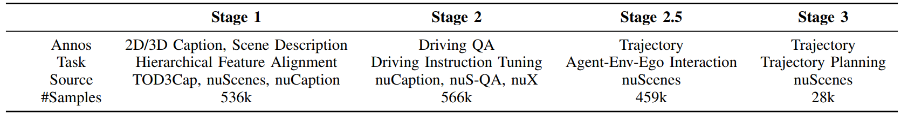
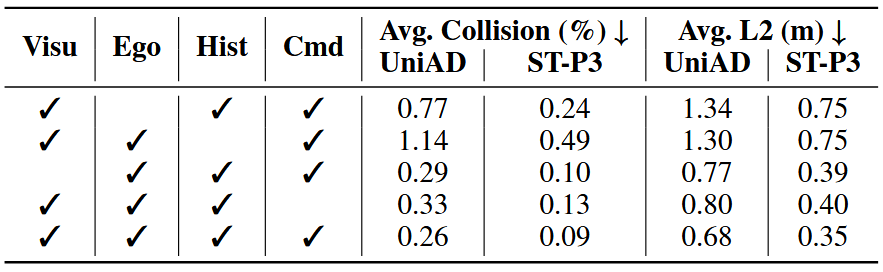
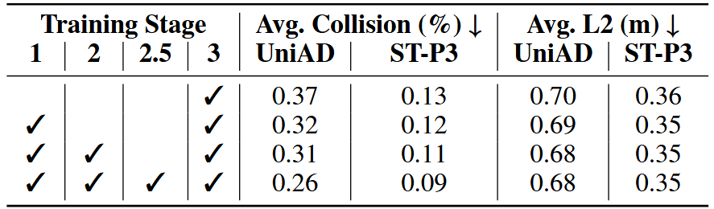

# OpenDriveVLA: Towards End-to-end Autonomous Driving with Large Vision Language Action Model

> ⚠ 入库注记（QUESTIONS #7）：本文实际标题为 "OpenDriveVLA: Towards End-to-end Autonomous Driving with Large Vision Language **Action** Model"（arXiv:2503.23463，v1/v2 一致，arXiv API ti 检索唯一命中），与早期任务给定标题「...Large Vision Language Models」的单复数不同；本笔记按 arXiv 实际标题（Action Model）入库。

**出处会议：** AAAI 2026（依据 GitHub 仓库 README News 原文 “**`2025/11/08`** OpenDriveVLA paper accepted by AAAI 2026.”，仓库 description/页面 title 原文含 “[AAAI 2026]”；arXiv abs 页无 Comments 会议标注，本次抓取确认 Comments 字段不存在）
**是否开源：** 是。GitHub https://github.com/DriveVLA/OpenDriveVLA （本次实际抓取确认存在，页面 title 原文 “GitHub - DriveVLA/OpenDriveVLA: [AAAI 2026] OpenDriveVLA: Towards End-to-end Autonomous Driving with Large Vision Language Action Model · GitHub”，license spdxId Apache-2.0）；项目页 https://drivevla.github.io/ ；README TODO List 原文 “We will release the model code and checkpoints soon. Stay tuned!”，其中 “Release inference code”、“Release checkpoints” 已勾选、“Release training scripts” 未勾选（训练脚本尚未发布）；News 原文 “2025/11/14 Released the OpenDriveVLA 0.5B checkpoint on Hugging Face.”（https://huggingface.co/OpenDriveVLA/OpenDriveVLA-0.5B ）；Acknowledgement 列 LLaVA-NeXT、Qwen2.5、UniAD、GPT-Driver、Hint-AD、TOD3Cap 等
**关键词：** 端到端自动驾驶 VLA（Vision-Language Action）、3D instance-aware 视觉表征（scene / agent / map tokens）、层级视觉-语言对齐（hierarchical vision-language alignment）、四段式训练（Stage 1 / 2 / 2.5 / 3）、agent–environment–ego 交互建模辅助任务、Qwen2.5-Instruct 0.5B/3B/7B、LLaVA-NeXT 框架、BEVFormer + TrackQFormer + MapQFormer、nuScenes 开环规划、nuScenes-QA / nuCaption / nuX / Nu-X VQA

> 来源与核验（抓取日期 2026-11-02）：
> - **标题核对（重要）**：任务给定标题为「OpenDriveVLA: Towards End-to-end Autonomous Driving with Large Vision Language Models」；arXiv 实际检索到的确切标题为「OpenDriveVLA: Towards End-to-end Autonomous Driving with Large Vision Language Action Model」（v1 与 v2 标题一致，abs 页 title 逐字核对）。按任务条件二（「检索到的确切标题与主题（端到端自动驾驶 VLA）吻合才可使用」）采用：arXiv API 标题检索 ti:“OpenDriveVLA”（本次抓取）totalResults=1，唯一命中 arXiv:2503.23463，摘要主题为端到端自动驾驶 VLA，作者 Xingcheng Zhou, Xuyuan Han, Feng Yang, Yunpu Ma, Volker Tresp, Alois Knoll，与库内 AutoVLA.md 引用的 OpenDriveVLA-3B 及 assets/OpenDriveVLA/ 预存表格截图主题吻合，无同名异文。
> - arXiv abs 页 v2（latest）https://arxiv.org/abs/2503.23463 （v1 2025-03-30，v2 2025-11-21；v1 abs 页 https://arxiv.org/abs/2503.23463v1 本次同抓，标题与 v2 相同，作者栏 v1 为 “Alois C. Knoll”、v2 为 “Alois Knoll”）。
> - 全文 arXiv 官方 HTML v2 https://arxiv.org/html/2503.23463v2 （LaTeXML 渲染，页面自标 “arXiv:2503.23463v2”，本次抓取）。以下 locator（§x / TABLE x）均指该 v2 的章节与表格编号（正文 I–V，附录 VI–VIII）；引号为本次实际抓取文本的逐字摘录；数学记号在 HTML 中为数学元素，摘录按其 alttext 还原并另行注明（〔…〕标记处即数学插入点；反引号内为 alttext 属性原文），引文以脚本对照抓取文本验证存在。
> - 开源核对：GitHub 仓库页面与 raw README、GitHub API repo metadata（license: Apache License 2.0 / spdx_id Apache-2.0，default_branch main）均本次实际抓取。
> - 表格：HTML v2 含全部 11 张表（TABLE I–XI，LaTeXML `ltx_tabular`），无「PDF 专属而 HTML 缺失」的表；本笔记转抄的表格均逐行照抄解析结果并经脚本逐单元格核验（见文末「表格核验」）。`library/assets/OpenDriveVLA/` 已有用户预存的 Table4.png / Table5.png / TableB.png（2026-11-01 存入），本次逐张查看并与 HTML 解析对照：分别对应 TABLE IV、TABLE V、TABLE XI（「TableB」文件名疑为旧版编号，数值与 v2 TABLE XI 逐格一致）。
> - 本笔记 2026-11-03 经入库前逐字 QA（quote 自洽 + 数字抽查）后自 nightshift/drafts/ 入库至 library/VLM_VLA/，未经用户核阅前所有结论均属「论文声称 / 尚未独立验证」。

------

## 1. 概述

- 论文定位（Abstract 原句）：“We present OpenDriveVLA, a Vision-Language Action (VLA) model designed for end-to-end autonomous driving, built upon open-source large language models.” 输入输出（Abstract 原句）：“OpenDriveVLA generates spatially-grounded driving actions by leveraging multimodal inputs, including both 2D and 3D instance-aware visual representations, ego vehicle states, and language commands.”
- 两个核心设计（Abstract 原句）：①对齐——“To bridge the modality gap between driving visual representations and language embeddings, we introduce a hierarchical vision-language alignment process, projecting both 2D and 3D structured visual tokens into a unified semantic space.”；②交互建模——“Furthermore, we incorporate structured agent–environment–ego interaction modeling into the autoregressive decoding process, enabling the model to capture fine-grained spatial dependencies and behavior-aware dynamics critical for reliable trajectory planning.”
- 头条声称（Abstract 原句）：“Extensive experiments on the nuScenes dataset demonstrate that OpenDriveVLA achieves state-of-the-art results across open-loop trajectory planning and driving-related question-answering tasks.”（注意：仅 nuScenes 开环评测，见 §VIII-D3 的自述局限）
- 问题动机（§I 原句）：“However, directly leveraging existing VLMs for autonomous driving poses fundamental challenges. Firstly, current VLMs are predominantly optimized for static, 2D image-language tasks, leading to poor spatial reasoning performance in dynamic 3D driving environments [5]. Besides, instance-agnostic VLMs [6] are prone to hallucinations, often yielding incorrect yet overconfident outputs, posing safety risks in autonomous driving.” 中心问题（§I 原句）：“How can we harness the emergent capabilities of large VLMs to produce safe spatially-grounded driving actions in dynamic 3D environments, while balancing inference speed and planning effectiveness?”
- 应对方案（§I 原句）：“To enhance spatial-awareness and safety in LLM-based vision-language action model, we introduce two key designs. First, we structure the driving environment using instance-aware, hierarchical 2D and 3D visual representations to reduce the risk of instance hallucinations. Second, we incorporate agent–environment–ego interaction modeling, which is originally explicitly modeled in traditional end-to-end driving systems, as an auxiliary objective into the autoregressive LLM training pipeline.”（§I 原句另有解释动机：“It enables the model to internalize physical feasibility and dynamic multi-agent interactions, improving robustness in safety-critical scenarios.”）
- 三条贡献（§I 列表，逐条原句）：
  1. “We present OpenDriveVLA, a 3D vision-language action model for end-to-end autonomous driving that generates reliable driving trajectories by integrating hierarchical visual input, ego state, and high-level language commands.”
  2. “We develop a multi-stage training strategy that aligns structured 2D and 3D visual features into a unified semantic space, enabling naive VLMs to generate spatially-grounded actions in complex driving scenarios.”
  3. “We introduce implicit agent–environment–ego interaction modeling into autoregressive LLM-based VLA training as an auxiliary task, enabling the model to learn behaviorally grounded and safety-aware driving actions.”
- 方法分类学定位（§II-C 原句）：“We categorize recent works into 4 paradigms, as illustrated in Figure 2.” 四类为（Fig. 2 子图 caption 原文）“(a) VLM as additional Caption or QA Head.”、“(b) VLM as high-level driving decision-maker.”、“(c) Native 2D VLM for end-to-end driving.”、“(d) 3D spatial-aware driving VLA (ours).”。对 (c) 的批评（§II-C 原句）：“These methods [25, 26, 27] process 2D images without explicit modeling of the instance, 3D spatial layout, and inter-agent interactions in the driving scene.” 自我定位（§II-C 原句）：“In this work, we investigate how to extend 2D VLMs by explicitly modeling 3D instance-aware and spatial-aware scene representations into an end-to-end autonomous driving framework, as shown in Fig.2(d).” 范围界定（§II-C 原句）：“Notably, we focus on fully differentiable end-to-end models in this work, while LLM-based agentic driving systems, such as [29, 30], fall outside the scope of our study.”
- 对端到端方法的批评（§II-A 原句）：“However, existing end-to-end methods still face semantic reasoning bottlenecks, as they struggle to fully comprehend high-level scene semantics, infer complex agent interactions, and adapt to dynamic task requirements.”（§II-A 原文另有拼写 “robostness”：“More recent approaches introduce diffusion models [11] and unified scene representations [12] to further enhance the effectiveness and robostness.”，照抄）
- 与本库 VLA 笔记的关系（有据，笔记作者定位）：论文 §II-B 把机器人操作的 VLA 列为相关工作并引用 OpenVLA 作参考文献 [18]，原句 “Recently, Vision-Language Action models have emerged to directly predict actions from visual inputs, demonstrating strong performance in robotic manipulation tasks [18].”，随即指出 “Yet, these methods are mostly limited to static setups and lack driving-specific 3D spatial design.”；实现层面（§VI-A3 原句）：“Our implementation builds upon the LLaVA NeXT framework [16], which enables the language model to perform structured cross-modality reasoning and autoregressive action generation.”（GitHub README Acknowledgement 亦列 LLaVA-NeXT）。即：OpenDriveVLA 是 LLaVA 式「视觉 token + projector 接入 LLM」范式向 3D 驾驶的扩展（LLaVA 为单层线性投影，本文为每类 token 一个两层 MLP + GeLU，§IV-C），与库内 library/VLM_VLA/LLaVA.md 同谱系；本库 TODO.md「VLM / VLA」组将 OpenVLA 与本文同列，两者均已入库（library/VLM_VLA/）。另：本库 library/ADe2e/AutoVLA.md 引用的 OpenDriveVLA-3B nuScenes 行（L2 0.14/0.30/0.55/0.33 等）与本文 TABLE I 逐格一致（本次对照核验）。

## 2. 方法

### 2.1 总体架构与 3D 视觉环境感知（§III、§III-A、附录 §VI-A）

- 流程（§III 原句）：“OpenDriveVLA uses a pre-trained vision encoder to extract tokenized environmental representations from multi-view images. These visual tokens are then aligned into the textual domain through cross-modal learning. After alignment, it undergoes driving instruction tuning, followed by agent-ego-environment interaction modeling. Finally, OpenDriveVLA is trained end-to-end to predict the ego vehicle’s future trajectory, guided by the aligned visual-language tokens and driving instructions.”
- 设计动机（§III-A 原句）：“To mitigate this, OpenDriveVLA adopts a visual-centric query module, where the model first learns to focus on driving-relevant objects and map tokens through 3D vision tasks, ensuring reliable visual token proposal.”（前句批评 2D 编码器：“While effective in open-domain vision-language applications, this design lacks explicit 3D spatial grounding and structured instance-level attention, which can lead to severe hallucinations in safety-critical driving scenarios [31].”）
- 三个查询模块（§III-A 原句）：“To obtain structured environmental representations, we adopt three visual query modules: Global Scene Sampler”〔𝒬_scene〕“, Agent QueryTransformer”〔𝒬_agent〕“, and Map QueryTransformer”〔𝒬_map〕（数学符号 alttext 分别为 `\mathcal{Q}_{\mathrm{scene}}`、`\mathcal{Q}_{\mathrm{agent}}`、`\mathcal{Q}_{\mathrm{map}}`）。输出（§III-A 原句，含数学）：“The output tokens, denoted as”〔V_env={v_scene, v_agent, v_map}〕“, serve as visual environment representation of the subsequent stages.”
- 视觉编码器沿用 UniAD（附录 §VI-A1 原句）：“We adopt the perception training stage introduced in UniAD [10, 57] to produce a robust visual encoder for the traffic environment. It is trained via vision-centric 3D perception tasks, including 3D object detection, tracking, and BEV panoptic segmentation.”（§VI-A1 原句解释为何不用语言引导的 grounding：“However, such supervision is often ambiguous and imprecise, especially in complex traffic environments where spatial accuracy is essential.”）
- 组件配置（TABLE VI，附录；逐行照抄，“Module | Input | Output | Architecture | Configuration”）：
  - “2D Backbone | Multi-view images | 2D features | ResNet-101 + FPN | Output strides: {1/8, 1/16, 1/32}”
  - “BEV Encoder | 2D features | BEV feature map | BEVFormer (6-layer encoder) | Hidden dim: 256; BEV: 200×200200\times 200”（“200×200200\times 200” 为数学元素拼接，alttext `200\times 200`，渲染为 200×200）
  - “Scene Sampler | 2D features | Global scene token | Adaptive max pooling | Output size: (6,3,5)(6,3,5)”（同理，alttext `(6,3,5)`）
  - “Agent Query Transformer | BEV features | Agent tokens | TrackQFormer (6-layer decoder) | 900 queries”
  - “Map Query Transformer | BEV features | Map tokens | MapQFormer (6-layer decoder) | 300 queries (3 thing + 1 stuff)”
- scene token 维度（§VI-A2 原句，含数学，片段摘录）：“To capture holistic scene-level context, we apply adaptive max pooling over the 2D features”〔𝐅_2D∈ℝ^{6×256×H×W}〕“from six camera views, compressing them into”〔(3×5)〕“spatial grids per view.”（𝐅_2D alttext `\mathbf{F}_{2D}\in\mathbb{R}^{6\times 256\times H\times W}`；(3×5) alttext `(3\times 5)`；§VI-A2 原句给出 scene token 维度〔v_scene=𝒬_scene(f_2D)∈ℝ^{90×D}〕，即 6 视图 × 3×5 = 90 个 token）
- agent token 置信度过滤（§VI-A2 原句）：“To improve efficiency and robustness, we filter out low-confidence agent predictions based on detection scores.” 及 “Moreover, it helps mitigate hallucination by suppressing uncertain or noisy detections from the vision input source.”

### 2.2 Stage 1 — 层级视觉-语言对齐（§III-B）

- 三个 token 专属 projector（§III-B 原句，含数学）：“Given the visual tokens extracted from the 3D visual perception module, we introduce three token-specific projectors”〔{Φ_scene, Φ_agent, Φ_map}〕（alttext `\{\Phi_{\mathrm{scene}},\Phi_{\mathrm{agent}},\Phi_{\mathrm{map}}\}`）。对齐目标：agent token 逐实例匹配 GT caption（“These captions provide detailed descriptions, including 2D appearance descriptions and 3D spatial positions.”，§III-B），scene/map token 逐样本匹配场景级 caption（§III-B 原句 “a sample-wise alignment is applied”）。
- 冻结策略（§III-B 原句）：“During this stage, both the visual encoder and LLM remain frozen to preserve pretrained semantics, with only the token-specific projectors being trainable.”
- 前向对齐公式（§III-B，Eq. alttext 逐字）：`\hat{\mathbf{X}}_{k}=\mathrm{LLM}\left(\Phi_{k}(v_{k})\right),\quad k\in\{\mathrm{scene},\mathrm{map}\}` 与 `\hat{\mathbf{X}}_{agent}^{i}=\mathrm{LLM}\left(\Phi_{\mathrm{agent}}(v_{agent}^{i})\right),\quad i=1,\dots,N_{a}`（渲染即 X̂_k = LLM(Φ_k(v_k))，X̂^i_agent = LLM(Φ_agent(v^i_agent))）

### 2.3 Stage 2 — 驾驶指令微调（§III-C）

- 目的（§III-C 原句）：“We distill high-level driving knowledge into the model via supervised instruction tuning, enabling it to internalize semantic reasoning patterns during training. This avoids costly chain-of-thought (CoT) reasoning at inference time and balances planning efficacy with runtime efficiency.”
- 数据形式（§III-C 原句，含数学）：“We formulate the tuning data as instruction-response pairs”〔{X_input, X_answer}〕“, where”〔X_input=(V_env, S_ego, X_query)〕（X_query 为驾驶相关问题，S_ego 为文本化自车状态，§III-C）。前向公式（Eq. alttext 逐字）：`\hat{\mathbf{X}}_{answer}=\mathrm{LLM}\left(\textbf{V}_{env},\textbf{S}_{ego},\mathbf{X}_{query}\right)`
- 冻结策略（§III-C 原句）：“During instruction tuning, the visual encoder remains frozen while the token-specific projectors and the LLM are set to be trainable.”

### 2.4 Stage 2.5 — Agent-Environment-Ego 交互建模（§III-D）

- 动机（§III-D 原句）：“However, existing pre-trained LLMs lack an inherent inductive bias for spatial reasoning in 3D driving scenes, as they are predominantly trained on 2D vision-language and text-based datasets.” 做法（§III-D 原句）：“We introduce a conditional agent trajectory forecasting task as an auxiliary objective, encouraging the model to learn spatially grounded interaction priors.”
- 条件（§III-D 原句，含数学）：“The predicted trajectory is conditioned on the scene context, map structure, and ego vehicle state, enabling OpenDriveVLA to infer interaction-aware and spatially grounded motion sequences.” 学习目标（Eq. alttext 逐字）：`\mathrm{max}\prod_{t=1}^{T}p\left(w^{i}_{t}\mid w^{i}_{1:t-1},\textbf{V}_{env},\textbf{S}_{ego},\Phi_{\mathrm{agent}}(v_{agent}^{i})\right)`（对第 i 个 agent 的自回归最大化）
- 定位（§III-D 原句）：“This provides OpenDriveVLA with essential spatial priors, enabling it to bridge the gap between high-level semantic reasoning and physically grounded motion planning.”

### 2.5 Stage 3 — 端到端轨迹规划微调（§III-E）

- 轨迹离散化（§III-E 原句，含数学）：“In this stage, OpenDriveVLA predicts ego trajectories as discrete waypoint sequences within a short horizon”〔𝒲_ego={w_1,…,w_T}〕；“Each waypoint”〔w_t〕“represents the 2D coordinates”〔(x_t, y_t)〕“of the ego vehicle at time step”〔t〕。“The waypoints are tokenized into a sequence of discrete textual tokens for autoregressive generation in the LLM”（token 化公式 alttext `\mathcal{T}{traj}=\mathrm{Tokenizer}(\mathcal{W}_{ego})`）
- 解码目标（Eq. alttext 逐字）：`\hat{\mathcal{T}}_{traj}=\textit{argmax}_{\textbf{T}_{traj}}\prod_{t=1}^{T}p\left(w_{t}\mid w_{1:t-1},\textbf{V}_{env},\textbf{S}_{ego},\textbf{X}_{dri}\right)`，解码回数值路点（Eq. alttext）：`\hat{\mathcal{W}}_{ego}=\mathrm{Decoder}(\hat{\mathcal{T}}_{traj})`
- 联合优化（§III-E 原句）：“The entire pipeline, including the 3D visual encoder, cross-modality projectors, and LLM, is jointly optimized end-to-end during training, with the 2D encoder kept frozen.”
- 轨迹规格（§IV-A 原句）：“Following [38], the ego vehicle state is encoded as textual input to ensure ego awareness throughout the training process. Both tasks predict 3-second future trajectories, sampled at 0.5-second intervals, resulting in 6 waypoints per trajectory.”

### 2.6 LLM 底座、特殊 token 与输入结构（附录 §VI-A3、§VI-B）

- LLM 底座（§VI-A3 原句）：“We adopt Qwen2.5-Instruct [14] as the pre-trained LLM backbone for generating structured driving actions. To balance model capacity and computational efficiency, we evaluate three variants with 0.5B, 3B, and 7B parameters.”（注意 §IV-C 实现细节句中写作 “Qwen 2.5-Instruct”，带空格，两处均照原文）
- 特殊 token（§VI-A3 原句）：“To support structured multimodal OpenDriveVLA input, we extend the Qwen2.5 tokenizer with a set of special tokens and token indices, as summarized in Table VII.” 输入序列（§VI-A3 展示行原文，HTML 源码中为 &lt;SYSTEM&gt; 等转义、typewriter 字体 span）：“<SYSTEM><SCENE><TRACK><MAP><EGO><COMMAND>”。替换规则（§VI-A3 原句）：“During input construction, <SCENE>, <TRACK>, and <MAP> are replaced with projected visual tokens, while <EGO> and <COMMAND> are filled with formatted textual strings.”
- TABLE VII（附录）为扩展 token 全表（22 行，含 Placeholder Token Indices / High-Level Markers / Token Delimiters / Optional QA Format Tokens 四组，分组行如 “Placeholder Token Indices” 为原文单格跨列行）；本笔记未逐行全抄，示例逐字行：“IMAGE_TOKEN_INDEX | Placeholder for global image token”、“<trajectory> | Start of autoregressive trajectory output”、“<traj_start>, <traj_end> | Generated trajectory delimiters”。
- System prompt（§VI-B1 原句）：“The system prompt follows the BEV coordinate conventions introduced in GPT Driver [38], while specifying the model role, driving objectives, and output format.” 及 “The system prompt is prepended to all inputs during both training and inference to ensure consistent task framing and instruction following.”

## 3. 实验

### 3.1 数据、实现与训练配置（§IV-A、§IV-C、附录 §VI-C、§VII）

- 训练数据（§IV-A 原句）：“We curate the training data of OpenDriveVLA based on its distinct training phases, drawing from: TOD3Cap [43], nuCaption [44], nuScenesQA [45], nuX [19], and GPT-Driver [38]. We conduct experiments on nuScenes [46], following standard data split into training and validation sets.”（§IV-A 原句：“OpenDriveVLA is trained using the training set paired with corresponding QA captions, while the validation set is exclusively used for performance evaluation to ensure fair comparisons with prior works.”）
- 数据规模（TABLE X，附录 §VII-A，逐行照抄，表头 “Dataset | #Train | #Val | Annotation Types | Type”）：

| Dataset | #Train | #Val | Annotation Types | Type |
| --- | --- | --- | --- | --- |
| TOD3Cap | 1.89M | 410K | Object Caption: appearance, motion, relationships | Dense Captioning |
| nuScenes-QA | 376K | 83K | existence, counting, object, status, comparison | Visual Question Answering |
| nuCaption | 348K | 72K | Scene Caption: layout, agents, hazards | Scene Description |
| nuX | 28K | 6K | Driving Decision Justification | Reasoning & Narration |

- 四阶段数据总览（TABLE XI，附录 §VII-B，逐行照抄；首列表头原文为空）：

|  | Stage 1 | Stage 2 | Stage 2.5 | Stage 3 |
| --- | --- | --- | --- | --- |
| Annos | 2D/3D Caption, Scene Description | Driving QA | Trajectory | Trajectory |
| Task | Hierarchical Feature Alignment | Driving Instruction Tuning | Agent-Env-Ego Interaction | Trajectory Planning |
| Source | TOD3Cap, nuScenes, nuCaption | nuCaption, nuS-QA, nuX | nuScenes | nuScenes |
| #Samples | 536k | 566k | 459k | 28k |



- 实现（§IV-C 原句）：“The 3D visual perception module in OpenDriveVLA follows the vision-centric design from [10], using a ResNet-101 backbone for 2D feature extraction.” 与 “The resulting BEV feature map has a spatial resolution of”〔200×200〕（数学 alttext `200\times 200`）以及 “Each token type is then mapped into the language space using a separate two-layer MLP with GeLU activation.”
- 训练配置（§IV-C 原句）：“We adopt Qwen 2.5-Instruct [14] as the pre-trained LLM, which undergoes full parameter tuning during training. Training is performed on 4 NVIDIA H100 GPUs with a batch size of 1, completed in approximately two days. We freeze the 2D backbone during stage 3. During inference, we set the decoding temperature to 0 to ensure deterministic trajectory generation.”
- 训练超参（TABLE VIII，附录 §VI-C1；原文表头与跨行结构较复杂，逐行照抄解析结果，行内竖线分隔单元格；“Train” 为原文跨行标签，“Epochs” 行首格原文为空）：

```
| | | Stage 1 | Stage 2 | Stage 2.5 | Stage 3 |
| Train | Tunable parts | projector | projector,LLM | projector,LLM | Full model (except 2D encoder) |
| Trainable Params (MB) | 3.1 | 496.9 | 496.9 | 552.6 |
| Per-GPU batch size | 1 | 1 | 1 | 1 |
| GPUs | 4 | 4 | 4 | 4 |
| LR (ψvision\psi_{\text{vision}}) | – | - | - | 1×10−51\times 10^{-5} |
| LR ({θproj/LLM}\{\theta_{\text{proj/LLM}}\}) | 1×10−41\times 10^{-4} | 1×10−51\times 10^{-5} | 1×10−51\times 10^{-5} | 1×10−51\times 10^{-5} |
| | Epochs | 1 | 1 | 1 | 1 |
```

（注：上块第 5/6 行行首的 LR 单元格与 Stage 3 数值、以及 “1×10−5” 一类数值在 HTML 中为数学元素（MathML 可见文本与 x-tex annotation 拼接），渲染分别为 ψ_vision、{θ_proj/LLM}、1×10⁻⁵、1×10⁻⁴；上块已按解析结果逐字照抄。Stage 1 的 LR 冻结格原文为 en-dash “–”，Stage 2/2.5 的视觉 LR 格原文为 hyphen “-”，均照抄。附录 §VI-C1 原句：“All training stages use mixed-precision (bf16) and gradient checkpointing to improve memory efficiency and speed.” 与 “LLM parameters are fully tuned unless specified otherwise.”）

- 推理效率（§VI-C2 原句）：“Table IX reports the inference performance of OpenDriveVLA across three LLM scales (0.5B, 3B, 7B) under bf16 precision on a single NVIDIA A100 GPU. Evaluation is conducted on the NuScenes trajectory validation set with 6019 samples.” TABLE IX（逐行照抄）：

| Model | LLM | GPUs | Speed (Sample/s) | Latency (s) | Max VRAM (GB) |
| --- | --- | --- | --- | --- | --- |
| 0.5B | Qwen2.5-0.5B-Instruct | 1 | 0.74 | 1.36 | 1.56 |
| 3B | Qwen2.5-3B-Instruct | 1 | 0.54 | 1.85 | 7.35 |
| 7B | Qwen2.5-7B-Instruct | 1 | 0.57 | 1.74 | 17.15 |

### 3.2 开环轨迹规划主结果（§IV-B、§IV-D，TABLE I）

- 评测协议（§IV-B 原句）：“We evaluate OpenDriveVLA on the open-loop planning task of nuScenes benchmark, where the model is reported under both ST-P3 [32] and UniAD [10] settings. The evaluation metrics include L2 displacement errors at 1, 2, and 3 seconds, along with the average collision rate over the prediction horizon.”
- TABLE I（caption 原文 “TABLE I: Open-Loop planning performance comparison of different driving models, including both autoregressive methods and non-autoregressive methods. OpenDriveVLA shows powerful planning ability and achieves best-in-class results among open-source models, even with the 0.5B version.”）。表头为三层结构（原文第 1 行 “Method | ST-P3 metrics | UniAD metrics | LLM | Input”，第 2 行 “L2 (m) ↓ | Collision (%) ↓ | L2 (m) ↓ | Collision (%) ↓”，第 3 行 “1s | 2s | 3s | Avg. | 1s | 2s | 3s | Avg. | 1s | 2s | 3s | Avg. | 1s | 2s | 3s | Avg.”；ST-P3/UniAD 各占 8 列，“None-Autoregressive Methods”/“Autoregressive Methods” 两行为原文跨列分组行）。数据行逐行照抄（列序：Method | ST-P3 L2 1s/2s/3s/Avg. | ST-P3 Col. 1s/2s/3s/Avg. | UniAD L2 1s/2s/3s/Avg. | UniAD Col. 1s/2s/3s/Avg. | LLM | Input；“-” 为原表格单元格内的原文连字符，HTML `<td>` 内即字符 “-”）：

| Method | 1s | 2s | 3s | Avg. | 1s | 2s | 3s | Avg. | 1s | 2s | 3s | Avg. | 1s | 2s | 3s | Avg. | LLM | Input |
| --- | --- | --- | --- | --- | --- | --- | --- | --- | --- | --- | --- | --- | --- | --- | --- | --- | --- | --- |
| None-Autoregressive Methods |  |  |  |  |  |  |  |  |  |  |  |  |  |  |  |  |  |  |
| ST-P3 [32] | 1.33 | 2.11 | 2.90 | 2.11 | 0.23 | 0.62 | 1.27 | 0.71 | - | - | - | - | - | - | - | - | - | Visual |
| VAD [33] | 0.17 | 0.34 | 0.60 | 0.37 | 0.07 | 0.10 | 0.24 | 0.14 | - | - | - | - | - | - | - | - | - | Visual |
| Ego-MLP [34] | 0.46 | 0.76 | 1.12 | 0.78 | 0.21 | 0.35 | 0.58 | 0.38 | - | - | - | - | - | - | - | - | - | Ego |
| UniAD [10] | 0.44 | 0.67 | 0.96 | 0.69 | 0.04 | 0.08 | 0.23 | 0.12 | 0.48 | 0.96 | 1.65 | 1.03 | 0.05 | 0.17 | 0.71 | 0.31 | - | Visual |
| InsightDrive [35] | 0.23 | 0.41 | 0.68 | 0.44 | 0.09 | 0.10 | 0.27 | 0.15 | 0.30 | 0.72 | 1.41 | 0.81 | 0.08 | 0.15 | 0.84 | 0.36 | - | Visual |
| FF [9] | - | - | - | - | - | - | - | - | 0.55 | 1.20 | 2.54 | 1.43 | 0.06 | 0.17 | 1.07 | 0.43 | - | LiDAR |
| EO [36] | - | - | - | - | - | - | - | - | 0.67 | 1.36 | 2.78 | 1.60 | 0.04 | 0.09 | 0.88 | 0.33 | - | LiDAR |
| Autoregressive Methods |  |  |  |  |  |  |  |  |  |  |  |  |  |  |  |  |  |  |
| GPVL [37] | 0.21 | 0.39 | 0.69 | 0.43 | 0.07 | 0.09 | 0.27 | 0.14 | - | - | - | - | - | - | - | - | BERT | Textual |
| DriveVLM [21] | 0.18 | 0.34 | 0.68 | 0.40 | 0.10 | 0.22 | 0.45 | 0.27 | - | - | - | - | - | - | - | - | Qwen-VL-7B | Visual |
| GPT-Driver [38] | 0.20 | 0.40 | 0.70 | 0.44 | 0.04 | 0.12 | 0.36 | 0.17 | 0.27 | 0.74 | 1.52 | 0.84 | 0.07 | 0.15 | 1.10 | 0.44 | GPT-3.5 | Textual |
| RDA-Driver [39] | 0.17 | 0.37 | 0.69 | 0.40 | 0.01 | 0.05 | 0.26 | 0.10 | 0.23 | 0.73 | 1.54 | 0.80 | 0.00 | 0.13 | 0.83 | 0.32 | LLaVa-7B | Visual |
| OminiDrive [29] | 0.14 | 0.29 | 0.55 | 0.33 | 0.00 | 0.13 | 0.78 | 0.30 | - | - | - | - | - | - | - | - | LLaVA-7B | Visual |
| EMMA [40] | 0.14 | 0.29 | 0.54 | 0.32 | - | - | - | - | - | - | - | - | - | - | - | - | Gemini | Visual |
| OpenEMMA [41] | 1.45 | 3.21 | 3.76 | 2.81 | - | - | - | - | - | - | - | - | - | - | - | - | Qwen-VL-7B | Visual |
| DME-Driver [42] | - | - | - | - | - | - | - | - | 0.45 | 0.91 | 1.58 | 0.98 | 0.05 | 0.28 | 0.55 | 0.29 | LLaVa-7B | Visual |
| OpenDriveVLA-0.5B (Ours) | 0.15 | 0.32 | 0.57 | 0.35 | 0.01 | 0.06 | 0.20 | 0.09 | 0.21 | 0.60 | 1.22 | 0.68 | 0.00 | 0.15 | 0.63 | 0.26 | Qwen2.5-0.5B | Visual |
| OpenDriveVLA-3B (Ours) | 0.14 | 0.30 | 0.55 | 0.33 | 0.02 | 0.07 | 0.22 | 0.10 | 0.19 | 0.58 | 1.24 | 0.67 | 0.02 | 0.18 | 0.70 | 0.30 | Qwen2.5-3B | Visual |
| OpenDriveVLA-7B (Ours) | 0.15 | 0.31 | 0.55 | 0.33 | 0.01 | 0.08 | 0.21 | 0.10 | 0.20 | 0.58 | 1.21 | 0.66 | 0.00 | 0.22 | 0.55 | 0.25 | Qwen2.5-7B | Visual |

（注：“None-Autoregressive Methods” 与 “Autoregressive Methods” 在原文为单格跨列分组标题行，此处按解析结果照抄单格并补空格对齐；“OminiDrive [29]” 为原文拼写（OmniDrive 之误），“LLaVa-7B”/“LLaVA-7B” 大小写不一亦照原文。）
- 读数（§IV-D 原句）：“As shown in Table I, OpenDriveVLA achieves state-of-the-art performance across both settings. Specifically, both 3B and 7B version models achieve an average L2 error of 0.33m under ST-P3 metrics, outperforming prior autoregressive language models [38, 21]. On the UniAD metrics, OpenDriveVLA-7B also achieves great performance with an average L2 error of 0.66m. Notably, despite significantly fewer parameters, the 0.5B version still outperforms prior models obviously.”

### 3.3 驾驶问答（VQA）结果（§IV-D，TABLE II、TABLE III）

- 设置（§IV-D 原句）：“We access OpenDriveVLA on the driving VQA task across three nuScenes-based datasets (Table II, Table III), reporting results after the second stage of training.”
- TABLE II（caption 原文 “TABLE II: Performance on nu-Caption [44] and nuScenes-QA [45]. BL-1/2/3/4: BLEU scores. QA metrics report accuracy on five question types: Existence, Counting, Object, Status, and Comparison.”；表头两行，第 1 行 “Method | nu-Caption | nuScenes-QA”，第 2 行 “BL-1 | BL-2 | BL-3 | BL-4 | BERT-S | Ext | Cnt | Obj | Sts | Cmp | H0 | H1 | Acc”；nu-Caption 覆盖 BL-1～BERT-S 共 5 列，nuScenes-QA 覆盖 Ext～Acc 共 9 列，“-” 为原表格单元格内的原文连字符）逐行照抄：

| Method | BL-1 | BL-2 | BL-3 | BL-4 | BERT-S | Ext | Cnt | Obj | Sts | Cmp | H0 | H1 | Acc |
| --- | --- | --- | --- | --- | --- | --- | --- | --- | --- | --- | --- | --- | --- |
| Mini-GPT4 [47] | 15.0 | 6.8 | 3.7 | 2.6 | 84.4 | - | - | - | - | - | - | - | - |
| Instruct-BLIP [48] | 18.7 | 13.4 | 7.4 | 5.2 | 85.9 | - | - | - | - | - | - | - | - |
| LLaMA-AdapV2 [49] | 30.2 | 17.3 | 10.4 | 7.5 | 86.5 | 19.3 | 2.7 | 7.6 | 10.8 | 1.6 | 15.1 | 4.8 | 9.6 |
| LLaVA1.5 [50] | 20.0 | 12.1 | 8.6 | 5.4 | 85.0 | 45.8 | 7.7 | 7.8 | 9.0 | 52.1 | 25.7 | 41.5 | 26.2 |
| LiDAR-LLM [44] | 41.0 | 30.0 | 23.4 | 19.3 | 91.3 | 74.5 | 15.0 | 37.8 | 45.9 | 57.8 | - | - | 48.6 |
| BEVDet+BUTD [45] | - | - | - | - | - | 83.7 | 20.9 | 48.8 | 52.0 | 67.7 | - | - | 57.0 |
| OpenDriveVLA-0.5B (Ours) | 47.2 | 35.8 | 29.4 | 25.2 | 91.9 | 83.9 | 22.0 | 50.2 | 57.0 | 68.4 | 62.3 | 56.5 | 58.4 |
| OpenDriveVLA-3B (Ours) | 48.3 | 36.9 | 30.3 | 26.1 | 92.0 | 84.0 | 22.3 | 50.3 | 56.9 | 68.5 | 62.6 | 56.5 | 58.5 |
| OpenDriveVLA-7B (Ours) | 49.6 | 38.3 | 31.9 | 27.6 | 92.2 | 84.2 | 22.7 | 49.6 | 54.5 | 68.8 | 62.4 | 56.1 | 58.2 |

- 读数（§IV-D 原句）：“OpenDriveVLA reaches best-in-class performance across all three datasets, consistently outperforming previous language-enhanced driving models and general-purpose multimodal baselines among most metrics. On nuCaption dataset, it achieves the best captioning performance among all evaluated models, outperforming both general VLMs LLaVA1.5 [50] and Mini-GPT4 [47], as well as autonomous driving-specific models such as LiDAR-LLM [44].” 及 “Compared to models that directly fuse BEV features with language models such as BEVDet+BUTD [45], it demonstrates clear advantages in object and status-related questions, which highlights the benefit of its spatially grounded visual-language alignment.”
- TABLE III（caption 原文 “TABLE III: Performance comparison of OpenDriveVLA on the Nu-X dataset [19].”；“OpenDriveVLA” 为原文跨 5 列分组标题行）逐行照抄：

| Models | CIDER | BL-4 | METEOR | ROUGE-L |
| --- | --- | --- | --- | --- |
| Hint-UniAD [19] | 21.7 | 4.2 | 12.7 | 27.0 |
| Hint-VAD [19] | 22.4 | 4.2 | 13.2 | 27.6 |
| GPT-4o [24] | 19.0 | 4.0 | 10.3 | 24.9 |
| Gemini 1.5 [51] | 17.6 | 3.4 | 9.3 | 23.4 |
| Vote2CapDETR [52] | 15.3 | 2.6 | 10.9 | 24.2 |
| TOD3Cap [43] | 14.5 | 2.5 | 10.5 | 23.5 |
| OpenDriveVLA |  |  |  |  |
| 0.5B (Ours) | 32.3 | 5.4 | 12.5 | 27.9 |
| 3B (Ours) | 25.5 | 4.3 | 12.8 | 27.8 |
| 7B (Ours) | 26.2 | 4.5 | 12.8 | 27.4 |

- 读数（§IV-D 原句）：“Notably, the 0.5B version outperforms even the larger 7B on the Nu-X dataset, which shows its powerful scene-understanding ability even with lightweight LLMs.”（TABLE III 中 0.5B CIDEr 32.3 vs 7B 26.2、ROUGE-L 27.9 vs 27.4）

### 3.4 消融研究（§IV-E，TABLE IV、TABLE V）

- 输入组合消融。TABLE IV（caption 原文 “TABLE IV: Ablation study on the effect of different input combinations on OpenDriveVLA-0.5B.”；表头两行，第 1 行 “Visu | Ego | Hist | Cmd | Avg. Collision (%) ↓ | Avg. L2 (m) ↓”，第 2 行 “UniAD | ST-P3 | UniAD | ST-P3”；✓ 为原文符号，空白为未使用）逐行照抄：

| Visu | Ego | Hist | Cmd | UniAD | ST-P3 | UniAD | ST-P3 |
| --- | --- | --- | --- | --- | --- | --- | --- |
| ✓ |  | ✓ | ✓ | 0.77 | 0.24 | 1.34 | 0.75 |
| ✓ | ✓ |  | ✓ | 1.14 | 0.49 | 1.30 | 0.75 |
|  | ✓ | ✓ | ✓ | 0.29 | 0.10 | 0.77 | 0.39 |
| ✓ | ✓ | ✓ |  | 0.33 | 0.13 | 0.80 | 0.40 |
| ✓ | ✓ | ✓ | ✓ | 0.26 | 0.09 | 0.68 | 0.35 |

（前 4 列为输入开关（Visu=视觉、Ego=自车状态、Hist=历史轨迹、Cmd=指令），后 4 列中第 1–2 列属 “Avg. Collision (%) ↓”、第 3–4 列属 “Avg. L2 (m) ↓”，对应原文表头第 1/2 行。）


- 读数（§IV-E 原句）：“The inclusion of visual inputs significantly boosts overall performance. Adding textual commands and historical information further improves the predictions, emphasizing the value of semantic intent and temporal context. Notably, ego-state features play a critical role in nuScenes open-loop benchmark, consistent with prior findings [53].”（TABLE IV：无 Visu 有 Ego/Hist/Cmd 行 Avg. Col. 0.29/0.10，无 Ego 行 0.77/0.24 与 1.14/0.49，全开行最优 0.26/0.09）
- 多阶段训练消融。TABLE V（caption 原文 “TABLE V: Ablation study on the effect of multi-stage training of 0.5B model. Stage 1, 2, 2.5, and 3 correspond to hierarchical feature alignment, driving instruction tuning, Agent-Env-Ego modeling, and trajectory tuning, respectively.”；表头两行，第 1 行 “Training Stage | Avg. Collision (%) ↓ | Avg. L2 (m) ↓”，第 2 行 “1 | 2 | 2.5 | 3 | UniAD | ST-P3 | UniAD | ST-P3”）逐行照抄（列名取自表头第 2 行；✓ 为原文符号）：

| 1 | 2 | 2.5 | 3 | UniAD | ST-P3 | UniAD | ST-P3 |
| --- | --- | --- | --- | --- | --- | --- | --- |
|  |  |  | ✓ | 0.37 | 0.13 | 0.70 | 0.36 |
| ✓ |  |  | ✓ | 0.32 | 0.12 | 0.69 | 0.35 |
| ✓ | ✓ |  | ✓ | 0.31 | 0.11 | 0.68 | 0.35 |
| ✓ | ✓ | ✓ | ✓ | 0.26 | 0.09 | 0.68 | 0.35 |

- 读数（§IV-E 原句）：“As shown in Table V, each additional stage consistently improves performance, with the most notable reductions in collision rate observed after Hierarchical Vision-Language Alignment and Agent-Environment-Ego Interaction Modeling. These improvements highlight the effectiveness of cross-modal grounding and interaction-aware reasoning in enhancing safety-critical planning behavior.”（TABLE V：仅 Stage 3 为 0.37，+Stage 1 降至 0.32，+Stage 2.5 后至 0.26）


- 指令跟随定性结果（§IV-E 原句）：“OpenDriveVLA accurately adapts its plan to the given command while maintaining context-aware and environment-consistent behavior, demonstrating robust command-following and generalization in complex scenes.”

## 4. 核心结论

- 论文自述（§V 原句）：“In this work, we present OpenDriveVLA, a scalable vision-language action model designed for end-to-end autonomous driving. Built upon pre-trained large language models, OpenDriveVLA generates 3D spatially grounded and semantically consistent driving actions from multimodal inputs. We introduce a hierarchical vision-language feature alignment module and realize agent-env-ego interaction in LLM to enable fine-grained spatial reasoning and dynamic scene understanding. Through multi-stage training paradigm, OpenDriveVLA achieves state-of-the-art performance in open-loop planning and driving-related question answering.”
- 模型规模结论（§VIII-D1 原句）：“The results in Main Content (Table 1,2,3) show that, while increasing model size generally leads to improved performance, the larger OpenDriveVLA-7B model does not consistently outperform the smaller 0.5B and 3B variants across all benchmarks.” 归因（§VIII-D1 原句）：“As detailed in Table X, the instruction tuning data and domain-specific driving annotations used in our current setup may not be sufficient to fully leverage the representation capacity of the 7B model, especially in the autonomous driving domain, where large-scale open-source vision language datasets are still very few.” 总括（§VIII-D1 原句）：“In summary, model size alone is not a robust indicator of performance in this domain-specific autonomous driving task with limited data sources. Instead, data quantity and quality, and multi-stage training strategies play a critical role in achieving robust and scalable performance.”
- 局限（§VIII-D2 原句）：①“First, the model relies on implicit reasoning patterns acquired through instruction tuning, without explicit step-by-step chain-of-thought deduction during inference.”（原文此句后有拼写 “eteriorate”：“Although this design helps maintain inference efficiency, it may eteriorate the reasoning performance and limit the model’s ability to handle complex scenarios.”，照抄）；②“Second, the autoregressive nature of LLM introduces inference latency.”（§VIII-D2 原句：“Even with careful control of token lengths, the sequential decoding process remains a bottleneck for deployment in high-speed driving scenarios.”）；③“Finally, our current planning evaluation is limited to an open-loop setting. This does not capture the interactive feedback dynamics of realistic driving and may lead to overestimated robustness, underscoring the importance of extending OpenDriveVLA to closed-loop, language-aware simulation environments.”
- 闭环扩展（§VIII-D3 原句）：“Prior studies also show that nuscences open-loop benchmark may lead to overly optimistic conclusions[34].”（“nuscences” 为原文拼写，照抄）及 “Unfortunately, these benchmarks currently lack vision-language annotations that are central to the training of domain-specific LLM-based Autonomous Driving models.”（§VIII-D3 提出的方向：“future work involves building an automated data generation pipeline that (semi-)automatically generates instance-level, map-level, and scene-level descriptions, as well as question–answer pairs linked to driving behaviors.”）
- 定性失败案例（§VIII-A 原句）：“However, in the scene-level description, the model hallucinates that there are no pedestrians visible in the right-front view, despite the presence of one pedestrian in the image.”（§VIII-A 另指出视角指代不准：“This may be attributed to the model being trained with scene-level captions in a camera-agnostic fashion, without explicit supervision for distinguishing between different camera perspectives.”）
- 可复用的方法论要点（均为论文声称）：
  1. 以 UniAD 感知预训练（3D 检测/跟踪/BEV 全景分割）产出 scene/agent/map 三类结构化 token，再用三个 token 专属 projector 做 Stage 1 对齐，是本文替代「2D VLM 直接吃图」的核心设计（§III-A、§VI-A1、TABLE VI）。
  2. 四段式训练各阶段冻结/解冻安排：Stage 1 仅训 projector（3.1 MB 可训参数），Stage 2/2.5 训 projector+LLM（496.9 MB），Stage 3 全模型（除 2D encoder，552.6 MB）；各阶段均 1 epoch、4×H100、per-GPU batch 1（TABLE VIII、§IV-C）。
  3. Stage 2.5 的 agent 轨迹预测辅助任务与 Stage 1 对齐是碰撞率下降的主要来源（TABLE V：0.37→0.32→0.26，§IV-E）。
  4. 输入消融显示视觉输入与 ego state 都不可省（TABLE IV），且 ego state 在 nuScenes 开环基准上作用关键（§IV-E，引 [53]）。
- ⚠ 措辞提示：①Abstract 的 “state-of-the-art results” 仅指 nuScenes 开环规划与驾驶 VQA，未含闭环（§VIII-D2/D3 自述）；②TABLE I 中 OpenDriveVLA 的 ST-P3 口径 L2 Avg. 0.33 与 VAD（0.37）、RDA-Driver（0.40）同量级，UniAD 口径下 0.5B 的 Avg. L2 0.68/Col. 0.26 与 UniAD 基线（1.03/0.31）接近；③各规模互有胜负（Nu-X 上 0.5B 优于 7B），引用规模结论时勿写「越大越好」；④推理延迟 1.36–1.85 s/样本（TABLE IX，A100 BF16），§VIII-D2 自认是高速场景部署瓶颈；⑤训练脚本截至本次抓取未发布（GitHub README TODO List 未勾选），训练复现受限。引用本文时建议写「论文声称 / 尚未独立验证」。

## TODO

- [x] **配图已回填（2026-11-03 入库）**：library/assets/OpenDriveVLA/ 3 张用户预存截图（2026-11-01）入库时再次逐张目视核对内容并按相对路径（../assets/OpenDriveVLA/）回填正文——Table4.png（= TABLE IV 输入组合消融 → §3.4）、Table5.png（= TABLE V 多阶段训练消融 → §3.4）、TableB.png（= TABLE XI 四阶段数据总览 → §3.1，文件名疑为旧版编号，数值与 v2 TABLE XI 逐格一致）。仍缺：Fig. 1（架构总览）、Fig. 2（VLM 驾驶范式分类学）、Fig. 3（四阶段训练示意）、Fig. 5（视觉编码器预训练）、Fig. 6–14 等，需用户补充或授权抓取。
- TABLE VII（扩展特殊 token 全表，22 行）仅示例逐字行，未逐行全抄；如需可补。
- 未核对 v1（2025-03-30）与 v2（2025-11-21）正文差异；本笔记仅基于 v2（arXiv HTML）。v1 与 v2 作者栏 “Alois C. Knoll” / “Alois Knoll” 的差异已记录于核验块。
- 训练脚本未开源（GitHub README TODO List “Release training scripts” 未勾选），Table VIII 之外的超参（如 Stage 2/2.5 的 LR 数值为何在表中以 “-” 占位、数据混合比例）无法从代码侧复核。
- 抓取 URL 与日期（均为 2026-11-02）：arXiv API 检索 https://arxiv.org/api/query?search_query=ti:%22OpenDriveVLA%22&max_results=20 ；abs 页 https://arxiv.org/abs/2503.23463 与 https://arxiv.org/abs/2503.23463v1 ；HTML 全文 https://arxiv.org/html/2503.23463v2 ；GitHub https://github.com/DriveVLA/OpenDriveVLA （页面 + raw README + GitHub API repo metadata）；未抓取 Hugging Face checkpoint 页与项目页 https://drivevla.github.io/（开源状态以 GitHub 侧为准）。
- 表格核验：TABLE I（S3.T1，含 2 个跨列分组行）/ TABLE II（S4.T2）/ TABLE III（S4.T3，含跨列分组行 “OpenDriveVLA”）/ TABLE IV（S4.T4）/ TABLE V（S4.T5）/ TABLE VIII（S6.T8，含跨行标签 “Train”）/ TABLE IX（S6.T9）/ TABLE X（S7.T10）/ TABLE XI（S7.T11）已逐单元格对照 HTML 解析结果核验通过；TABLE VI、TABLE VII 以逐字行摘录方式核验。数学元素拼接（“200×200200\times 200” 等）按 alttext 另注，✓/–/- 等符号按原文字符照抄。
- 关联待写项（TODO.md「VLM / VLA」组）：OpenVLA（本文 §II-B 引其为机器人操作 VLA [18]，已入库 library/VLM_VLA/OpenVLA.md）与 LLaVA-1.5（本文 TABLE II 基线 [50]）与本文的关系待各自笔记展开；库内 library/VLM_VLA/LLaVA.md、library/ADe2e/AutoVLA.md 已存在（AutoVLA.md 3.6 节引用本文 OpenDriveVLA-3B nuScenes 行，本次核验一致）。
