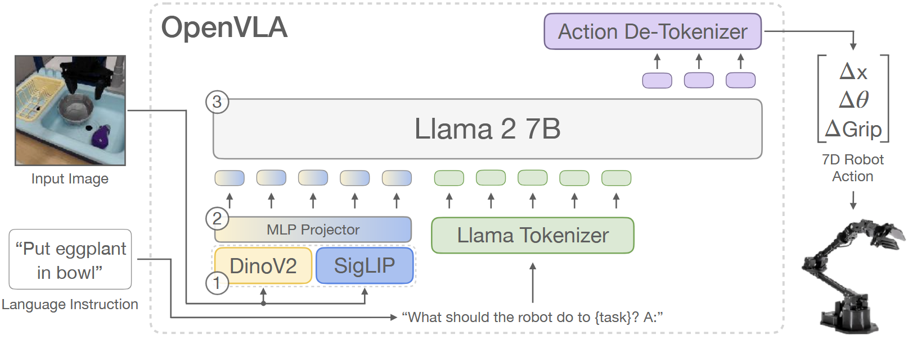
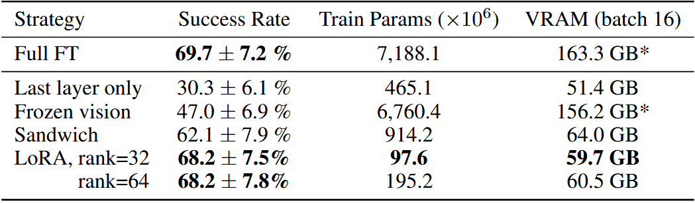
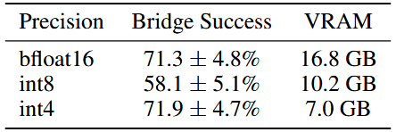
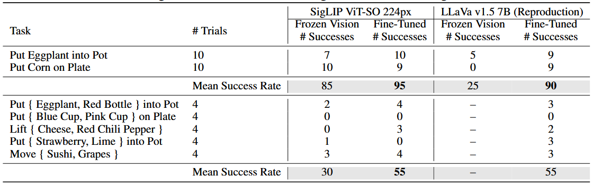

# OpenVLA: An Open-Source Vision-Language-Action Model

**出处会议：** CoRL 2024（The 8th Conference on Robot Learning，Munich, Germany，2024-11-06~09；PMLR v270:2679-2713，2025-01-12 出版）。本次抓取 PMLR v270 目录页确认条目，原文 "OpenVLA: An Open-Source Vision-Language-Action Model Moo Jin Kim, Karl Pertsch, Siddharth Karamcheti, Ted Xiao, Ashwin Balakrishna, Suraj Nair, Rafael Rafailov, Ethan P Foster, Pannag R Sanketi, Quan Vuong, Thomas Kollar, Benjamin Burchfiel, Russ Tedrake, Dorsa Sadigh, Sergey Levine, Percy Liang, Chelsea Finn ; Proceedings of The 8th Conference on Robot Learning , PMLR 270:2679-2713"（卷页 title 原文 "Proceedings of The 8th Conference on Robot Learning Held in Munich, Germany on 06-09 November 2024 Published as Volume 270 by the Proceedings of Machine Learning Research on 12 January 2025."，连写文本，编辑者为 Pulkit Agrawal 等）。arXiv abs 页 Subjects 原文 "Robotics (cs.RO) ; Machine Learning (cs.LG)"，Comments 原文仅 "Website: this https URL"（abs 页本身未标 CoRL，出处以 PMLR 为准）。
**是否开源：** 是。GitHub https://github.com/openvla/openvla （本次经 GitHub API 确认存在，description 原文 "OpenVLA: An open-source vision-language-action model for robotic manipulation."，license: MIT）；项目页 https://openvla.github.io/ （本次抓取确认，页面 title 与论文标题一致）；Abstract 原句 "Finally, we release model checkpoints, fine-tuning notebooks, and our PyTorch codebase with built-in support for training VLAs at scale on Open X-Embodiment datasets."；§1 亦称 "we open-source all models, deployment and fine-tuning notebooks, and the OpenVLA codebase for training VLAs at scale"。HuggingFace 权重页（openvla/openvla-7b）因本环境网络不可达未直接核验（见 TODO）。
**关键词：** vision-language-action（VLA，动作离散化为 token 的 VLM 微调）、7B 参数、Prismatic-7B VLM 基座（fused DinoSigLIP 双视觉编码器：DINOv2 空间特征 + SigLIP 语义特征 + 2 层 MLP projector + Llama 2 7B）、动作连续值→256 bins 离散化并覆写 Llama tokenizer 末 256 个 token、Open X-Embodiment 970k 轨迹（70+ 数据集，混合权重沿用 Octo）、对比 RT-2-X (55B) 绝对成功率 +16.5%（29 任务）、LoRA（rank=32，1.4% 参数）与 int4 量化推理（7.0 GB）、WidowX / Google Robot / Franka / LIBERO 评测

> 来源与核验（抓取日期 2026-11-02）：
> - arXiv abs 页 https://arxiv.org/abs/2406.09246 ，标题 "OpenVLA: An Open-Source Vision-Language-Action Model"，作者 Moo Jin Kim 等 18 人（v1 2024-06-13，v3 2024-09-05 为当前版本），与任务给定标题一致，允许使用。全文 HTML 页面 title 与 abs 页标题逐字一致。
> - 全文 arXiv 官方 HTML v3 https://arxiv.org/html/2406.09246v3 （LaTeXML 渲染，本次抓取）。以下 locator（§x / Table x / Appendix x / Fig. x）均指该 v3 的章节、表格与图编号。
> - 出处核对：PMLR 第 270 卷目录页 https://proceedings.mlr.press/v270/ （本次抓取）含上述 OpenVLA 条目，卷信息见头部「出处会议」行；该条目另给出 OpenReview 链接。CoRL 2024 = The 8th Conference on Robot Learning。
> - 开源核对：GitHub API https://api.github.com/repos/openvla/openvla （本次抓取）返回 full_name "openvla/openvla"、license spdx "MIT"；项目页 https://openvla.github.io/ 本次抓取 title 为 "OpenVLA: An Open-Source Vision-Language-Action Model"。
> - 摘要引文核对对象为 abs 页 abstract blockquote；正文引文核对对象为上述 HTML 全文的规范化提取文本（脚本已生成）。规范化约定（两侧同规则，见文末「表格与引文核验」）：①数学元素以 ⟨MATH:alttext⟩ 标出，alttext 为 HTML 属性原文（如 ± 的 alttext 为 \pm，⟨MATH:\pm⟩ 即渲染后的 ±）；②LaTeXML 引文空格 "[ 7 , 1 ]" 规范化为 "[7, 1]"；③行内标签边界产生的标点前空格（"closed ,"→"closed,"）、"(" 后空格、"⟨MATH:x⟩ -" 连字、" %" 空格一并规范化；④上/下标直接粘连（"1 st"→"1st"）。
> - 表格逐行照抄自 HTML 解析结果并经脚本逐单元格核验（见文末）；本笔记 2026-11-03 经入库前逐字 QA（quote 自洽 + 数字抽查）后自 nightshift/drafts/ 入库至 library/VLM_VLA/，未经用户核阅前所有结论均属「论文声称 / 尚未独立验证」。

------

## 1. 概述

- 论文动机（Abstract 原句）："Large policies pretrained on a combination of Internet-scale vision-language data and diverse robot demonstrations have the potential to change how we teach robots new skills: rather than training new behaviors from scratch, we can fine-tune such vision-language-action (VLA) models to obtain robust, generalizable policies for visuomotor control."
- 两大阻碍（Abstract 原句）："Yet, widespread adoption of VLAs for robotics has been challenging as 1) existing VLAs are largely closed and inaccessible to the public, and 2) prior work fails to explore methods for efficiently fine-tuning VLAs for new tasks, a key component for adoption."
- 论文核心主张（Abstract 原句）："Addressing these challenges, we introduce OpenVLA, a 7B-parameter open-source VLA trained on a diverse collection of 970k real-world robot demonstrations. OpenVLA builds on a Llama 2 language model combined with a visual encoder that fuses pretrained features from DINOv2 and SigLIP."
- 头条数字（Abstract 原句）："OpenVLA demonstrates strong results for generalist manipulation, outperforming closed models such as RT-2-X (55B) by 16.5% in absolute task success rate across 29 tasks and multiple robot embodiments, with 7x fewer parameters." 微调侧（Abstract）："outperform expressive from-scratch imitation learning methods such as Diffusion Policy by 20.4%"；效率侧（Abstract）："we show that OpenVLA can be fine-tuned on consumer GPUs via modern low-rank adaptation methods and served efficiently via quantization without a hit to downstream success rate."
- §1 的方法论定位（§1 原句）："We argue that to develop a rich foundation for future research and development, robotics needs open-source, generalist VLAs that support effective fine-tuning and adaptation, akin to the existing ecosystem around open-source language models [21, 22, 23, 24]. To this end, we introduce OpenVLA, a 7B-parameter open-source VLA that establishes a new state of the art for generalist robot manipulation policies."
- §1 对头条数字的复述（§1 原句）："OpenVLA outperforms the 55B-parameter RT-2-X model [7, 1], the prior state-of-the-art VLA, by 16.5% absolute success rate across 29 evaluation tasks on the WidowX and Google Robot embodiments."
- 与 RT-2-X 的四点差异（§2 原句）："However, our work differs from RT-2-X in multiple important aspects: (1) by combining a strong open VLM backbone with a richer robot pretraining dataset, OpenVLA outperforms RT-2-X in our experiments while being an order of magnitude smaller; (2) we thoroughly investigate fine-tuning of OpenVLA models to new target setups, while RT-2-X does not investigate the fine-tuning setting; (3) we are the first to demonstrate the effectiveness of modern parameter-efficient fine-tuning and quantization approaches for VLAs; and (4) OpenVLA is the first generalist VLA that is open-source and thus supports future research on VLA training, data mixtures, objectives, and inference."
- 对 VLM 路线的判断（§2 原句）："Unlike these works, OpenVLA adopts a more end-to-end approach, directly fine-tuning VLMs to generate robot actions by treating them as tokens in the language model vocabulary. Our experimental evaluation shows that this simple yet scalable pipeline substantially boosts performance and generalization ability over prior generalist policies."（§2，对比对象是 Octo 一类「拼接」式 generalist policy）
- 与本库 LLaVA 笔记（library/VLM_VLA/LLaVA.md，VLM 基座）的关系（有据两句）：OpenVLA 的 Prismatic-7B 基座本身是「用 LLaVA 1.5 数据混合微调」出来的——§3.1 原句 "The Prismatic VLM is fine-tuned on top of these components using the LLaVA 1.5 data mixture [43], which contains a total of approximately 1M image-text and text-only data samples from open-source datasets [81, 82, 29, 83, 42]."；且 §3.4 选型时把 LLaVA 当 VLM 候选实测过："we tested fine-tuning IDEFICS-1 [84] and LLaVA [85] for robot action prediction"，结论是 LLaVA 在多物体语言 grounding 上比 IDEFICS-1 高 35% 绝对成功率、Prismatic 再高约 10%（§3.4，详见 2.4 节）——即本库 LLaVA 笔记对应的模型范式是 OpenVLA 动作离散化路线的直接上游之一（此句为笔记作者定位，非论文原话）。

## 2. 方法

### 2.1 架构：Prismatic-7B VLM（§3.1）

- VLM 三段式（§3.1 原句）："The architecture of most recent VLMs [42, 43, 20, 44] consists of three main parts (see Fig. 2): (1) a visual encoder that maps image inputs to a number of “image patch embeddings”, (2) a projector that takes the output embeddings of the visual encoder and maps them into the input space of a language model, and (3) a large language model (LLM) backbone."
- 具体构成（§3.1 原句）："In this work, we build on the Prismatic-7B VLM [44]. Prismatic follows the same standard architecture described above, with a 600M-parameter visual encoder, a small 2-layer MLP projector, and a 7B-parameter Llama 2 language model backbone [10]."
- 双视觉编码器（§3.1 原句）："Notably, Prismatic uses a two-part visual encoder, consisting of pretrained SigLIP [79] and DinoV2 [25] models. Input image patches are passed separately through both encoders and the resulting feature vectors are concatenated channel-wise."
- 加 DinoV2 的理由（§3.1 原句）："In contrast to the more commonly used vision encoders such as CLIP- [80] or SigLIP-only encoders, the addition of DinoV2 features has been shown to be helpful for improved spatial reasoning [44], which can be particularly helpful for robot control."
- 基座的预训练（§3.1 原句）："The Prismatic VLM is fine-tuned on top of these components using the LLaVA 1.5 data mixture [43], which contains a total of approximately 1M image-text and text-only data samples from open-source datasets [81, 82, 29, 83, 42]."

### 2.2 动作离散化与训练目标（§3.2）

- 问题形式（§3.2 原句）："We formulate the action prediction problem as a “vision-language” task, where an input observation image and a natural language task instruction are mapped to a string of predicted robot actions [7]."
- 256 bins（§3.2 原句）："Following Brohan et al. [7], we discretize each dimension of the robot actions separately into one of 256 bins. For each action dimension, we set the bin width to uniformly divide the interval between the 1st and 99th quantile of the actions in the training data."
- 用分位数而非 min-max 的理由（§3.2 原句）："Using quantiles instead of the min-max bounds Brohan et al. [7] used allows us to ignore outlier actions in the data that could otherwise drastically expand the discretization interval and reduce the effective granularity of our action discretization."
- token 来源（§3.2 原句）："Unfortunately, the tokenizer used by OpenVLA’s language backbone, the Llama tokenizer [10], only reserves 100 “special tokens” for tokens newly introduced during fine-tuning, which is too few for the 256 tokens of our action discretization. Instead, we again opt for simplicity and follow Brohan et al. [7]’s approach by simply overwriting the 256 least used tokens in the Llama tokenizer’s vocabulary (which corresponds to the last 256 tokens) with our action tokens."
- 训练目标（§3.2 原句）："Once the actions are processed into a sequence of tokens, OpenVLA is trained with a standard next-token prediction objective, evaluating the cross-entropy loss on the predicted action tokens only."

### 2.3 训练数据（§3.3，Table 3）

- 数据基座（§3.3 原句）："We leverage the Open X-Embodiment dataset [1] (OpenX) as a base to curate our training dataset. The full OpenX dataset, at the time of writing, consists of more than 70 individual robot datasets, with more than 2M robot trajectories, that were pooled into a coherent and easy-to-use data format in a large community effort."
- 两步 curation（§3.3 原句）："we apply multiple steps of data curation to the raw dataset. The goals of this curation are to ensure (1) a coherent input and output space across all training datasets, and (2) a balanced mix of embodiments, tasks, and scenes in the final training mixture."
- 过滤与混合权重（§3.3 原句）："we follow [1, 5] and restrict our training dataset to contain only manipulation datasets with at least one 3rd person camera and use single-arm end-effector control. For (2), we leverage the data mixture weights of Octo [5] for all datasets that pass the first round of filtering."
- DROID 的插曲（§3.3 原句）："We also experimented with incorporating a few additional datasets into our training mixture that were added to the OpenX dataset since the release of Octo, including the DROID dataset [11], although at a conservative mixture weight of 10%. In practice, we found that the action token accuracy on DROID remained low throughout training, suggesting a larger mixture weight or model may be required to fit its diversity in the future. To not jeopardize the quality of the final model, we removed DROID from the data mixture for the final third of training."（Appendix A 脚注 6 原句："We remove DROID for the last third of training due to slow learning progress (see Section 3.3) and re-distribute its mixture weights across all other datasets."）
- 规模对比（§5.1 原句）："we curated a much larger training dataset for OpenVLA with 970k trajectories (vs. 350k for RT-2-X)"
- Table 3（OpenVLA training data mixture；caption 原文 "OpenVLA training data mixture using datasets from the Open X-Embodiment dataset [1], following [5] with a few additions."）逐行照抄（两列：数据集 / 混合比例；引用编号照原文）：

| 数据集 | 比例 |
| --- | --- |
| Fractal [92] | 12.7% |
| Kuka [45] | 12.7% |
| Bridge [47, 6] | 13.3% |
| Taco Play [93, 94] | 3.0% |
| Jaco Play [95] | 0.4% |
| Berkeley Cable Routing [96] | 0.2% |
| Roboturk [97] | 2.3% |
| Viola [98] | 0.9% |
| Berkeley Autolab UR5 [99] | 1.2% |
| Toto [100] | 2.0% |
| Language Table [101] | 4.4% |
| Stanford Hydra Dataset [102] | 4.4% |
| Austin Buds Dataset [103] | 0.2% |
| NYU Franka Play Dataset [104] | 0.8% |
| Furniture Bench Dataset [105] | 2.4% |
| UCSD Kitchen Dataset [106] | <0.1% |
| Austin Sailor Dataset [107] | 2.2% |
| Austin Sirius Dataset [108] | 1.7% |
| DLR EDAN Shared Control [109] | <0.1% |
| IAMLab CMU Pickup Insert [110] | 0.9% |
| UTAustin Mutex [111] | 2.2% |
| Berkeley Fanuc Manipulation [112] | 0.7% |
| CMU Stretch [113] | 0.2% |
| BC-Z [55] | 7.5% |
| FMB Dataset [114] | 7.1% |
| DobbE [115] | 1.4% |
| DROID [11] | 10.0% |

### 2.4 设计决策（§3.4，小规模 BridgeData V2 预实验）

- 预实验设置（§3.4 原句）："we trained and evaluated OpenVLA models on BridgeData V2 [6] for our initial experiments, instead of training on the full OpenX mixture, to increase iteration speed and reduce computational cost."
- VLM backbone 选型（§3.4 原句）："Apart from Prismatic [44], we tested fine-tuning IDEFICS-1 [84] and LLaVA [85] for robot action prediction. We found that LLaVA and IDEFICS-1 performed comparably on tasks with only one object in the scene, but LLaVA demonstrated stronger language grounding in tasks that involved multiple objects in the scene and required the policy to manipulate the correct object, i.e., the object specified in the language instruction." 数字（§3.4 原句）："Concretely, LLaVA improved upon IDEFICS-1 by 35% in absolute success rate, averaged across five language grounding tasks in a BridgeData V2 sink environment. The fine-tuned Prismatic VLM policy achieved further improvements, outperforming the LLaVA policy by roughly 10% in absolute success rate across both simple single-object tasks and multi-object, language grounding tasks." 归因（§3.4 原句）："We attribute this performance delta to improved spatial reasoning capabilities afforded by the fused SigLIP-DinoV2 backbones (see Section 3.1)."
- 分辨率（§3.4 原句）："We compared VLAs with ⟨MATH:224\times 224⟩ px and ⟨MATH:384\times 384⟩ px inputs, but found no performance difference in our evaluations, while the latter takes 3x longer to train. We thus opt for a resolution of ⟨MATH:224\times 224⟩ px for the final OpenVLA model." 补充（§3.4）："Note that on many VLM benchmarks, increased resolution does improve performance [44, 86, 87], but we did not see this trend (yet) for VLAs."
- 视觉编码器微调 vs 冻结（§3.4 原句）："Prior work on VLMs found that freezing vision encoders during VLM training typically leads to higher performance [44]." 转折（§3.4 原句）："However, we found fine-tuning the vision encoder during VLA training to be crucial for good VLA performance. We hypothesize that the pretrained vision backbone may not capture sufficient fine-grained spatial details about important parts of the scene to enable precise robotic control."（消融见 3.6 节）
- 训练轮数（§3.4 原句）："Typical LLM or VLM training runs complete at most one or two epochs through their training dataset. In contrast, we found it important for VLA training to iterate through the training dataset significantly more times, with real robot performance continually increasing until training action token accuracy surpasses 95%. Our final training run completes 27 epochs through its training dataset."
- 学习率（§3.4 原句）："We swept the learning rate across multiple orders of magnitude for VLA training, and achieved the best results using a fixed learning rate of 2e-5 (the same learning rate used during VLM pretraining [44]). We did not find learning rate warmup to provide benefits."

### 2.5 训练与推理基础设施（§3.5）

- 训练开销（§3.5 原句）："The final OpenVLA model is trained on a cluster of 64 A100 GPUs for 14 days, or a total of 21,500 A100-hours, using a batch size of 2048."
- 推理开销（§3.5 原句）："During inference, OpenVLA requires 15GB of GPU memory when loaded in bfloat16 precision (i.e., without quantization) and runs at approximately 6Hz on one NVIDIA RTX 4090 GPU (without compilation, speculative decoding, or other inference speed-up tricks)."
- 远程推理（§3.5 原句）："we implement a remote VLA inference server to allow real-time remote streaming of action predictions to the robot – removing the requirement of having access to a powerful local compute device to control the robot."
- 代码库（§4 原句）："we release the OpenVLA codebase, a modular PyTorch codebase for training VLA models (see https://openvla.github.io). It scales from fine-tuning VLAs on individual GPUs to training billion-parameter VLAs on multi-node GPU clusters, and supports modern techniques for large transformer model training such as automatic mixed precision (AMP, PyTorch [75]), FlashAttention [76], and fully sharded data parallelism (FSDP, Zhao et al. [77]). Out of the box, the OpenVLA codebase has full support for training on the Open X dataset, integrates with HuggingFace’s [21] AutoModel class, and supports LoRA fine-tuning [26] and quantized model inference [88, 27]."

## 3. 实验

### 3.1 多平台直接评测（§5.1，结果在 Fig. 3/Fig. 4，明细在 Table 4/Table 6）

- 评测平台与规模（§5.1 原句）："We evaluate OpenVLA’s performance “out-of-the-box” on two robot embodiments: the WidowX robot from the BridgeData V2 evaluations [6] (see Fig. 1, left) and the mobile manipulation robot from the RT-1 and RT-2 evaluations [2, 7] (“Google robot”; see Fig. 1, middle)." 规模（§5.1）："Overall, we evaluated each method in 170 rollouts (17 tasks with 10 trials each) for BridgeData V2 experiments and 60 rollouts (12 tasks with 5 trials each) for Google robot experiments."
- 泛化轴（§5.1 原句）："We define a comprehensive set of evaluation tasks in each environment that covers various axes of generalization, such as visual (unseen backgrounds, distractor objects, colors/appearances of objects); motion (unseen object positions/orientations); physical (unseen object sizes/shapes); and semantic (unseen target objects, instructions, and concepts from the Internet) generalization."
- 公平性协议（§5.1 原句）："All evaluations in this and the following sections are conducted as A/B evaluations, using the same tasks with the same sets of initial robot and object states, to ensure fair comparison."
- 基线（§5.1 原句）："RT-1-X (35M parameters) and Octo (93M parameters) are transformer policies trained from scratch on subsets of the OpenX dataset; Octo is the state-of-the-art model among open-source manipulation policies. RT-2-X (55B parameters) is a state-of-the-art, closed-source VLA that leverages Internet-pretrained vision and language backbones."
- 主结果（§5.1 原句）："Notably, OpenVLA performs comparably to RT-2-X on Google robot evaluations and significantly outperforms RT-2-X on BridgeData V2 evaluations despite being an order of magnitude smaller (7B vs. 55B parameters)."
- RT-2-X 的相对优势（§5.1 原句）："RT-2-X achieves higher performance in semantic generalization tasks, as shown in Fig. 3, which is expected given that it uses larger-scale Internet pretraining data and is co-fine-tuned with both robot action data and Internet pretraining data to better preserve the pretraining knowledge, rather than being fine-tuned solely on robot data, like OpenVLA. However, OpenVLA performs comparably or better in all other task categories in both BridgeData V2 and Google robot evaluations."
- 差异归因（§5.1 原句）："The performance difference can be attributed to a combination of factors: we curated a much larger training dataset for OpenVLA with 970k trajectories (vs. 350k for RT-2-X); we performed more careful cleaning of the training dataset and, e.g., filtered out all-zero actions in the Bridge dataset (see Appendix C for a detailed discussion); and OpenVLA uses a fused vision encoder that combines pretrained semantic and spatial features."
- Bridge 数据清洗的细节（Appendix C 原句）："we discovered that the original version of the BridgeData V2 dataset contained many transitions with all-zero (no-op) actions. For instance, in every demonstration, an all-zero action was recorded as the ground-truth action in the first timestep. Consequently, training a highly expressive VLA model on the original dataset without any data preprocessing led to a policy that frequently predicted all-zero actions and froze during evaluations. Therefore, we simply filtered out the first transition in every demonstration when training the OpenVLA model, and this was sufficient for mitigating the freezing behavior in most cases."
- RT-2-X 的评测 workaround（Appendix C 原句）："Since this is a proprietary model that is infeasible for us to re-train (e.g., with our preprocessed version of the BridgeData V2 dataset), we mitigated this issue by simply querying the second-most-likely action from the model, since the first-most-likely action was often all zeros while the second-most-likely action was not. (Note that this is the same workaround that was applied by the developers of the RT-2-X model for BridgeData V2 evaluations reported in the Open X-Embodiment experiments [1].)"

### 3.2 数据高效适配新机器人（§5.2，结果在 Fig. 5，明细在 Table 7）

- 微调配方（§5.2 原句）："We test a simple fine-tuning recipe for the OpenVLA model: full fine-tuning of all model parameters, using small datasets with 10–150 demonstrations of a target task (see Fig. 5; we explore parameter-efficient fine-tuning approaches in Section 5.3)."
- 两个平台（§5.2 原句）："We test OpenVLA in two setups: Franka-Tabletop, a stationary, table-mounted Franka Emika Panda 7-DoF robot arm; and Franka-DROID, the Franka robot arm setup from the recently released DROID dataset [11], mounted on a movable standing desk. The setups use 5Hz and 15 Hz non-blocking controllers, respectively."
- 基线（§5.2）：Diffusion Policy（原版与 matched 版，脚注 3：原版 "performs receding horizon control by predicting a chunk of ⟨MATH:T⟩ future actions and executing the first ⟨MATH:X⟩ actions in open-loop fashion before predicting the next chunk (for 15Hz control, we set ⟨MATH:T=16,X=8⟩ like in the DROID prior work [11]; for 5Hz control, we reduce the chunk sizes to ⟨MATH:T=8,X=3⟩)"）；Octo（fine-tuned）；OpenVLA；以及 OpenVLA (scratch)（"we directly fine-tune the underlying base Prismatic VLM on the target robot setup – rather than fine-tuning the OpenX-pretrained OpenVLA model – to assess the benefit of large-scale robot pretraining"）。
- 评测规模（Fig. 5 caption 原句）："Average success rates ⟨MATH:\pm⟩ StdErr are computed across 129 rollouts per approach (99 for Franka-Tabletop tasks and 30 for Franka-DROID tasks)."
- 主结果（§5.2 原句）："We find that both versions of Diffusion Policy are competitive with or outperform the generalist policies Octo and OpenVLA on narrower single-instruction tasks like “Put Carrot in Bowl” and “Pour Corn into Pot”, but the pretrained generalist policies perform better in more diverse fine-tuning tasks that involve multiple objects in the scene and require language conditioning."
- OpenVLA 的均衡性（§5.2 原句）："OpenVLA is the only approach that achieves at least 50% success rate across all tested tasks, suggesting that it can be a strong default option for imitation learning tasks, particularly if they involve a diverse set of language instructions."
- 承认的短板（§5.2 原句）："For narrower but highly dexterous tasks, Diffusion Policy still shows smoother and more precise trajectories; incorporating action chunking and temporal smoothing, as implemented in Diffusion Policy, may help OpenVLA attain the same level of dexterity and may be a promising direction for future work"

### 3.3 参数高效微调（§5.3，Table 1）

- 背景（§5.3 原句）："The full fine-tuning runs of OpenVLA in the previous section used 8 A100 GPUs for 5-15 hours per task (depending on the dataset size) to achieve high performance."
- 五种策略定义（§5.3 原句）："full fine-tuning updates all weights during fine-tuning, as described in Section 5.2; last layer only fine-tunes only the last layer of OpenVLA’s transformer backbone and the token embedding matrix; frozen vision freezes the vision encoder but fine-tunes all other weights; sandwich fine-tuning unfreezes the vision encoder, token embedding matrix, and last layer; and LoRA uses the popular low-rank adaptation technique of Hu et al. [26] with multiple rank values ⟨MATH:r⟩, applied to all linear layers of the model."
- Table 1（Parameter-efficient fine-tuning evaluation；caption 原文 "LoRA fine-tuning achieves the best performance-compute trade-off, matching full fine-tuning performance while training only 1.4% of the model parameters. Mean success ⟨MATH:\pm⟩ StdErr computed across 33 rollouts per approach on select Franka-Tabletop tasks (see Table 8 for details). ∗: Sharded across 2 GPUs with FSDP [77]."）逐行照抄（Train Params 列的单位为 ⟨MATH:\times 10^{6}⟩，即 ×10⁶）：

| Strategy | Success Rate | Train Params ( ⟨MATH:\times 10^{6}⟩ ) | VRAM (batch 16) |
| --- | --- | --- | --- |
| Full FT | 69.7 ⟨MATH:\pm⟩ 7.2 % | 7,188.1 | 163.3 GB* |
| Last layer only | 30.3 ⟨MATH:\pm⟩ 6.1 % | 465.1 | 51.4 GB |
| Frozen vision | 47.0 ⟨MATH:\pm⟩ 6.9 % | 6,760.4 | 156.2 GB* |
| Sandwich | 62.1 ⟨MATH:\pm⟩ 7.9 % | 914.2 | 64.0 GB |
| LoRA, rank=32 | 68.2 ⟨MATH:\pm⟩ 7.5% | 97.6 | 59.7 GB |
| rank=64 | 68.2 ⟨MATH:\pm⟩ 7.8% | 195.2 | 60.5 GB |

- 读数（§5.3 原句）："We find that only fine-tuning the network’s last layer or freezing the vision encoder leads to poor performance, suggesting that further adaptation of the visual features to the target scene is crucial." 与 "Lastly, LoRA achieves the best trade-off between performance and training memory consumption, outperforming “sandwich fine-tuning” and matching full fine-tuning performance while fine-tuning only 1.4% of the parameters. We find that the LoRA rank has negligible effect on policy performance and thus recommend using a default rank of ⟨MATH:r=32⟩."
- 算力结论（§5.3 原句）："With LoRA, we can fine-tune OpenVLA on a new task within 10-15 hours on a single A100 GPU – an 8x reduction in compute compared to full fine-tuning."

### 3.4 量化推理（§5.4，Table 2；补充 §D.4）

- 动机（§5.4 原句）："OpenVLA, a 7B-parameter model, consumes more memory at inference time than prior open-source generalist policies such as Octo, which has ⟨MATH:<⟩ 100M parameters. We follow best-practices from LLM serving by saving and loading OpenVLA in bfloat16 precision for inference (our default approach), which cuts the memory footprint in half, allowing us to serve OpenVLA on GPUs with only 16GB of GPU memory."
- 设置（§5.4 原句）："Concretely, we investigate serving the OpenVLA model with 8-bit and 4-bit precision on 8 representative BridgeData V2 tasks."
- Table 2（Performance with quantized inference；caption 原文 "4-bit quantization matches the performance of bfloat16 inference (our default approach) while reducing the GPU memory footprint by more than half. Mean success ⟨MATH:\pm⟩ StdErr computed across 8 representative BridgeData V2 tasks [6] and 80 rollouts per approach (see Table 5 for details)."）逐行照抄：

| Precision | Bridge Success | VRAM |
| --- | --- | --- |
| bfloat16 | 71.3 ⟨MATH:\pm⟩ 4.8% | 16.8 GB |
| int8 | 58.1 ⟨MATH:\pm⟩ 5.1% | 10.2 GB |
| int4 | 71.9 ⟨MATH:\pm⟩ 4.7% | 7.0 GB |

- int8 掉点的解释（§5.4 原句）："we observe a substantial performance decrease with 8-bit quantization: on the A5000 GPU we use for our evaluations, we can only run the model at 1.2Hz, which significantly changes the system dynamics compared to the training dataset for the 5Hz non-blocking controller used in the BridgeData V2 tasks."（脚注 5："We attribute the performance loss to low inference speed, since both 8-bit and 4-bit quantization achieve comparable token accuracy to bfloat16 inference when evaluated offline on training data."）
- int4 结论（§5.4 原句）："Notably, 4-bit quantization results in similar performance as bfloat16 half-precision inference despite requiring less than half the amount of GPU memory. 4-bit quantized models can run at 3Hz on the A5000, thus more closely matching the system dynamics during data collection."
- §D.4 的对照实验（blocking control，Table 11；§D.4 原句）："here we observe that 8-bit quantization performs comparably to bfloat16 precision and 4-bit quantization given that we evaluate with blocking control to remove the influence of varying inference speeds on task performance. This confirms our hypothesis about the effect of inference speed on 8-bit quantization performance in previous experiments (when using non-blocking control)."

### 3.5 消融：OpenX 数据与双视觉编码器（§D.1/§D.2，Table 9）

- 设置（§D.1 原句）："We compare the original OpenVLA model with OpenVLA-Bridge, which is produced by taking the same pretrained VLM as OpenVLA (Prismatic VLM [44]) and fine-tuning it solely on BridgeData V2 [6] rather than the entire OpenX training mixture discussed in Appendix A. We evaluate OpenVLA and OpenVLA-Bridge on a subset of 8 representative tasks from the BridgeData V2 WidowX robot evaluation suite discussed in Section B.1.1."
- OpenX 消融结论（§D.1 原句）："By comparing OpenVLA with OpenVLA-Bridge, we see that performance drops drastically (reduction of 30 percent in absolute success rate), which demonstrates the importance of OpenX pretraining on final policy performance. Although the language grounding performance is not impacted, we observe performance reduction across all generalization categories."
- DinoV2 消融（§D.2 原句）："the only difference between OpenVLA-Bridge-SigLIP and OpenVLA-Bridge is that the former omits the DinoV2 encoder in the vision backbone." 结论："The drop in performance from OpenVLA-Bridge to OpenVLA-Bridge-SigLIP implies that additionally including the DinoV2 encoder in the vision backbone improves policy performance. However, the 5 percent reduction in performance here is not as significant as the 30 percent drop in performance observed from ablating OpenX training."
- Table 9（BridgeData V2 WidowX ablation experiment results；caption 原文 "We evaluate various methods on a subset of 8 representative tasks to assess the importance of different components of the OpenVLA model architecture and training scheme. OpenVLA-Bridge is a version of OpenVLA without OpenX training (it is trained only on BridgeData V2), and OpenVLA-Bridge-SigLIP additionally ablates the fused vision backbone by removing the DinoV2 encoder (its vision backbone only consists of the SigLIP encoder). We observe that both OpenX training and the fused vision encoder improve policy performance, though the former has a much greater effect than the latter."）逐行照抄：

| Category | Task | # Trials | OpenVLA # Successes | OpenVLA-Bridge # Successes | OpenVLA-Bridge-SigLIP # Successes |
| --- | --- | --- | --- | --- | --- |
| Visual gen | Put Eggplant into Pot (Easy Version) | 10 | 10 | 8 | 8 |
| Visual gen | Put Eggplant into Pot | 10 | 10 | 2 | 3 |
| Visual gen | Put Cup from Counter into Sink | 10 | 7 | 4 | 2 |
| Motion gen | Lift Eggplant | 10 | 7.5 | 5.5 | 6.5 |
| Physical gen | Put Carrot on Plate | 10 | 8 | 4 | 1 |
| Physical gen | Lift AAA Battery | 10 | 7 | 2 | 2 |
| Semantic gen | Take Purple Grapes out of Pot | 10 | 4 | 3 | 3 |
| Language grounding | Put {Eggplant, Red Bottle} into Pot | 10 | 7.5 | 8 | 7 |
| Mean Success Rate | — | — | 76.3 ⟨MATH:\pm⟩ 4.8% | 45.6 ⟨MATH:\pm⟩ 5.6% | 40.6 ⟨MATH:\pm⟩ 5.5% |

（注：原表最后一行为跨列的 "Mean Success Rate"，此处以「—」占位表示原文该格无单独数值；"76.3 ⟨MATH:\pm⟩ 4.8%" 等为原文末行单元格内容。）

### 3.6 消融：视觉编码器微调 vs 冻结（§D.3，Table 10）

- 结论（§D.3 原句）："We find that for both VLAs tested, fine-tuning the vision encoder leads to significantly higher success rates across various tasks." 汇总数字（Table 10 caption 原句）："Among the evaluations where both frozen vision and fine-tuned approaches are tested, fine-tuning the vision encoder leads to 80.0% average success versus 46.7% average success from leaving it frozen."
- 实验对象（§D.3 原句）："The two pretrained models are named SigLIP ViT-SO 224px and LLaVa v1.5 7B (Reproduction); see Karamcheti et al. [44] for details on their architectures and training mixtures."（另 §D.3 开头原句 "when training OpenVLA, we fine-tuned all 7B parameters in the model, including the SigLIP-DinoV2 vision backbone"）

### 3.7 LIBERO 仿真微调（Appendix E，Table 12）

- 设置（§E.1 原句）："The LIBERO benchmark [116] consists of four task suites designed for studying lifelong learning in robotic manipulation" 四个 suite 各 "10 tasks with 50 human-teleoperated demonstrations each"：LIBERO-Spatial / LIBERO-Object / LIBERO-Goal / LIBERO-Long（also called LIBERO-10）。
- 数据修改（§E.1 要点，原句摘录）："We filter out all “no-op” actions from the dataset" 及 "We rotate all third-person images at both train and test time by 180 degrees because we observe that the LIBERO environments return images that are upside down on our hardware." 清洗量："we remove 68 of 500 LIBERO-Spatial demonstrations, 46 of 500 LIBERO-Object demonstrations, 72 of 500 LIBERO-Goal demonstrations, and 121 of 500 LIBERO-Long demonstratinos."（原文 "demonstratinos" 系笔误，照抄）
- 评测规模（§E.1 原句）："all methods are evaluated across 500 trials for each task suite, and the reported performance is the average success rate over three random seeds (resulting in 1500 total trials per statistic)."
- Table 12（LIBERO simulation benchmark results；caption 原文 "We report the success rate (SR) and standard error of each method for the four task suites in the LIBERO benchmark, averaged over three random seeds with 500 trials each."）逐行照抄（SR 后为 ⟨MATH:\pm⟩ StdErr；Rank 列 ⟨MATH:\downarrow⟩，1 为最强；Average 为最后两列）：

| 方法 | LIBERO-Spatial SR | Rank | LIBERO-Object SR | Rank | LIBERO-Goal SR | Rank | LIBERO-Long SR | Rank | Average SR ( ⟨MATH:\uparrow⟩ ) | Rank ( ⟨MATH:\downarrow⟩ ) |
| --- | --- | --- | --- | --- | --- | --- | --- | --- | --- | --- |
| Diffusion Policy from scratch | 78.3 ⟨MATH:\pm⟩ 1.1% | 3 | 92.5 ⟨MATH:\pm⟩ 0.7% | 1 | 68.3 ⟨MATH:\pm⟩ 1.2% | 3 | 50.5 ⟨MATH:\pm⟩ 1.3% | 3 | 72.4 ⟨MATH:\pm⟩ 0.7% | 2.5 |
| Octo fine-tuned | 78.9 ⟨MATH:\pm⟩ 1.0% | 2 | 85.7 ⟨MATH:\pm⟩ 0.9% | 3 | 84.6 ⟨MATH:\pm⟩ 0.9% | 1 | 51.1 ⟨MATH:\pm⟩ 1.3% | 2 | 75.1 ⟨MATH:\pm⟩ 0.6% | 2 |
| OpenVLA fine-tuned (ours) | 84.7 ⟨MATH:\pm⟩ 0.9% | 1 | 88.4 ⟨MATH:\pm⟩ 0.8% | 2 | 79.2 ⟨MATH:\pm⟩ 1.0% | 2 | 53.7 ⟨MATH:\pm⟩ 1.3% | 1 | 76.5 ⟨MATH:\pm⟩ 0.6% | 1.5 |

- 读数（§E.2 原句）："Importantly, we observe that OpenVLA can be effectively adapted to tasks in the LIBERO simulation environments, as it obtains highest average success rate and rank among the tested methods. However, we find that the overall margin between OpenVLA and the other methods are tighter here than in the real-world fine-tuning experiments discussed in Section 5.2." 归因（§E.2）："We attribute this to the fact that OpenVLA was pretrained with purely real-world robot data and no simulation data, which suggests that fine-tuning the model on simulated robot tasks may not be as effective as fine-tuning it on real-world tasks due to the domain gap between simulated and real-world environments and dynamics."

## 4. 核心结论

- 论文自述（§6 原句）："In this work, we presented OpenVLA, a state-of-the-art, open-source vision-language-action model that obtains strong performance for cross-embodiment robot control out-of-the-box. We also demonstrated that OpenVLA can be easily adapted to new robot setups via parameter-efficient fine-tuning techniques."
- 论文自列局限（§6 原句）：
  1. 单图像输入："First, it currently only supports single-image observations." 后续（§6 原句）："Expanding OpenVLA to support multiple image and proprioceptive inputs as well as observation history is an important avenue for future work."
  2. 推理吞吐："Secondly, improving the inference throughput of OpenVLA is critical to enable VLA control for high-frequency control setups such as ALOHA [90], which runs at 50Hz." 补救（§6 原句）："Exploring the use of action chunking or alternative inference-time optimization techniques such as speculative decoding [91] offer potential remedies."
  3. 可靠性："Additionally, there is room for further performance improvements. While OpenVLA outperforms prior generalist policies, it does not yet offer very high reliability on the tested tasks, typically achieving <90% success rate."
  4. 未尽问题（§6）："due to compute limitations, many VLA design questions remain underexplored: What effect does the size of the base VLM have on VLA performance? Does co-training on robot action prediction data and Internet-scale vision-language data substantially improve VLA performance? What visual features are best-suited for VLA models?"
- 可复用的方法论要点（均为论文声称）：
  1. 通用 VLM 直接把动作当 token 微调即可成为强 generalist policy，不需要为机器人定制架构（§2、§3.2）；7B 级即可在 A/B 评测下压过 55B 闭源 VLA（§5.1，注意 RT-2-X 评测方式见 3.1 节 workaround）。
  2. VLM 基座选型有实感差异：多物体语言 grounding 场景 LLaVA > IDEFICS-1（+35% 绝对成功率）、Prismatic（DinoSigLIP 融合编码器）> LLaVA（约 +10%）（§3.4）。
  3. VLA 与 VLM 的两条经验相反：①分辨率 224×224 即可，384×384 无收益但训练 3 倍耗时（§3.4）；②视觉编码器要微调不要冻结（VLM 侧文献通常反着说；§3.4、§D.3：80.0% vs 46.7%）。
  4. 数据多样性是第一杠杆：去掉 OpenX 预训练掉 30 个绝对点，去掉 DinoV2 只掉 5 个点（§D.1/§D.2，Table 9）；数据清洗（去 no-op/all-zero 动作）对单步表达力策略至关重要（§5.2、Appendix C/E）。
  5. 算力账本：预训练 64×A100×14 天（21,500 A100-hours，batch 2048，27 epochs，lr 2e-5）；下游 LoRA rank=32 只训 1.4% 参数、单卡 A100 10-15 小时（8 倍省）；int4 量化推理 7.0 GB 无成功率损失（§3.5、§5.3、§5.4）。
- ⚠ 措辞提示：①16.5% 是 "absolute task success rate across 29 tasks"（WidowX + Google Robot 两平台，Fig. 3/4 汇总，明细在 Table 4/6），并非单一 benchmark 分数；RT-2-X 的 Bridge 评测数字依赖「取次优动作」的 workaround（Appendix C），对比口径由 OpenVLA 作者执行。②20.4%（Abstract，对 Diffusion Policy）对应 §5.2 Franka 微调实验，Diffusion Policy 在窄任务上仍更准、轨迹更平滑（§5.2 自述）。③LIBERO 仿真上 OpenVLA 优势收窄（76.5% vs Octo 75.1%、DP 72.4%，Table 12），且预训练纯真实数据，作者归因 sim-to-real 域差（§E.2）。④Table 1/2/9/12 的 "±" 均为 StdErr（⟨MATH:\pm⟩，alttext "\pm"）；各表 rollout 数不同（33/80/每任务 10/500×3 seeds），不可横向比较。⑤§5.3/§5.4 用的是「小混合预训练 + SigLIP-only」的简化版 OpenVLA（§5.3 脚注 4 原句："we experiment with a version of the OpenVLA model that is pretrained with a smaller robot data mixture (the same OpenX dataset mixture as Octo) and has a slightly smaller architecture which only uses a SigLIP [79] vision backbone instead of the fused DinoSigLIP encoder."），与最终发布模型并非同一配置。引用本文时建议写「论文声称 / 尚未独立验证」。

## TODO

- [x] **配图已回填（2026-11-03 入库）**：library/assets/OpenVLA/ 现有 4 张截图，入库时逐张目视核对内容并按相对路径（../assets/OpenVLA/）回填正文——Figure2.png（= 论文 Figure 2 架构图 → §2.1）、Table1.png（= 论文 Table 1 参数高效微调 → §3.3）、Table2.png（= 论文 Table 2 量化推理 → §3.4）、Table10.png（= 论文 Table 10 视觉编码器冻结 vs 微调逐任务明细 → §3.6）。仍缺：Figure 1（teaser：三平台示意）、Figure 3/4/5/6 及附录 Figure 7-11、Table 4/5/6/7/8/11（逐任务明细），需用户补充或授权抓取。
- HuggingFace 模型权重页（https://huggingface.co/openvla/openvla-7b）本环境抓取失败（curl SSL 错误 exit 35），权重托管与下载量未直接核验；开源结论目前仅基于 GitHub API 与论文自述。
- 未核对 v1（2024-06-13）/ v2（2024-09-04）与 v3（2024-09-05）正文的差异；本笔记仅基于 v3。
- 附录 B（各任务定义与训练数据差异，§B.1-B.3）仅概览未逐条抄录；Table 4/5/6/7/8/10/11 明细未逐行展开（正文仅引用其汇总数字）。
- 摘要中 "20.4%" 的完整原句见头部与 1 节（Abstract）；其在正文的具体对应任务级数字在 Table 7（未逐行抄录），引用时注意口径。
- 抓取 URL 与日期：arXiv abs 页 https://arxiv.org/abs/2406.09246 （2026-11-02）；arXiv HTML 全文 v3 https://arxiv.org/html/2406.09246v3 （2026-11-02）；PMLR v270 目录 https://proceedings.mlr.press/v270/ （2026-11-02）；项目页 https://openvla.github.io/ （2026-11-02）；GitHub API https://api.github.com/repos/openvla/openvla （2026-11-02，license MIT）。
- 表格核验：Table 1 / Table 2 / Table 3 / Table 9 / Table 12 已逐单元格对照 HTML 解析结果核验通过（「±」原文为数学元素 alttext "\pm"；Train Params 单位为数学元素 alttext "\times 10^{6}"；Table 9 末行 Mean Success Rate 为跨列行；Table 12 的 ↑/↓ 为数学元素 alttext "\uparrow"/"\downarrow"；Table 12 原表头为两行跨列结构，笔记表头系合并改写，数据行逐字照抄；弯引号按原文字符照抄）。引文核验：全部引文（含弯引号并入后的完整句，去重后 132 条、长度 ≥10 字符），经脚本对照上述规范化提取文本（abs/pmlr/github/sections 四个池）逐条验证存在，0 失败。
- 作者名单差异备忘：arXiv abs 页列 18 位作者（含 Grace Lam）；PMLR v270 条目名单为 17 人（未见 Grace Lam），两处各自照抄，以官方页面为准。
- 关联待写项：RT-2 / RT-2-X（闭源对比基线）、Octo（mixture 权重来源）、Prismatic VLM（基座）、LLaVA-1.5 与本库 library/VLM_VLA/LLaVA.md 的关系（§3.1/§3.4 已一句带过，详见 1 节末条）。
