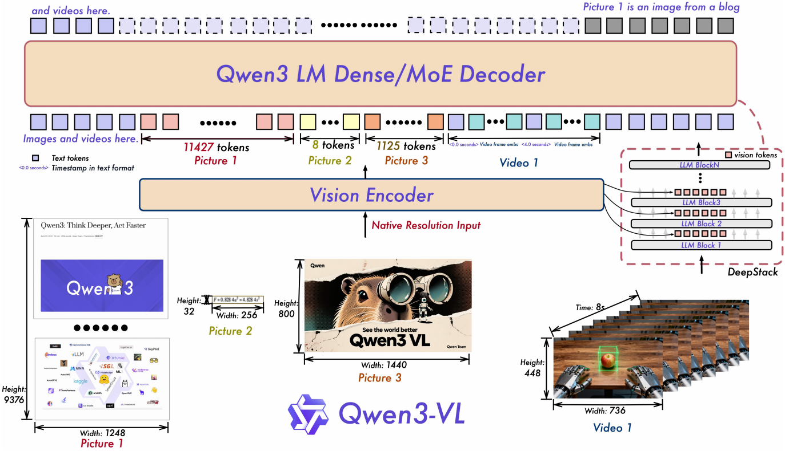

# Qwen3-VL Technical Report

**出处会议：** 暂无（截至抓取日 2026-11-02，arXiv abs 页未标注任何会议/期刊；Comments 原文 "42 pages"；Subjects 原文 "Computer Vision and Pattern Recognition (cs.CV); Artificial Intelligence (cs.AI)"）。arXiv 编号 2511.21631，标题 "Qwen3-VL Technical Report"；v1 提交于 2025-11-26 17:59:08 UTC，v2 于 2025-11-27 12:16:54 UTC（abs 页 Submission history 逐字）；PDF 扉页署名 "Qwen Team"、日期 "December 1, 2025"，arXiv API 元数据列 64 位作者（第一作者 Shuai Bai）。
**是否开源：** 开源。论文结论段声称（§6 原句）："By openly releasing the entire model family under the Apache 2.0 license, we aim to catalyze community-driven innovation toward the vision of truly integrated, multimodal AI agents." PDF 扉页逐字列出以下官方入口："https://chat.qwen.ai"、"https://huggingface.co/Qwen"、"https://modelscope.cn/organization/qwen"、"https://github.com/QwenLM/Qwen3-VL"（四个 URL 在扉页各占一行）。本次实际抓取 GitHub 仓库 https://github.com/QwenLM/Qwen3-VL 确认存在（页面 title 原文 "GitHub - QwenLM/Qwen3-VL: Qwen3-VL is the multimodal large language model series developed by Qwen team, Alibaba Cloud. · GitHub"；页面 license 元数据 spdxId 为 "Apache-2.0"）。注意：仅据论文与仓库页面记录，本次未逐一核对各 variant 权重是否已全部上传。
**关键词：** 多模态大语言模型（VLM/MLLM）、Interleaved MRoPE、DeepStack 跨层视觉注入、文本时间戳（text-based timestamps）、原生 256K 上下文、dense 2B/4B/8B/32B 与 MoE 30B-A3B/235B-A22B、non-thinking/thinking 双模式、strong-to-weak distillation、SAPO 强化学习、thinking with images（工具集成多轮 RL）、GUI agent、SigLIP-2 视觉编码器

> 来源与核验（抓取日期 2026-11-02）：
> - 歧义检查：arXiv API 标题检索 ti:"Qwen3-VL"（https://export.arxiv.org/api/query?search_query=ti:%22Qwen3-VL%22&max_results=20 ，本次抓取；注：http:// 明文端口本次返回空响应，改用 https 后正常）共命中 4 条：本篇 "Qwen3-VL Technical Report"（2511.21631）、"Qwen3-VL-Embedding and Qwen3-VL-Reranker: A Unified Framework for State-of-the-Art Multimodal Retrieval and Ranking"（检索/重排，独立论文）、"Qwen3-VL-Seg: Unlocking Open-World Referring Segmentation with Vision-Language Grounding"（分割，独立论文）、"A Safety Report on GPT-5.2, Gemini 3 Pro, Qwen3-VL, Grok 4.1 Fast, Nano Banana Pro, and Seedream 4.5"（第三方报告）。无同名异文；2511.21631 即以 Qwen3-VL 全系列为主题的技术报告，允许作为本笔记主题。
> - abs 页 https://arxiv.org/abs/2511.21631 本次抓取确认，页面 title 为 "[2511.21631] Qwen3-VL Technical Report"。
> - 全文依据 arXiv 官方 HTML v2 https://arxiv.org/html/2511.21631v2 （LaTeXML oxide 0.7.6 渲染，约 613 KB，本次抓取）。以下 locator（§x / Table x）均指该 HTML v2 的章节与表格编号；引号内英文为本次实际抓取渲染文本的逐字摘录，HTML 内夹带的粗体/等宽 span 按渲染文本还原；LaTeX 数学按该渲染的 alttext 记录（如 merger 压缩比的 LaTeX alttext "2\times 2" 即 2×2；§2.3 时间戳样例 "<3.0 seconds>" 的尖括号是 token 的一部分，非引用符号）。
> - 已知 HTML v2 缺陷：§5.1–5.10 正文有 10 处空交叉引用（"shown in Table ,"×3、"shown in ,"×3、"As detailed in , and ,"、"As reported in ,"、"presented in Tables and ,"、"provided in Tables and ,"），对应的多模态结果大表未包含在该 HTML 中（HTML 全文只有 Table 1–9：Table 1 训练配置、Table 2–7 文本中心评测、Table 8/9 消融）。PDF（https://arxiv.org/pdf/2511.21631v2 ，本次抓取后经 pdftotext 抽查）含 12 张表：PDF Table 2/3/4 为 HTML 缺失的多模态大表，PDF Table 5–10 对应 HTML Table 2–7，PDF Table 11/12 对应 HTML Table 8/9（编号相差 3）。本笔记多模态数字一律取自正文 prose 逐字句，未从缺失大表转抄；仅对少量 prose 数字做了 PDF 表抽查（MMStar 78.7 在 Qwen3-VL thinking 列首值块、MMMU 80.6 同块首值、MMBench-EN 89.3/88.9 在 instruct 块，均与 prose 一致），详见 TODO。
> - 本笔记 2026-11-03 经入库前逐字 QA（quote 自洽 + 数字抽查）后自 nightshift/drafts/ 入库至 library/VLM_VLA/。

------

## 1. 概述

- 系列定位（Abstract 原句）："We introduce Qwen3-VL, the most capable vision–language model in the Qwen series to date, achieving superior performance across a broad range of multimodal benchmarks." 注意此为论文自述；引用时保留 "in the Qwen series to date" 限定。
- 模型家族（Abstract 逐字）："It natively supports interleaved contexts of up to 256K tokens, seamlessly integrating text, images, and video. The model family includes both dense (2B/4B/8B/32B) and mixture-of-experts (30B-A3B/235B-A22B) variants to accommodate diverse latency–quality trade-offs."（"latency–quality" 原文为 en dash）
- 三大能力支柱（Abstract）：(i) 更强纯文本理解——"surpassing comparable text-only backbones in several cases"（注意限定 "in several cases"）；(ii) 原生 256K 长上下文（文本与多模态交错输入）"enabling faithful retention, retrieval, and cross-referencing across long documents and videos"；(iii) 单图/多图/视频的多模态推理，"demonstrating leading performance on comprehensive evaluations such as MMMU and visual-math benchmarks (e.g., MathVista and MathVision)"。
- 骨干与双模式（§1）：基于 Qwen3 系列（原文引 "Built on the Qwen3 series (Yang et al., 2025a), we instantiate four dense models (2B/4B/8B/32B) and two mixture-of-experts (MoE) models (30B-A3B / 235B-A22B)"）；"We release both non-thinking and thinking variants; the latter demonstrates significantly stronger multimodal reasoning capabilities, achieving superior performance on complex reasoning tasks."
- 三项架构升级（§1 逐字要点）：
  1. "Enhanced positional encoding"——Qwen2.5-VL 的 MRoPE 把维度按 t/h/w 分块导致 "an imbalanced frequency spectrum and hampers long-video understanding"；"We therefore adopt an interleaved MRoPE that distributes t, h, and w uniformly across low- and high-frequency bands, yielding more faithful positional representations."
  2. "DeepStack for cross-layer fusion"——"Visual tokens from different layers of the vision encoder are routed to corresponding LLM layers via lightweight residual connections, enhancing multi-level fusion without introducing extra context length."
  3. "Explicit video timestamps"——"We replace the absolute-time alignment via positional encoding used in Qwen2.5-VL with explicit timestamp tokens to mark frame groups, providing a simpler and more direct temporal representation."
- 损失函数改动（§1 原句）："we move from a per-sample loss to a square-root-normalized per-token loss, which better balances the contributions of text and multimodal data during training."（PDF 摘要的对应表述为 "we apply square-root reweighting, which boosts multimodal performance without compromising text capabilities."）
- 训练流程总览（§1）：pretraining 四阶段——"a warm-up alignment phase that updates only the merger (vision–language projection) layers while keeping the rest of the model frozen, followed by full-parameter training with progressively larger context windows at 8K, 32K, and 256K sequence lengths."；post-training 三阶段——"(i) supervised fine-tuning on long chain-of-thought data, (ii) knowledge distillation from stronger teacher models, and (iii) reinforcement learning."
- 数据侧升级总述（§1）："enhanced caption supervision, expanded omni-recognition and OCR coverage, normalized grounding with 3D/spatial reasoning, and new corpora for code, long documents, and temporally grounded video"，并注入 CoT 推理与 GUI-agent 交互数据以 "bridge perception, reasoning, and action"。
- ⚠ 措辞提示（引用本文结果时注意）：
  - 摘要的 "superior performance" 集中于多模态基准；文本中心基准上（HTML Table 2）Qwen3-VL-235B-A22B-Instruct 的 MMLU-Pro 81.8 低于 Qwen3-235B-A22B-Instruct-2507 的 83.0 与 Claude-Opus-4 的 86.6，GPQA 74.3 亦低于两者（77.5/74.9），AIME-25 74.7 反而为四列最高。论文自己的总结用词是 "achieves competitive results, comparable to or even surpassing the other leading models"（§5.11）。
  - §5.2 的 SOTA 声明均带限定：Instruct 是 "among non-thinking or low-thinking-budget models"，Thinking 限定在具体基准清单（见 3.4 节逐字）。PDF Table 2 抽查显示 MMMU thinking 列为 80.6、GPT-5(high) 列为 84.2*（* 表示分数取自原技术报告），即与全部推理模型同场时并非全面第一。

## 2. 方法

### 2.1 总体架构（§2）

- 三模块结构（§2 原句）："Following Qwen2.5-VL (Bai et al., 2025), Qwen3-VL adopts a three-module architecture comprising a vision encoder, an MLP-based vision–language merger, and a large language model (LLM)."
- 家族与旗舰（§2）："Qwen3-VL is instantiated in three dense variants (Qwen3-VL-2B/4B/8B/32B) and two MoE variants (Qwen3-VL-30B-A3B, Qwen3-VL-235B-A22B), all built upon Qwen3 backbones."（⚠ 原文写 "three dense variants" 但括号列了 4 个规模，与摘要/§1 的 "four dense models" 不一致，照录待勘误。）旗舰（§2 原句）："The flagship model, Qwen3-VL-235B-A22B, has 235B total parameters with 22B activated per token."
- 视觉编码器（§2）：SigLIP-2 架构继续训练（动态分辨率）："We utilize the SigLIP-2 architecture (Tschannen et al., 2025) as our vision encoder and continue training it with dynamic input resolutions, initialized from official pretrained checkpoints." 用 2D-RoPE 并按 CoMP (Chen et al., 2025) 方法对绝对位置嵌入做插值；"we default to the SigLIP2-SO-400M variant and use SigLIP2-Large (300M) for small-scale LLMs (2B and 4B)."
- Merger（§2）："we use a two-layer MLP to compress 2\times 2 visual features from the vision encoder into a single visual token, aligned with the LLM’s hidden dimension."（引文中 2\times 2 为该渲染 alttext，即 2×2 压缩）；另为 DeepStack 部署专用 merger。

### 2.2 Interleaved MRoPE（§2.1）

- 背景（§2.1）：Qwen2-VL 的 MRoPE 将嵌入维度划分为 temporal (t)/horizontal (h)/vertical (w) 子空间并各配不同旋转频率，"This results in an imbalanced frequency spectrum, which subsequent studies have shown to degrade performance on long-video understanding benchmarks."
- 方案（§2.1 原句）："To address this, we redesign the frequency allocation by interleaving the t, h, and w components across the embedding dimensions (Huang et al., 2025). This ensures that each spatial–temporal axis is uniformly represented across both low- and high-frequency bands."

### 2.3 DeepStack（§2.2）

- 与原 DeepStack（Meng et al., 2024）的区别（§2.2 原句）："Unlike the original DeepStack approach, which stacks tokens from multi-scale visual inputs, we extend DeepStack to extract visual tokens from intermediate layers of the Vision Transformer (ViT)."
- 实现（§2.2）："we select features from three distinct levels of the vision encoder. Subsequently, dedicated vision–language merger modules project these multi-level features into visual tokens, which are then added directly to the corresponding hidden states of the first three LLM layers."

### 2.4 视频文本时间戳（§2.3）

- Qwen2.5-VL 时间同步 MRoPE 的两个局限（§2.1→§2.3 原文要点）：
  1. "By tying temporal position IDs directly to absolute time, the method produces excessively large and sparse temporal position ids for long videos, degrading the model’s ability to understand long temporal contexts."
  2. "Effective learning under this scheme requires extensive and uniformly distributed sampling across various frame rates (fps), significantly increasing the cost of training data construction."
- 方案（§2.3 原句）："we adopt a textual token–based time encoding strategy (Chen et al., 2024b), wherein each video temporal patch is prefixed with a timestamp expressed as a formatted text string—e.g., <3.0 seconds>."
- 训练时（§2.3 原句）："we generate timestamps in both seconds and HMS (hours:minutes:seconds) formats to ensure the model learns to interpret diverse timecode representations." 代价是 "a modest increase in context length"，收益是 video grounding 与 dense captioning 等时间感知任务。

### 2.5 预训练配方（§3.1）

Table 1 逐字（caption: "Training setup and hyperparameters across different stages for Qwen3-VL"；列：Stage / Objective / Training / Token Budget / Sequence Length）：

| Stage | Objective | Training | Token Budget | Sequence Length |
| --- | --- | --- | --- | --- |
| S0 | Vision-Language Alignment | Merger | 67B | 8,192 |
| S1 | Multimodal Pre-Training | All | ~1T | 8,192 |
| S2 | Long-Context Pre-Training | All | ~1T | 32,768 |
| S3 | Ultra-Long-Context Adaptation | All | 100B | 262,144 |

- S0（§3.1）："only the parameters of the MLP merger are trained during this phase, while both the vision encoder and the LLM backbone remain frozen." 数据约 67B tokens（image-caption 对 + 视觉知识 + OCR），序列长 8,192。
- S1（§3.1）：全参解冻，"approximately 1 trillion (1T) tokens"，数据为 VL + text-only 混合（VL 含交错图文、grounding、VQA、STEM、少量视频）。
- S2（§3.1）：序列长翻两番至 32,768，仍 ~1T tokens；"The proportion of text-only data is increased to bolster long-form text comprehension, while the remaining VL data incorporates a significantly larger volume of video and agent-oriented instruction-following data."
- S3（§3.1）：序列长 262,144，"a more focused 100B token dataset"，侧重长视频与长文档。

### 2.6 预训练数据要点（§3.2，按域）

- Caption（§3.2.1）：用专门微调的 Qwen2.5-VL-32B 做 recaptioning；对重写文本做语义去重；对视觉嵌入聚类补充稀缺概念。
- 交错图文（§3.2.1）：书级交错数据用微调 Qwen2.5-VL-7B 解析；"we construct a specialized subset by merging consecutive pages into sequences of up to 256K tokens, preserving natural page order and multimodal coherence."
- OCR（§3.2.3 原句）："we curate a dataset of 30 million in-house collected samples using a coarse-to-fine pipeline"（伪标签 + Qwen2.5-VL 精修，无人工标注）；"Expanding beyond the 10 languages supported by Qwen2.5-VL (excluding Chinese and English), we incorporate an additional 29 languages, synthesizing approximately 30 million high-quality multilingual OCR samples and curating over 1 million internal real-world multilingual images."
- 文档解析（§3.2.3 原句）："we collect 3 million PDFs from Common Crawl, evenly distributed across 10 document types (300K samples each), along with 4 million internal documents." 统一标注框架两表示：QwenVL-HTML（元素级框）与 QwenVL-Markdown（仅图表定位、表格用 LaTeX）。
- Grounding/Counting（§3.2.4）：聚合 COCO、Objects365、OpenImages、RefCOCO/+/g + 自动合成管线（Qwen2.5-VL 提候选、Grounding DINO 与 Qwen2.5-VL 标注、低置信过滤）；支持框与点两类 + 计数三类任务（直接/框/点）。"Different from Qwen2.5-VL, we adopt a normalized coordinate system scaled to the range [0,1000] in this version."
- 空间与 3D（§3.2.5）：关系标注、affordance 标签、动作条件查询；3D grounding 用单视图图像 + referring 表达 + 9-DoF 3D 框 JSON，"we filter out heavily occluded and inaccurate labels and follow Omni3D (Brazil et al., 2023) to unify all data into a virtual camera coordinate system."
- Code（§3.2.6）：复用 Qwen3/Qwen3-Coder 语料（text-only）+ 多模态 coding（UI 截图→HTML/CSS、图→SVG、视觉编程题、带图 StackOverflow 问答、流程图/公式转代码）。
- 视频（§3.2.7）：长视频短到长 caption 合成（时间戳交错的故事级描述）+ 物体/动作/人三级时空 grounding；数据源平衡与按序列长度自适应的 fps/帧数采样。
- STEM（§3.2.8 原句数字）："we generate: (i) 1 million point-grounding samples, such as intersection points, corners, and centers of gravity; and (ii) 2 million perception-oriented visual question answering pairs targeting fine-grained visual understanding of diagrams."；"This process yields a comprehensive dataset of 6 million richly annotated diagram captions spanning diverse STEM disciplines."；"The majority of our multi-modal reasoning data consists of over 60 million K–12 and undergraduate-level exercises"；"we synthesize over 12 million multimodal reasoning samples paired with images"（rollouts 经规则 + 模型双重验证、过滤中英混杂，rejection sampling 只留难题）。
- Agent（§3.2.9）：GUI 跨 desktop/mobile/web 的元素描述、dense captioning/grounding + 自进化轨迹生产框架（"complemented by targeted human audits"）；function calling 轨迹合成（"without the need to implement executable functions"）；多模态搜索轨迹（在线图搜/文搜工具）。

### 2.7 后训练（§4）

- 三阶段总述（§4.1）：SFT（先 32k 后 256k 两段上下文，数据分 non-thinking 标准格式与 thinking CoT 格式）→ Strong-to-Weak Distillation → RL（Reasoning RL + General RL）。
- SFT 数据（§4.2.1 原句）："This dataset comprises approximately 1,200,000 samples, strategically composed to foster robust multimodal capabilities. This collection is partitioned into unimodal and multimodal data, with one-third consisting of text-only entries and the remaining two-thirds comprising image-text and video-text pairs." 训练分两阶段（§4.2.1 原句）："an initial one-epoch training phase with a sequence length of 32K tokens, followed by a second epoch at the full 256K token length."（长上下文课程含数百页技术文档、整本教材、最长 2 小时视频。）数据经 Query Filtering（Qwen2.5-VL 挑不可验证/歧义查询）与 Response Filtering（规则 + Qwen2.5-VL 系 reward model 多维打分）双重清洗。
- Long-CoT 冷启动（§4.2.2）：VL 与纯文本查询 "maintaining an approximate 1:1 ratio between vision-language and text-only samples"；三重筛选——Difficulty Curation（基座低 pass rate 或长回复者保留）、Multimodal Necessity Filtering（"we discard any samples that our Qwen3-30B-nothink model could solve correctly without access to the visual input"）、Response Quality Control（去错答/重复/语言混杂/猜测性作答）。
- Strong-to-Weak Distillation（§4.3 原句要点）："Crucially, we perform this distillation using text-only data to fine-tune the LLM backbone." 两阶段：off-policy（教师输出做 SFT）+ on-policy（学生自己采样后微调，"align the logits predicted by the student and teacher by minimizing the KL divergence"）。
- Reasoning RL（§4.4.1）：
  - 任务限定可验证（"mathematics, coding, logical reasoning, visual grounding, and visual puzzles"，"solutions can be verified deterministically via rules or code executors"）。
  - 数据（§4.4.1 原句）："we use a preliminary checkpoint of our most advanced vision–language model (Qwen3-VL-235B-A22B) to sample 16 responses per query; any query for which all responses are incorrect is discarded."；"This process yields approximately 30K RL queries covering a variety of text and multimodal tasks." 训练每模型采 16 responses/query，"filter out easy queries whose pass rate exceeds 90%"，按预定比例混任务组 batch。
  - 奖励（§4.4.1）："We use task-specific format prompts to guide model outputs to the required formats and therefore do not rely on explicit format rewards. To mitigate code-switching, we apply a penalty when the response language differs from the prompt language."
  - 算法（§4.4.1 原句）："We employ SAPO (Gao et al., 2025), a smooth and adaptive policy-gradient method, for RL training."（本笔记未展开 SAPO 细节，引文 [Gao et al., 2025] 为原文参考文献。）
- General RL（§4.4.2）：多任务奖励（VQA、captioning、OCR、文档解析、grounding、时钟识别）；两个优化维度 "Instruction Following" 与 "Preference Alignment"；兼任纠偏机制——用可验证任务触发并覆盖错误先验（"such as counter-intuitive object counting and complex clock time recognition"），并对语言混杂/重复/格式错误用专门数据集做高频定向惩罚。奖励混合：Rule-Based Rewards + Model-Based Rewards（"employs Qwen2.5-VL-72B-Instruct or Qwen3 as sophisticated judgers"）。
- Thinking with Images（§4.5）：两阶段范式。阶段一合成 "approximately 10k grounding examples" 冷启动数据，对 Qwen2.5-VL-32B 做 SFT 模拟视觉智能体行为 "think → act → analyze feedback → answer"，再做 "multi-turn, tool-integrated reinforcement learning (RL)"。阶段二将训练出的 Qwen2.5-VL-32B 视觉智能体蒸馏，生成 "a larger, more diverse dataset of approximately 120k multi-turn agentic interactions"，再以同样的冷启动 SFT + 工具集成 RL 后训练 Qwen3-VL。三个奖励（§4.5 原文列表）："Answer Accuracy Reward leverages Qwen3-32B"；"Multi-Turn Reasoning Reward leverages Qwen2.5-VL-72B"；"Tool-Calling Reward encourages appropriate tool usage by comparing the actual number of tool calls to an expert-estimated target."（第三个奖励是为治 "models to degenerate into making only a single tool call to hack the first two rewards, regardless of task demands" 的奖励攻击。）
- 基础设施（§4.6 原句要点）："We train the Qwen3-VL series models on Alibaba Cloud’s PAI-Lingjun AI Computing Service"；预训练用 Megatron-LM 之上的混合并行（"Tensor Parallelism (TP), Pipeline Parallelism (PP), Context Parallelism (CP), Expert Parallelism (EP), and ZeRO-1 Data Parallelism (DP)"），"even at scales of up to 10,000 GPUs"；部署推理用 vLLM 或 SGLang。

## 3. 实验

### 3.1 评测设置（§5.11 Evaluation Settings）

- 大型 instruct（235B-A22B/32B/30B-A3B）采样（§5.11 原句）："we configure the sampling hyperparameters with temperature = 0.7, top-p = 0.8, top-k = 20, and presence penalty = 1.5."；小型 instruct（8B/4B/2B）："we set the temperature = 1.0, top-p = 1.0, top-k = 40, and presence penalty = 2.0."；"We set the max output length to 32,768 tokens."
- Thinking 模型：MoE 架构 "we set the sampling temperature to 0.6, top‑p to 0.95, and top‑k to 20"（原文 top‑p/top‑k 为非断行连字符）；dense 架构 temperature=1.0、top-p=0.95、top-k=20、presence penalty 1.5；"We set the max output length to 32,768 tokens, except AIME-25, HMMT-25 and LiveCodeBench v6 where we extend the length to 81,920 tokens to provide sufficient thinking space."
- 评分器脚注（§5.11）："For reproducibility of Arena-Hard v2, we report the win rates evaluated by GPT-4.1."；"For reproducibility of Creative Writing v3, we report the scores evaluated by Claude 3.7 Sonnet."

### 3.2 旗舰模型文本中心结果（HTML Table 2 / Table 3，§5.11）

Table 2 逐字行（caption: "Comparison among Qwen3-VL-235B-A22B (Instruct) and other baselines. The highest and second-best scores are shown in bold and underlined respectively."；HTML 中最高/次高有粗体/下划线格式，此处未还原格式，仅抄数值；"-" 为原文空缺）：

| Benchmark | Qwen3-VL 235B-A22B Instruct | Qwen3 235B-A22B Instruct-2507 | Deepseek V3 0324 | Claude-Opus-4 (Without thinking) |
| --- | --- | --- | --- | --- |
| **Knowledge** MMLU-Pro | 81.8 | 83.0 | 81.2 | 86.6 |
| MMLU-Redux | 92.2 | 93.1 | 90.4 | 94.2 |
| GPQA | 74.3 | 77.5 | 68.4 | 74.9 |
| SuperGPQA | 60.4 | 62.6 | 57.3 | 56.5 |
| **Reasoning** AIME-25 | 74.7 | 70.3 | 46.6 | 33.9 |
| HMMT-25 | 57.4 | 55.4 | 27.5 | 15.9 |
| LiveBench 2024-11-25 | 74.8 | 75.4 | 66.9 | 74.6 |
| **Alignment Tasks** IFEval | 87.8 | 88.7 | 82.3 | 87.4 |
| Arena-Hard V2 (winrate) | 77.4 | 79.2 | 45.6 | 51.5 |
| Creative Writing v3 | 86.5 | 87.5 | 81.6 | 83.8 |
| WritingBench | 85.5 | 85.2 | 74.5 | 79.2 |
| **Coding & Agent** LiveCodeBench v6 | 54.3 | 51.8 | 45.2 | 44.6 |
| BFCL-v3 | 67.7 | 70.9 | 64.7 | 60.1 |
| **Multilingualism** MultiIF | 76.3 | 77.5 | 66.5 | - |
| MMLU-ProX | 77.8 | 79.4 | 75.8 | - |
| INCLUDE | 80.0 | 79.5 | 80.1 | - |
| PolyMATH | 45.1 | 50.2 | 32.2 | 30.0 |

（上表行分组标签 Knowledge/Reasoning/Alignment Tasks/Coding & Agent/Multilingualism 为原表行侧分组，照抄；AIME-25 在原表中位于 Reasoning 组首行。）

Table 3 逐字行（caption: "Comparison among Qwen3-VL-235B-A22B (Thinking) and other reasoning baselines. The highest and second-best scores are shown in bold and underlined respectively."）：

| Benchmark | Qwen3-VL 235B-A22B Thinking | Qwen3 235B-A22B Thinking-2507 | OpenAI o3 (medium) | Claude-Opus-4 (With thinking) |
| --- | --- | --- | --- | --- |
| **Knowledge** MMLU-Pro | 83.8 | 84.4 | 85.9 | - |
| MMLU-Redux | 93.7 | 93.8 | 94.9 | 94.6 |
| GPQA | 77.1 | 81.1 | 83.3(high) | 79.6 |
| SuperGPQA | 64.3 | 64.9 | - | - |
| **Reasoning** AIME-25 | 89.7 | 92.3 | 88.9(high) | 75.5 |
| HMMT-25 | 77.4 | 83.9 | 77.5 | 58.3 |
| LiveBench 2024-11-25 | 79.6 | 78.4 | 78.3 | 78.2 |
| **Coding** LiveCodeBench v6 | 70.1 | 74.1 | 58.6 | 48.9 |
| CFEval | 1964 | 2134 | 2043 | - |
| OJBench | 27.5 | 32.5 | 25.4 | - |
| **Alignment Tasks** IFEval | 88.2 | 87.8 | 92.1 | 89.7 |
| Arena-Hard V2 (winrate) | 74.8 | 79.7 | 80.8 | 59.1 |
| Creative Writing v3 | 85.7 | 86.1 | 87.7 | 83.8 |
| WritingBench | 86.7 | 88.3 | 85.3 | 79.1 |
| **Agent** BFCL-v3 | 71.8 | 71.9 | 72.4 | 61.8 |
| TAU2-Retail | 67.0 | 71.9 | 76.3 | - |
| TAU2-Airline | 62.0 | 58.0 | 70.0 | - |
| TAU2-Telecom | 44.7 | 45.6 | 60.5 | - |
| **Multilingualism** MultiIF | 79.1 | 80.6 | 80.3 | - |
| MMLU-ProX | 80.6 | 81.0 | 83.3 | - |
| INCLUDE | 80.0 | 81.0 | 86.6 | - |
| PolyMATH | 57.8 | 60.1 | 49.7 | - |

- 基线设定（§5.11 原句）："For the Qwen3-VL-235B-A22B-Instruct, we take Qwen3-235B-A22B-Instruct-2507, DeepSeek V3 0324, and Claude-Opus-4 (without thinking) as the baselines. For the Qwen3-VL-235B-A22B-Thinking, we take Qwen3-235B-A22B-Thinking-2507, OpenAI o3 (medium), Claude-Opus-4 (with thinking) as baselines."
- 论文总结（§5.11 原句）："From Table 2, Qwen3-VL-235B-A22B-Instruct achieves competitive results, comparable to or even surpassing the other leading models, including DeepSeek V3 0324, Claude-Opus-4 (without thinking), and our previous flagship model Qwen3-235B-A22B-Instruct-2507. Particularly, Qwen3-VL-235B-A22B-Instruct exceeds other models on reasoning-demand tasks (e.g., mathematics and coding)."（事实核对：按 Table 2，"exceeds other models" 成立的行是 AIME-25、HMMT-25、LiveCodeBench v6；MMLU-Pro/GPQA/Arena-Hard 等多行低于 Qwen3-235B-A22B-Instruct-2507 或 Claude-Opus-4。）
- 文本基座对比的意义（§5.11 原句）："It is worth noting that DeepSeek V3 0324 and Qwen3-235B-A22B-Instruct-2507 are Large Language Models, while Qwen3-VL-235B-A22B-Instruct is a Vision Language model which can process visual and textual tasks. This means that Qwen3-VL-235B-Instruct has achieved the integration of visual and textual capabilities."
- Thinking 总结（§5.11 原句）："Qwen3-VL-235B-A22B-Thinking exceeds OpenAI o3 (medium) and Claude-Opus-4 (with thinking) on AIME-25 and LiveCodeBench v6, which means Qwen3-VL-235B-A22B-Thinking has better reasoning ability."（事实核对：AIME-25 89.7 vs o3 88.9(high) 成立；但对 Qwen3-235B-A22B-Thinking-2507 的 92.3 仍低 2.6 分。）

### 3.3 中型与小模型文本结果（HTML Table 4–7，§5.11）

Table 4 逐字行（caption: "Comparison among Qwen3-VL-32B-Instruct, Qwen3-VL-30B-A3B-Instruct, and corresponding baselines."）：

| Benchmark | Qwen3-VL 32B Instruct | Qwen3 32B Instruct | Qwen3-VL 30B-A3B Instruct | Qwen3 30B-A3B Instruct | Qwen3 30B-A3B Instruct-2507 |
| --- | --- | --- | --- | --- | --- |
| **Knowledge** MMLU-Pro | 78.6 | 71.9 | 77.8 | 69.1 | 78.4 |
| MMLU-Redux | 89.8 | 85.7 | 88.4 | 84.1 | 89.3 |
| GPQA | 68.9 | 54.6 | 70.4 | 54.8 | 70.4 |
| SuperGPQA | 54.6 | 43.2 | 53.1 | 42.2 | 53.4 |
| **Reasoning** AIME-25 | 66.2 | 20.2 | 69.3 | 21.6 | 61.3 |
| HMMT-25 | 46.1 | 10.9 | 50.6 | 12.0 | 43.0 |
| LiveBench 2024-11-25 | 72.2 | 31.3 | 65.4 | 59.4 | 69.0 |
| **Alignment Tasks** IFEval | 84.7 | 83.2 | 85.8 | 83.7 | 84.7 |
| Arena-Hard V2 (winrate) | 64.7 | 37.4 | 58.5 | 24.8 | 69.0 |
| Creative Writing v3 | 85.6 | 80.6 | 84.6 | 68.1 | 86.0 |
| WritingBench | 82.9 | 81.3 | 82.6 | 72.2 | 85.5 |
| **Coding & Agent** LiveCodeBench v6 | 43.8 | 29.1 | 42.6 | 29.0 | 43.2 |
| BFCL-v3 | 70.2 | 63.0 | 66.3 | 58.6 | 65.1 |
| **Multilingualism** MultiIF | 72.0 | 70.7 | 66.1 | 70.8 | 67.9 |
| MMLU-ProX | 73.4 | 69.3 | 70.9 | 65.1 | 72.0 |
| INCLUDE | 74.0 | 69.6 | 71.6 | 67.8 | 71.9 |
| PolyMATH | 40.5 | 22.5 | 44.3 | 23.3 | 43.1 |

Table 5 逐字行（caption: "Comparison among Qwen3-VL-32B (Thinking), Qwen3-VL-30B-A3B (Thinking), and corresponding baselines."）：

| Benchmark | Qwen3-VL 32B Thinking | Qwen3 32B Thinking | Qwen3-VL 30B-A3B Thinking | Qwen3 30B-A3B Thinking | Qwen3 30B-A3B Thinking-2507 |
| --- | --- | --- | --- | --- | --- |
| **Knowledge** MMLU-Pro | 82.1 | 79.1 | 80.5 | 78.5 | 80.9 |
| MMLU-Redux | 91.9 | 90.9 | 90.9 | 89.5 | 91.4 |
| GPQA | 73.1 | 68.4 | 74.4 | 65.8 | 73.4 |
| SuperGPQA | 59.0 | 54.1 | 56.4 | 51.8 | 56.8 |
| **Reasoning** AIME-25 | 83.7 | 72.9 | 83.1 | 70.9 | 85.0 |
| HMMT-25 | 64.6 | 51.8 | 67.6 | 49.8 | 71.4 |
| LiveBench 2024-11-25 | 74.7 | 65.7 | 72.1 | 74.3 | 76.8 |
| **Coding** LiveCodeBench v6 | 65.6 | 60.6 | 64.2 | 57.4 | 66.0 |
| CFEval | 1842 | 1986 | 1894 | 1940 | 2044 |
| OJBench | 20.0 | 24.1 | 23.4 | 20.7 | 25.1 |
| **Alignment Tasks** IFEval | 87.8 | 85.0 | 81.7 | 86.5 | 88.9 |
| Arena-Hard V2 (winrate) | 60.5 | 50.3 | 56.7 | 36.3 | 56.0 |
| Creative Writing v3 | 83.3 | 84.4 | 82.5 | 79.1 | 84.4 |
| WritingBench | 86.2 | 78.4 | 85.2 | 77.0 | 85.0 |
| **Agent** BFCL-v3 | 71.7 | 70.3 | 68.6 | 69.1 | 72.4 |
| TAU2-Retail | 59.4 | 59.6 | 64.0 | 34.2 | 58.8 |
| TAU2-Airline | 52.5 | 38.0 | 48.0 | 36.0 | 58.0 |
| TAU2-Telecom | 46.9 | 26.3 | 27.2 | 22.8 | 26.3 |
| **Multilingualism** MultiIF | 78.0 | 73.0 | 73.0 | 72.2 | 76.4 |
| MMLU-ProX | 77.2 | 74.6 | 76.1 | 73.1 | 76.4 |
| INCLUDE | 76.3 | 73.7 | 74.5 | 71.9 | 74.4 |
| PolyMATH | 52.0 | 47.4 | 51.7 | 46.1 | 52.6 |

Table 6 逐字行（caption: "Comparison among Qwen3-VL-2B (Instruct), Qwen3-VL-4B (Instruct), Qwen3-VL-8B (Instruct) and corresponding baselines."）：

| Benchmark | Qwen3-VL 2B Instruct | Qwen3-VL 4B Instruct | Qwen3-VL 8B Instruct | Qwen3 1.7B Instruct | Qwen3 4B Instruct | Qwen3 8B Instruct | Qwen3 4B Instruct-2507 |
| --- | --- | --- | --- | --- | --- | --- | --- |
| **Knowledge** MMLU-Pro | 49.0 | 67.1 | 71.6 | 42.3 | 58.0 | 63.4 | 69.6 |
| MMLU-Redux | 66.5 | 81.5 | 84.9 | 63.6 | 77.3 | 79.5 | 84.2 |
| GPQA | 42.0 | 55.9 | 61.9 | 34.7 | 41.7 | 39.3 | 62.0 |
| SuperGPQA | 24.3 | 40.3 | 44.5 | 22.8 | 32.0 | 35.8 | 42.8 |
| **Reasoning** AIME-25 | 22.2 | 46.6 | 45.9 | 10.6 | 19.1 | 20.9 | 47.4 |
| HMMT-25 | 10.9 | 30.7 | 32.5 | 6.2 | 12.1 | 11.8 | 31.0 |
| LiveBench 2024-11-25 | 39.5 | 60.9 | 62.0 | 35.6 | 48.4 | 53.5 | 63.0 |
| **Alignment Tasks** IFEval | 68.2 | 82.3 | 83.7 | 67.1 | 81.2 | 83.0 | 83.4 |
| Arena-Hard V2 (winrate) | 6.4 | 30.4 | 46.3 | 4.1 | 9.5 | 15.5 | 43.4 |
| Creative Writing v3 | 48.6 | 72.3 | 77.0 | 49.1 | 53.6 | 69.0 | 83.5 |
| WritingBench | 73.0 | 82.5 | 83.1 | 65.1 | 68.5 | 71.4 | 83.4 |
| **Coding & Agent** LiveCodeBench v6 | 20.3 | 37.9 | 39.3 | 16.1 | 26.4 | 25.5 | 35.1 |
| BFCL-v3 | 55.4 | 63.3 | 66.3 | 52.2 | 57.6 | 60.2 | 61.9 |
| **Multilingualism** MultiIF | 43.2 | 61.5 | 66.8 | 43.2 | 61.3 | 69.2 | 69.0 |
| MMLU-ProX | 38.8 | 59.4 | 65.4 | 33.5 | 49.6 | 58.0 | 61.6 |
| INCLUDE | 45.8 | 61.4 | 67.0 | 42.6 | 53.8 | 62.5 | 60.1 |
| PolyMATH | 14.9 | 28.8 | 30.4 | 10.3 | 16.6 | 18.8 | 31.1 |

Table 7 逐字行（caption: "Comparison among Qwen3-VL-2B (Thinking), Qwen3-VL-4B (Thinking), Qwen3-VL-8B (Thinking) and corresponding baselines."）：

| Benchmark | Qwen3-VL 2B Thinking | Qwen3-VL 4B Thinking | Qwen3-VL 8B Thinking | Qwen3 1.7B Thinking | Qwen3 4B Thinking | Qwen3 8B Thinking | Qwen3 4B Thinking-2507 |
| --- | --- | --- | --- | --- | --- | --- | --- |
| **Knowledge** MMLU-Pro | 62.3 | 73.6 | 77.3 | 58.1 | 70.4 | 74.6 | 74.0 |
| MMLU-Redux | 76.9 | 86.0 | 88.8 | 73.9 | 83.7 | 87.5 | 86.1 |
| GPQA | 49.5 | 64.1 | 69.9 | 27.9 | 55.9 | 62.0 | 65.8 |
| SuperGPQA | 34.6 | 46.8 | 51.2 | 31.2 | 42.7 | 47.6 | 47.8 |
| **Reasoning** AIME-25 | 39.0 | 74.5 | 80.3 | 36.8 | 65.6 | 67.3 | 81.3 |
| HMMT-25 | 22.8 | 53.1 | 60.6 | 24.3 | 42.1 | 43.2 | 55.5 |
| LiveBench 2024-11-25 | 50.1 | 68.4 | 69.8 | 51.1 | 63.6 | 67.1 | 71.8 |
| **Alignment Tasks** IFEval | 75.1 | 82.6 | 83.2 | 72.5 | 81.9 | 85.0 | 87.4 |
| Arena-Hard V2 (winrate) | 12.0 | 36.8 | 51.1 | 4.7 | 13.7 | 29.1 | 34.9 |
| Creative Writing v3 | 55.6 | 76.1 | 82.4 | 50.6 | 61.1 | 78.5 | 75.6 |
| WritingBench | 77.9 | 84.0 | 85.5 | 68.9 | 73.5 | 75.0 | 83.3 |
| **Coding & Agent** LiveCodeBench v6 | 29.3 | 51.3 | 58.6 | 31.3 | 48.4 | 51.0 | 55.2 |
| BFCL-v3 | 57.2 | 67.3 | 63.0 | 56.6 | 65.9 | 68.1 | 71.2 |
| **Multilingualism** MultiIF | 58.9 | 73.6 | 75.1 | 51.2 | 66.3 | 71.2 | 77.3 |
| MMLU-ProX | 55.1 | 65.0 | 70.7 | 50.4 | 61.0 | 68.1 | 64.2 |
| INCLUDE | 53.3 | 64.6 | 69.5 | 51.8 | 61.8 | 67.8 | 64.4 |
| PolyMATH | 28.0 | 44.6 | 47.5 | 25.2 | 40.0 | 42.7 | 46.2 |

- 论文总结（§5.11 原句）："From Table 4, for instruct models, Qwen3-VL-32B and Qwen3-VL-30B-A3B show significant performance improvement compared with Qwen3-32B and Qwen3-30B-A3B on all the benchmarks."（事实核对：逐行检查 Table 4，Qwen3-VL 32B 列全部 17 行高于 Qwen3 32B 列；30B-A3B 对 30B-A3B 亦全部高于基线，"all the benchmarks" 成立。）"From Table 5, for thinking models, Qwen3-VL-32B and Qwen3-VL-30B-A3B surpass the baselines in most of the benchmarks."（注意此处措辞是 "most of" 而非 "all"——如 Table 5 中 OJBench、Creative Writing v3 等行低于基线。）
- 小模型（§5.11 原句）："Overall, these edge-side models exhibit impressive performance and outperform baselines. These results demonstrate the efficacy of our Strong-to-Weak Distillation approach, making it possible for us to build the lightweight models with remarkably reduced costs and efforts."

### 3.4 多模态各能力域结果（§5.1–5.10，prose 逐字数字；对应大表不在 HTML v2 中）

- General VQA（§5.1）："Qwen3-VL-235B-A22B-Thinking achieves the highest score of 78.7 on MMStar."；"Qwen3-VL-235B-A22B-Instruct obtains the highest scores on MMBench and RealWorldQA, with 89.3/88.9 and 79.2, respectively."（MMBench-EN/CN 两口径 89.3/88.9。）中型（§5.1）："Qwen3-VL-32B-Thinking achieves the highest scores on MMBench and RealWorldQA, with 89.5/89.5 and 79.4, respectively." 小模型 scaling（§5.1）："on MMBench-EN, the score in ”thinking” mode increases from 79.9 for the 2B model to 85.3 for the 8B model. A similar upward trend is observed on other benchmarks, such as MMStar, where the score rises from 68.1 (2B, thinking) to 75.3 (8B, thinking)."（此处 “thinking” 两侧引号在原文渲染中均为右弯引号 ”，照录。）
- 多模态推理（§5.2 原句）："Qwen3-VL-235B-A22B-Instruct achieves the best reported results among non-thinking or low-thinking-budget models on multiple benchmarks, including MathVistamini, MathVision, MathVersemini, DynaMath, ZeroBench, VLMsAreBlind, VisuLogic, and VisualPuzzlesDirect. While, Qwen3-VL-235B-A22B-Thinking achieves state-of-the-art results on MathVistamini, MathVision, MathVersemini, ZeroBench, LogicVista, and VisuLogic."（注意两处清单不同、且均带限定；MathVistamini、MathVersemini、VisualPuzzlesDirect 为原文连写形式。）中型（§5.2 原句）："Compared to the previous-generation Qwen2.5-VL-72B model, the medium-sized Qwen3-VL model has already surpassed it on reasoning tasks."
- 对齐与主观（§5.3 原句）："On HallusionBench, our thinking version surpasses Gemini-2.5-pro (Comanici et al., 2025), GPT-5 (OpenAI., 2025) and Claude opus 4.1 (Anthropic., 2025) by 3.0, 1.0, and 6.3 points, respectively."；"Qwen3-VL-235B-A22B-Thinking achieves the overall best score across all the other models"（MIA-Bench）；MIA-Bench math/textual 子项 "overtakes GPT-5-high-thinking version by 10.0 and 5.0 points"。
- 文本识别与文档（§5.4）：OCR 解析类基准（CC-OCR、OmniDocBench、OCRBench、OCRBench_v2）上 "the Qwen3-VL-235B-A22B-Instruct model establishes a new state of the art, marginally outperforming its “thinking” counterpart"；CharXiv reasoning 子集 "the Thinking variant surpasses the Instruct version and ranks second only to GPT5-thinking and Gemini-2.5-Pro-Thinking"；长文档（§5.4 原句）："our Qwen3-VL-235B-A22B achieves overall accuracy of 57.0%/56.2% under the instruct/thinking settings, showcasing the SOTA performance on the long document understanding task."（MMLongBench-Doc。）多语言（§5.4）："This represents a major expansion from the 10 non-English/Chinese languages supported by Qwen2.5-VL to 39 languages in Qwen3-VL." 自建测试集上 "the model’s accuracy surpasses 70%—a threshold we consider practical for real-world usability—on 32 out of the 39 languages tested."（各语言数值在 Fig. 2 中，本笔记未抄。）
- 2D/3D Grounding（§5.5）：2D "achieves state-of-the-art (SOTA) results across 2D grounding and counting benchmarks. Notably, it achieves 48.6 mAP on ODinW-13"（评测口径："we adopt mean Average Precision (mAP) as the evaluation metric by setting confidence scores to 1.0"，prompt 中同时给出全部数据集类别）。3D（Omni3D 测试集，"we set the IoU threshold to 0.15 and report mAP@0.15 on the Omni3D test set, with detection confidence fixed at 1.0"）："the Qwen3-VL-235B-A22B-Thinking variants surpass the performance of Gemini-2.5-Pro by 5.2 points"（SUN RGB-D 数据集）。
- 细粒度感知（§5.6 原句）："Qwen3-VL-235B-A22B achieves the state-of-the-art performance across all three benchmarks when augmented with tools—reaching 93.7 on V* (Wu and Xie, 2024), 85.3 on HRBench-4k (Wang et al., 2024e), and 82.3 on HRBench-8k (Wang et al., 2024e)." 且 "the performance gains from integrating external tools consistently outweigh those from simply increasing model size"（"within the Qwen3-VL family, the absolute improvement by adding tools is consistently \sim 5 points across V*."；\sim 为该渲染 alttext，即「约 5 分」）。
- 多图理解（§5.7 原句）："Qwen3-VL-235B-A22B-Thinking attains a remarkable leading score of 80.1 on MuirBench, surpassing all other models."
- 具身与空间（§5.8 原句）：EmbSpatial/RefSpatial/RoboSpatialHome 上 "Qwen3-VL-235B-A22 achieves scores of 84.3, 69.9, and 73.9, respectively"（原文此处型号写作 "Qwen3-VL-235B-A22"，缺尾字母 B，照录）；"top-tier scores of 52.5 on ERQA (Team et al., 2025) and 60.0 on VSIBench (Yang et al., 2025b) for Qwen3-VL-235B-A22B."
- 视频理解（§5.9）："the integration of interleaved MRoPE, the insertion of textual timestamps, and scaling temporally dense video captions collectively enable the Qwen3-VL 8B variant to achieve performance competitive with the significantly larger Qwen2.5-VL 72B model." 评测细节（§5.9 原句）："we imposed a cap of 2,048 frames per video for all benchmarks, ensuring that the total number of video tokens did not exceed 224K. The maximum number of tokens per frame was set to 768 for VideoMMMU and MMVU, and to 640 for all other benchmarks. Additionally, videos from Charades-STA were sampled at 4 frames per second (fps), while a rate of 2 fps was used for all other benchmarks."（VideoMMMU 用 model-based judge，"as rule-based scoring proved insufficiently accurate"。）公平性声明（§5.9 原句）："our comparison cannot guarantee full fairness due to resource and API limitations, which constrained the number of input frames used during evaluation: 512 for Gemini 2.5 Pro, 256 for GPT-5, and 100 for Claude Opus 4.1."（Qwen3-VL 自身最多 2,048 帧——对比帧数不对等，引用对比结论时必须携带此 caveat。）
- Agent（§5.10 原句）："For GUI grounding, Qwen3-VL-235B-A22B achieves state-of-the-art performance across multiple tasks, covering interactive interfaces on desktop, mobile, and PC"；"Qwen3-VL 32B scores 41 on OSWorld and 63.7 on AndroidWorld, which surpasses the current foundation VLMs."

### 3.5 消融（§5.12）

Table 8 逐字行（caption: "Ablation on Qwen3-ViT. We compare the performance metrics of Qwen3-ViT and SigLIP-2 during the CLIP pre-training stage, and further evaluate their downstream performance in the vision-language modeling (VLM) stage when paired with the same 1.7B Qwen3 language model."；列分组：Clip Bench = ImageNet-1K/ImageNet-V2/ImageNet-A/ImageNet-R/ImageNet-S/ObjectNet/Omni；VLM Bench = OCRB/AI2D/RLWDQA/InfoVQA/Omni）：

| ViT | ImageNet-1K | ImageNet-V2 | ImageNet-A | ImageNet-R | ImageNet-S | ObjectNet | Omni (CLIP) | OCRB | AI2D | RLWDQA | InfoVQA | Omni (VLM) |
| --- | --- | --- | --- | --- | --- | --- | --- | --- | --- | --- | --- | --- |
| SigLIP-2 | 84.2 | 78.6 | 87.0 | 96.1 | 76.2 | 79.9 | 36.9 | 77.2 | 74.1 | 58.7 | 65.3 | 50.1 |
| Qwen3-ViT | 84.6 | 78.8 | 87.1 | 95.7 | 74.5 | 81.0 | 45.5 | 78.7 | 76.2 | 66.1 | 67.0 | 53.0 |

- 结论（§5.12.1 原句）："Qwen3-ViT maintains competitive performance on standard benchmarks while achieving substantial gains on OmniBench, our in-house holistic evaluation suite designed to assess world knowledge integration under diverse and challenging conditions."（注意 OmniBench/Omni 为自建评测套件。）

Table 9 逐字行（caption: "Ablation on DeepStack. We conduct the ablation study on the DeepStack using an internal 15B-A2B LLM, with all experiments pretrained on 200 billion tokens. We directly evaluate these pretrained models on the validation sets, without any post-training."）：

| Method | AVG | AI2D | OCRB | TVQA | InfoVQA | ChartQA | DocVQA | MMMU | MMStar | RLWDQA | MMBEN | MMBCN |
| --- | --- | --- | --- | --- | --- | --- | --- | --- | --- | --- | --- | --- |
| Baseline | 74.7 | 81.8 | 81.0 | 80.6 | 71.9 | 81.5 | 89.5 | 52.9 | 55.5 | 67.7 | 81.0 | 78.1 |
| DeepStack | 76.0 | 83.2 | 83.6 | 80.5 | 74.2 | 83.3 | 91.1 | 54.1 | 57.7 | 68.1 | 81.2 | 78.5 |

- 结论（§5.12.2 原句）："This gain is attributed to DeepStack’s ability to integrate rich visual information, which effectively boosts the capability in fine-grained visual understanding, such as on the InfoVQA and DocVQA benchmarks."（事实核对：TVQA 80.5 vs 80.6、MMBCN 78.5 vs 78.1 上升 0.4，其余行均上升；AVG +1.3。）

### 3.6 长上下文 Needle-in-a-Haystack（§5.12.3）

- 设置（§5.12.3 原句）："In this task, a semantically salient “needle” frame—containing critical visual evidence—is inserted at varying temporal positions within a long video."；"videos are uniformly sampled at 1 FPS, and frame resolution is dynamically adjusted to maintain a constant visual token budget."
- 结果（§5.12.3 原句）："the model achieves a perfect 100% accuracy on videos up to 30 minutes in duration—corresponding to a context length of 256K tokens. Remarkably, even when extrapolating to sequences of up to 1M tokens (approximately 2 hours of video) via YaRN-based positional extension, the model retains a high accuracy of 99.5%."（被测对象为 Qwen3-VL-235B-A22B-Instruct；逐格数值在 Fig. 3 热图中，本笔记未抄。）

## 4. 核心结论

1. 论文声称：Qwen3-VL 以「SigLIP-2 视觉编码器 + 两层 MLP merger + Qwen3 LLM 骨干」三模块架构，配合三项升级（interleaved MRoPE、DeepStack 多层 ViT 特征注入前三层 LLM、文本时间戳替代 T-RoPE），在 4 dense（2B/4B/8B/32B）+ 2 MoE（30B-A3B/235B-A22B）上实现 256K 原生交错上下文与 non-thinking/thinking 双模式（Abstract；§1；§2）。此为论文声称。
2. 训练配方可复述为「4 阶段预训练（merger 对齐 67B → 全参 ~1T @8K → 全参 ~1T @32K → 100B @256K）+ 3 阶段后训练（1.2M 样本 SFT → 强到弱蒸馏（仅文本数据、调 LLM 骨干）→ SAPO 强化学习 + 通用 RL）」，配合 thinking with images 两阶段工具集成 RL（Table 1；§3.1；§4）。预训练数据规模声称：30M OCR、3M+4M 文档、6M 图题、>60M 习题、>12M 长 CoT 推理样本（§3.2.3/3.2.3/3.2.8）。
3. 文本能力：旗舰 Instruct/Thinking 与对应 Qwen3 文本基座及闭源模型"competitive"（Table 2/3 具体数字见 3.2 节）；32B/30B-A3B 全面超过同规模 Qwen3 文本模型（Table 4 逐行成立；Table 5 为 "most of"）；小模型受益于蒸馏（§5.11）。跨代对比（§5.2 原句）："the medium-sized Qwen3-VL model has already surpassed it on reasoning tasks"（指超过上代 Qwen2.5-VL-72B）。
4. 多模态：论文的 SOTA 声明集中在 OCR/文档（Instruct 建立新 SOTA）、2D grounding（ODinW-13 48.6 mAP）、GUI agent（32B OSWorld 41 / AndroidWorld 63.7）、长文档（MMLongBench-Doc 57.0/56.2）、带工具细粒度感知（V* 93.7 / HRBench-4k 85.3 / HRBench-8k 82.3）等域，且多带限定语；与最强推理模型（GPT-5 high 等）同场时部分基准并非第一（§5.2；§5.4；§5.5；§5.6；§5.10；PDF Table 2 抽查）。视频侧 8B ≈ 上代 72B（§5.9）。
5. 长上下文检索：视频 NIAH 100%（≤30 min，对应 256K tokens）、YaRN 外推 1M tokens（约 2 小时视频）保持 99.5%（§5.12.3）；与 Abstract 的 "natively supports interleaved contexts of up to 256K tokens" 相互印证。
6. 使用注意：闭源对比分数为论文自测且明示「不能保证完全公平」（视频基准对比帧数 Qwen3-VL 2,048 vs Gemini 512 / GPT-5 256 / Claude 100，§5.9）；多语言 OCR 与 OmniBench 为自建评测（§5.4；§5.12.1）；多模态结果大表未随 arXiv HTML v2 提供（见 TODO），独立核对需查 PDF。

------

## TODO

- [x] **配图已回填（2026-11-03 入库）**：library/assets/Qwen3-VL/ 现有 1 张截图，入库时目视核对内容并按相对路径（../assets/Qwen3-VL/）回填 §2.1——Figure2.png（内容 = 论文 Figure 1 架构总览；本地文件名与论文图号错位，论文 Figure 2 实为多语言 OCR）。仍缺：论文 Fig. 2（多语言 OCR，39 语言逐语言数值在图中，本笔记未抄）、Fig. 3（NIAH 热图）截图，需用户补充或授权抓取。
- 多模态结果大表未转抄：PDF（https://arxiv.org/pdf/2511.21631v2 ，2026-11-02 抓取）Table 2/3/4（旗舰/中型/小型多模态基准，14+ 行 × 8 列）在 HTML v2 中缺失，pdftotext 将其线性化为「每列一段数值块」，人工重组列对齐风险高（EMC2 笔记表格错位为前车之鉴）。本笔记仅做了抽查：MMMU 行 Qwen3-VL thinking 数值块首值 80.6、GPT-5(high) 块 84.2*、MMStar 78.7、MMBench-EN 89.3/88.9（instruct 块），均与 §5.1/§5.2 prose 一致；如需引用表中其它数字，必须对照 PDF 原表逐格核对。
- HTML v2 的 §5.1–5.10 有 10 处空交叉引用（LaTeXML 未解析出表号："shown in Table ,"×3、"shown in ,"×3、"As detailed in , and ,"、"As reported in ,"、"presented in Tables and ,"、"provided in Tables and ,"），与上述缺失表对应；引用该部分时只能依据 prose。
- 版本差异未比对：v1（2025-11-26）与 v2（2025-11-27）内容差异未知；本笔记全部依据 v2（HTML 与 PDF 均为 v2；PDF 扉页日期 "December 1, 2025"）。
- 开源核验不完整：仅抓取 GitHub 仓库页面（确认存在、license spdxId Apache-2.0），未抓 README 正文、未逐一核对 HuggingFace/ModelScope 各 variant 权重与 license 页；论文 §4.5 提到的 thinking-with-images 数据（10k/120k）未说明是否随模型开源。
- 文内不一致待勘误：§2 原文 "instantiated in three dense variants (Qwen3-VL-2B/4B/8B/32B)"（"three" 与列举的 4 个规模不符；摘要与 §1 均为 4 dense + 2 MoE）；§5.8 原文两处型号 "Qwen3-VL-235B-A22"（缺尾字母 B）；§6 结论段在 HTML 与 PDF 渲染中均有一句不完整："and our post-training strategy—including non-thinking and thinking modes."（无谓语收尾）。
- CFEval 分数（1964/2134/2043/1842/1894/1986/1940/2044）非百分制，论文未给出换算/口径说明，跨表比较前需查明。
- 后训练未披露各 variant 的 RL 步数、学习率等超参（仅流程描述），复现需等官方开源配置。
- 相关但独立的论文（同日检索发现，未抓取全文）："Qwen3-VL-Embedding and Qwen3-VL-Reranker"（arXiv 检索命中，检索/重排方向）与 "Qwen3-VL-Seg"（分割方向）；如需入库应另立笔记，勿与本篇混同。
- arXiv API 检索备注：http://export.arxiv.org（80 端口）本次返回空响应，改用 https://export.arxiv.org 后正常；后续班次检索建议直接用 https。
